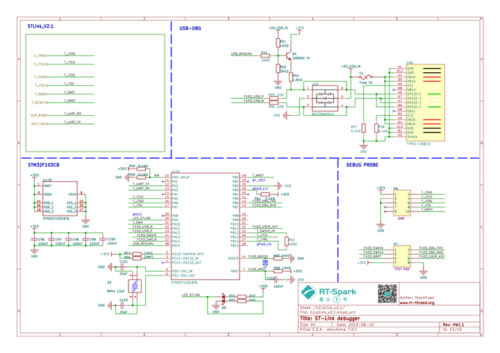
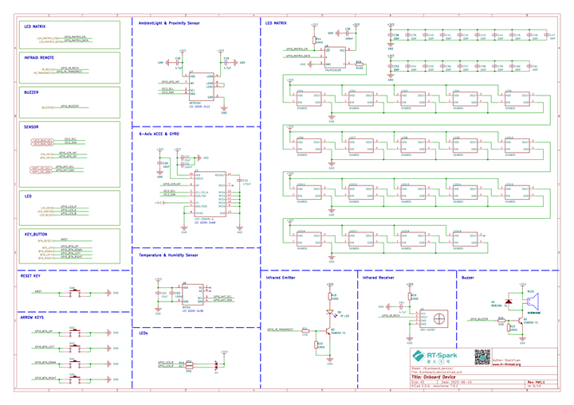
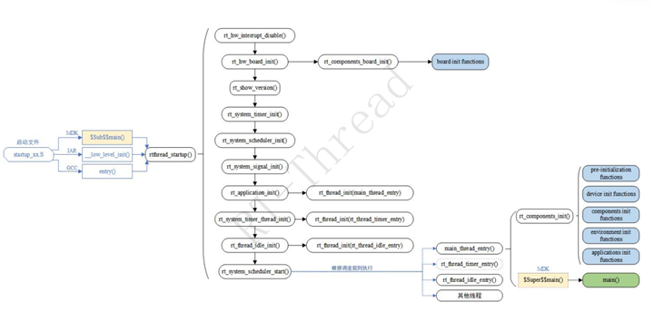
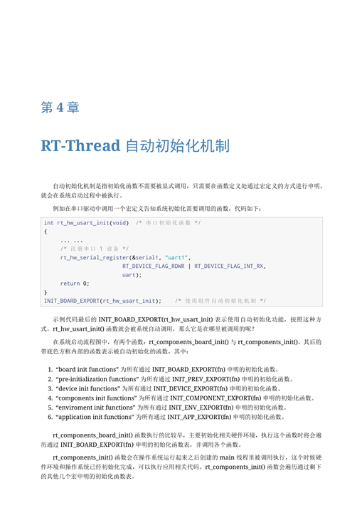
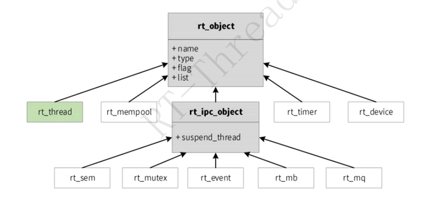
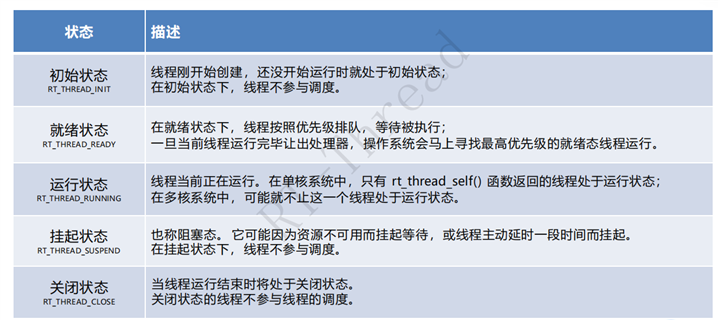
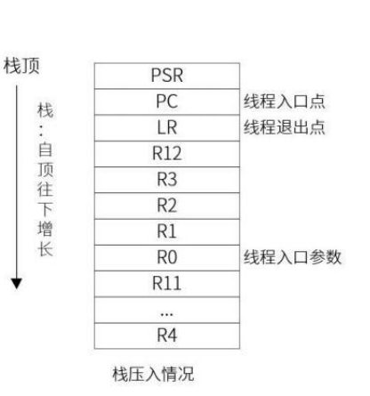
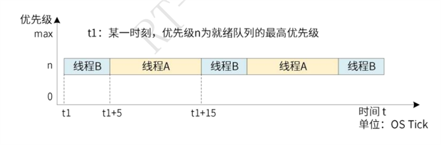
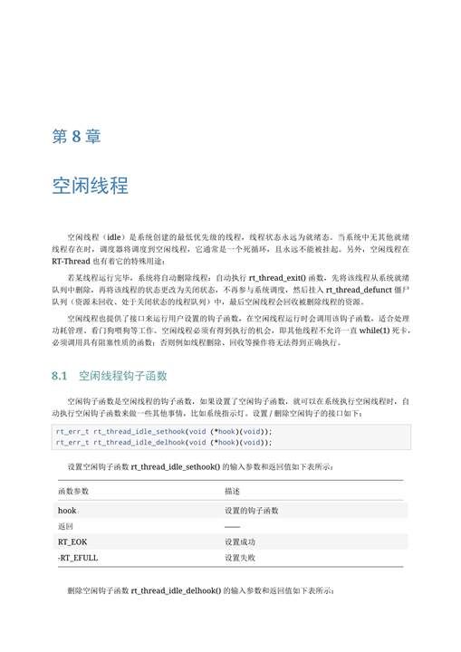
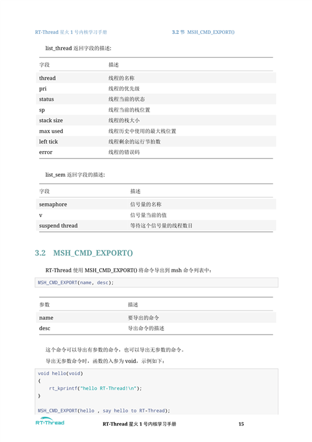

# RT-Thread Day2 学习笔记

## 一、课程主题

Day2 从 RT-Thread 的内核启动讲到线程创建、调度与状态观察，再讲 SCons 构建系统和 RT-Thread Studio 的编译、下载、串口调试。实验以星火 1 号 STM32F407 工程为载体，实现一个动态 LED 线程、一个静态 LED 线程、一个按键监控线程，以及用于查看状态的 MSH 命令。

本笔记结合课程课件、RT-Thread 官方 SCons/Studio 文档、星火 1 号原理图、RT-Thread V4.1.1 内核学习手册和实际 `thread_sample1` 工程整理。通用课件用于理解机制；引脚、电平、Tick、线程优先级范围及启用的软件组件，以当前 BSP 的 `rtconfig.h`、源码和终端输出为最终依据。

## 二、开发板、调试链路与 Studio 工作流

本次平台为 RT-Spark 星火 1 号，主控为 `STM32F407ZGT6`。板卡包含板载 ST-Link/V2.1、USB 调试接口、SWD/JTAG、虚拟串口（VCP）、方向按键和 RGB LED 等设备。原理图的价值是解释硬件连接关系，而驱动能否被应用调用，还取决于 BSP 是否实现并启用了对应接口。



上图用于确认“电脑 USB -> 板载 ST-Link -> SWD 下载/调试与 VCP 串口”的链路。设备管理器中出现 ST-Link 虚拟串口只说明 VCP 在当时已枚举；它不等同于固件已经下载或应用已经输出日志。



板载设备页标有 `BTN_UP`、`BTN_DOWN`、`BTN_LEFT`、`BTN_RIGHT` 以及 LED 相关网络。RGB 灯器件为 `SK6805` 串行 LED 链，不能仅凭网络名称推断为“每种颜色对应一个普通 GPIO”。本实验源码中的 PF12、PF11、PC0 是当前工程采用并已运行的配置；将代码迁移到其他星火 BSP 时，应先从原理图追踪网络到 MCU 引脚，再核对 board/driver 源码和有效电平。

在 RT-Thread Studio 中，建议将操作拆为独立闭环：选择正确的板卡、芯片和调试器，确认 `applications/thread_study.c` 参与构建，零错误构建，使用 ST-Link 下载，打开当前 VCP 串口终端，最后再观察 `msh >`、线程信息和实体行为。这样能够避免把“USB 已连接”误判为“作业已运行”。

## 三、从上电到用户程序

```text
芯片复位
  -> 启动汇编设置栈和 C 运行环境
  -> 初始化 .data、清零 .bss
  -> SystemInit()、板级时钟和外设初始化
  -> rtthread_startup()
  -> 初始化内核对象、时钟、定时器和组件
  -> 创建 main、idle 等系统线程
  -> 启动调度器
  -> main 线程运行用户 main()
```



用户 `main()` 并不是芯片复位后的第一个 C 函数。RT-Thread 先完成内核和板级准备，再让调度器选中 main 线程执行。idle 线程优先级最低，不能被挂起；它在没有其他就绪线程时运行，并负责回收已退出的动态线程资源，也可以承载低功耗或看门狗钩子。

从裸机视角看，传统前后台程序通常把多个任务放在 `while (1)` 中顺序轮询，并用中断处理异步事件。RTOS 则把职责拆为多个线程：线程描述“做什么、何时等待”，调度器决定“谁先使用 CPU”。STM32F407 是单核 MCU，多线程是通过快速上下文切换形成的并发效果，同一时刻只有一个线程真正处于运行态。

## 四、自动初始化

`INIT_APP_EXPORT(function)` 会把函数登记到链接期的初始化表。系统进入应用初始化阶段时自动遍历该表并调用函数，因此应用无需在 `main.c` 手动调用初始化入口。

```text
源码中的 INIT_APP_EXPORT(thread_study_init)
  -> 链接到自动初始化表
  -> 系统启动时遍历应用初始化表
  -> thread_study_init() 初始化 GPIO、信号量和三个线程
  -> rt_thread_startup() 将线程加入就绪队列
```



自动初始化函数应只做一次性工作，例如设备配置、IPC 对象初始化和创建线程。无限循环必须放在线程入口函数中，否则会阻塞后续初始化。

自动初始化并非只有 `INIT_APP_EXPORT()` 一种阶段。与 Day2 最相关的阶段可理解为：`INIT_BOARD_EXPORT()` 用于调度器启动前的早期板级初始化；`INIT_DEVICE_EXPORT()`、`INIT_COMPONENT_EXPORT()`、`INIT_ENV_EXPORT()` 依次准备设备、组件和环境；`INIT_APP_EXPORT()` 适合登记应用模块。宏会将函数指针收集到 RTI 链接段，main 线程执行 `rt_components_init()` 时按阶段遍历。选择初始化阶段时，关键是判断“该函数是否依赖调度器、线程、设备或堆已经可用”。

## 五、线程、栈与生命周期

线程控制块 `struct rt_thread` 记录线程名称、优先级、状态、入口函数、栈地址和栈指针等信息。调度切换时，CPU 寄存器现场压入当前线程栈；重新获得 CPU 时再从该栈恢复。因此递归过深、大型局部数组或调用层级过多都可能造成栈溢出。



`rt_thread` 同时是 RT-Thread 统一内核对象模型的一部分。线程、定时器、设备、内存池等对象通过 `rt_object` 被统一管理；信号量、互斥量、事件、邮箱和消息队列等 IPC 对象通过 `rt_ipc_object` 维护等待队列。这样当线程等待一个信号量时，内核不仅记录“线程暂停”，还知道它正等待哪个 IPC 对象，以便资源可用时恢复相应线程。

```text
创建/初始化 -> 初始态 -> startup -> 就绪态 -> 运行态
                                      ^         |
                                      |         | 延时、等待信号量
                                      |         v
                                      +----- 挂起/阻塞态

线程入口返回或线程删除 -> 关闭态 -> idle 线程回收动态资源
```



动态线程由 `rt_thread_create()` 从系统堆申请线程控制块和栈，调用方便但依赖堆空间；静态线程使用应用预先定义的线程控制块和栈，再通过 `rt_thread_init()` 初始化，内存边界明确且不会引入运行期堆碎片。两者创建后都必须调用 `rt_thread_startup()` 才能调度执行。

对 Cortex-M 而言，首次运行一个新线程前，内核会预先构造一帧符合异常返回格式的初始栈内容，包括入口地址、入口参数、退出处理位置和待恢复的寄存器值。第一次切换时 CPU 恢复这帧上下文，线程便从入口函数开始执行。



栈使用的观察不能只看“创建时分配了多少”。应结合 `ps`/`list_thread` 或本实验的 `thread_dump` 观察剩余空间，并在日志量最大、调用最深的路径复查。深递归、大数组、`rt_kprintf`/格式化输出和层级过深的驱动调用，都可能令单次看似充足的栈在极端路径下溢出。

## 六、调度器与时间片

RT-Thread 使用抢占式优先级调度：优先级数值越小，优先级越高；更高优先级线程进入就绪态时，可以抢占低优先级线程。同优先级线程按时间片轮转，时间片单位是 Tick。

本工程中 `RT_TICK_PER_SECOND` 为 1000，故 1 Tick 约为 1 ms。两个 LED 线程都使用优先级 16、时间片 5 Tick；监控线程优先级 10，数值更小，因此优先级更高。线程若调用 `rt_thread_mdelay()`，在等待期间会暂时处于 `suspend` 状态，这不等同于按键触发的人工暂停。



时间片只处理“同优先级且同时就绪”的线程：当前线程时间片耗尽后，会让同一优先级就绪队列中的下一线程获得 CPU。更高优先级线程一旦就绪，抢占规则优先于时间片轮转。`RT_TICK_PER_SECOND`、Timer 线程是否启用和各系统线程优先级均可能因 BSP 配置不同而变化，课堂中的数值不应直接套用于全部工程。

idle 线程始终就绪且优先级最低，通常负责回收已结束动态线程的资源。它不是普通业务线程：idle 钩子中不能调用延时、等待信号量等可能挂起的 API，也应避免调用内部可能依赖同步保护的动态内存操作。



## 七、本次线程设计

| 线程 | 创建方式 | 优先级/栈/时间片 | 职责 |
| --- | --- | --- | --- |
| `th_led1` | 动态 `rt_thread_create()` | 16 / 1024 B / 5 Tick | 周期翻转当前代码配置的 PF12；按键暂停时等待恢复信号量。 |
| `th_led2` | 静态 `rt_thread_init()` | 16 / 1024 B / 5 Tick | 周期翻转当前代码配置的 PF11。 |
| `th_monitor` | 动态 `rt_thread_create()` | 10 / 1024 B / 5 Tick | 每 20 ms 扫描 PC0 按键，做消抖并控制 LED1。 |

当前 `thread_study.c` 定义 PF12、PF11 和 PC0（KEY0，低电平有效），初始化时将前两者设为输出高电平、按键设为上拉输入。PF12/PF11 的“红/蓝”命名来自本实验代码注释和运行目标，不能替代对 SK6805 驱动方式、实际 LED 颜色与有效电平的板级核对；实体行为应以当前 BSP 和连续硬件观察为准。

## 八、按键暂停的信号量实现

本实验没有让 monitor 线程直接调用 `rt_thread_suspend()` 和 `rt_thread_resume()`。它使用 `led1_paused` 表示控制意图，使用初值为 0 的 `led1_resume_sem` 作为恢复事件：

```text
第一次有效按键
  -> monitor 线程延时 20 ms 消抖
  -> led1_paused = RT_TRUE
  -> 输出 led1 control=manual_suspend
  -> th_led1 在下一轮检查中 rt_sem_take(..., RT_WAITING_FOREVER)
  -> LED1 周期翻转停止

后续恢复逻辑已写入源码：再次有效按键释放信号量，唤醒 th_led1。
本次实验记录按用户要求截止在第一次按键后的人工暂停，不记录第二次按键恢复结果。
```

暂停前通过 `rt_sem_trytake()` 清理残留令牌，避免旧的释放信号使下一次暂停立刻失效。`volatile` 只保证状态变量每次从内存读取，不能替代互斥、原子操作或完整的状态机；本实验中 monitor 是该标志的唯一写入者，适合演示线程等待事件。更复杂的产品逻辑应优先使用事件、消息队列或受保护的状态机。

`MSH_CMD_EXPORT(thread_dump, ...)` 导出 `thread_dump` 命令，输出三个线程的名称、内核状态、优先级和剩余栈，并额外输出：

```text
led1 control=periodic_running
```

或：

```text
led1 control=manual_suspend
```

这个控制标志用于区分周期延时造成的普通 `suspend` 与按键造成的人工暂停。

## 九、SCons 构建系统

RT-Thread 的构建配置链路如下：

```text
Kconfig
  -> menuconfig / Studio 配置
  -> rtconfig.h 中的配置宏
  -> SConstruct 调用各目录 SConscript
  -> DefineGroup() 按 depend 条件收集源码
  -> rtconfig.py 提供工具链、编译和链接参数
  -> 编译、链接并生成 rtthread.elf / rtthread.bin
```

- `SConstruct`：工程构建入口。
- `SConscript`：目录级构建脚本，通常用 `Glob()` 搜集源文件并用 `DefineGroup()` 注册源码组。
- `Kconfig`：配置菜单的定义源；配置结果最终影响 `rtconfig.h` 宏。
- `rtconfig.py`：GCC、Keil、IAR 等工具链参数和链接相关设置。

`Glob('*.c')` 常用于收集目录下 C 源文件；`DefineGroup(name, src, depend)` 将源文件注册为一个构建组，`depend` 则是配置开关。例如 `depend=['RT_USING_PIN']` 时，只有 `rtconfig.h` 中启用该宏，组内文件才会参与编译。源码文件放在 `applications` 目录中不保证参与构建，还要确认其被当前目录 `SConscript` 收集，并在编译日志中找到对应的编译命令。

常用操作与目的如下：

| 命令 | 用途 |
| --- | --- |
| `scons` | 使用当前配置编译工程。 |
| `scons -j8` | 以 8 个并行任务编译；任务数应按 CPU 与内存情况调整。 |
| `scons -c` | 清理构建生成物后重新构建。 |
| `scons --menuconfig` | 进入配置菜单，修改 Kconfig 选项。 |
| `scons --target=mdk5` / `scons --target=iar` | 生成对应 IDE 工程，前提是 BSP 提供模板。 |
| `scons --target=cmake` | 生成 CMake 相关脚本。 |
| `scons --dist` | 导出裁剪后的独立 BSP 框架。 |
| `scons --verbose` | 显示真实编译、汇编和链接命令，便于定位参数问题。 |

修改 menuconfig 后，应重新生成 IDE 工程或刷新 Studio 工程配置，避免 IDE 的文件列表、宏定义与 `rtconfig.h` 不一致。

## 十、实际构建与运行验证

本次验证基于同一个 `thread_sample1` RT-Thread Studio 工程，结论分层记录：

| 验证项 | 已取得的证据 | 结论 |
| --- | --- | --- |
| 板卡连接和串口 | 设备管理器枚举 `STMicroelectronics STLink Virtual COM Port (COM21)` | 当时 USB 与虚拟串口可用；重新插拔后端口号可能变化。 |
| 工程构建 | Studio 显示 `Build Finished. 0 errors, 0 warnings`；Flash 约 60.83 KB、RAM 约 6.22 KB | 已构建成功。 |
| 固件下载 | 显示 `File download complete`、硬件复位、应用运行成功 | 已通过 ST-Link 下载并启动。 |
| 调试会话 | Studio 显示运行中的 ST-LINK GDB Server 和 GDB | 调试会话已建立。 |
| 串口运行 | RT-Thread 4.1.1 启动横幅、`msh >` 和 `thread_dump` | 固件已在板上运行并可交互。 |
| 三个线程 | `th_led1`、`th_led2`、`th_monitor` 均出现在 `thread_dump` 中 | 已确认创建并被调度。 |
| 首次按键 | 从 `led1 control=periodic_running` 变为 `led1 control=manual_suspend` | 已确认首次有效按键触发人工暂停控制。 |

截图中的线程剩余栈为 `th_led1` 852/1024、`th_led2` 848/1024、`th_monitor` 844/1024。按键验证到首次人工暂停为止，未将后续恢复行为写为已验证事实。

除了自定义 `thread_dump`，启用 FinSH/MSH 的工程通常还可使用 `ps` 或 `list_thread` 查看内核线程表。不同 RT-Thread 版本的列名和统计方式可能不同，常见字段包括线程名、优先级、状态、栈指针、栈大小、最大栈使用量、剩余 Tick 和错误码。它们用于发现异常优先级、持续运行、栈接近耗尽或 IPC 等待；单次命令输出只是一个时刻的快照，应结合线程代码中的延时和等待点解释。



## 十一、从代码到运行现象的完整链路

完成代码不等于功能已经在开发板上运行。Day2 的实际操作可以分为五层，每一层都回答不同的问题：

```text
源码层
  thread_study.c 中的 GPIO、线程和自动初始化代码是否正确
        |
        v
构建层
  源文件是否参与编译，能否生成 rtthread.elf / rtthread.bin
        |
        v
下载层
  固件是否经 ST-Link 写入目标芯片并在复位后启动
        |
        v
串口与调试层
  系统启动后是否能输出日志、进入 msh，以及是否观察到目标线程
        |
        v
实体行为层
  LED 和按键的可见、可重复行为是否与线程控制逻辑一一对应
```

这五层不能相互替代。例如，`Build Finished. 0 errors, 0 warnings` 只证明构建成功，不能证明下载成功；下载完成也不能证明串口已经连通；串口中看到线程存在，也不能单独证明红、蓝 LED 的颜色和闪烁节奏均正确。将证据拆开记录，能够在问题出现时快速判断故障位于代码、构建、下载、连接还是硬件映射。

### 1. 串口枚举与终端连接

设备管理器出现 `STMicroelectronics STLink Virtual COM Port (COM21)`，说明该时刻 USB 连接和 ST-Link 虚拟串口驱动可用。它是打开终端的前提，但 COM 编号由 Windows 动态分配，重新插拔后可能不再是 COM21。

连接终端时应先确认当前端口，再等待 RT-Thread 横幅和 `msh >`：

```text
RT-Thread 4.1.1 ...
msh >
```

横幅证明内核已经走过启动过程；`msh >` 说明 FinSH/MSH 已工作，可以输入 `thread_dump` 观察应用线程。若只看到端口却没有横幅，应分别检查波特率、复位时机、控制台 UART 配置和下载的固件是否为当前工程。

### 2. Studio 构建、下载和调试的判定

构建完成时，Studio 控制台显示 `Build Finished. 0 errors, 0 warnings`。本次输出还给出 Flash 约 60.83 KB、RAM 约 6.22 KB，它们是链接后的资源占用，而不是线程栈本身的瞬时使用量。后续增加线程、日志或软件包时，应持续观察 RAM 是否接近板卡可用内存。

下载成功要以下载日志为准。本次 ST-Link 日志包含：

```text
File download complete
Hardware reset is performed
Application is running
Start operation achieved successfully
```

这组信息形成“写入完成 -> 芯片复位 -> 应用启动”的顺序证据。Studio 调试视图中 `Thread #1 [core:0] (Running)`，以及 `ST-LINK_gdbserver.exe` 和 `arm-none-eabi-gdb.exe` 同时存在，则说明调试服务器和 GDB 客户端已建立运行中的会话。

### 3. 使用 thread_dump 观察线程

`thread_dump` 不只是显示“线程是否存在”，还可以用于解释调度和栈使用。例如输出中的字段可以这样理解：

| 字段 | 含义 | 本次观察时的解释 |
| --- | --- | --- |
| `name` | 线程对象名 | 用于确认自动初始化创建的目标线程确实存在。 |
| `state` | 读取命令瞬间的内核状态 | LED 线程在 `rt_thread_mdelay()` 期间常显示 `suspend`，属于正常周期等待。 |
| `priority` | 当前调度优先级 | `th_monitor` 为 10，两个 LED 线程为 16；数值小表示优先级高。 |
| `remaining_stack` | 从栈底填充标记估算的未使用栈空间 | 例如 852/1024 表示当前观察点尚有较多余量，但仍应在最深调用路径下复查。 |
| `led1 control` | 实验自行维护的控制状态 | 用于区分“正常延时等待”与“按键要求 LED1 人工暂停”。 |

截图中 `th_led1`、`th_led2` 的优先级均为 16，`th_monitor` 为 10；这与源码配置相符。两个 LED 线程同优先级，调度器允许它们依时间片公平竞争 CPU；不过它们大部分时间主动延时，因此不会持续占用处理器。

### 4. 首次按键暂停的判定过程

按键是低电平有效，monitor 线程每 20 ms 扫描一次。检测到低电平后，它先等待一个消抖周期，再读取一次按键；只有两次都为有效电平才接受本次按下。`key_armed` 在按键释放后重新置位，避免持续按住按键时反复切换状态。

本次的验证顺序如下：

```text
上电并进入 msh
  -> 输入 thread_dump
  -> 看到 led1 control=periodic_running
  -> 第一次有效按下 KEY0
  -> 20 ms 消抖通过
  -> monitor 设置 led1_paused = RT_TRUE
  -> 输出 led1 control=manual_suspend
  -> LED1 在下一次循环检查到暂停标志后等待 led1_resume_sem
```

这里的关键判断不是三个线程的 `state=suspend`。因为 LED 线程每次调用 `rt_thread_mdelay()` 也会进入挂起态，单看 `state` 无法辨别是正常延时还是按键控制。`led1 control=manual_suspend` 是本实验专门增加的可观测状态，因此可作为首次按键暂停已触发的可靠软件证据。

源码中还包含后续恢复分支：再次有效按键会释放 `led1_resume_sem` 并清除暂停标志。该分支属于已实现的代码逻辑，但本次采集的验证记录按要求停在第一次按键后的 `manual_suspend`，不能将恢复写为已验证结果。

### 5. LED 现象与源码的对应边界

`th_led1` 和 `th_led2` 的 Tick 日志、线程状态和板卡灯光照片共同说明两个 LED 线程已被调度执行。源代码设置的周期分别为 500 ms 和 700 ms，因此理论上会表现为不同节奏。

但单张照片无法稳定证明“PF12 一定对应红色、PF11 一定对应蓝色”以及两个周期的逐一可见对应。板卡原理图、BSP 定义、有效电平和外设驱动方式都可能影响最终灯光。因此，当前结论是“线程已运行、板上灯光可见、首次按键的软件暂停状态已确认”；若要证明颜色与节奏的完整映射，应补充一段连续视频或完整连续串口记录。

## 十二、建议的增量实现与排错顺序

将作业拆成小步验证，定位效率最高：

```text
1. 仅保留 thread_study_init()
   -> 确认 INIT_APP_EXPORT 已执行、GPIO 初始化无误

2. 加入 th_led1（动态）
   -> 构建、下载，确认单线程周期行为

3. 加入 th_led2（静态）
   -> 用 thread_dump 确认两个线程名称、优先级和栈

4. 加入 th_monitor 与 MSH 命令
   -> 确认终端可查看状态，不开启高频自动打印

5. 加入按键消抖与信号量等待
   -> 先验证 periodic_running，再验证首次 manual_suspend
```

若构建失败，先检查 `thread_study.c` 是否被所在目录的 `SConscript` 收集、相关 Kconfig 宏是否启用，再看编译日志中的第一个真实错误。若下载失败，检查 ST-Link 连接、目标芯片和下载配置；若没有串口输出，检查当前 VCP 编号、串口参数、控制台 UART 和固件版本。不要把多个层级的问题混在一起修改。

## 十三、实验记录模板

一次可复核的 Day2 验证记录应至少按下列顺序保存：

```text
1. 板卡上电和 ST-Link VCP 枚举
2. Studio 零错误构建结果及 Flash/RAM 占用
3. 下载完成、复位和应用启动日志
4. RT-Thread 启动横幅与 msh >
5. thread_dump 的初始输出：三个线程和 periodic_running
6. 第一次按键后的 thread_dump：manual_suspend
```

使用该顺序可以让其他人从证据中复现“工程编译成功、程序已实际运行、线程已创建、按键控制已触发”的完整路径。无截图或日志支持的内容，应明确标记为设计说明、待验证项或后续建议，而不是写成测试结论。

## 十四、小结

Day2 把“线程如何创建”延伸到“线程何时得到 CPU、何时等待、如何观察和如何被事件控制”。动态与静态线程的区别在内存来源，抢占和时间片决定运行次序，自动初始化把应用准备工作接入系统启动阶段。构建成功、下载成功、串口运行成功和实体按键现象属于不同证据层级，需要分别记录。
