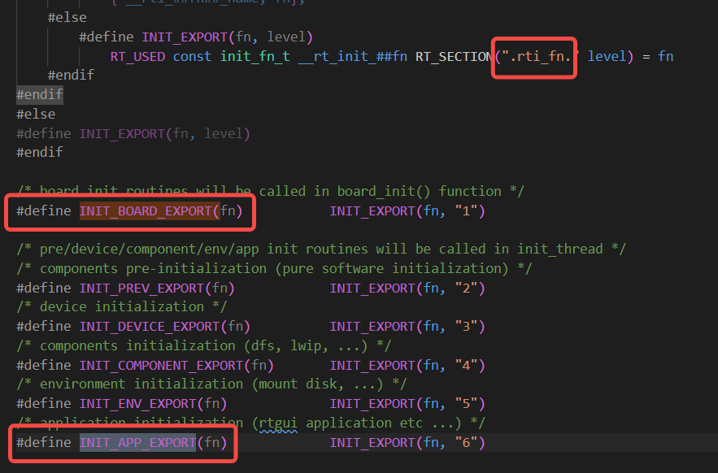
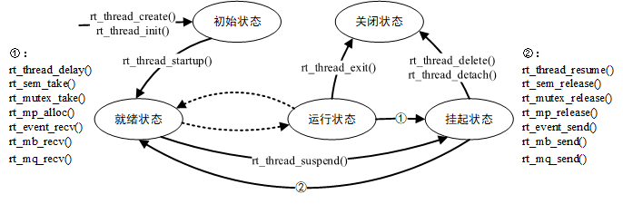
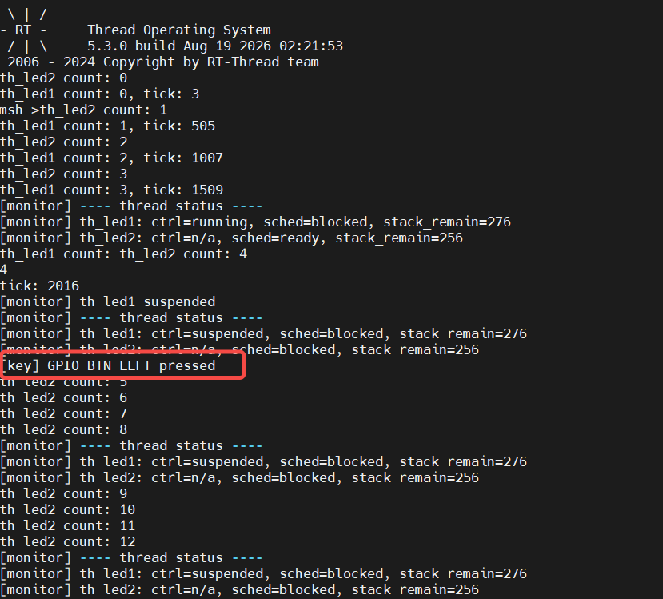
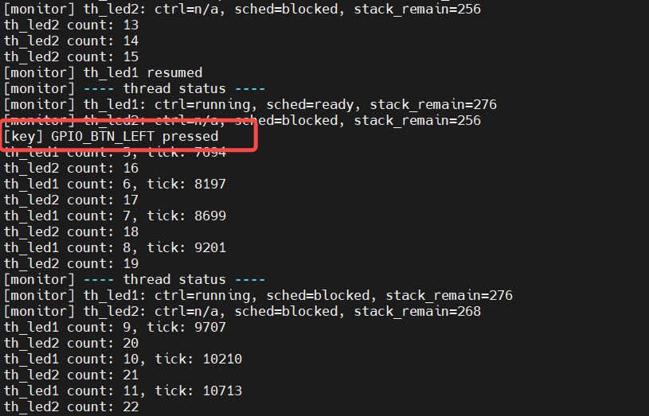

# 【DAY2】作业

## Part 1：理论知识梳理文档

### 1. STM32F407 启动流程与 RT-Thread 引导机制

- **启动路径**：详细画出/写出从上电复位 `Reset_Handler` 到进入 `main()` 的完整调用链。

  ```mermaid
  flowchart TD
      A[上电/复位] --> B[硬件读向量表]
      B --> C[SP = _estack]
      B --> D[PC = Reset_Handler]
  
      D --> E[拷贝 .data]
      E --> F[清零 .bss]
      F --> G[SystemInit]
      G --> H[entry]
  
      H --> I[rtthread_startup]
  
      I --> J[rt_hw_board_init]
      J --> J1[rt_system_heap_init]
      J1 --> J2[hw_board_init]
      J2 --> J2a[HAL_Init]
      J2a --> J2b[clk_init 配置系统时钟]
      J2b --> J2c[rt_hw_systick_init]
      J2c --> J2d[rt_hw_pin/usart_init]
      J2d --> J3[rt_console_set_device]
      J3 --> J4[rt_components_board_init]
  
      I --> K[rt_system_timer_init]
      K --> L[rt_system_scheduler_init]
      L --> M[rt_application_init]
      M --> M1[rt_thread_create main]
      M1 --> M2[main_thread_entry 作为线程入口]
      I --> N[rt_system_timer_thread_init]
      N --> O[rt_thread_idle_init]
      O --> P[rt_system_scheduler_start]
      P --> Q[rt_hw_context_switch_to]
      Q --> R[PendSV 上下文切换]
      R --> S[main_thread_entry 在线程上下文执行]
  
      S --> T[rt_components_init]
      T --> U[main 用户代码]
  ```

  ---

- **自动初始化原理**：解释 `INIT_BOARD_EXPORT` 与 `INIT_APP_EXPORT` 的底层实现原理。

  把函数指针放进 Flash 里一个专用段（`.rti_fn.x`），链接器按段名排序拼成一张“初始化函数表”，启动时 C 代码遍历这张表依次调用。

  

  

### 2. 内核基础与对象模型

- **对象容器与控制块**：简述 RT-Thread 面向对象的设计思想，线程控制块（`struct rt_thread`）中关键成员（如 `stat`、`current_priority`、`init_tick`、`sp`）的作用。

  RT-Thread 的内核并不是 C++ 意义上的类继承，而是用 C 语言结构体 + 对象容器 模拟面向对象：

  - 统一基类：所有内核对象都有 `struct rt_object` 公共头部

  - “继承”：子对象把 `rt_object` 放在结构体最前面，共享同一套管理机制

  - 对象容器：每类对象有一个全局链表，用于注册、查找、枚举

    | 成员               | 作用                                                         |
    | :----------------- | :----------------------------------------------------------- |
    | `stat`             | 线程生命周期状态：调度器依据它决定能否被切换、挂起或销毁     |
    | `current_priority` | 当前有效优先级。数值越小优先级越高。                         |
    | `init_tick`        | 创建时设定的时间片（单位：系统 tick）。同优先级线程轮转时使用 |
    | `sp`               | 线程栈顶指针。`PendSV_Handler` 上下文切换时读写的就是它；    |

- **内存分配方式**：对比静态对象与动态对象的区别（分配位置、生命周期、释放机制），分析为什么某些高可靠场景强制使用静态线程。

  | 静态对象    | 动态对象                                    |                                                             |
  | :---------- | :------------------------------------------ | ----------------------------------------------------------- |
  | 创建 API    | `rt_xxx_init()` + 用户提供的内存            | `rt_xxx_create()` 内部 `malloc`                             |
  | 控制块位置  | 全局变量 / 栈 / 用户指定 BSS 区             | 堆（heap）                                                  |
  | 栈/资源位置 | 用户静态数组，如 `main_stack[]`             | `RT_KERNEL_MALLOC(stack_size)`                              |
  | 释放 API    | `rt_xxx_detach()`：从容器摘除，不 free 内存 | `rt_xxx_delete()`：挂到 defunct 队列，idle 线程里 free 内存 |
  | 前提条件    | 无堆也能用                                  | 必须 `RT_USING_HEAP`                                        |

为什么高可靠场景倾向静态线程？
1. 内存确定性（无堆碎片、无分配失败）
2. 生命周期可控,静态对象 不会误 free，detach 只注销不释放内存

### 3. 线程状态机与调度算法

- **五态模型**：绘制或描述 RT-Thread 线程状态（初始态、就绪态、运行态、挂起态、关闭态）及触发状态转换的典型 API。

  | 状态    | 含义                                         | 是否在就绪队列                          |
  | :------ | :------------------------------------------- | :-------------------------------------- |
  | INIT    | 已创建/初始化，尚未启动                      | 否                                      |
  | READY   | 具备运行条件，等待 CPU                       | 是（挂在 `rt_thread_priority_table[]`） |
  | RUNNING | 正在占用 CPU（单核下即 `rt_current_thread`） | 否（已从就绪队列移除）                  |
  | SUSPEND | 阻塞/睡眠，不参与调度                        | 否（可能在 IPC 等待链或挂起链）         |
  | CLOSE   | 逻辑死亡，等待 idle 回收                     | 否                                      |

  

  **调度机制剖析**：

  - **抢占式调度**:一旦就绪队列中出现 比当前线程优先级更高 的线程，内核会 立即（在 rt_schedule() 调用点）剥夺当前 CPU，切换到高优先级线程。

  - **时间片轮转**:仅当 多个 READY 线程处于同一优先级 时，在它们之间轮流分配 CPU

    RT-Thread 是 基于优先级的抢占式调度，同优先级之间再辅以 时间片轮转。

    

## Part 2：多线程实战编程（C 语言实现）

### 代码思路

1个任务一个线程，线程间通过消息通信

** th_led1  动态创建，翻转 LED_R，打印计数与 tick*

 ** th_led2  静态初始化，翻转 LED_B，打印计数*

 ** th_monitor 监控两线程状态/栈，按键切换 th_led1 挂起与恢复*

 ** th_key  轮询 GPIO_BTN_LEFT，释放信号量通知 monitor*

详细代码见代码文件

	### 实验结果

按下按键1次



第2次按下恢复

