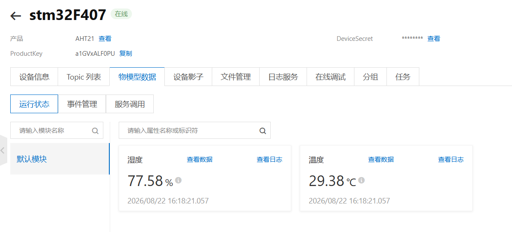
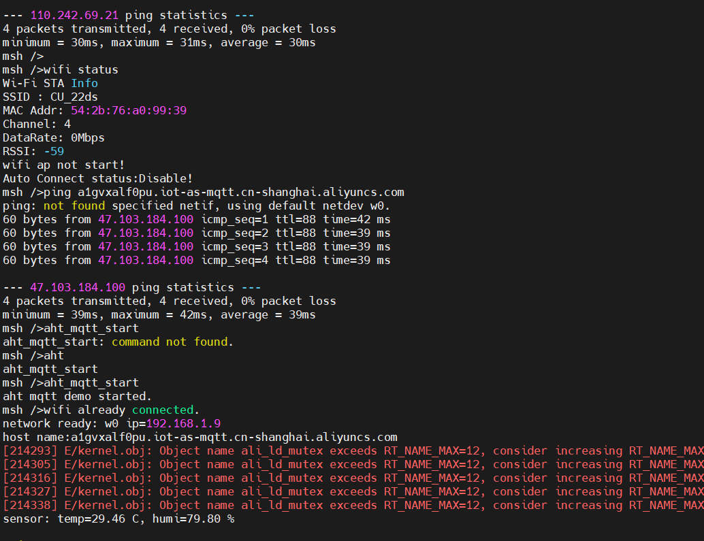
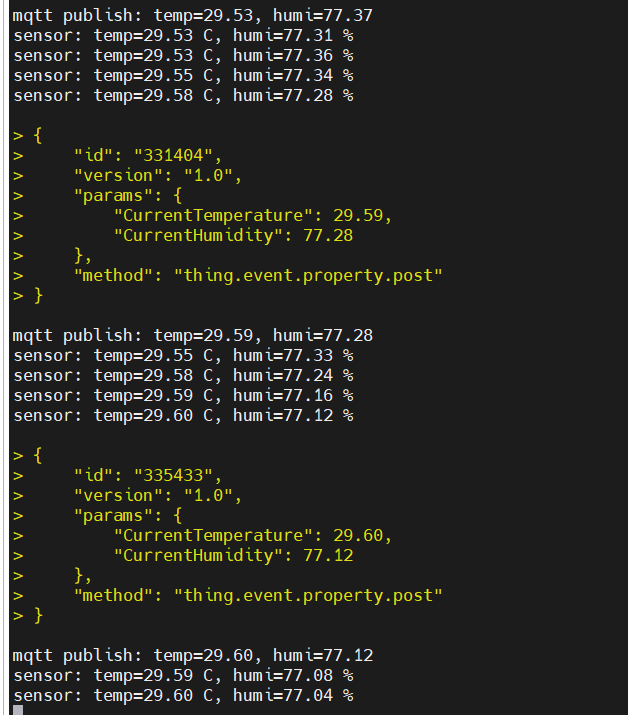
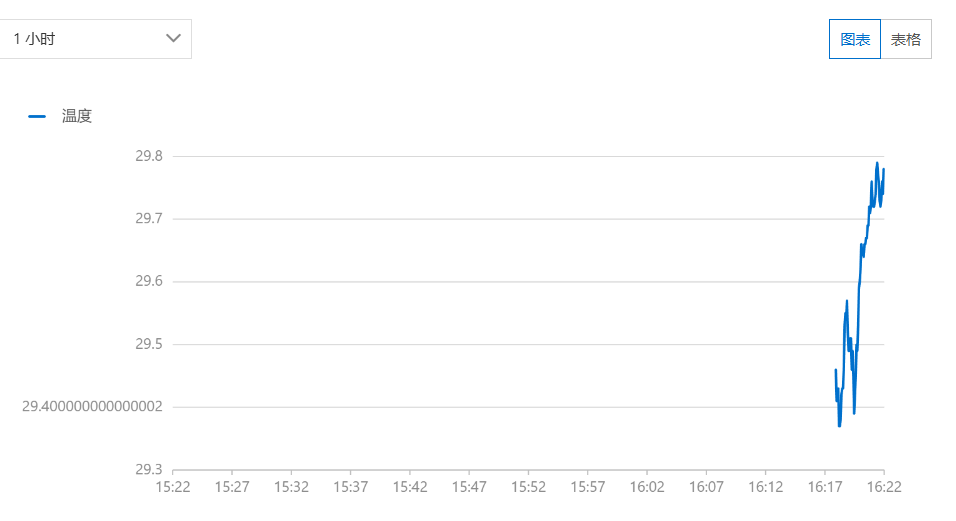
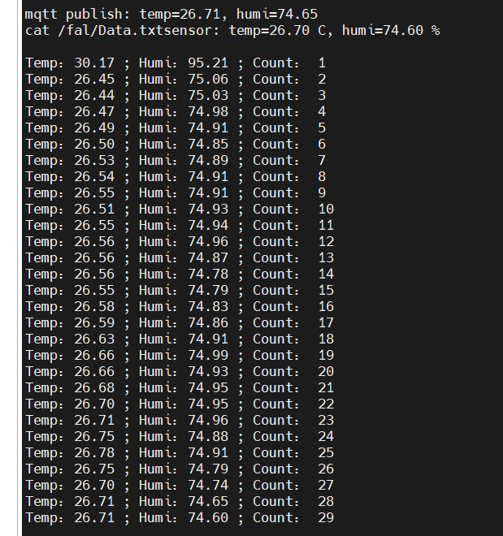

# day5作业

## 1.连接通过mqtt协议，连接阿里云，上传数据








## 2.挂载文件系统存储数据

```bash
格式化：mkfs -t elm filesystem

挂载：mount filesystem /fal elm

检查存储数据：cat /fal/Data.txt
```



## 3代码见附件

aht_mqtt_demo.c；data_storage.c