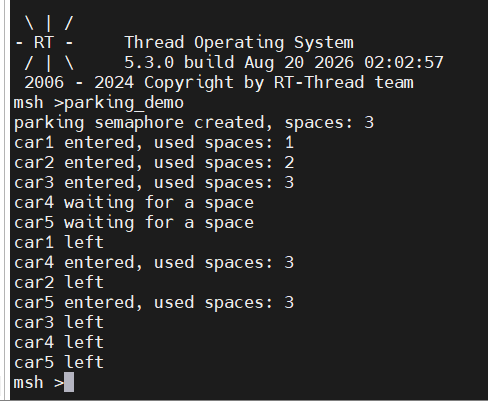
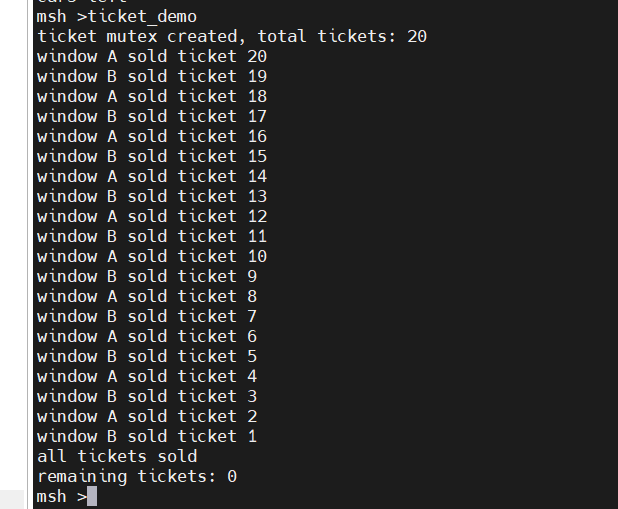
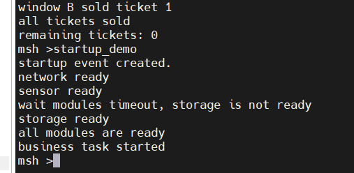
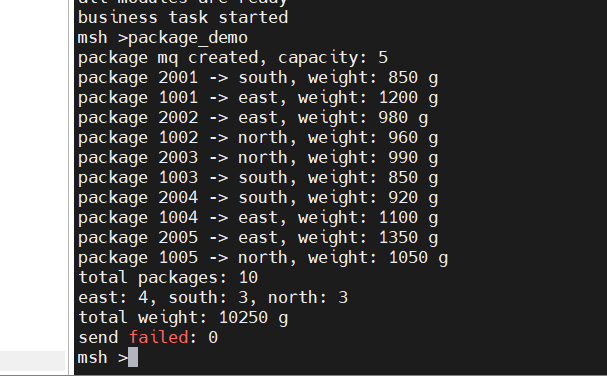

# RT-Thread 线程间同步与通信课后作业

---

## 练习一：停车场车位管理

### 思考题

为什么这里使用计数信号量，而不是互斥量？

互斥量解决的是同一时刻谁在用这一个资源；计数信号量解决的是还有几个同类资源可用。

---

## 练习二：多窗口售票系统

### 对比实验

先暂时不使用互斥量，并在“读取余票”和“修改余票”之间加入短暂延时，观察是否会出现重复售票或余票错误。

随后加入互斥量并再次运行，对比两次结果。

检查余票和减 1不是原子操作；中间延时让两个线程都能通过“还有票”的判断，再各自减 1，造成丢失更新。

### 思考题

为什么只给 `ticket_count--` 加锁仍可能不安全？

锁的范围太小，没有保护“检查 + 减 1”这个组合。

---

## 练习三：系统启动条件检查

### 

如果用三个独立信号量实现这个功能，与使用事件集相比有什么区别？

事件集，一个对象、多个标志位、支持 AND/OR 组合等待，实现方便。	

三个独立信号量，三个独立「通知」，各管各的，实现复杂。

---

## 练习四：快递分拣中心

