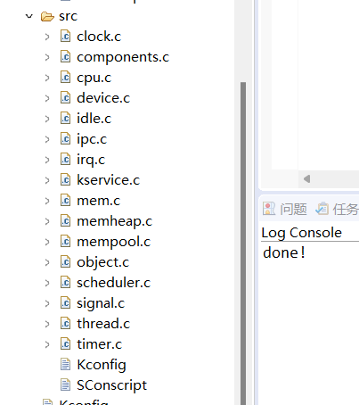
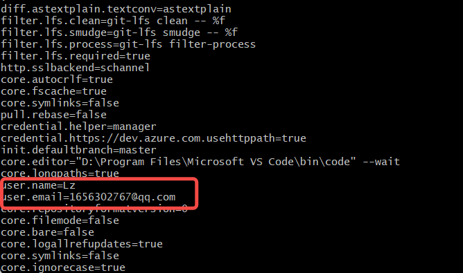
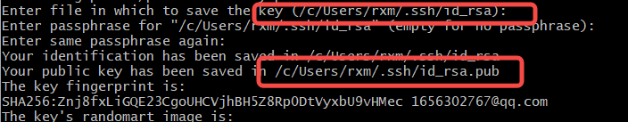
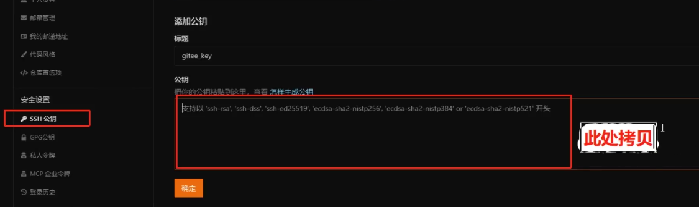
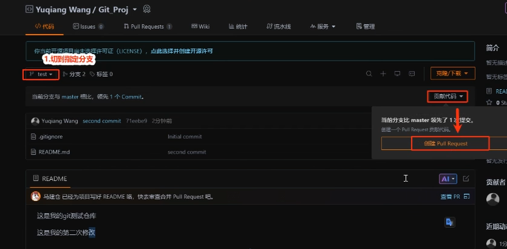
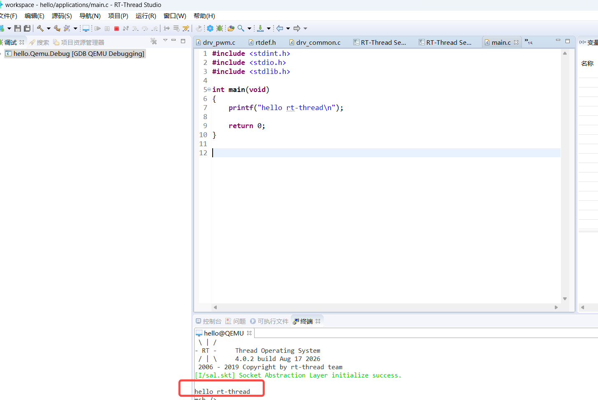

# day1

## 1.辅助工具

### 辅助软件


## 2文档语法

代码

```
```

```c

```

表格

|      |      |
| ---- | ---- |
|      |      |

特殊

`q`

**B**

## 3代码架构

内核源码 对象思想 **4.1.1版本**



## 4.配置git

### 1用户名

设置用户名：`git config --global user.name "你的名字"`

设置邮箱：`git config --global user.email "你的邮箱`



### 2.密钥

ssh-keygen -t rsa -b 4096 -C "your_email@example.com"

```bash
cat  /c/Users/rxm/.ssh/id_rsa.pub
```





验证

```bash
 ssh -T git@gitee.com
```

PR



## 其他

任务点



## 