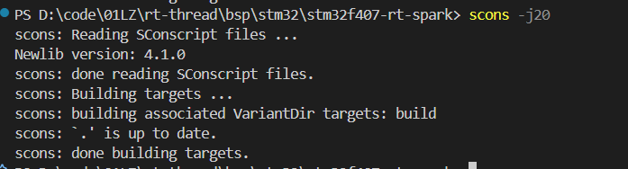
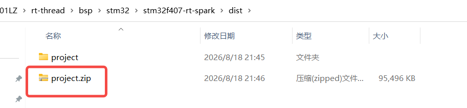
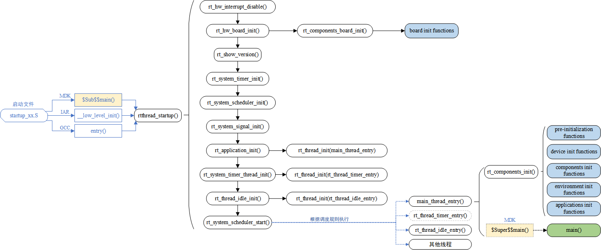
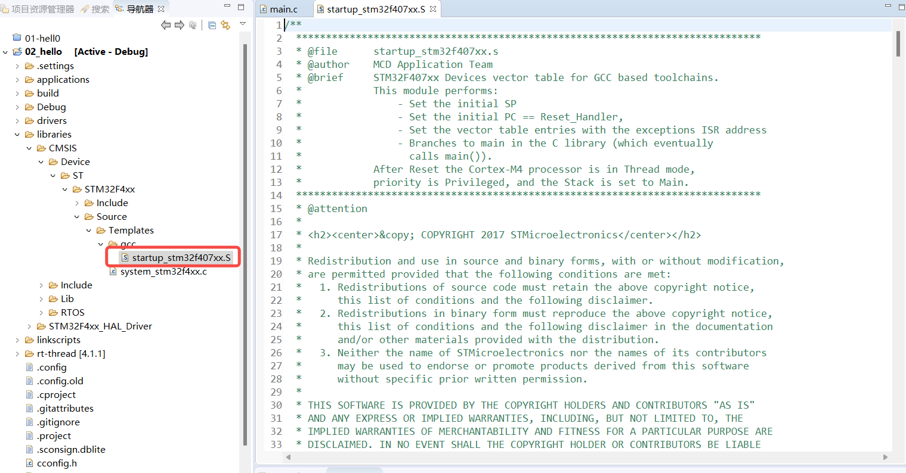
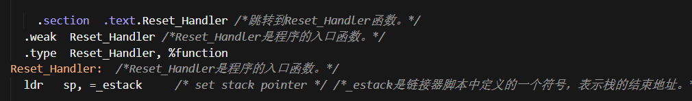
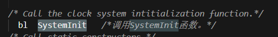

# day2笔记

## 1.env环境

```bash
# 1.生成vscode工程
 scons --target=vsc
#2.vscode打开
code .
#3.vscode编译
scons -j20
#4.打包工程
scons --dist
menuconfig #设置配置
```





## 2.RT-Thread 启动流程



stm32f407汇编文件



上电或复位后，CPU 最终会执行到 `Reset_Handler`






## 3.线程

静态和动态创建

