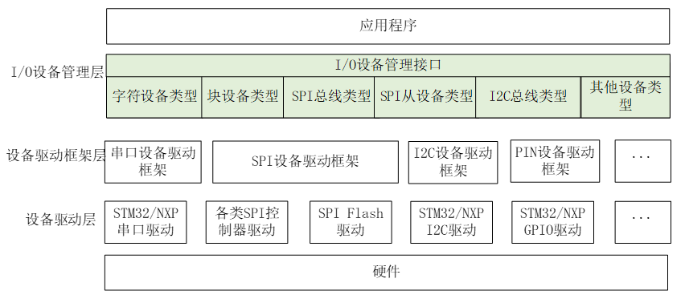

# RT-Thread 夏令营学习笔记：I/O 设备驱动开发与总线外设实战

## 一、RT-Thread I/O 设备模型与核心思想

### 1. 为什么需要设备驱动框架？

- **传统开发的痛点**：不同芯片厂商（ST、GD、NXP 等）外设库 API 差异大，更换 MCU 时上层业务与底层驱动强耦合，导致重复造轮子。
- **分层抽象解耦**：RT-Thread 将驱动与应用解耦，上层面向统一接口编程，底层仅需对接特定硬件驱动，极大提升代码复用性与跨平台迁移效率。

### 2. 三层设备架构模型

RT-Thread 的 I/O 模型自顶向下分为三层：

### 3. 设备分类机制

- **字符设备 (Char Device)**：提供连续数据流，**顺序访问**，不支持随机寻址（如 UART 串口、键盘）。
- **块设备 (Block Device)**：以固定大小的数据块为单位进行读写，**支持随机访问**（如 SD 卡、SPI Flash、Nor/Nand Flash），是文件系统的底层依赖。

## 二、I/O 设备核心 API 与 `ops` 机制

### 1. 设备生命周期管理

- **创建与销毁**：
  - `rt_device_create(int type, int attach_size)`：动态申请设备控制块。
  - `rt_device_destroy(rt_device_t device)`：销毁设备前需先注销。
- **注册与注销**：
  - `rt_device_register(rt_device_t dev, const char *name, rt_uint16_t flags)`：将设备句柄挂入全局管理链表。
  - `rt_device_unregister(rt_device_t dev)`：从管理链表中移除设备。
- **自动初始化机制**：
  - 使用 `INIT_DEVICE_EXPORT(fn)` 或 `INIT_BOARD_EXPORT(fn)` 宏将初始化函数置入专属段区，系统启动时由 `rt_components_init()` 自动遍历执行。

### 2. 标准 I/O 操作接口与映射

上层通用 API 会通过设备控制块中的 `ops` 函数指针逐级下发：

| **上层通用 API**                       | **rt_device_ops 映射** | **典型应用行为**                                    |
| -------------------------------------- | ---------------------- | --------------------------------------------------- |
| `rt_device_find(name)`                 | —                      | 遍历全局链表获取 `rt_device_t` 句柄                 |
| `rt_device_init(dev)`                  | `ops->init`            | 硬件初始化（置位 `RT_DEVICE_FLAG_ACTIVATED`）       |
| `rt_device_open(dev, flags)`           | `ops->open`            | 打开设备（若未激活会自动触发 `init`，引用计数 +1）  |
| `rt_device_read(dev, pos, buf, size)`  | `ops->read`            | 读取数据（字符设备忽略 `pos`，块设备以 `pos` 定位） |
| `rt_device_write(dev, pos, buf, size)` | `ops->write`           | 写入数据                                            |
| `rt_device_control(dev, cmd, arg)`     | `ops->control`         | 设备控制（如修改波特率、配置模式）                  |
| `rt_device_close(dev)`                 | `ops->close`           | 关闭设备（引用计数 -1）                             |

> **关键排坑**：
>
> 1. 调用 `rt_device_read`/`write` 前必须先成功执行 `rt_device_open`，否则操作会被系统底层拦截。
> 2. 中断/DMA 非阻塞接收必须配合 `rt_device_set_rx_indicate()` 设置回调函数。

## 三、外设驱动开发与实战

### 1. PIN / GPIO 设备开发

PIN 框架对引脚进行了编号抽象，提供了独立于具体硬件寄存器的 API。

- **核心 API**：

  - `rt_pin_mode(rt_base_t pin, rt_base_t mode)`：支持 `PIN_MODE_OUTPUT`、`PIN_MODE_INPUT_PULLUP`、`PIN_MODE_INPUT_PULLDOWN`、`PIN_MODE_OUTPUT_OD`。
  - `rt_pin_write(rt_base_t pin, rt_base_t val)` / `rt_pin_read(rt_base_t pin)`。
  - `rt_pin_attach_irq(pin, mode, hdr, args)`：绑定中断回调（支持上升沿、下降沿、双边沿等）。
  - `rt_pin_irq_enable(pin, RT_TRUE/RT_FALSE)`：中断使能控制。

  

### 2. I2C 总线设备开发

- **通信特性**：主从架构半双工通信，SDA 与 SCL 需外加上拉电阻。
- **地址对齐机制**：`struct rt_i2c_msg` 中的 `addr` 字段**直接填写 7 位从机地址**，RT-Thread 驱动内部会根据 `flags`（`RT_I2C_WR` / `RT_I2C_RD`）自动左移一位并补齐读写位。
- **常见故障处理**：若遇到总线死锁（SCL/SDA 被从机拉低不释放），可在主机端向 SCL 连续发送 9 个时钟脉冲恢复总线。

### 3. SPI 总线与设备开发

- **总线与设备分离模型**：
  - **SPI 总线（SPI Bus）**：对应物理控制器（如 `spi1`）。
  - **SPI 设备（SPI Device）**：挂载在总线上的从机实体（如 `spi10`），通过片选（CS）引脚区分。

**注意**：SPI 传输接口内部使用了互斥量（`rt_mutex_take`），**严禁在中断服务程序 (ISR) 中直接调用**。

## 四、工程配置与 BSP 移植要点

### 1. 基于芯片 vs 基于 SDK 的配置流程

- **基于芯片构建**：
  1. 在 `board.h` 中使能外设宏定义（如 `#define BSP_USING_SPI1` 并配置对应引脚宏）。
  2. 使用 STM32CubeMX 配置引脚复用功能，生成代码。
  3. 利用 HAL 库的**弱符号机制（`__weak`）**，将 CubeMX 生成的 `HAL_SPI_MspInit` 等引脚初始化代码复制并实现在 `board.c` 中，覆盖默认的弱符号实现。
- **基于 SDK 构建**：SDK 针对固定开发板（如星火一号）深度适配，直接在 Studio 图形界面或 CubeMX 联动配置即可，无需手动搬运引脚初始化代码。

## 五、学习总结与心得

1. **面向对象与解耦思想**：RT-Thread 通过基类 `rt_device` 与 `ops` 函数指针表，在 C 语言层面实现了极其优雅的面向对象多态机制，彻底解决了多外设、跨芯片平台代码难以复用的行业痛点。
2. **总线抽象层次**：SPI/I2C 总线驱动将“控制器”与“从外设”剥离，使得无论是硬件控制器还是软件 GPIO 模拟，对上层设备驱动（如传感器、Flash）呈现的 API 完全一致。
3. **驱动调试技巧**：
   - 善用 MSH 终端命令（如 `list_device`、`i2c-tools`）快速排查设备挂载与地址冲突。
   - 单步跟踪驱动的初始化与 `ops` 调用链路，能够直观理清操作系统框架与底层硬件外设的调用时序。