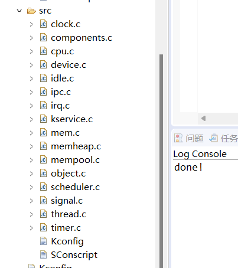
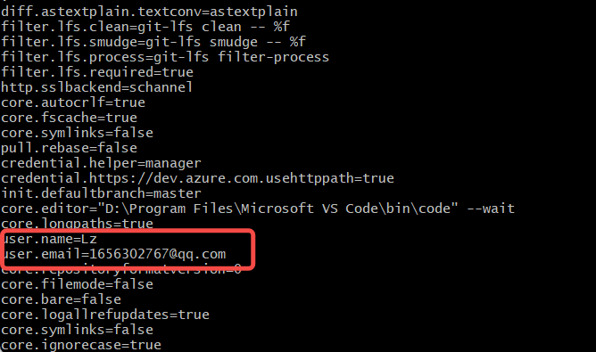
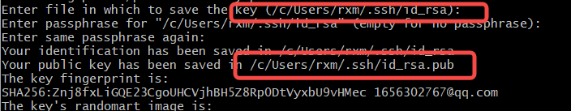
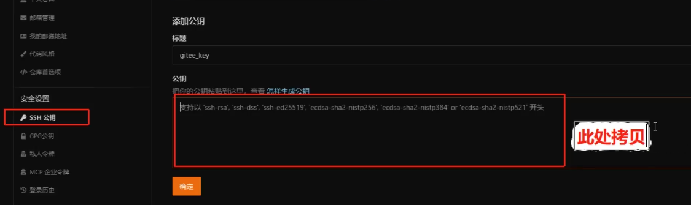
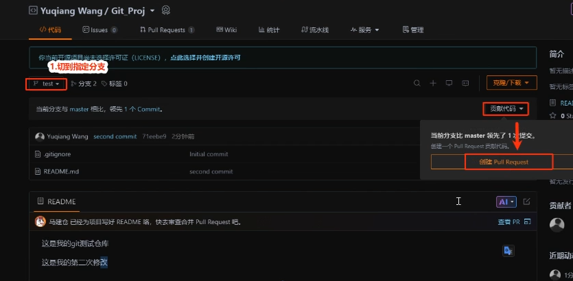
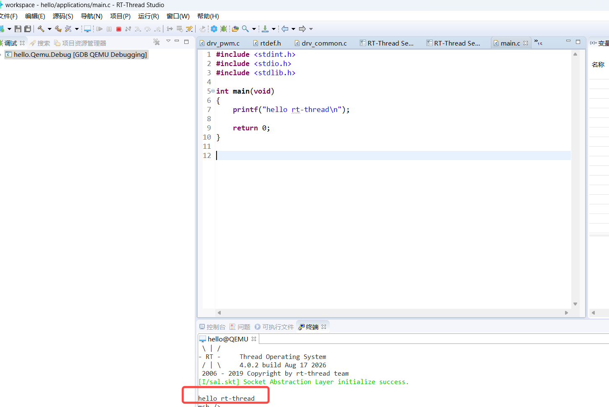

# day1

## 1.辅助工具

### 辅助软件


## 2文档语法

代码

```
```

```c

```

表格

|      |      |
| ---- | ---- |
|      |      |

特殊

`q`

**B**

## 3代码架构

内核源码 对象思想 **4.1.1版本**



2. RT-Thread的架构与组件 01:13:37
1）系统架构分层
架构分层: RT-Thread系统架构从上到下分为三层：
I/O设备管理层: 统⼀管理字符设备、块设备、SPI设备、I2C设备等。
驱动框架层: 针对外设的特性与共性抽象出的设备驱动框架，如串⼝、SPI、I2C、PWM等。
设备驱动层: 针对不同⼚商（如ST、NXP）或不同外设模块（如SPI Flash、W25Q）的具体驱动实现。
硬件层: 位于架构最底层，是驱动框架的底层⽀撑。
3. RT-Thread的驱动框架 01:13:55
1）驱动框架的作⽤
驱动框架定位: 介于硬件和应⽤程序之间，是位于架构第⼆层的“drivers”。
抽象原则: 基于外设的共性进⾏抽象，形成⼀套统⼀的概念和接⼝。
4. RT-Thread的CPU架构⽀持 01:15:17
1）libcpu组件
libcpu作⽤: 针对不同CPU架构，实现与架构相关的汇编代码，如上下⽂切换函数（context switch）、开关中断等。
⽀持的架构: ⽀持M0、M4、M23、M33、M4、M7、R、A系列，以及国产的⻰芯、阿⾥平头哥（RISC-V架构）等。
5. RT-Thread的内核源码 01:16:07
1）src⽬录核⼼模块
**src⽬录:** 是RT-Thread最关键的内核源码⽬录，包含以下核⼼管理模块：
时钟管理: 负责系统时钟的调度与管理。
设备管理: 管理系统中的各种设备对象。
空闲线程管理（Idle）: 管理空闲线程。
IPC（进程间通信）: 实现线程间的同步与通信机制。
中断管理: 管理中断的注册、处理与分发。
内存管理: 包含多个内存管理相关⽂件。
对象管理（object.c）: RT-Thread采⽤⾯向对象的编程思想，所有事物（如线程、设备）都是基于对象的概念。
调度器管理: 负责线程的调度与切换。
信号管理: 处理信号相关功能。
线程管理: 管理线程的创建、删除、挂起等操作。

## 4.配置git

### 1用户名

设置用户名：`git config --global user.name "你的名字"`

设置邮箱：`git config --global user.email "你的邮箱`



### 2.密钥

ssh-keygen -t rsa -b 4096 -C "your_email@example.com"

```bash
cat  /c/Users/rxm/.ssh/id_rsa.pub
```





验证

```bash
 ssh -T git@gitee.com
```

PR



补充
```
推送第一次PR后，如何进行下一次代码推送和PR创建：

1.浏览器fork仓库同步上游
2.本地仓库打开git bash，依次执行：
* git switch master：切回到主分支
* git pull origin master：从远端拉取主分支到本地（确保第一步完成，即origin master是同步的最新上游仓库）
3.git checkout -b day2
4.（修改/新增/删除对应的文档/内容）
5.git add .（将当前目录下的所有文件修改提交到本地git管理库）
6.git commit -m "第二次提交信息"
7.git push origin day2：将最新修改同步到远端day2分支
8.到day2分支下创建PR
```

## 其他

任务点


