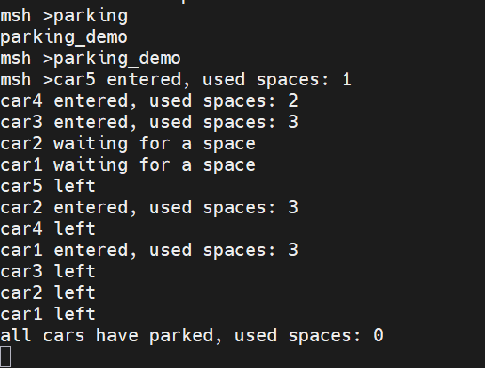
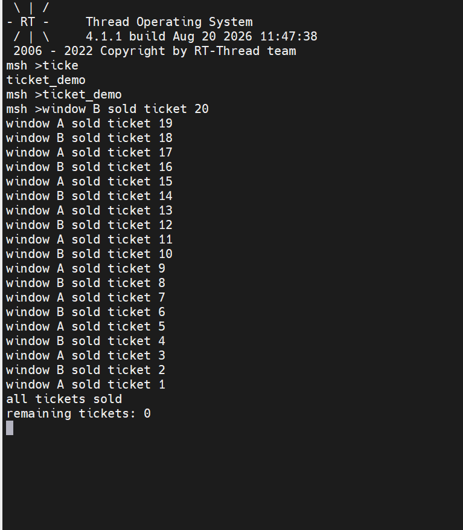
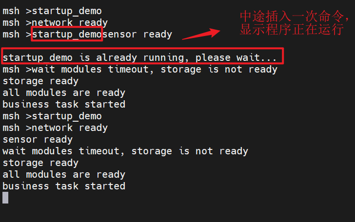
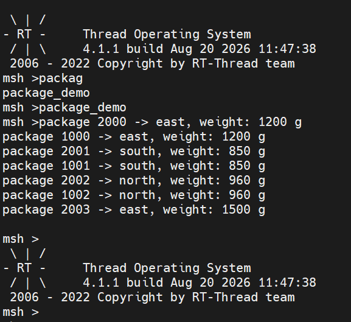
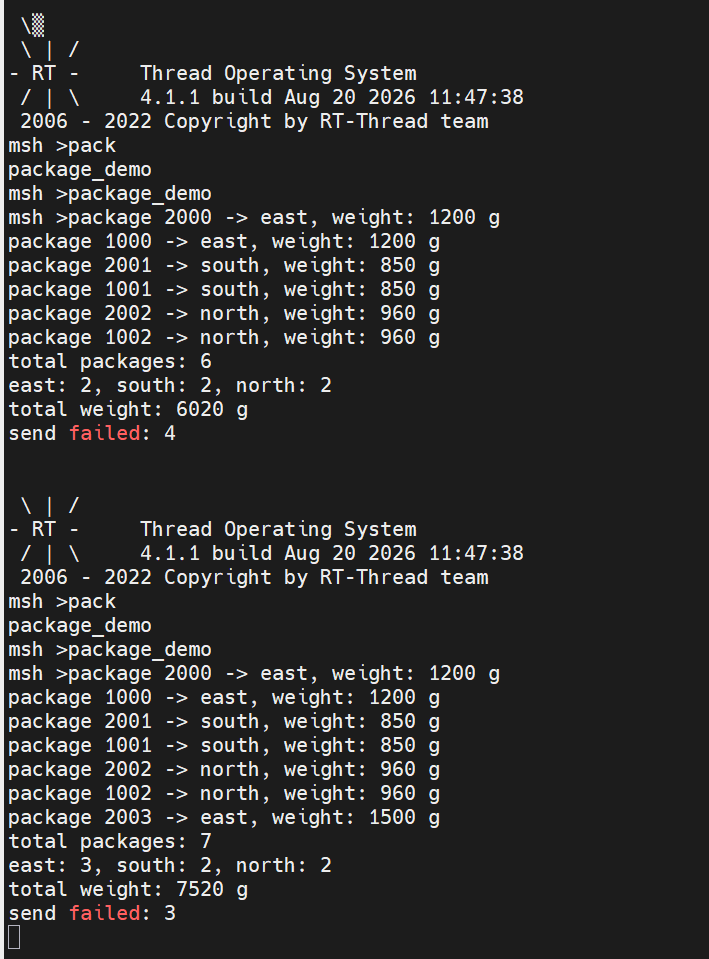
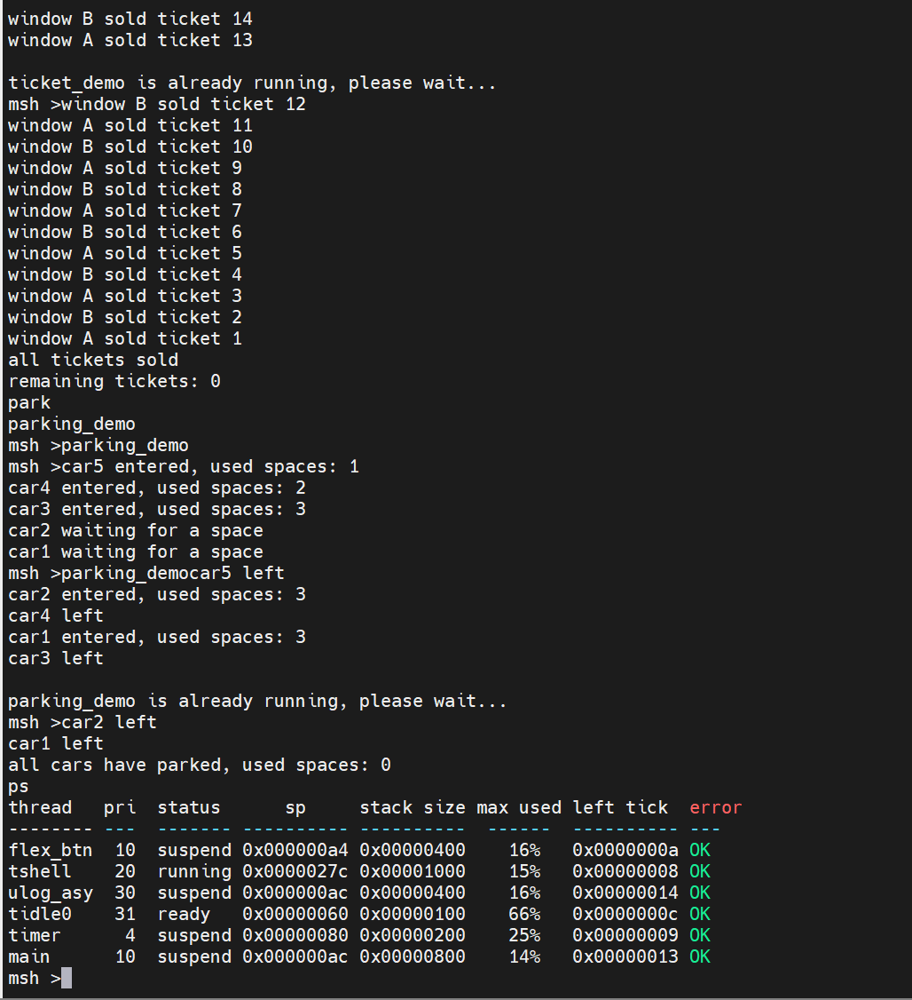

# RT-Thread 线程间同步与通信课后作业

## 一、作业要求

要求：

1. 不得直接复制 `kernel_samples` 示例后只修改变量名和打印内容。
2. 每个练习至少创建两个线程。
3. 所有线程和 IPC 对象都要检查创建结果。
4. 程序需要通过 MSH 命令启动。
5. 提交理论总结与实验报告（`README.md`）+ 源代码（`*.c`）。

---

## 练习一：停车场车位管理

### 场景

一个停车场只有 3 个车位，同时有 5 辆车尝试进入。车位属于有限资源，车辆只有获得车位后才能进入。

### 功能要求

1. 创建一个初始值为 3 的计数信号量，表示剩余车位。
2. 创建 5 个车辆线程。
3. 每辆车到达后申请一个车位。
4. 获得车位后打印车辆编号和进入信息。
5. 车辆停留一段时间后离开，并释放车位。
6. 未在 2 秒内获得车位的车辆打印等待超时信息，稍后重新申请。
7. 任意时刻进入停车场的车辆数不能超过 3。

### 实验分析

最开始三个车位（信号量）很快就被申请占满，car2、car1就都只能等待申请，等到其中一辆走了之后，car2就立即申请车位（信号量），car1同理，最后所有车位都清空。



### 思考题

为什么这里使用计数信号量，而不是互斥量？
停车场有 **3 个车位**，这是多个相同类型的资源。当一辆车进入时，占用一个车位（信号量值减 1）；离开时释放一个车位（信号量值加 1）。
计数信号量恰好能表达这种“剩余车位数量”的概念：初始值为 3，每辆车申请成功就减 1，当值变为 0 时，后续车辆必须等待。
如果使用互斥量，则相当于停车场只有一个车位（互斥量只能表示“有/无”资源），无法同时容纳 3 辆车，不符合需求。

---

## 练习二：多窗口售票系统

### 场景

两个售票窗口同时出售同一批车票。系统初始有 20 张票，每次只能由一个窗口修改剩余票数。

### 功能要求

1. 创建两个售票线程，分别代表窗口 A 和窗口 B。
2. 使用一个全局变量保存剩余票数。
3. 每个窗口循环完成以下操作：
   - 检查是否还有余票；
   - 将余票减 1；
   - 记录售出的票号；
   - 打印售票结果。
4. 使用互斥量保护完整的售票过程。
5. 售完后两个线程自动退出。
6. 最终必须满足：
   - 20 张票全部售出；
   - 不出现相同票号；
   - 剩余票数不能小于 0。

### 实验分析

```text
window A sold ticket 20
window B sold ticket 19
window B sold ticket 18
...
all tickets sold
remaining tickets: 0
```



### 对比实验

先暂时不使用互斥量，并在“读取余票”和“修改余票”之间加入短暂延时，观察是否会出现重复售票或余票错误。随后加入互斥量并再次运行，对比两次结果。

不知道是什么原因，我不使用互斥量和使用互斥量的程序两次结果一模一样，但是如果变成“读取余票”和“修改余票”是两个不同的线程，而且不使用互斥量时就会出现重复售票或余票错误。

### 思考题

为什么只给 `ticket_count--` 加锁仍可能不安全？

实际上，即使 `ticket_count--` 本身是原子操作（例如通过关中断或原子指令实现），也不能保证售票过程的正确性，因为**检查余票和减票是两个独立的操作**。

**竞态场景分析**：

假设当前 `ticket_count = 1`，两个线程 A 和 B 几乎同时执行：

1. **线程 A** 检查 `if (ticket_count > 0)`，条件为真，准备减票。
2. **线程 B** 也检查 `if (ticket_count > 0)`，因为此时 A 还没有执行减票，`ticket_count` 仍为 1，条件也为真。
3. **线程 A** 执行 `ticket_count--`，`ticket_count` 变为 0，成功售出一张票。
4. **线程 B** 执行 `ticket_count--`（原子操作），`ticket_count` 变为 -1，超卖了一张票。

如果只给 `ticket_count--` 加锁，锁住的只是减一这个单一操作，并不能阻止两个线程都通过检查。必须将 **“检查余票 > 0”** 和 **“减票”** 作为一个整体临界区保护起来，才能避免这种“检查-修改”竞态。

---

## 练习三：系统启动条件检查

### 场景

设备启动前需要完成三个独立模块的初始化：

- 网络模块初始化；
- 传感器模块初始化；
- 存储模块初始化。

只有三个模块全部准备完成，主业务线程才能启动。

PS：只是举例，模拟即可。

### 功能要求

定义三个事件位：

```c
#define EVENT_NET_READY      (1U << 0)
#define EVENT_SENSOR_READY   (1U << 1)
#define EVENT_STORAGE_READY  (1U << 2)
```

创建以下线程：

- 网络初始化线程；
- 传感器初始化线程；
- 存储初始化线程；
- 主业务线程。

每个初始化线程经过不同时间的延时后，发送对应的就绪事件。

主业务线程必须使用 AND 模式等待三个事件全部到达，然后打印：

```text
all modules are ready
business task started
```

另外增加一次超时测试：

- 将存储模块初始化时间设置为 5 秒；
- 主业务线程最多等待 3 秒；
- 超时后打印尚未完成的模块，并再次等待。

### 实验分析

运行结果显示如果在程序运行中再次插入程序命令，会检测程序是否仍在运行并拒绝重复启动。



### 思考题

如果用三个独立信号量实现这个功能，与使用事件集相比有什么区别？

**1. 等待语义的复杂性**

- **事件集**：可以原子地等待**多个事件的组合**，支持 AND/OR 逻辑。主业务线程只需一次调用即可等待三个模块全部就绪，且可以设置超时并查询哪些事件未到达。
- **三个信号量**：主业务线程需要分别获取三个信号量，无法在一次调用中判断“全部就绪”。通常需要额外的逻辑（如一个计数器或复合信号量）来实现“全部到达”的条件，代码复杂度高且容易出错。

**2. 状态查询能力**

- **事件集**：通过 `rt_event_recv` 可以随时查询当前事件集合，便于打印未完成的模块（如超时后检查）。
- **信号量**：只能获取计数值，无法直接得知哪个模块尚未初始化。

**3. 资源语义的匹配**

- **事件集**：专门用于事件通知，表达“某事件是否发生”，适合表示模块初始化的完成状态。
- **信号量**：本质是“资源计数”，更适用于管理可用资源的数量（如车位数）。若用来表示“初始化完成”，语义上并不直观。

**4. 清除与重入**

- **事件集**：支持 `RT_EVENT_FLAG_CLEAR` 标志，在满足条件后自动清除事件位，方便重新运行演示。
- **信号量**：获取后值会减一，若多个线程同时等待信号量，可能产生竞争；事件集则允许多个线程同时等待同一组事件。

**结论**

事件集更适合“多个条件全部满足才继续”的场景，它提供了原子性的多事件等待、条件组合判断和状态查询能力，而信号量则更擅长资源计数和互斥访问。因此，系统启动条件检查应优先使用事件集。

---

## 练习四：快递分拣中心

### 场景

两个收件线程不断产生快递信息，一个分拣线程从消息队列中取出快递并按照目的地区域分类。

### 消息结构

```c
struct package_msg
{
    rt_uint32_t id;
    rt_uint8_t region;
    rt_uint16_t weight;
};
```

其中：

```text
region = 1：华东
region = 2：华南
region = 3：华北
```

### 功能要求

1. 创建一个消息队列，队列容量为 5 条消息。
2. 创建两个发件线程，每个线程产生 5 条快递消息。
3. 快递编号不得重复。
4. 分拣线程接收消息，并打印快递编号、区域和重量。
5. 分拣完成后统计：
   - 总快递数量；
   - 各区域快递数量；
   - 所有快递的总重量。
6. 当队列已满时，发送线程不得崩溃，应记录发送失败次数。
7. 两个发送线程完成后，向分拣线程发送一条结束消息。
8. 分拣线程收到结束消息后打印统计结果并退出。

### 实验分析

在分拣线程函数中，结束消息的接收要选择阻塞接收，可以用下面的代码，。

```c
    while (rt_mq_send(pkg_mq, &msg, sizeof(msg)) != RT_EOK)
    {
        rt_thread_mdelay(rt_tick_from_millisecond(10));
    }
```

如果不使用阻塞接收而是，直接使用`rt_mq_send(pkg_mq, &msg, sizeof(msg));`的话会导致**分拣线程等不到第二个结束消息**。因为两个发送线程最后都会发送一条 `region == REGION_END` 的结束消息，但若其中任何一条（甚至两条都）因队列满而发送失败，分拣线程就永远等不到 `end_received >= 2`，于是卡死在 `rt_mq_recv()`，统计代码无法执行，只能重启系统。



这里我测试两种发送快递的延时，前一个是2ms，后一个是20ms，接收快递分类延时都是40ms，可以看到第二个程序比第一个要多接收一次快递消息。

首先讨论一下20ms发送消息的线程出现失败的原因

- 发送线程优先级高于分拣线程（数值更小，`29` vs `30`），所以两个发送线程更容易获得 CPU。
- 发送线程每发送一条后只延时 `20 ms`；两个发送线程同时运行，平均约 `10 ms` 产生一条快递消息。
- 分拣线程每收到一条快递要延时 `40 ms` 模拟分拣耗时，消费速度明显慢于生产速度。

生产快、消费慢，队列很快就会被填满。当队列已满时，`rt_mq_send()` 是非阻塞发送，会立即返回 `-RT_EFULL`，发送线程不会等待，于是这条快递消息被丢弃，失败计数加一。
而加快发送消息之后，队列满的就更快了，所以会多一次发送失败的计数。



---

## 二、MSH 命令要求

每个练习导出一个独立命令：

```text
parking_demo
ticket_demo
startup_demo
package_demo
```

重复执行命令时，不得因同名线程或 IPC 对象残留而发生异常。可以在任务结束后主动释放资源，也可以检测任务是否仍在运行并拒绝重复启动。

1、重复执行命令时不会发生异常；

2、任务结束后主动释放资源，不会出现线程残留。
