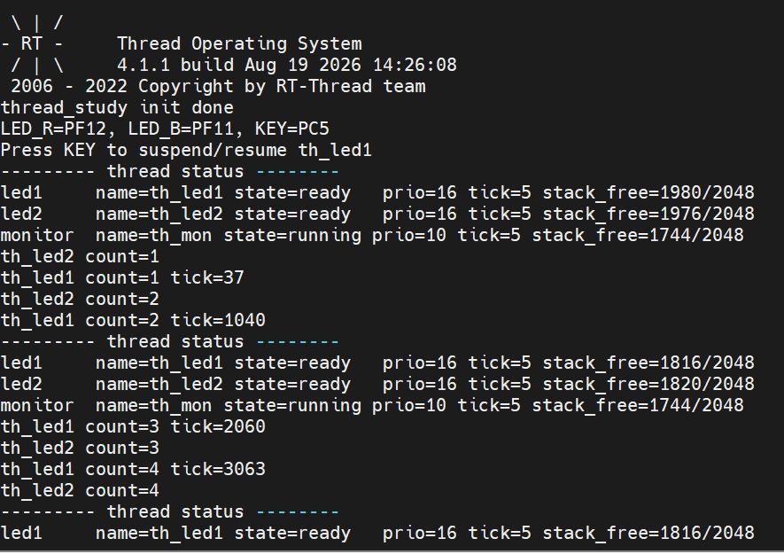
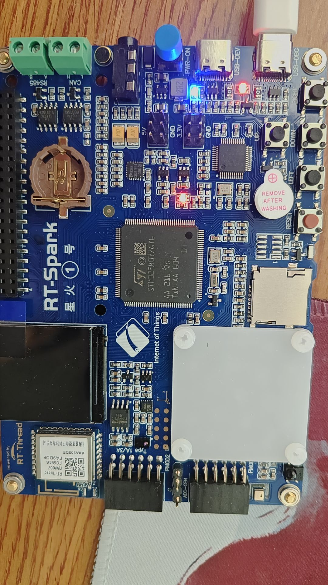
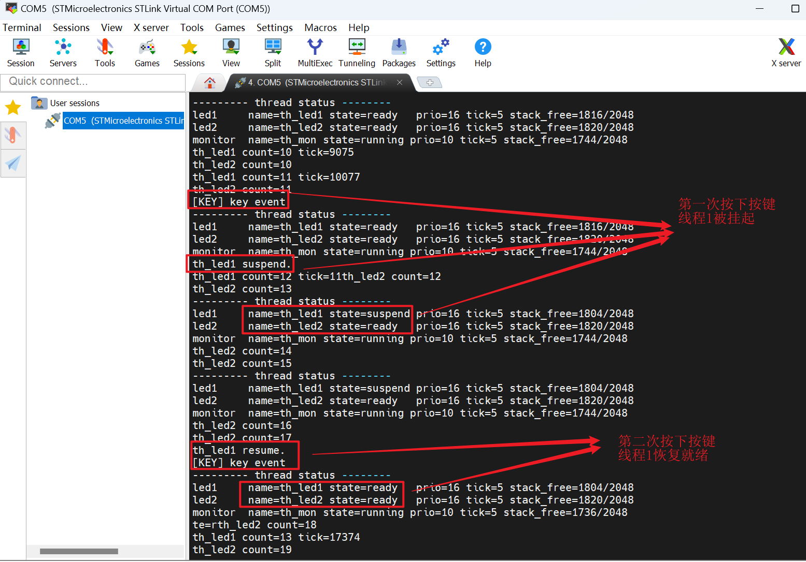

## Part 1：理论知识梳理文档（写入作业目录 `README.md`）

### 1. STM32F407 启动流程与 RT-Thread 引导机制

- **启动路径**：从上电复位 `Reset_Handler` 到进入 `main()` 的完整调用链。

##### 第一阶段：启动文件入口

系统复位后的第一个执行入口，负责初始化堆栈、中断向量等基础环境，并根据不同编译工具链进入对应的启动入口。

| 步骤 | 内容                                    | 功能作用                                                     |
| ---- | --------------------------------------- | ------------------------------------------------------------ |
| 1    | `startup_stm32f407xx.S`（汇编启动文件） | 系统复位后的第一个执行入口，负责初始化堆栈、中断向量等基础环境 |
| 2    | MDK → `$Sub$$main()`                    | Keil 工具链的启动入口，在进入 main 前完成系统初始化          |
| 3    | IAR → `__low_level_init()`              | IAR 工具链的启动入口，完成底层初始化                         |
| 4    | GCC → `entry()`                         | GCC 工具链的启动入口，进入系统初始化流程                     |
| 5    | 三个工具链分支汇入 `rtthread_startup()` | 实现跨编译器兼容，统一进入系统启动主流程                     |

##### 第二阶段：内核核心初始化（rt-thread_startup 主流程）

`rtthread_startup()` 是系统启动主入口函数，串起整个初始化流程，依次完成中断、板级硬件、版本显示、定时器、调度器、信号等内核核心初始化。

| 步骤 | 内容                                                  | 功能作用                                                     |
| ---- | ----------------------------------------------------- | ------------------------------------------------------------ |
| 1    | `rtthread_startup()`                                  | 系统启动主入口函数，串起整个初始化流程                       |
| 2    | `rt_hw_interrupt_disable()`                           | 禁用硬件中断，保证初始化过程不被中断打扰                     |
| 3    | `rt_hw_board_init()`→4                                | 板级硬件初始化，配置时钟、串口、内存等基础硬件               |
| 4    | `rt_components_board_init()` → `board init functions` | 调用板级初始化函数列表，完成各外设的板级配置                 |
| 5    | `rt_show_version()`                                   | 显示系统版本号，串口输出 RT-Thread 版本横幅                  |
| 6    | `rt_system_timer_init()`                              | 初始化系统定时器，为系统提供时间基准                         |
| 7    | `rt_system_scheduler_init()`                          | 初始化调度器，建立调度器数据结构                             |
| 8    | `rt_system_signal_init()`*                            | 初始化信号处理机制，支持线程间信号通信(如果不使用信号相关内容，可以在menuconfig里面关掉) |

##### 第三阶段：线程创建

完成内核核心初始化后，系统开始创建各类系统线程与用户主线程，包括 main 主线程、定时器线程和空闲线程。

| 步骤 | 内容                                    | 功能作用                                                     |
| ---- | --------------------------------------- | ------------------------------------------------------------ |
| 1    | `rt_application_init()`→2               | 初始化应用程序框架，创建应用入口线程                         |
| 2    | `rt_thread_init(main_thread_entry)`     | 创建 main 主线程（用户代码入口）                             |
| 3    | `rt_system_timer_thread_init()`*→4      | 初始化系统定时器线程（如果不使用，可以在menuconfig里面关掉） |
| 4    | `rt_thread_init(rt_thread_timer_entry)` | 创建定时器线程，负责软件定时器管理                           |
| 5    | **`rt_thread_idle_init()`**→6           | 初始化空闲线程                                               |
| 6    | `rt_thread_init(rt_thread_idle_entry)`  | 创建 idle 空闲线程（优先级最低，回收资源）                   |

##### 第四阶段：启动调度器

| 步骤 | 内容                          | 功能作用                                     |
| ---- | ----------------------------- | -------------------------------------------- |
| 1    | `rt_system_scheduler_start()` | 启动调度器，开始按优先级和时间片调度就绪线程 |
| 2    | 根据调度规则执行不同线程      | 线程创建后不会立即执行，由调度器决定何时运行 |

##### 第五阶段：组件初始化与用户代码

调度器启动后，系统继续完成组件初始化，最终进入用户 `main()` 函数执行用户代码。

| 步骤 | 内容                                                         | 功能作用                                           |
| ---- | ------------------------------------------------------------ | -------------------------------------------------- |
| 1    | `rt_components_init()`→2-6                                   | 组件初始化，按序执行各类初始化函数，系统自动初始化 |
| 2    | pre-initialization functions                                 | 预初始化函数（最早执行）                           |
| 3    | device init functions                                        | 设备驱动初始化                                     |
| 4    | components init functions                                    | 组件初始化（文件系统、网络等）                     |
| 5    | environment init functions                                   | 环境初始化                                         |
| 6    | applications init functions                                  | 应用层初始化                                       |
| 7    | `main_thread_entry()`（包含`rt_components_init()`和MDK编译的`$Super$$mian()$`） → `main()` | 用户主函数入口，用户代码从这里开始执行             |

**整体流程**：汇编启动文件 → 内核核心初始化（中断/板级/定时器/调度器/信号）→ 创建 main/定时器/空闲线程 → 启动调度器 → 组件初始化 → 进入用户 main()

- **自动初始化原理**：解释 `INIT_BOARD_EXPORT` 与 `INIT_APP_EXPORT` 的底层实现原理。

基本原理是：

```tex
宏展开生成函数指针
	↓
函数指针放入特殊 section
    ↓
链接器收集成初始化函数表
    ↓
RT-Thread 启动时遍历表
    ↓
依次调用函数
```

RT-Thread 的自动初始化机制本质上是通过 **宏 + 编译器 section + 链接脚本 + 启动遍历** 实现的，即宏定义写入函数指针，宏定义把函数指针放入指定的代码段（section），系统启动时 `rt_components_init()` 按段顺序遍历并逐个调用，实现「声明即自动执行」。

**1.宏展开：生成函数指针**

以 `INIT_APP_EXPORT()` 为例，源码：

```c
INIT_APP_EXPORT(my_thread_create);
可以被简化理解为展开成：
typedef int (*init_fn_t)(void);	\\ 定义一个函数指针变量；

const init_fn_t __used				\\ 这个变量保存 my_thread_create 的函数地址；
__attribute__((section(".rti_fn.6")))	\\ 并把这个函数指针放到特殊段 .rti_fn.6 中。

```

也就是说，`INIT_APP_EXPORT()` 并不是直接调用函数，而是把函数地址登记到一张“自动初始化函数表”里。

**2、`INIT_BOARD_EXPORT` 与` INIT_APP_EXPORT` 的区别**:

两者底层原理相同，区别主要是 **section 不同**，因此被调用的阶段不同。

| 宏                    | 常见 section      | 用途           |
| --------------------- | ----------------- | -------------- |
| `INIT_BOARD_EXPORT()` | `.rti_fn.1.board` | 板级硬件初始化 |
| `INIT_APP_EXPORT()`   | `.rti_fn.6`       | 应用层初始化   |

**3. 链接器收集函数指针表**

编译器只是把函数指针放到特殊 section，真正形成“表”的是链接脚本。

典型链接脚本可能类似：

```tex
.rti_fn.board :
{
    . = ALIGN(4);
    __rt_init_rti_board_start = .;
    KEEP(*(SORT(.rti_fn.1.board)))
    __rt_init_rti_board_end = .;
} > FLASH

.rti_fn :
{
    . = ALIGN(4);
    __rt_init_rti_start = .;
    KEEP(*(SORT(.rti_fn.*)))
    __rt_init_rti_end = .;
} > FLASH
```

关键点：
```tex
KEEP：防止初始化函数表被链接器优化删除
SORT：按 section 名称排序，保证初始化顺序
__rt_init_rti_board_start / __rt_init_rti_board_end：板级初始化表的起止地址
__rt_init_rti_start / __rt_init_rti_end：普通初始化表的起止地址
```

**4. 链接后的内存示意图**

如果有如下初始化函数：

```c 
INIT_BOARD_EXPORT(board_init);
INIT_DEVICE_EXPORT(device_init);
INIT_COMPONENT_EXPORT
```

链接后 Flash 中可能形成类似结构：

```tex
Flash

.rti_fn.1.board
┌────────────────────────────┐
│ board_init 函数地址        │
└────────────────────────────┘

.rti_fn.3
┌────────────────────────────┐
│ device_init 函数地址       │
└────────────────────────────┘

.rti_fn.4
┌────────────────────────────┐
│ component_init 函数地址    │
└────────────────────────────┘

.rti_fn.6
┌────────────────────────────┐
│ my_thread_create 函数地址  │
└────────────────────────────┘
```

但这些项的本质都是：**函数指针**

**5. 启动时遍历调用**

RT-Thread 启动时会遍历这些函数指针表。

**底层完整流程**：

```tex
源码阶段
    ↓
用户写：
INIT_APP_EXPORT(my_thread_create);
    ↓
预处理器展开宏
    ↓
生成一个函数指针变量：
const init_fn_t xxx = my_thread_create;
    ↓
编译器把这个变量放到：
.rti_fn.6 段
    ↓
链接器收集所有 .rti_fn.* 段
    ↓
形成初始化函数表
    ↓
链接脚本定义起始/结束符号：
__rt_init_rti_start
__rt_init_rti_end
    ↓
RT-Thread 启动时调用 rt_components_init()
    ↓
遍历函数指针表
    ↓
依次调用表中的函数
    ↓
my_thread_create() 被执行
    ↓
main() 被执行
```

### 2. 内核基础与对象模型

- **对象容器与控制块**：简述 RT-Thread 面向对象的设计思想，线程控制块（`struct rt_thread`）中关键成员（如 `stat`、`current_priority`、`init_tick`、`sp`）的作用。

RT-Thread 面向对象的设计思想：

将逻辑抽象化成一个对象，将用结构体表示对象、用函数表示对象行为、用对象类型区分对象种类、用链表/容器统一管理系统对象。

**线程控制块中关键成员作用：**

| 成员                                 | 功能作用                                                  |
| ------------------------------------ | --------------------------------------------------------- |
| `parent`                             | 继承 rt_object 基类，使线程成为内核对象，可被对象容器管理 |
| `sp`                                 | 栈指针，保存线程当前运行上下文（寄存器状态）              |
| `entry`                              | 入口函数指针，线程启动后执行的函数                        |
| `parameter`                          | 传给入口函数的参数                                        |
| `stack_addr` / `stack_size`          | 线程栈的地址和大小，用于保存线程局部变量和调用栈          |
| `error`                              | 线程错误代码                                              |
| `stat`                               | 表示线程当前状态（初始化/就绪/运行/挂起/关闭态）          |
| `current_priority` / `init_priority` | 当前优先级 / 初始优先级（支持优先级继承）                 |
| `number_mask`                        | 优先级位图掩码，用于快速调度                              |
| `init_tick` / `remaining_tick`       | 时间片初始值 / 剩余值，用于时间片轮转调度                 |
| `thread_timer`                       | 内置线程定时器，用于线程延时、超时等                      |
| `cleanup`                            | 线程退出时的清除函数                                      |
| `user_data`                          | 用户自定义数据                                            |

- **内存分配方式**：对比静态对象与动态对象的区别（分配位置、生命周期、释放机制），分析为什么某些高可靠场景强制使用静态线程。

线程对象可以通过动态线程`rt_thread_create()`和静态线程`rt_thread_init()`创建动态对象和静态对象，二者通过静态分配和动态分配内存。

**1、分配位置**

| 项目             | 静态线程        | 动态线程           |
| ---------------- | --------------- | ------------------ |
| 内存来源         | 全局/静态区     | 堆区               |
| 分配时机         | 编译/链接时确定 | 运行时申请         |
| 内存位置         | 固定            | 不固定             |
| 是否依赖堆       | 不依赖          | 通常依赖           |
| 内存大小是否明确 | 明确            | 取决于运行时堆状态 |

**2、生命周期**

| 项目             | 静态线程         | 动态线程               |
| ---------------- | ---------------- | ---------------------- |
| 创建时机         | 通常开机初始化   | 运行时按需创建         |
| 生命周期         | 通常和系统一样长 | 可短可长               |
| 是否常驻         | 通常常驻         | 可临时存在             |
| 是否频繁创建销毁 | 一般不销毁       | 可以创建销毁           |
| 适合任务         | 长期固定任务     | 临时任务、数量不定任务 |

**3、释放机制**

| 项目             | 静态线程   | 动态线程                    |
| ---------------- | ---------- | --------------------------- |
| 是否需要手动释放 | 通常不需要 | 需要关注释放                |
| 内存来源         | 静态区     | 堆                          |
| 是否可能内存泄漏 | 一般不会   | 可能                        |
| 是否可能内存碎片 | 基本不会   | 可能                        |
| 资源回收方式     | 固定占用   | 线程退出/删除/detach 后释放 |

而高可靠场景通常要求：行为确定、内存可控、启动可靠、不能随机死机、不能运行时分配失败。

1. 静态线程内存在编译时就可以确定。

2. 动态线程创建依赖堆，但是堆可能不足；静态线程开机前就把内存准备好，不依赖运行时堆状态。

3. 动态内存长时间运行后可能出现碎片，静态线程不会造成这种问题，因为静态线程的内存位置固定。

4. 动态内存系统常见风险是内存泄漏，而静态线程不存在“用完释放”的概念，它的内存固定占用，不会因为泄漏导致系统运行越久越危险。

5. 静态线程通常在系统启动早期就可以初始化，只要静态数组存在，线程对象就存在。动态线程则可能受各种因素影响。

6. 静态线程不需要运行时分配内存，所以行为更确定，实时性更可预测。

   总之：静态线程把内存问题从“运行时不确定问题”变成了“编译期可检查问题”。

### 3. 线程状态机与调度算法

- **五态模型**：绘制或描述 RT-Thread 线程状态（初始态、就绪态、运行态、挂起态、关闭态）及触发状态转换的典型 API。

  **状态转换关系：**

  | 起始状态 | 目标状态 | 触发函数 / 条件                                              |
  | -------- | -------- | ------------------------------------------------------------ |
  | 无       | 初始状态 | 通过动态线程创建`rt_thread_create()`和静态线程创建`rt_thread_init()` |
  | 初始状态 | 就绪状态 | `rt_thread_startup()`                                        |
  | 就绪状态 | 运行状态 | 被调度器选中执行（调度器调度）                               |
  | 运行状态 | 挂起状态 | `rt_thread_suspend()` 及①组阻塞函数                          |
  | 挂起状态 | 就绪状态 | ②组唤醒函数                                                  |
  | 运行状态 | 关闭状态 | `rt_thread_exit()`                                           |
  | 挂起状态 | 关闭状态 | `rt_thread_delete()` / `rt_thread_detach()`                  |

  **①组阻塞函数（运行 → 挂起）**

  运行中的线程调用以下函数会主动让出 CPU 或阻塞等待资源，从而转入挂起状态：

  ```c
  rt_thread_delay();   /* 延时等待 */
  rt_sem_take();       /* 获取信号量（不可用则阻塞） */
  rt_mutex_take();     /* 获取互斥锁（被占用则阻塞） */
  rt_mp_alloc();       /* 分配内存池块（无可用块则阻塞） */
  rt_event_recv();     /* 接收事件标志（无匹配事件则阻塞） */
  rt_mb_recv();        /* 接收邮箱消息（为空则阻塞） */
  rt_mq_recv();        /* 接收消息队列（为空则阻塞） */
  ```

  **②组唤醒函数（挂起 → 就绪）**

  由其他线程或中断调用，用于唤醒挂起中的线程，使其回到就绪状态：

  ```c
  rt_thread_resume();  /* 显式恢复线程 */
  rt_sem_release();    /* 释放信号量（唤醒等待者） */
  rt_mutex_release();  /* 释放互斥锁（唤醒等待者） */
  rt_mp_release();     /* 释放内存池块（唤醒等待分配者） */
  rt_event_send();     /* 发送事件标志（唤醒等待者） */
  rt_mb_send();        /* 发送邮箱消息（唤醒等待接收者） */
  rt_mq_send();        /* 发送消息队列（唤醒等待接收者） */
  ```

- **调度机制剖析**：

  - **抢占式调度**

    核心思想：如果有更高优先级的线程进入就绪态，那么当前低优先级线程会被立即暂停，CPU 切换给高优先级线程。

    其中优先级数值越小，优先级越高。

    如果当前正在运行线程 B，而线程 A 突然变成就绪态，那么调度器会切换到线程 A。通过线程控制块中的`stat、current_priority、sp`来判断线程是否可以被调用。

    `statu:`判断线程是否可以被调度。

    ```c
    READY     可以被调度
    RUNNING   正在运行
    SUSPEND   不能运行
    ```

    `current_priority:`调度器根据当前优先级判断谁更重要。优先级数值越小，越优先运行。

    `sp:`切换线程时保存和恢复现场。

    ```tex  
    切走线程：保存 sp
    切入线程：恢复 sp
    ```

  - **时间片轮转**

    通过时间片轮转判断多个相同优先级线程如何公平使用 CPU，同优先级线程轮流使用 CPU。如果没有时间片机制，可能一个线程一直运行，另一个线程很难得到机会。

    时间片轮转就是：每个同优先级线程运行一段时间，时间片用完后切换到下一个同优先级线程。

## Part 2：多线程实战编程（C 语言实现）

### 任务说明

1. **工作线程 1（动态创建 `th_led1`）**：
   - 优先级 `16`，时间片 `5 ticks`，栈 `1024 Bytes`。
   - 循环翻转板载 LED_R，每次执行打印计数与 `rt_tick_get()`。
   
2. **工作线程 2（静态初始化 `th_led2`）**：
   - 优先级 `16`，时间片 `5 ticks`，静态定义全局栈与 TCB。
   - 循环翻转板载 LED_B，每次执行打印计数。
   
3. **监控与控制线程（动态创建 `th_monitor`）**：
   - 优先级 `10`（高于工作线程），周期延时 `rt_thread_mdelay(2000)`。
   - 唤醒后获取并打印 `th_led1` 与 `th_led2` 的运行状态与剩余栈空间大小。
   - 结合板载按键检测（或按键中断）：单次触发时调用 `rt_thread_suspend()` 挂起 `th_led1`；再次触发时调用 `rt_thread_resume()` 恢复。
   
   **实验结果：**
   
   先执行监控线程，后续再依次执行工作线程1、2，并打印线程信息
   
   
   
   实物图
   
   
   
   串口打印消息截图
   
   
   
4. **系统集成与调试命令**：
   - 使用 `INIT_APP_EXPORT()` 自动加载测试模块，禁止在 `main.c` 中硬编码调用。
   - 使用 `MSH_CMD_EXPORT()` 导出自定义查看命令（如 `thread_dump`）。
   - 