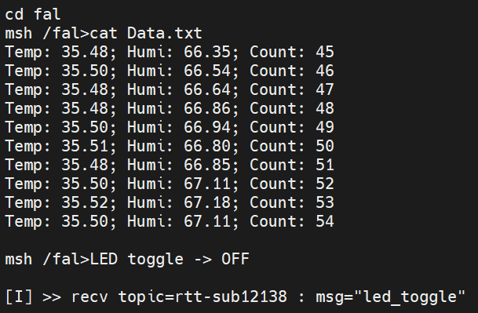
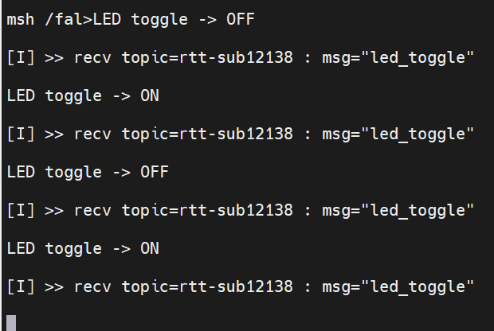
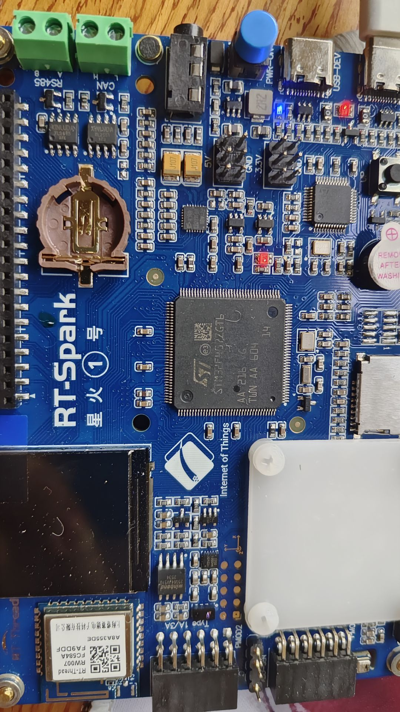
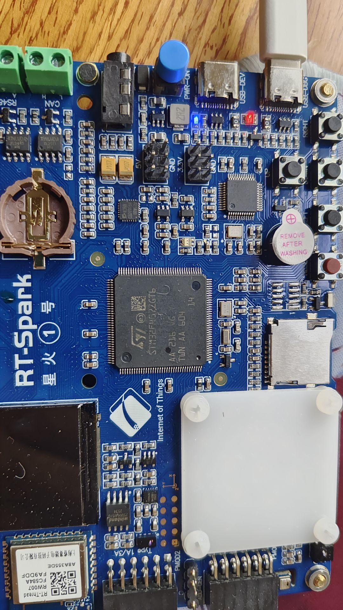
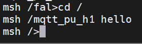
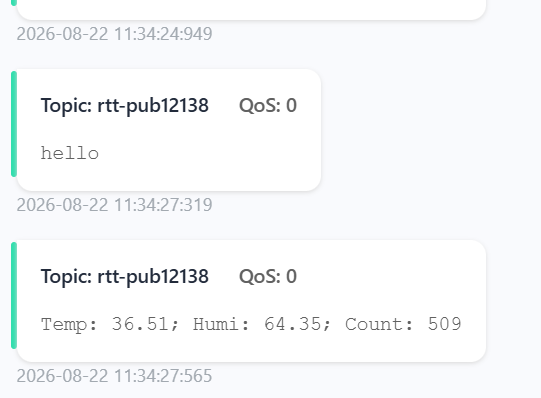

# RT-Thread 夏令营 Day5 课后作业（软件包 + MQTT + 文件系统）

## 作业说明

1. 使用 **AHT10 软件包**采集温湿度，上传到 **EMQX**（或其它 MQTT 服务器）；
2. 梳理 **DFS 文件系统**启动流程，熟悉 shell 命令，把 **font 分区挂载**上，温湿度上传的同时**同步写入文件系统 `Data.txt`**（内容格式 `Temp: XX ; Humi: XX ; Count: N`，N 为自上电起采集次数）；
3. 利用**云端给开发板发送指令**实现**小灯翻转**；
4. 熟悉**其它软件包**（kawaii-mqtt / Sensor 框架 / rt_vsnprintf_full 等）。

---

## 一、作业实现总结

### 1. 整体架构：三线程 + 双消息队列解耦

本作业的核心设计是**「采集、上传、落盘」三者解耦**：采集线程只负责读数，通过消息队列把数据"广播"给上传线程与保存线程，三者互不阻塞。

```
                    ┌──────────────────────────────────────────────────┐
                    │              AHT10 采集线程（线程1）              │
                    │   aht10_init("i2c3") → 读温度/湿度 → Count++     │
                    └──────────────────┬───────────────────────────────┘
                         rt_mq_send    │  rt_mq_send（同一份数据发两份）
              ┌────────────────────────┼────────────────────────────┐
              ▼                        ▼                            │
   ┌────────────────────┐   ┌────────────────────┐                  │
   │ sensor_mqtt_mq     │   │ sensor_file_mq     │                  │
   │ （消息队列，深5）     │   │ （消息队列，深5）    │                   │
   └─────────┬──────────┘   └─────────┬──────────┘                  │
             ▼                        ▼                             │
   ┌────────────────────┐   ┌────────────────────┐                  │
   │ MQTT 上传线程（线程2）│   │ 文件保存线程（线程3）│                   │
   │ rt_mq_recv(500ms超时)│   │ rt_mq_recv(死等)   │                  │
   │ → mqtt_publish 上行  │   │ → open/write/close │                 │
   │ → mqtt_sleep_ms 保活 │   │ → /fal/Data.txt    │                 │
   └─────────┬──────────┘   └────────────────────┘                 │
             ▼                                                     ▼
   ┌────────────────────┐                                   ┌──────────────┐
   │ EMQX (broker.emqx.io)                                   │ W25Q64 FAL  │
   │ 发布 rtt-pub12138 │                                   │ /fal 分区     │
   └─────────┬──────────┘                                   └──────────────┘
             ▼
   ┌────────────────────┐
   │ 云端下发 led_toggle │
   │ → 订阅回调 → 翻转 LED │
   └────────────────────┘
```

**设计要点**：
- **上行走消息队列解耦**：采集线程与 MQTT 发送、文件保存互不阻塞，谁慢都不影响采集；
- **下行走订阅回调**：`sub_topic_handle1` 收到 `led_toggle` 即翻转小灯，回调内不做耗时操作；
- **心跳保活**：`rt_mq_recv` 用 **500ms 短超时**而非死等，保证 `mqtt_sleep_ms()` 周期性执行，MQTT 心跳不饿死、不被服务器踢下线。

### 2. 功能模块说明

| 模块 | 线程 | 职责 | 关键实现 |
|---|---|---|---|
| 温湿度采集 | `AHT10_read`（优先级 10） | 每 3 秒读一次温湿度，Count 自增，数据发往两条队列 | `aht10_init("i2c3")` + `aht10_read_temperature/humidity` |
| MQTT 上行 | `MQTT_auto`（优先级 15） | 从 `sensor_mqtt_mq` 取数据，拼装后 `mqtt_publish` 到 EMQX；周期保活 | `kawaii-mqtt`：`mqtt_lease/connect/subscribe/publish` + `mqtt_sleep_ms(500)` |
| 文件落盘 | `File_save`（优先级 15） | 从 `sensor_file_mq` 取数据，滚动缓存最近 10 条，整份重写 `/fal/Data.txt` | `open(O_CREAT\|O_RDWR\|O_TRUNC)` + `write` + `close`（落盘） |
| 云端控灯 | 订阅回调（无独立线程） | 收到 `led_toggle` 消息，翻转板载 LED（F12） | `strstr(payload, "led_toggle")` 包含匹配 + `rt_pin_write` |

### 3. 温湿度采集与文件格式（作业要求 1、2）

采集线程把 `sensor_data_t`（temp / humi / Count）通过两条消息队列分发。MQTT 线程与文件线程各自拼装：

- **MQTT 上行**：`Temp: %.2f; Humi: %.2f; Count: %d`
- **文件落盘**：`Temp: %.2f; Humi: %.2f; Count: %d\r\n`（每行一条，`Count` 即自上电起采集次数）




### 4. 关键代码片段（提炼）

**① 采集线程：读数据 → 双队列分发**

```c
mq_data.temp = aht10_read_temperature(aht10);
mq_data.humi = aht10_read_humidity(aht10);
mq_data.Count += 1;                                   // 自上电起采集次数

rt_mq_send(sensor_mqtt_mq, &mq_data, sizeof(mq_data)); // 发给 MQTT 线程
rt_mq_send(sensor_file_mq, &mq_data, sizeof(mq_data)); // 发给文件线程
rt_thread_mdelay(3000);                                // 3 秒一轮
```

**② MQTT 上传线程：短超时取队列 + 心跳保活**

```c
if (rt_mq_recv(sensor_mqtt_mq, &data, sizeof(data),
               rt_tick_from_millisecond(500)) == RT_EOK)
{
    snprintf(buf, sizeof(buf), "Temp: %.2f; Humi: %.2f; Count: %d",
             data.temp, data.humi, data.Count);
    msg.payload = buf;
    mqtt_publish(client, KAWAII_MQTT_PUBTOPIC, &msg);
}
mqtt_sleep_ms(500);   /* 必须周期性调用，否则心跳饿死被踢下线 */
```

**③ 文件保存线程：滚动缓存 10 条 + O_TRUNC 整份重写 + close 落盘**

```c
if (count >= MAX_SAVE) {              /* 缓存满：整体前移，丢最旧一条 */
    for (int i = 0; i < MAX_SAVE - 1; i++) strcpy(cache[i], cache[i + 1]);
    count = MAX_SAVE - 1;
}
snprintf(cache[count], sizeof(cache[count]),
         "Temp: %.2f; Humi: %.2f; Count: %d\r\n", data.temp, data.humi, data.Count);
count++;

int fd = open("/fal/Data.txt", O_CREAT | O_RDWR | O_TRUNC);  /* 截断旧内容 */
if (fd >= 0) {
    for (int i = 0; i < count; i++)
        write(fd, cache[i], rt_strlen(cache[i]));   /* 用实际长度，防垃圾字节 */
    close(fd);          /* close 触发 flush 落盘，内容立即进磁盘 */
}
```

**④ 云端控灯：订阅回调 strstr 匹配**

```c
static void sub_topic_handle1(void *client, message_data_t *msg)
{
    const char *payload = (const char *)msg->message->payload;
    /* strstr 包含匹配，兼容 JSON 包裹格式 {"msg":"led_toggle"} */
    if (strstr(payload, "led_toggle") != RT_NULL) {
        led_state = rt_pin_read(LED_R_PIN);
        rt_pin_write(LED_R_PIN, led_state ? LED_OFF : LED_ON);
        rt_kprintf("LED toggle -> %s\n", led_state ? "OFF" : "ON");
    }
}
```







### 5. 使用方法（shell 命令）

```bash
# 1. 联网（RW007）
wifi join <热点名> <密码>     # 连接 WiFi
ping baidu.com               # 验证联网

# 2. 挂载文件系统（设备已自动挂载，一般无需手动；若未挂载）：
mount filesystem /fal elm    # 注意设备名是 filesystem，不是 fal
ls /fal                      # 查看分区内容
mkfs -t elm filesystem       # 若出现 BAD file 乱码，先格式化（会清空分区）

# 3. 启动作业主程序（创建队列 + 三个线程）
mqtt_aht10

# 4. 手动向服务器发一条消息（验证 MSH 带参命令）
mqtt_pu_h1 hello

# 5. 云端控灯（在 MQTTX 里向 rtt-sub12138 发送 led_toggle）
```





### 6. 作业要求对照

| 作业要求 | 实现情况 |
|---|---|
| ① AHT10 采集温湿度上传 EMQX | ✅ `mqtt_aht10` 启动三线程，MQTT 上行到 `broker.emqx.io`，MQTTX 可订阅查看 |
| ② 文件系统挂载 + Data.txt 落盘 | ✅ `/fal` 分区（FAL + elm）自动挂载，`Data.txt` 按 `Temp: XX ; Humi: XX ; Count: N` 格式写入，保留最近 10 条 |
| ③ 云端指令翻转小灯 | ✅ 订阅 `rtt-sub12138`，下发 `led_toggle` 即可翻转板载 LED（F12） |
| ④ 熟悉其它软件包 | ✅ kawaii-mqtt（MQTT）、Sensor 框架（AHT10 依赖）、rt_vsnprintf_full（浮点打印）、SFUD（Flash） |

---

## 二、踩坑与排错经验

1. **`/fal` 目录出现 BAD file 乱码文件名**：FAT 目录项损坏（写一半断电 / 旧代码写入含垃圾整块）。解决：`mkfs -t elm filesystem` 格式化（注意设备名是 `filesystem`，不是 `fal`；`fal` 只是挂载目录名）；`fal probe filesystem`查看挂载文件。
2. **write 成功但文件 0 字节**：DFS 写缓存未落盘——open 在循环外、close 永不执行。解决：每次 `open/write/close`，`close` 触发 flush 立即进磁盘。
3. **RTC 警告 `Cannot find a RTC device!`**：FAT 取时间戳找不到 RTC。解决：在 `ffconf.h` 中把 `FF_FS_NORTC` 设为 1（不用改 rtconfig 或注册 RTC）。
4. **MQTT 栈溢出 HardFault**：kawaii-mqtt 自动重连线程栈不足，把 `KAWAII_MQTT_AUTO_RECONNECT_THREAD_STACK_SIZE` 调大（4096 → 8192）。
5. **MSH 带参命令签名**：必须是 `int cmd(int num, char **str)`，`num` 不能删（底层按 `(int, char**)` 调用），用 `(void) num;` 消除警告。
6. **write 长度**：`write(fd, buf, rt_strlen(buf))` 用实际长度，别写 `sizeof(buf)`（会带出垃圾字节）。
