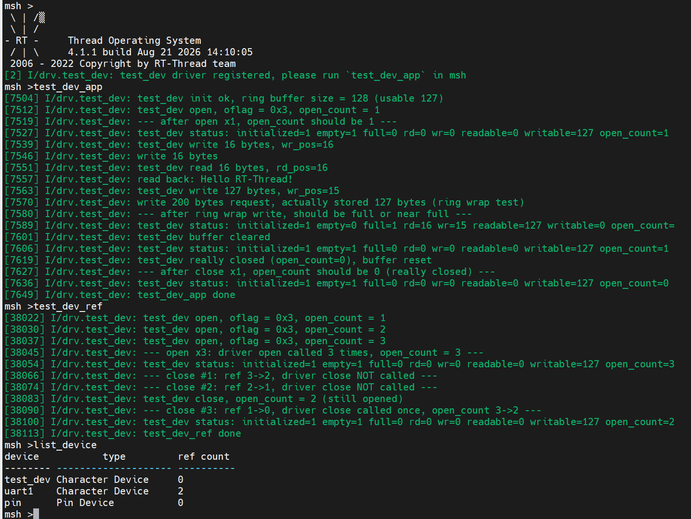

# RT-Thread 夏令营 Day4 课后作业（设备驱动框架与 IO 外设开发）

## 一、PIN 设备对接分析

### 1. 对接总览：一条从 API 到寄存器的调用链

PIN 设备的对接是「分层 + 函数指针（ops）」思想的典型体现：上层应用只调用统一的 `rt_pin_*` 接口，逐层经 Pin 设备框架、BSP 驱动、STM32 HAL 库，最终落到寄存器。整个过程：

```tex
┌────────────────────────────────────────────────────────────────────────┐
│ 应用层：                                                                 │
│   rt_pin_mode(37, PIN_MODE_INPUT_PULLUP)         // 配置上拉输入        │
│   rt_pin_attach_irq(37, PIN_IRQ_MODE_FALLING, key_cb, RT_NULL)  // 中断回调│
│   rt_pin_irq_enable(37, PIN_IRQ_ENABLE)          // 使能中断            │
├────────────────────────────────────────────────────────────────────────┤
│ ① Pin 设备框架层（RT-Thread 内核组件 pin.c）                            │
│    rt_pin_mode() ──▶ _pin_ops->pin_mode(pin, mode)                     │
│    rt_pin_attach_irq() ──▶ _pin_ops->pin_attach_irq(...)               │
├────────────────────────────────────────────────────────────────────────┤
│ ② IO 设备管理层：                                                       │
│    rt_device_pin_register() 注册名为 "pin" 的 rt_device                │
│    并把 BSP 填充的 rt_pin_ops 挂到 _pin_ops（find("pin") 找到该设备）     │
├────────────────────────────────────────────────────────────────────────┤
│ ③ BSP 驱动框架层 drv_pin（drv_gpio.c / stm32_pin）：                    │
│    stm32_pin_ops = { stm32_pin_mode, stm32_pin_write,                  │
│                      stm32_pin_read, stm32_pin_attach_irq, ... }      │
│    —— 在这里完成 ops 函数指针的逐层赋值                                 │
├────────────────────────────────────────────────────────────────────────┤
│ ④ 设备驱动层 stm32_pin 具体实现：                                        │
│    stm32_pin_mode() → GPIO_Init(...)        （STM32 HAL 库）           │
│    stm32_pin_attach_irq() → HAL_GPIO_EXTI_IRQHandler 等                │
├────────────────────────────────────────────────────────────────────────┤
│ ⑤ 寄存器层：GPIOx_MODER（模式）/ ODR（输出）/ IDR（输入）/ EXTI（中断）    │
└────────────────────────────────────────────────────────────────────────┘
```

### 2. 第一层：上层应用调用 rt_pin_* 接口

应用层不需要知道引脚在 STM32 内部如何实现，只调用统一接口：

- `rt_pin_mode(pin, mode)`：设置引脚模式（上拉输入等）；
- `rt_pin_write / rt_pin_read`：读写电平；
- `rt_pin_attach_irq(pin, mode, callback, args)`：绑定中断回调；
- `rt_pin_irq_enable(pin, enabled)`：使能中断。

（详见 `dev_test.c` 的 `irq_key_enable()` 与四个按键回调。）

### 3. 第二层：IO 设备管理层与 rt_pin_ops 对接

与字符设备使用通用 `ops`（init/open/close/read/write/control）不同，**Pin 设备使用了一套专用的操作集 `rt_pin_ops`**：

```c
struct rt_pin_ops
{
    void (*pin_mode)(rt_base_t pin, rt_base_t mode);
    void (*pin_write)(rt_base_t pin, rt_base_t value);
    rt_base_t (*pin_read)(rt_base_t pin);
    rt_err_t (*pin_attach_irq)(rt_base_t pin, rt_uint32_t mode, void (*hdr)(void *args), void *args);
    rt_err_t (*pin_detach_irq)(rt_base_t pin);
    rt_err_t (*pin_irq_enable)(rt_base_t pin, rt_bool_t enabled);
    void (*pin_wakeup)... /* 可选，部分平台 */
};
```

对接机制：RT-Thread 组件层调用 `rt_device_pin_register()` 把名称为 `"pin"` 的 `rt_device` 注册进 IO 设备管理器，同时把 `_pin_ops` 指向 BSP 传入的 ops 结构体。应用层调用 `rt_pin_mode()` 时，框架层就是通过 `_pin_ops->pin_mode()` 间接调用到底层实现的——**这正是"IO 设备管理层 find("pin") / ops" 的含义**。

### 4. 第三层：drv_pin（stm32_pin）底层实现与 HAL 库

BSP 中的 `drv_gpio.c`（即 drv_pin 驱动框架层）定义并赋值 `stm32_pin_ops`：

```c
static struct rt_pin_ops stm32_pin_ops =
{
    stm32_pin_mode,
    stm32_pin_write,
    stm32_pin_read,
    stm32_pin_attach_irq,
    stm32_pin_detach_irq,
    stm32_pin_irq_enable,
};
```

- `stm32_pin_mode()` 内部调用 STM32 HAL 库 `GPIO_Init()`（或 LL 库），把 `PIN_MODE_INPUT_PULLUP` 翻译成对应的 HAL 配置，最终写入 `GPIOx_MODER` 等寄存器；
- `stm32_pin_attach_irq()` 配置 EXTI 与 NVIC，注册回调；
- 中断到来时进入 `HAL_GPIO_EXTI_IRQHandler` → `HAL_GPIO_EXTI_Callback`，再由 stm32_pin 层找到对应引脚的回调并执行（这就是 Day4 课程中"先调 STM32 HAL 回调，再转到 RT-Thread 回调"的调用链）。

### 5. GET_PIN 宏与引脚编号推导

```c
#define GET_PIN(PORTx, PIN)  ((rt_base_t)(((PORTx) * 16u) + (PIN)))
```

STM32 GPIO 按组（PA/PB/PC…）组织，每组 16 个引脚：`PA0~15` 编号 0~15，`PB0~15` 编号 16~31，`PC0~15` 编号 32~47……

- `PC5` → `GET_PIN(C, 5)` = 32 + 5 = **37**；
- `PC1` → 33，`PC0` → 32，`PC4` → 36。

（Day4 开发板四个方向键正是 PC5/PC1/PC0/PC4，见 `dev_test.c`。）

### 6. 五种中断触发模式与按键中断实验（dev_test.c）

- **五种触发模式**：上升沿、下降沿、高电平、低电平、双边沿。
- **按键实验**（`dev_test.c`）：
  1. 用 `GET_PIN` 定义四个按键引脚；
  2. `rt_pin_mode(KEY_x, PIN_MODE_INPUT_PULLUP)`：按键按下为低电平，用上拉输入保证未按下读到高电平；
  3. `rt_pin_attach_irq(KEY_x, PIN_IRQ_MODE_FALLING, key_x_callback, RT_NULL)`：按下降沿触发（按下瞬间高→低）；
  4. 回调里 `rt_pin_read(KEY_x)` 读电平并 `LOG_I` 打印；
  5. `rt_pin_irq_enable(KEY_x, PIN_IRQ_ENABLE)` 使能中断。
- **中断上行路径**：按键按下（下降沿）→ EXTI 中断 → `HAL_GPIO_EXTI_IRQHandler` → `HAL_GPIO_EXTI_Callback` → stm32_pin 层定位引脚 → 框架层调用用户回调（如 `key_up_callback`）→ 打印。

### 7. 按键消抖

实验中发现按键一次按下触发两次中断，原因是**机械抖动**。解决思路：
- 使用 RT-Thread 软件包（如 **button 库**）封装按键状态机，自动消抖并支持长按/短按；
- 或回调中延时（10~20ms）再确认电平（占用中断时间，不推荐）；
- 或用定时器周期扫描代替中断触发。

### 8. 小结：ops 函数指针逐层对接的本质

无论是字符设备的通用 ops，还是 Pin 设备的 `rt_pin_ops`，本质相同：**上层 API 通过函数指针间接调用底层实现，底层实现通过"把函数指针赋值给 ops 结构体"完成对接**。研究任意设备框架的对接，只需重点看 ops 是如何定义、如何被赋值的。

---

## 二、test_dev 虚拟设备驱动框架层设计

### 1. 设计思路：为什么要自己写一个虚拟字符设备

- **理解框架最小闭环**：课程 `test_drv.c` 只做了"创建 + 注册 + 六 ops 打印日志"，没有真实的读写行为。本作业在此基础上设计一个**可真正读写数据**的虚拟字符设备，把 `rt_device` 生命周期、ops 对接、引用计数、`msh` 测试完整跑通。
- **模拟什么设备**：模拟一个"内存型字符设备"——内部维护一块 **128 字节的环形缓冲 FIFO**（留 1 格判空/判满，实际可用 127 字节），应用层通过标准 IO 接口按**先进先出**顺序写入/读取，模拟真实串口 / FIFO 的读写指针语义，可用来验证设备框架行为，不需要任何真实硬件。

### 2. 框架结构：rt_device 对象 + ops 函数集 + 私有数据

```c
rt_device（由 rt_device_create 创建，类 RT_Device_Class_Char）
   ├── user_data ──▶ struct test_dev_data { buffer[128] 环形缓冲（留1格，可用127）;
   │                                       rd_pos; wr_pos; open_count;
   │                                       read_bytes; write_bytes; initialized; }
   ├── init    = test_dev_init
   ├── open    = test_dev_open      （引用计数 +1 + 打开模式校验）
   ├── close   = test_dev_close     （引用计数 -1，归零才真正关闭并复位缓冲）
   ├── read    = test_dev_read       （环形 FIFO 读，忽略 pos，按可读量截断）
   ├── write   = test_dev_write      （环形 FIFO 写，忽略 pos，按可写量截断）
   └── control = test_dev_control    （清空 / 查状态：空/满/可读可写量）
        └── rt_device_register(dev, "test_dev", RDWR) → 挂入设备链表
```

- **驱动对象**：`rt_device_create(RT_Device_Class_Char, 0)` 创建；
- **私有数据**：全局静态 `struct test_dev_data`，通过 `dev->user_data` 挂到设备上（驱动内自持，不污染应用层）；
- **注册**：`rt_device_register(dev, "test_dev", RT_DEVICE_FLAG_RDWR)`，用 `INIT_DEVICE_EXPORT` 在系统启动阶段自动执行。

### 3. 六个 ops 的实现要点

| ops | 实现要点 |
|---|---|
| `init` | 挂接私有数据（`dev->user_data = &test_dev_info`）；清空环形缓冲、复位 `rd/wr` 指针与统计；置 `initialized` 标志；`LOG_I` 打印（提示可用 127 字节） |
| `open` | 校验已初始化；**打开模式校验**（`oflag` 的模式位与设备能力位匹配，只写而设备不可写 / 只读而设备不可读 → 拒绝返回 `-RT_EINVAL`）；`open_count++` 引用计数累加 |
| `close` | `open_count--`；**计数归零才真正关闭**（清空缓冲、复位指针），否则仅打印"仍被占用" |
| `read` | **环形 FIFO 读，忽略 `pos`**；空缓冲返回 0；按当前可读量截断；**分两段拷贝处理回绕**；`rd_pos` 前进；返回实际读字节数 |
| `write` | **环形 FIFO 写，忽略 `pos`**；满缓冲返回 0；按当前可写量截断；**分两段拷贝处理回绕**；`wr_pos` 前进；返回实际写字节数 |
| `control` | `TEST_DEV_CTRL_CLEAR`（清空缓冲并复位指针）、`TEST_DEV_CTRL_GET_STATUS`（打印状态，含空/满/可读/可写量）；未知命令返回 `-RT_EINVAL` |

### 4. 扩展功能说明（相比课程 test_drv.c）

1. **环形缓冲 FIFO**：128 字节环形缓冲（实际可用 127），用"留一格"区分空/满，读写分两段拷贝处理回绕，模拟真实 FIFO 读写指针语义；
2. **引用计数补全**：`open` 累加、`close` 递减，**计数归零才真正关闭并复位缓冲**，完整呼应课程强调的"引用计数"语义；
3. **打开模式校验**：`open` 校验 `oflag` 与设备能力（RDWR）是否匹配，不匹配拒绝，演示设备能力约束；
4. **自定义 control 命令**：清空 / 查状态（含空/满/可读可写量），演示 `rt_device_control` 的参数与命令分发；
5. **完整 msh 命令**：`test_dev_app` 一键演示 find→open→write→read→环形回绕→control→close 全流程（**单开单关**，展示"引用计数归零 → 驱动 close → 真正关闭"闭环）；`test_dev_ref` 专门演示多次 open/close 下驱动 open 与 close 的不对称语义。

### 5. 编译与使用方法（msh 命令）

- 将 `test_dev.c` 加入工程（如 `applications` 目录或驱动目录，确保参与编译）；
- 确认工程开启 `ulog`（否则无日志输出）；
- 烧录后进入 msh 终端：

```c
list_device                 # 查看 "test_dev" 是否出现在设备列表
test_dev_app                # 运行完整测试流程
```

### 6. 运行现象与预期输出

```c
[drv.test_dev] I/test_dev driver registered, please run `test_dev_app` in msh
msh />test_dev_app
[drv.test_dev] I/test_dev init ok, ring buffer size = 128 (usable 127)
[drv.test_dev] I/test_dev open, oflag = 0x3, open_count = 1
[drv.test_dev] I/--- after open x1, open_count should be 1 ---
[drv.test_dev] I/test_dev status: initialized=1 empty=1 full=0 rd=0 wr=0 readable=0 writable=127 open_count=1
[drv.test_dev] I/test_dev write 33 bytes, wr_pos=33
[drv.test_dev] I/test_dev read 33 bytes, rd_pos=33
[drv.test_dev] I/read back: Hello RT-Thread Day4 test_dev v2!
[drv.test_dev] I/test_dev write 127 bytes, wr_pos=32
[drv.test_dev] I/test_dev write 200 bytes request, actually stored 127 bytes (ring wrap test)
[drv.test_dev] I/--- after ring wrap write, should be full or near full ---
[drv.test_dev] I/test_dev status: initialized=1 empty=0 full=1 rd=33 wr=32 readable=127 writable=0 open_count=1
[drv.test_dev] I/test_dev buffer cleared
[drv.test_dev] I/test_dev status: initialized=1 empty=1 full=0 rd=0 wr=0 readable=0 writable=127 open_count=1
[drv.test_dev] I/test_dev close, open_count = 0 (really closed), buffer reset
[drv.test_dev] I/--- after close x1, open_count should be 0 (really closed) ---
[drv.test_dev] I/test_dev status: initialized=1 empty=1 full=0 rd=0 wr=0 readable=0 writable=127 open_count=0
[drv.test_dev] I/test_dev_app done

msh />test_dev_ref
[drv.test_dev] I/test_dev open, oflag = 0x3, open_count = 1
[drv.test_dev] I/test_dev open, oflag = 0x3, open_count = 2
[drv.test_dev] I/test_dev open, oflag = 0x3, open_count = 3
[drv.test_dev] I/--- open x3: driver open called 3 times, open_count = 3 ---
[drv.test_dev] I/test_dev status: initialized=1 empty=1 full=0 rd=0 wr=0 readable=0 writable=127 open_count=3
[drv.test_dev] I/--- close #1: ref 3->2, driver close NOT called ---
[drv.test_dev] I/--- close #2: ref 2->1, driver close NOT called ---
[drv.test_dev] I/test_dev close, open_count = 2 (still opened)
[drv.test_dev] I/--- close #3: ref 1->0, driver close called once, open_count 3->2 ---
[drv.test_dev] I/test_dev status: initialized=1 empty=1 full=0 rd=0 wr=0 readable=0 writable=127 open_count=2
[drv.test_dev] I/test_dev_ref done
```

> 说明：`test_dev_app` 采用**单开单关**，因此能看到"引用计数归零 → 驱动 close 被调用 → 缓冲复位"的完整闭环；`test_dev_ref` 用 open×3 / close×3 展示 RT-Thread 4.x 的引用计数不对称语义——驱动 open 每次都会被调用，而驱动 close 只在系统引用计数归零那一刻被调用一次（前两次 close 无任何驱动日志，`open_count` 停在 2）。

实验结果：符合预期



说明：
- `open` 首次触发 `init`（open 自动初始化机制）；连续 `open` 两次引用计数累加到 2；
- 写入 34 字节后按 FIFO 顺序读回全部数据，验证读写真实生效；
- 请求写 200 字节被**截断为可写量 127**，写入后环形缓冲达到**满**状态（`full=1`、`writable=0`），演示回绕与判满；
- `close` 第一次计数 2→1 仅提示"仍被占用"，第二次归零才"真正关闭"并复位缓冲；
- 清空后再查状态，`wr/rd` 归 0，验证 control 命令生效（累计统计 `read/write` 不清零）。

> 结论：用环形缓冲 FIFO 模拟真实读写指针语义，补全引用计数与打开模式校验，用于巩固设备驱动框架的分层、ops 对接与设备生命周期知识。
