# RT-Thread 夏令营 Day1 学习记录

## 学习目标

**Day1 学习目标**：

1. 完成 RT-Thread Studio 开发环境搭建
2. 掌握 Markdown 笔记规范
3. 创建并调试 STM32F407 工程
4. 掌握 Git 基础操作与 PR 开源协作流程

## 一、开发环境搭建

### 1. 安装 RT-Thread Studio

- 下载地址：https://www.rt-thread.org/document/site/#/development-tools/rtthread-studio/um/studio-user-begin
- 第一次启动需要注册一个 RT-Thread 社区账号（手机号和邮箱都可以）。
- 打开应用后点击恢复窗口布局：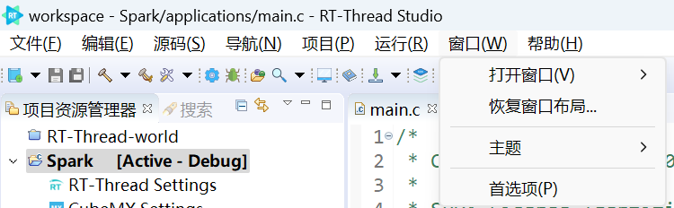

### 2. 更新软件包

- 勾选<mark>4.1.1</mark>版本：

  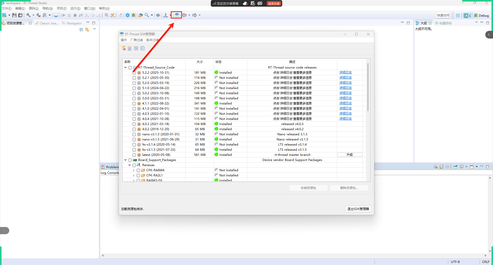

- 并勾选芯片包 STM32F4 系列的 0.2.4 最新版进行更新：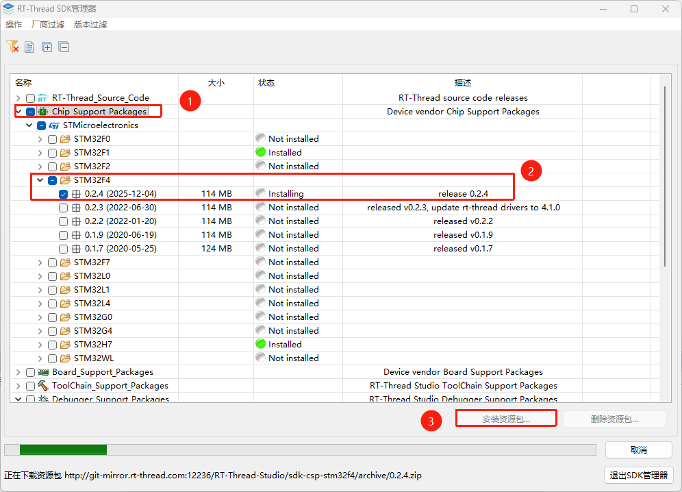

- 确认设备管理器识别到 **ST-Link 驱动**，确保硬件连接正常。

---

## 二、工程创建与运行

### task1：新建一个 qemu-a9 仿真工程，并运行 RT-Thread

1. 创建 rt-thread 仿真项目：

   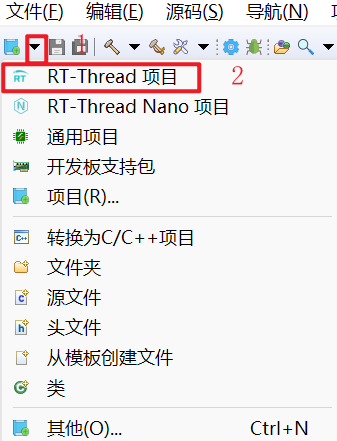

   或者

   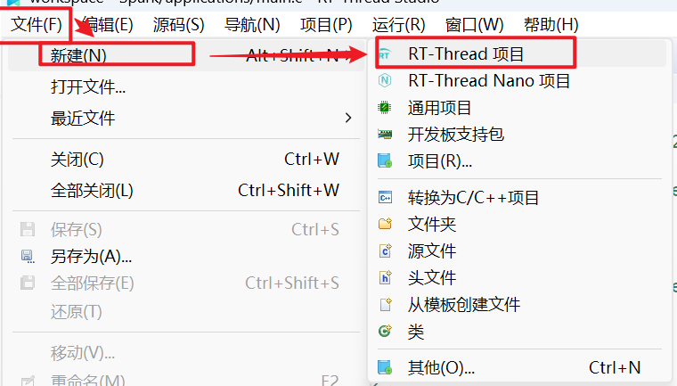

2. 选择项目基于开发板：

   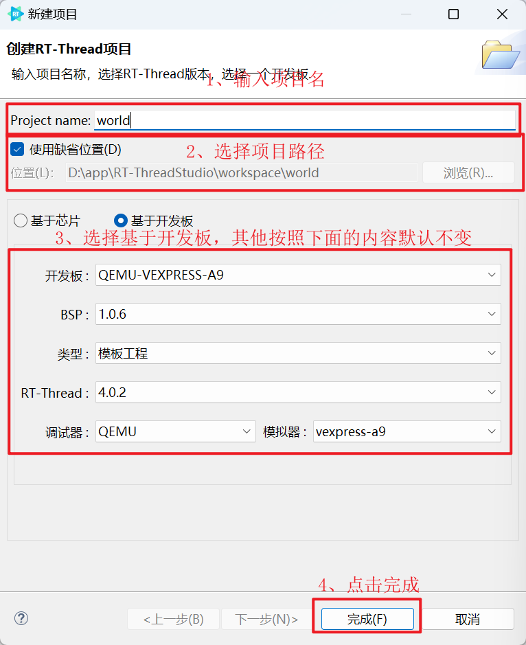

3. 打开 main.c：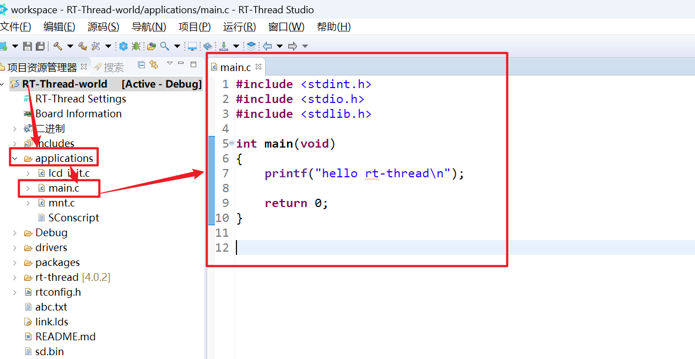

4. 点击编译，出现控制台的内容即可：

   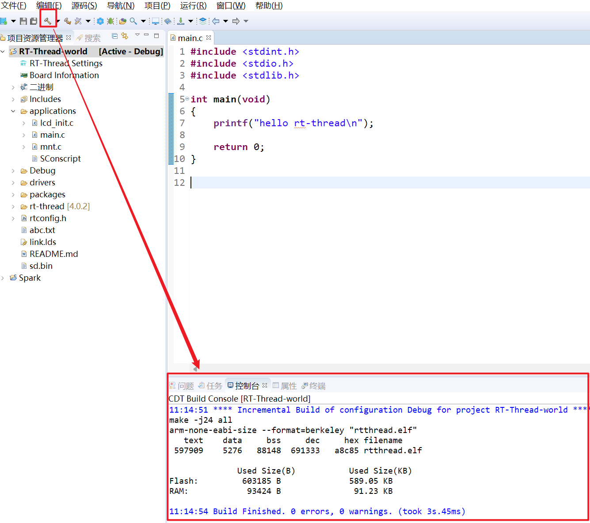

5. 完成编译后进行 debug 验证，终止 debug：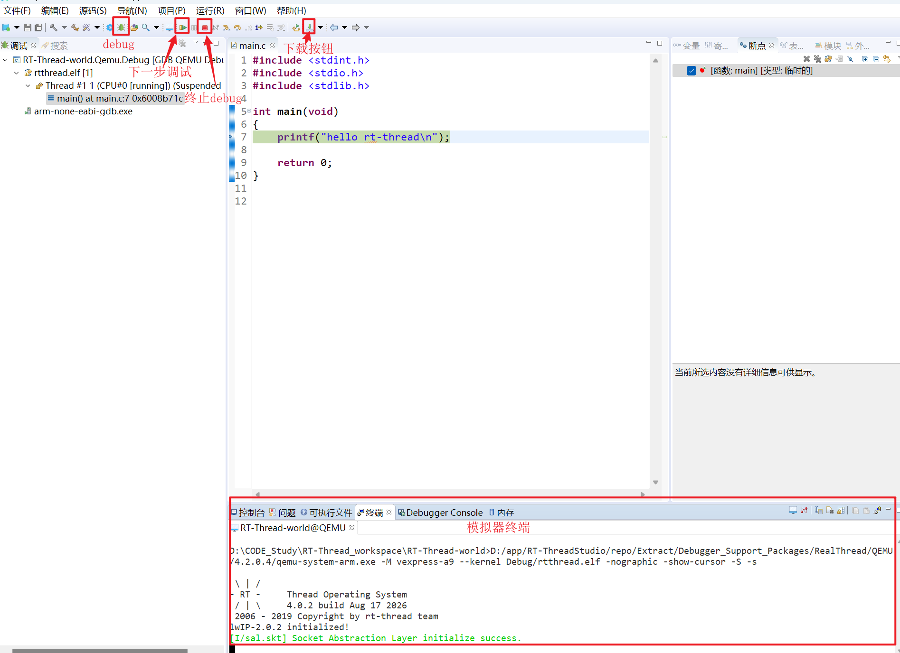

6. 点击下载按钮：终端输出hello rt-thread。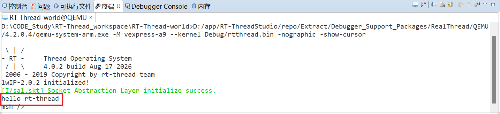

任务 1 仿真 RT-Thread 运行完成。

### task3：基于 RT-Thread 4.1.1 版本新建 stm32f407zg 芯片工程

1. 创建一个 RT-Thread 项目，输入项目名，<mark>**选择 RT-Thread 的版本为 4.1.1**</mark>，按照开发板的板载芯片选择内容进行创建：

   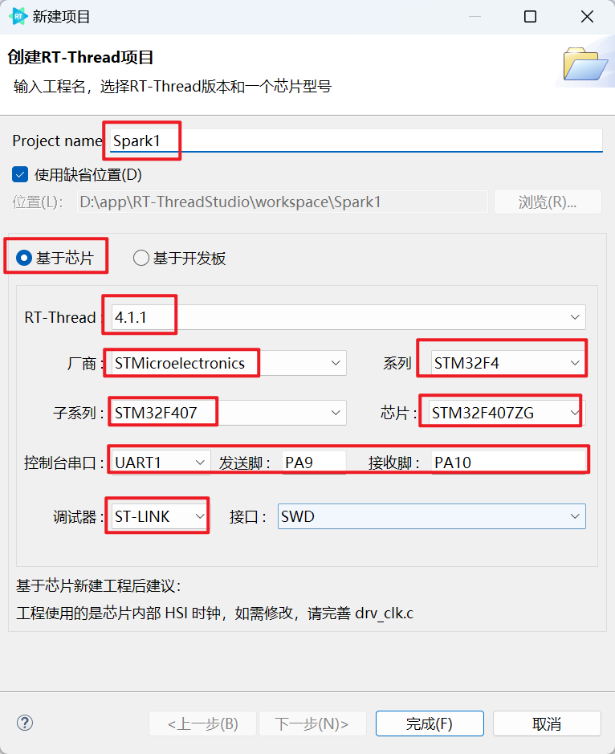

2. 打开 main.c 文件：

   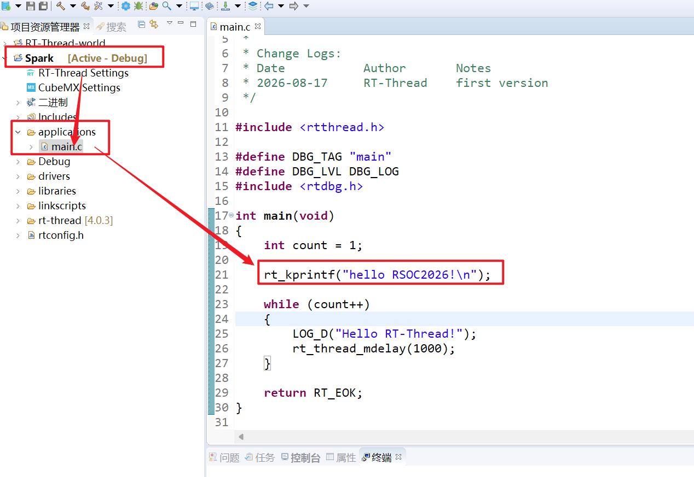

3. 在最后一个定义声明后输入代码：

```c
rt_kprintf("hello RSOC2026!\n");
```

4. 点击编译，控制台输出：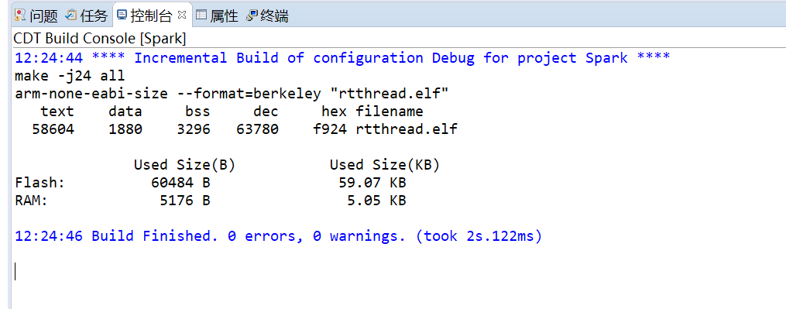
5. 用数据线连接板子 USB-DBG 接口，按下板子上的 PWR-ON 按键打开电源。
6. 点击下载，点击启动终端，串口选择查看设备管理器，查看STLink是哪个端口，选择对应端口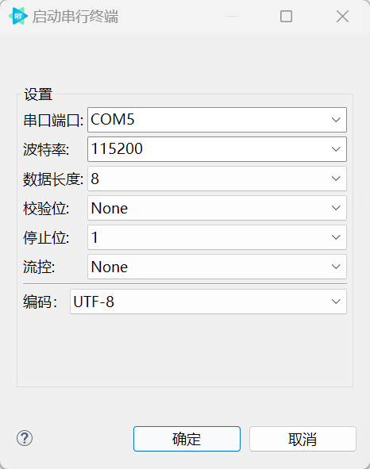
7. 确认自动打开终端查看串口发送信息：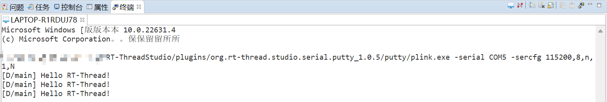

工程创建完成。此时在终端中输入 `ps` 并回车可以看到 msh（**Module Shell**）相关信息:

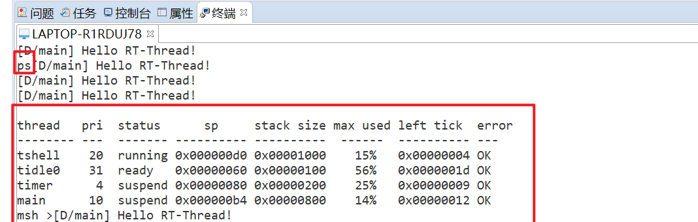

嵌入式工程的完整编译流程为：**编辑 → 编译 → 汇编 → 烧录（下载）**。

- **编辑**：编写源代码（如 main.c）。
- **编译**：将 C 源码编译为汇编代码，再汇编为机器码，最终链接生成 `.elf` 和 `.bin` 文件。
- **烧录**：通过 ST-Link 等工具将 `.bin` 文件下载至开发板 Flash。

### 断点调试的作用

- 在代码中设置**断点**后，程序运行到断点处会**暂停**，此时可以查看变量值、寄存器状态、调用栈等信息。
- 通过单步执行（Step Over / Step Into）逐行观察程序行为，帮助**定位逻辑错误**和**验证程序运行流程**。
- 调试完成后需**终止 debug**，再点击下载按钮将程序固化到开发板。

### RT-Thread 启动与线程调度理解

RT-Thread 系统启动过程中会完成硬件初始化、内核对象初始化和组件初始化等工作，随后启动调度器。线程创建后不会立即执行：

- 使用 `rt_thread_create()` 动态创建线程，或使用 `rt_thread_init()` 初始化静态线程；
- 在系统进入 `rt_thread_startup()` 后，线程进入就绪状态；
- 而调用 `rt_system_scheduler_start()` 后，调度器开始根据优先级和时间片调度就绪线程。

系统启动时的版本横幅由 `rt_show_version()` 输出。串口出现如下信息，说明程序已运行至 RT-Thread 的系统启动阶段：

```text
\ | /
- RT -     Thread Operating System
 / | \     4.1.1 build Aug 17 2026 11:02:01
 2006 - 2022 Copyright by RT-Thread team
```

---

#### 1. 系统启动流程

RT-Thread 系统从复位开始，依次完成硬件初始化、内核初始化和调度器启动，主要流程如下：

| 阶段         | 关键函数                    | 作用                             |
| ------------ | --------------------------- | -------------------------------- |
| 硬件初始化   | rt_hw_board_init()          | 初始化时钟、串口、内存等基础硬件 |
| 版本信息     | rt_show_version()           | 输出系统版本横幅                 |
| 定时器初始化 | rt_system_timer_init()      | 初始化系统定时器                 |
| 调度器初始化 | rt_system_scheduler_init()  | 初始化调度器数据结构             |
| 应用初始化   | rt_application_init()       | 创建 main 线程（应用入口）       |
| 空闲线程     | rt_thread_idle_init()       | 创建 idle 空闲线程               |
| 启动调度器   | rt_system_scheduler_start() | 启动调度器，开始调度就绪线程     |

#### 2. 线程创建与状态转换

线程创建有两种方式：

- rt_thread_create()：**动态创建**，从系统堆中自动分配线程控制块（TCB）和栈空间，使用简单，但需注意堆内存消耗；
- rt_thread_init()：**静态初始化**，由用户提供线程控制块和栈空间，不依赖堆，适合资源受限场景。

线程创建后不会立即执行，需经历状态转换：

```
初始态(INITIAL) → 就绪态(READY) → 运行态(RUNNING) → 挂起态(SUSPEND) → 关闭态(CLOSE)
```

- rt_thread_startup()：将线程从**初始态**转为**就绪态**，进入调度队列等待调度；
- rt_system_scheduler_start()：启动调度器后，调度器根据**优先级**和**时间片**调度就绪线程。

#### 3. 调度机制

- **优先级抢占式调度**：高优先级线程就绪时，立即抢占正在运行的低优先级线程；
- **时间片轮转**：同优先级的多个线程按时间片轮流执行，避免单个线程独占 CPU；
- **位图调度算法**：RT-Thread 使用位图方式快速查找当前最高优先级的就绪线程，调度效率高。

#### 4. main 线程与 idle 线程

- **main 线程**：应用入口线程，用户代码从 main() 开始执行，优先级较低；
- **idle 线程**：空闲线程，优先级最低，当系统无其他就绪线程时运行，负责回收被删除线程的资源。

#### 5. 启动验证

系统启动时的版本横幅由 rt_show_version() 输出。串口出现如下信息，说明程序已运行至 RT-Thread 的系统启动阶段：

```text
\ | /
- RT -     Thread Operating System
 / | \     4.1.1 build Aug 17 2026 11:02:01
 2006 - 2022 Copyright by RT-Thread team
```

## 三、Markdown 笔记规范

### task2：Markdown 语法学习

> 所有开头的符号都是英文符号。

#### 标题

- 一级标题：开头输入 `#` 加上一个空格，输入想要的标题，按下 Enter 即可。
- 二级标题：开头输入 `##` 加上一个空格，输入想要的标题，按下 Enter 即可。
- 三级标题：开头输入 `###` 加上一个空格，输入想要的标题，按下 Enter 即可。
- 几级标题几个 `#` 开头。

#### 代码段

- 用 ``` 开头加带语言类型，或者先输入三个反引号后续再选择代码语言。
- 段落中间写代码段可以输入两遍反引号再在中间输入内容就会自动生成代码段（不需要选择代码语言）。
- 反引号是英文输入法数字 1 左边的下的符号（就是打出波浪号 `~` 的那个键）。

**2 个反引号包括起来**：用于段落中间的**短代码**（行内代码），如段落中代码 `printf()`。

**3 个反引号 ```**：用于单独占一行的**大段代码**（代码块），例如：

```c
#include <stdio.h>

int main()
{
	return 0;
}
```

#### 表格

- **竖线 `|`**：相当于表格的**墙**，用来分隔每一列。
- **横线 `-`**：相当于表格的**地板**，用来把表头和下面的内容分开。

##### 1. 基础表格

只需要这样敲（注意：竖线之间要有空格）：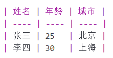

显示内容：

| 姓名 | 年龄 | 城市 |
| ---- | ---- | ---- |
| 张三 | 25   | 北京 |
| 李四 | 30   | 上海 |

敲完第一行表头，按一下回车，会自动补全第二行的 `| ---- |`。

| t1   | t2   |
| ---- | ---- |
| 1    | 2    |

##### 2. 表格文字对齐

如果想让某一列的文字靠左、居中或靠右，只需要在第二行的横线旁边加上**冒号 `:`**。

- **左对齐**：冒号在左边 `:---`（默认就是左对齐）
- **居中对齐**：冒号在两边 `:---:`
- **右对齐**：冒号在右边 `---:`

**敲代码：**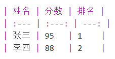

显示内容：

| 姓名 | 分数 | 排名 |
| :--- | :--: | ---: |
| 张三 |  95  |    1 |
| 李四 |  88  |    2 |

快捷键插入表格：Ctrl + T

#### 高亮语法

用 `` 包裹文字即可高亮文字，或者用 `<mark></mark>` 包裹文字，使得文字变成黄底；用 `<span style="background-color: #ffcccc; "></span>` 包裹文字，使得文字变成粉底。

- `高亮语法`
- <mark>高亮</mark>
- <span style="background-color: #ffcccc; ">高亮</span>

#### 加粗

使用两个 `**` 将文字包裹即可加粗文字，如 **加粗字体**。

#### 图片管理

- 建议将图片保存至 `./figures` 目录，防止项目迁移时资源丢失。

---

## 四、Git 基础操作与开源协作

### task4：Git 基础操作与开源协作

#### 1. 安装 Git 并新建仓库

- 下载 Git 程序和 tortoisegit 程序（可安装汉化包）进行安装。
- 安装完成后新建一个文件夹 `RT-Thread-summer-camp`，最好文件路径上全是英文。
- 注册一个 gitee 账号，新建一个仓库 `RT-Thread-summer-camp`：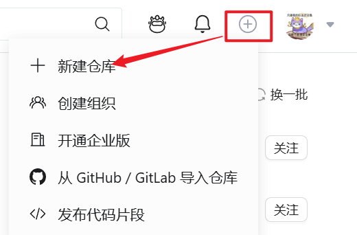
- 在仓库右上角点击克隆/下载按钮，在这个界面下复制第三行代码命令：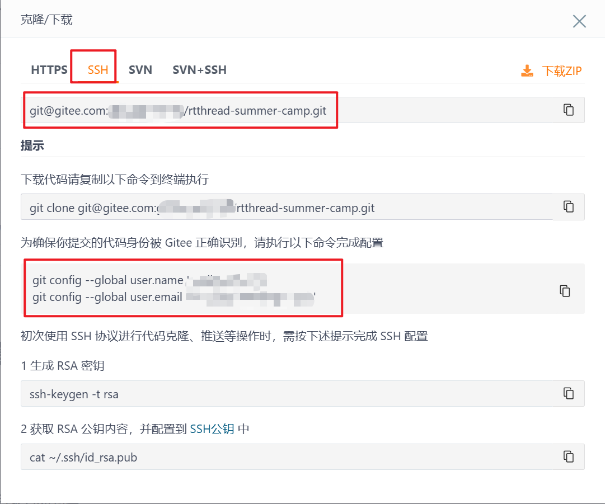
- 在之前新建的文件夹下右键鼠标选择 Open Git Bash here，进入 Git 终端：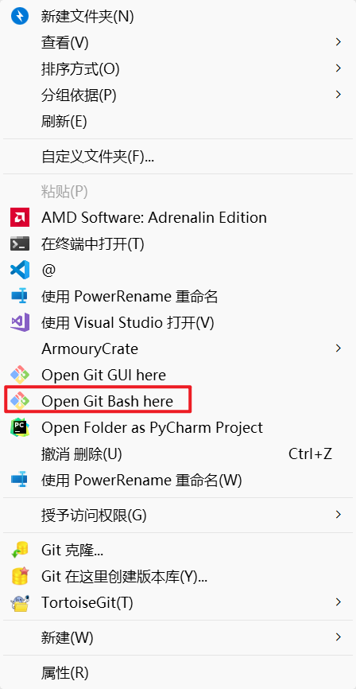

> **注意**：在 Git 终端里面复制粘贴内容不能用快捷键，要右键点击 Paste、Copy。下面所有出现 `your` 的相关内容都是需要填个人的信息。

#### 2. Git 信息配置

将这两行代码分两次输入进去并按下回车键：

```bash
git config --global user.name "your_name"
git config --global user.email "your_email@example.com"
```

- `--global` 表示全局配置，适用于所有仓库。
- 如果只想针对某个仓库设置，去掉 `--global` 即可。
- 可输入 `git config --list` 查看配置信息：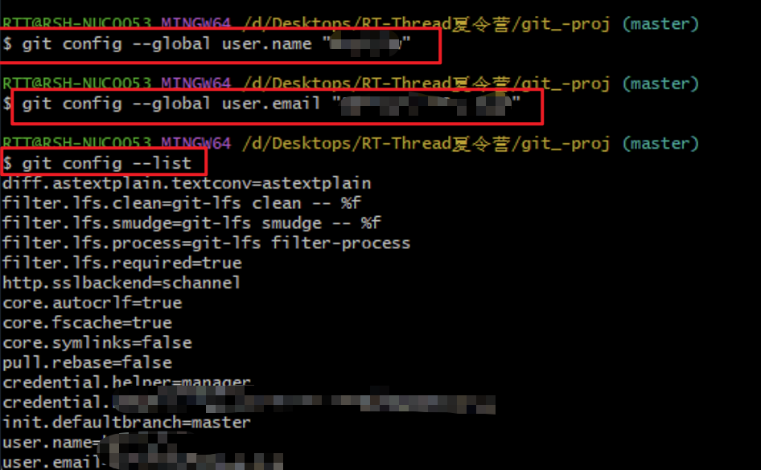

#### 3. 生成 SSH 公钥

在终端输入：

```bash
ssh-keygen -t rsa -b 4096 -C "your_email@example.com"
```

连续按回车键，出现问题时输入 `y` 或者 `yes` 等按回车即可，然后输入 `cat /c/Users/Your_User/.ssh/id_rsa.pub` 就生成密钥，复制该密钥，在 gitee 界面点击右上角的头像，选择设置，点击 SSH 公钥，添加公钥，输入名称，输入刚刚生成的公钥，点击保存：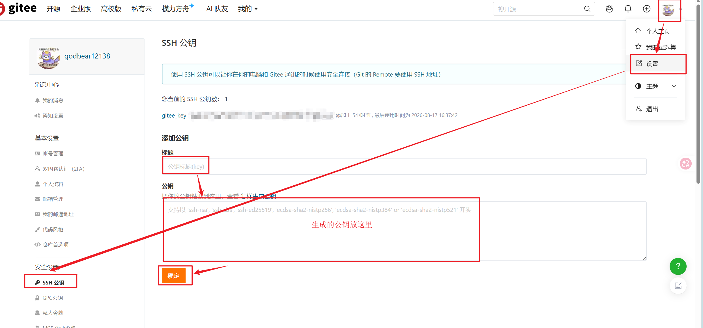

然后在终端输入 `ssh -T git@gitee.com` 按下回车，看见 successfully 代表密钥测试成功：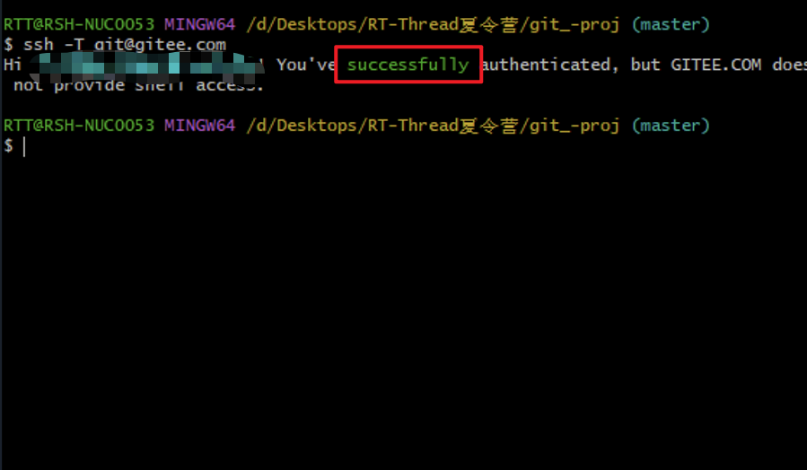

在之前获取 git 信息配置的界面获取 `git remote set-url origin git@gitee.com:your.git`（根据自己的修改）：设置当前 git 仓库 URL，将该代码输入到终端中。

#### 4. 基本 Git 命令

| 序号 | 命令                                 | 作用                                                         |
| ---- | ------------------------------------ | ------------------------------------------------------------ |
| 1    | `git init`                           | 初始化当前目录为 git 仓库                                    |
| 2    | `git pull origin master`             | 拉取远程 master 分支                                         |
| 3    | `git add file/path`                  | 添加 file/path 到 git 暂存区                                 |
| 4    | `git commit -m "message"`            | 本次 git 提交日志为 "message"                                |
| 5    | `git push origin master`             | 将本地 git 分支最新内容同步/推送到远端                       |
| 6    | `git fetch origin master`            | 只把远程的最新代码"下载"到本地的隐藏缓存区，但不会修改你当前正在写的文件 |
| 7    | `git remote -v`                      | 查看本地仓库连接到了哪个远程服务器（比如 Gitee、GitHub），以及连接的网址是什么 |
| 8    | `git checkout -b test`               | 基于当前分支切出一个名为 test 的新分支                       |
| 9    | `git switch branch_name`             | 切换分支                                                     |
| 10   | `git stash`                          | 保存修改。如果你正在开发功能，但突然需要切换分支修 bug，可以先暂存当前修改 |
| 11   | `git branch -d test`                 | 删除分支（`-d` 是 `--delete` 的缩写。如果分支还有没合并的代码，Git 会阻止你删除，防止代码丢失） |
| 12   | `git branch -D test`                 | 强制删除分支（大写的 `-D` 是强制删除，不管有没有合并都会直接删掉，**慎用**！） |
| 13   | `git push origin --delete first_day` | 删除远端仓库分支（执行后，去 Gitee 网页上刷新，就会发现那个分支不见了） |
| 14   | `git fetch -p`                       | 清理本地的远程分支缓存（`-p` 是 prune 的缩写，意思是修剪、清理过期的远程分支记录） |

> **补充**：git 暂存区代表你本地的 git 管理库，将指定的文件/文件夹加入 git 暂存库后，这些文件可以得到一个保护。
>
> **同步方向**：`git pull`：远端 -> 本地；`git push`：本地 -> 远端。
>
> 有时候你删了远程分支，但在本地用 `git branch -a` 查看时，发现远程分支还在（其实是个残留的影子），可用 `git fetch -p` 清理。

#### 5. 创建本地 git 仓库同步

1. 在终端中分别输入 `git init` 和 `git pull origin master` 将远端 master 仓库拉到本地；
2. 在文件夹下新建 README.md（如果没有的话），输入内容或者修改内容；
3. 输入 `git add README.md`，添加文件到本地仓库中；
4. 输入 `git commit -m "修改说明信息"` 进行暂存操作并提交修改说明；
5. 输入 `git push origin master` 将暂存的文件将本地 git 分支最新内容同步/推送到远端。

#### 6. 创建分支

1. 通过 `git checkout -b test` 或者 `git branch test` 命令创建一个名为 test 的分支，并自动跳转到分支 test；
2. 进行任何修改操作后，输入 `git status` 查看有无显示有红色或绿色文字，有代表存在修改；
3. 输入 `git add ./` 把**当前目录**下面的文件变化添加到 Git 的暂存区，准备提交；
4. 存在修改时，输入 `git commit -m "修改说明信息"` 进行暂存操作并提交修改说明；
5. 输入 `git push`，把暂存的内容推送到当前分支 test 命名相同的文字，如果没有远端这个分支则会报错，此时应该输入 `git push origin test`（意思：推送到名叫 `origin` 的仓库，分支名叫 `test`），或者 `git push -u origin test`（`-u` 意思是 upstream，设置上游关联，加上 `-u` 之后，Git 就记住了："本地的 `test` 对应远程的 `test`"），之后都可以直接使用 `git push`。

#### 7. 分支仓库同步与合并

1. `git branch`：查看本地的"版本列表"；`git branch -r`（查看远程分支）；`git branch -a`（查看所有分支：本地 + 远程），其中后面带 `remotes/origin/` 开头的，就是**远程仓库里实际存在的分支**。带 `*` 的表示本地仓库当前正停留的分支。
2. `git fetch origin master`：只把远程的最新代码"下载"到本地的隐藏缓存区，但不会修改你当前正在写的文件；`git pull origin main`：先下载远程最新代码，然后**自动尝试合并**到你当前的分支。如果多人同时修改了同一行代码，可能会产生冲突（Conflict）；`git pull --rebase origin main`：先下载远程最新代码，然后把你本地还没推送的提交"挪"到远程最新代码的后面。
3. `git merge test`：把 `test` 分支里的代码，合并到你"当前所在"的分支里；`git rebase first_day`：把我当前的分支，重新"嫁接"到 `first_day` 的最新状态后面。

| 特性         | `git merge`（合并）                            | `git rebase`（变基）                     |
| ------------ | ---------------------------------------------- | ---------------------------------------- |
| **历史记录** | 会产生一个新的"合并节点"，历史像树枝分叉又合拢 | 把你的提交"挪"到主干后面，历史像一条直线 |
| **适用场景** | 团队协作、保留完整的开发痕迹                   | 个人分支整理、强迫症想要干净的直线历史   |
| **风险**     | 低，比较安全                                   | 高，如果操作不当容易丢代码               |

**注意**：合并时进入了 **Vim 编辑器**，这是 Git 默认的文本编辑器。它正在让你确认这次合并（Merge）的说明信息。

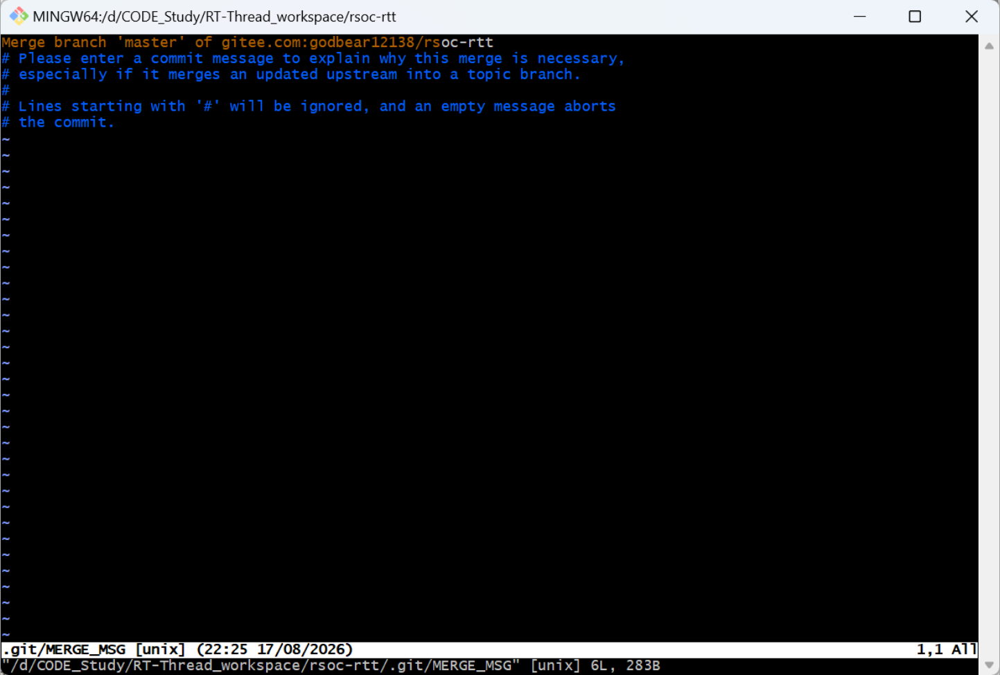

不需要修改任何内容，只需要**保存并退出**即可完成合并。请严格按照以下步骤操作（不要乱按其他键）：

**快速解决步骤（3步走）**

1. 按一下键盘左上角的 `Esc` 键。
   - *作用：确保你退出了编辑模式，回到了命令模式。（虽然看起来没变化，但这步很关键）*
2. 输入英文冒号 `:`。
   - *注意：必须是英文输入法下的冒号。此时你会看到光标跳到了屏幕的最左下角。*
3. 输入 `wq` 然后按 `回车键 (Enter)`。
   - *解释：`w` 代表 write (保存)，`q` 代表 quit (退出)。*

#### 8. 删除分支

1. 切换到主分支：`git checkout master`
2. 删除本地分支：`git branch -d test`
3. 删除远程分支：`git push origin --delete test`

#### 9. Fork 仓库

- fork 仓库是为了保证原有的 master 分支不变，只修改自己需要修改的那一部分代码。
- 选择要 fork 的仓库，点击右上方的 Fork 即可完成 fork：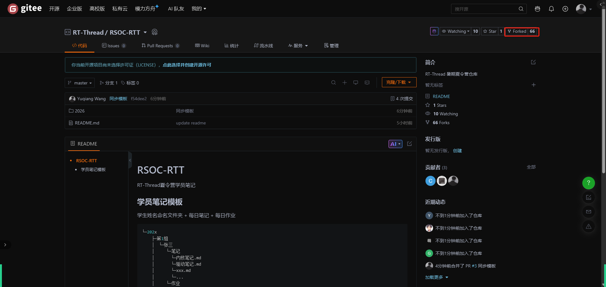

#### 10. 提交 PR

1. 在修改完成分支后切换到要合并的分支，在贡献代码下点击创建 PR：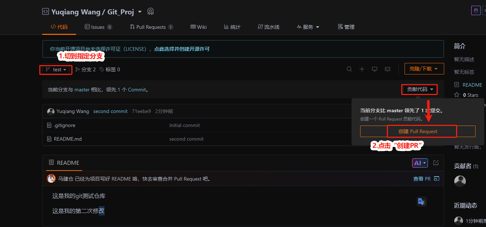
2. 选择源分支和要合并过去的分支，输入 PR 标题和 PR 信息，@需要审核的对象，创建 PR，等待审核和合并：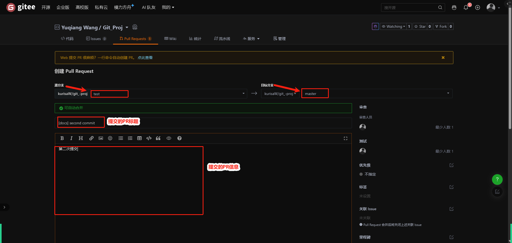

#### 11. 解决 Git 冲突

**注意**：fork 合并 PR 时可能会产生 git 冲突，原因如下：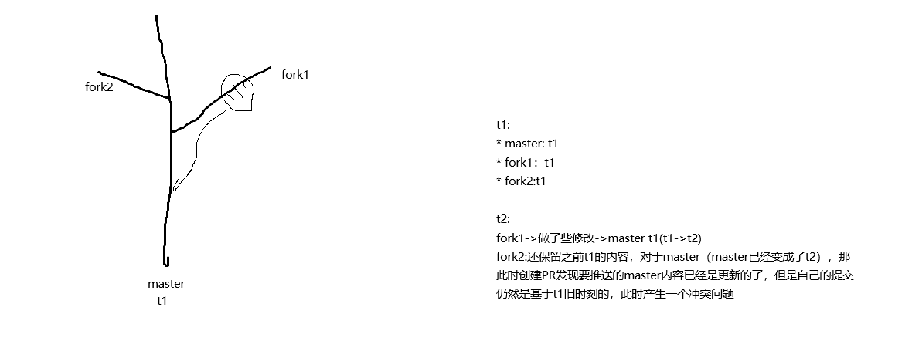

**冲突产生原因**：多个 fork 仓库基于不同时间点的主仓库内容进行修改，当主仓库已更新而自己的提交仍基于旧版本时，创建 PR 就会产生冲突。

**如何解决 git 冲突**：

1. fork repo：同步当前上游（在 fork 仓库页面点击"同步"按钮，将上游最新更改同步到自己的 fork）；
2. 切到产生冲突的分支，执行 `git merge` / `git rebase`，将最新远端的修改同步到产生冲突的分支；
3. 此时会让你解决冲突（自行选择旧的时间线还是新的时间线的修改）。

#### 12. 作业提交规范

- **目录结构**：在 fork 仓库中按 **"组别/学员姓名/日期"** 的层级创建目录，分别存放笔记和作业。
- **分支命名**：使用 `day1`、`day2` 等命名分支，避免覆盖模板文件，确保提交结构清晰。
- **PR 审核**：学员提交 PR 时需指定对应的小组长作为审查人员（Reviewer），审查通过后方可合并。
- **职责分工**：
  - **小组长**：拥有合并 PR 的权限，负责审核组员提交的代码结构、命名规范及内容质量。
  - **导师**：负责审核小组长的 PR，并处理跨组的复杂问题。
- **每日任务**：每天至少提交 2 个 PR（第一个用于初始化个人目录模板，第二个用于提交当天的作业与笔记内容）。

