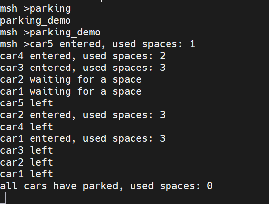
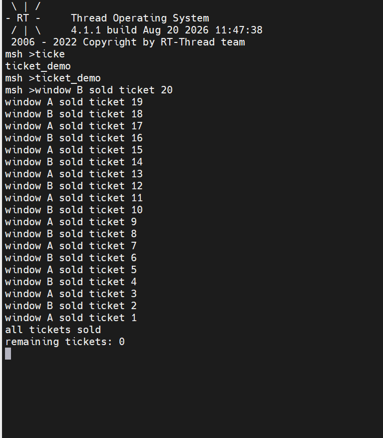
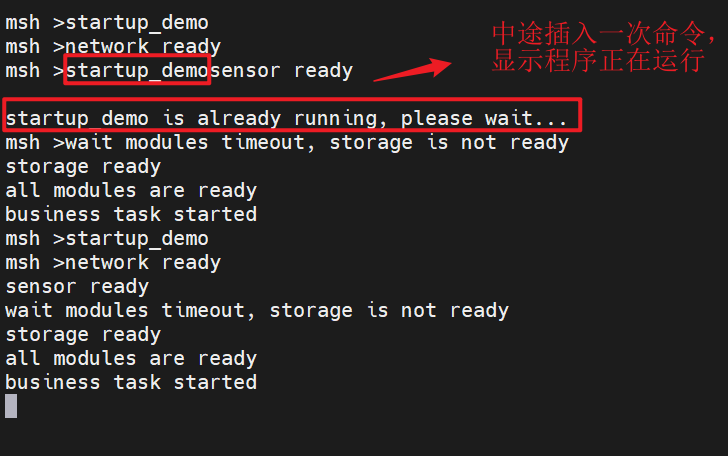
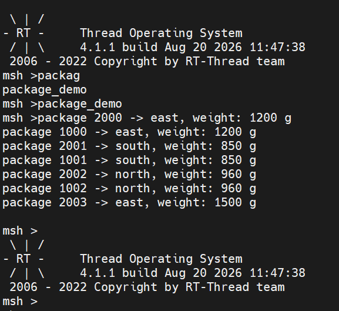
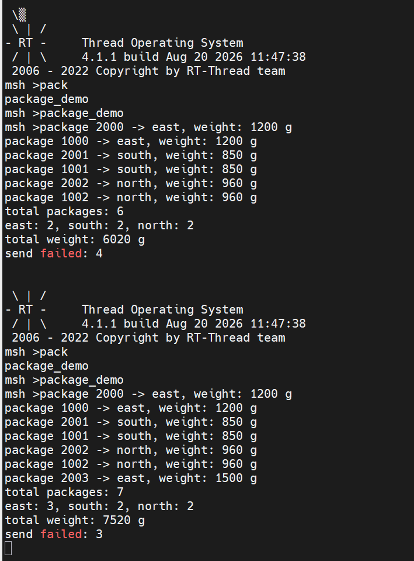

# RT-Thread 夏令营 Day3 学习记录

## 学习目标

**Day3 学习目标**：

1. 理解多线程同步与通信（IPC）的必要性，掌握临界区、阻塞/非阻塞、线程挂起等基础概念。
2. 掌握 RT-Thread 五大 IPC 机制：信号量、互斥量、事件集（线程同步）+ 消息邮箱、消息队列（线程间通信）的原理、控制块与核心 API。
3. 理解优先级反转现象及基于「优先级继承协议」的解决方案。
4. 完成 Day3 课后四项实战编程（停车场、售票、启动条件检查、快递分拣），将 IPC 理论落地到代码。

## 一、IPC 基础概念与总览

### 1. 为什么需要 IPC（线程间同步与通信）

经过前两天的学习，我们已经掌握环境搭建、芯片启动流程与 RT-Thread 启动流程。在实际的 RTOS 系统中会**频繁使用多线程编程**，而多个线程之间需要解决两类问题：

- **线程同步（Synchronization）**：多个线程访问同一共享资源或协调执行顺序，需要互斥与先后约束。
- **线程间通信（Communication）**：线程之间需要传递数据，如按键状态、传感器采样值、字符串消息等。

RT-Thread 提供的 IPC（Inter-Process Communication，进程间通信）机制正是解决这两类问题的工具。裸机编程中我们常靠**全局变量**在不同功能模块之间通信（一个功能改值、另一个功能读值），但这种方式在多线程下存在竞争风险，RT-Thread 提供了更完善、更安全的机制。

### 2. 基础概念：临界区、阻塞与非阻塞、线程挂起

#### 2.1 临界区（Critical Section）

**临界区**：一个资源在同一时间**只能被一个线程使用**，不能同时被多个线程占用，这样的资源区域称为临界区。

> 类比：一个房间里有一台饮水机、一套健身器材和一个厕所这三个资源，房间里有四位住户。这三个资源在同一时刻只能被一位住户使用，不能被多个人同时占用——这就是临界区的概念。

#### 2.2 阻塞与非阻塞

- **阻塞（Blocking）**：一个线程占用了临界区资源，此时其他线程想使用该资源就必须**等待**，这个等待现象称为线程的阻塞。
  > 类比：拿杯子去饮水机接水，必须站在饮水机前等水接完，期间不能干别的事。
- **非阻塞（Non-blocking）**：把杯子放到饮水机下面后自动装水，装满后会发出通知（如声音提示），等待期间可以去做其他事情。
  > 类比：放好杯子后自动装水，装完通知，期间可以自由活动。

#### 2.3 线程挂起（Suspend）

结合 Day2 学过的线程状态：**当一个线程被阻塞时，它会转入挂起（SUSPEND）状态**；直到阻塞解除之后，才会进入就绪（READY）状态，等待调度器调度运行。

### 3. IPC 机制总览

RT-Thread 的 IPC 机制分为两大类、共五种：

| 分类 | 机制 | 一句话用途 |
| --- | --- | --- |
| 线程同步 | 信号量（Semaphore） | 资源计数与线程同步，二值/计数两种形态 |
| 线程同步 | 互斥量（Mutex） | 临界区互斥访问，有所有权、可防优先级反转 |
| 线程同步 | 事件集（Event） | 一对多/多对多的事件组合同步（逻辑与/或） |
| 线程间通信 | 消息邮箱（Mailbox） | 传递固定 4 字节消息，开销低、效率高 |
| 线程间通信 | 消息队列（Message Queue） | 传递不定长消息，支持紧急消息插队 |

> 同步机制解决「谁先谁后、能不能用」的问题；通信机制解决「数据怎么传」的问题。

## 二、线程同步机制（一）：信号量与互斥量

### 1. 信号量（Semaphore）

#### 1.1 概念与分类

信号量是 RT-Thread 中最基础的同步工具，可以类比为**交通信号灯**：绿灯放行、红灯等待；也可以理解为裸机中的全局标志变量（flag），由 RTOS 内核统一管理。

信号量分为三类：

| 类型 | 取值 | 初始值 | 典型用途 |
| --- | --- | --- | --- |
| 二值信号量 | 0 / 1 | 通常为 0 | **同步**：一个线程完成任务后通知另一个线程 |
| 计数信号量 | 0 ~ N | 资源数量 N | **资源管理**：管理多个同类资源实例 |
| 互斥信号量 | — | — | 归入互斥量章节讲解（具有所有权） |

- **二值信号量用于同步**：初始值通常为 0，表示「事件尚未发生」。线程 A 完成某任务后释放（值 0→1），线程 B 获取到信号量（值 1→0）后被唤醒执行后续操作。
- **计数信号量用于资源管理**：初始值为资源数量（如 3 个车位 → 3）。线程获取信号量相当于占用一个资源（值 -1），释放相当于归还资源（值 +1）。

#### 1.2 信号量的工作原理（take / release）

- **获取信号量 `rt_sem_take()`**：当信号量值 > 0 时，获取成功并执行值 -1；当信号量值为 0 时无法获取，线程会根据 `timeout` 参数进行等待：
  - 若 `timeout = 10`（tick），则等待 10 个 tick，期间仍无法获取就返回超时错误；
  - 若 `timeout = 0`（无等待），获取不到立即返回超时，**不会阻塞线程**，继续执行后续逻辑。
- **释放信号量 `rt_sem_release()`**：信号量值 +1，并唤醒正在等待该信号量的线程，使其能够获取。

> **注意区分**：释放（`rt_sem_release`）与脱离（`rt_sem_detach`）不是一回事。释放是归还信号量资源；脱离是把通过 `rt_sem_init` 静态初始化的信号量对象从内核对象管理器中移除（相当于删除）。

#### 1.3 信号量控制块

信号量对象继承自 IPC 对象基类 `rt_ipc_object`，其主要结构如下：

```c
struct rt_semaphore
{
    struct rt_ipc_object parent;   /* 继承 IPC 基类：含等待队列 suspend_thread、自旋锁等 */
    rt_uint16_t value;             /* 信号量的当前计数值 */
};
```

- `parent`（`rt_ipc_object`）：包含挂起线程等待队列（存放因获取不到信号量而阻塞的线程链表）与用于保护的自旋锁；
- `value`：当前信号量计数值，体现剩余可用资源数量。

#### 1.4 信号量核心 API

| API | 作用 |
| --- | --- |
| `rt_sem_create(name, value, flag)` | **动态创建**信号量，返回句柄；失败返回 `RT_NULL` |
| `rt_sem_init(sem, name, value, flag)` | **静态初始化**信号量，对象与内存由用户提供 |
| `rt_sem_take(sem, time)` | 获取信号量，`time` 为等待超时（tick），`0` 表示不等待 |
| `rt_sem_trytake(sem)` | 无等待获取，等价于 `rt_sem_take(sem, 0)` |
| `rt_sem_release(sem)` | 释放信号量，值 +1，唤醒等待线程 |
| `rt_sem_delete(sem)` | 删除动态创建的信号量 |
| `rt_sem_detach(sem)` | 脱离静态初始化的信号量 |

**`flag` 参数的选择**（信号量/互斥量/事件集/邮箱/队列通用）：

| flag 取值 | 含义 |
| --- | --- |
| `RT_IPC_FLAG_FIFO` | 先进先出等待：按阻塞先后顺序唤醒 |
| `RT_IPC_FLAG_PRIO` | 优先级等待：按线程优先级高低唤醒 |

> 课程强调：在**实时性要求高**的场景下，应优先选择**优先级等待（PRIO）**模式，保证高优先级线程先获得资源。

#### 1.5 演示示例（信号量线程同步）

课程在 ART-Pi Studio 中演示了信号量示例的完整流程：

1. **创建工程**：基于芯片创建工程，RT-Thread 版本选择 4.1.1，芯片选择 STM32F4 系列（星火一号为 F407ZEG），调试器选择 ST-Link。
2. **添加软件包**：通过 settings 配置工具添加官方**内核示例软件包（kernel_samples）**，输入关键词搜索并添加。
3. **开启示例**：在内核示例中开启信号量示例。
4. **分析代码逻辑**：示例中线程一循环计数并**释放信号量**，线程二**等待信号量**后执行 LED 点亮/熄灭操作，实现两个线程之间的**同步**——线程一通知，线程二响应。

> 该示例体现的是「二值信号量做同步」的典型用法：释放方与获取方互相配合，形成「生产-消费」式的事件通知关系。

### 2. 实战编程一：停车场车位管理（计数信号量）

> 对应作业 `parking_demo.c`，MSH 命令：`parking_demo`

#### 2.1 实验要求

1. 创建一个**初始值为 3 的计数信号量**，表示剩余车位；
2. 创建 5 个车辆线程；
3. 每辆车到达后申请一个车位；
4. 获得车位后打印车辆编号和进入信息；
5. 车辆停留一段时间后离开，并释放车位；
6. 未在 2 秒内获得车位的车辆打印等待超时信息，稍后重新申请；
7. 任意时刻进入停车场的车辆数不能超过 3。

#### 2.2 核心代码解析（要点提炼）

```c
static rt_sem_t park_sem = RT_NULL;            /* 计数信号量，初始值 3 */
static volatile rt_uint32_t park_entered = 0;  /* 当前在场车辆数 */
static volatile rt_uint8_t park_running = 0;   /* 运行标志，支持 MSH 重复执行 */

park_sem = rt_sem_create("park_sem", 3, RT_IPC_FLAG_PRIO);   /* 创建初始值=3 的计数信号量 */

static void car_entry(void *param)
{
    while (1)
    {
        /* 申请车位：2 秒超时，取不到则打印等待并延时 100ms 重新申请 */
        if (rt_sem_take(park_sem, rt_tick_from_millisecond(2000)) != RT_EOK)
        {
            rt_kprintf("car%d waiting for a space\n", no);
            rt_thread_mdelay(rt_tick_from_millisecond(100));
            continue;
        }
        rt_enter_critical();                      /* 进入临界区保护共享计数 */
        park_entered++;
        rt_exit_critical();
        rt_kprintf("car%d entered, used spaces: %d\n", no, park_entered);
        rt_thread_mdelay(rt_tick_from_millisecond(2500));  /* 停留 2.5s */
        rt_enter_critical();
        park_entered--;
        rt_exit_critical();
        rt_kprintf("car%d left\n", no);
        rt_sem_release(park_sem);                 /* 离开后释放车位 */
        break;
    }
    /* 全部离场后：删除信号量、复位标志，使命令可重复执行 */
}
```

代码要点：

- **`rt_sem_create` 初始值 3**：计数信号量天然限制「最多 3 辆车同时在停车场」，即使 5 个线程并发申请，`rt_sem_take` 也只会让 3 个成功；
- **超时重试**：`rt_sem_take(park_sem, 2000ms)` 取不到信号量时返回非 `RT_EOK`，车辆打印等待信息后 `mdelay(100ms)` 再进入 while 循环重新申请，而非直接退出；
- **临界区保护共享计数**：`park_entered` 是跨线程共享变量，用 `rt_enter_critical/rt_exit_critical`（全局关中断）保护自加/自减，避免并发竞争；
- **重复执行设计**：所有车辆线程结束后（`park_finished == park_created`）删除信号量并复位运行标志，保证再次执行 `parking_demo` 不会因同名 IPC 对象残留而出错。

#### 2.3 实验结果与现象



- 前 3 辆车（car1/car2/car3）立即获得车位进入，`used spaces` 依次为 1/2/3；
- 第 4、5 辆车因车位已满，打印 `car4 waiting for a space` 等等待信息；
- 有车离开释放车位后，等待中的车辆重新申请成功进入，`used spaces` 始终 ≤ 3；
- 计数信号量保证了「任意时刻进入停车场的车辆数不超过 3」的资源上限约束。

#### 2.4 思考题解答：为什么用计数信号量而不是互斥量？

> 计数信号量表示「可用的同类资源数量」（这里是 3 个车位），允许多个线程**同时占用**、数量受控——3 辆车可以同时在停车场内；而互斥量本质是二值的「排他锁」，同一时刻**只允许一个线程**访问临界区，无法表达"允许 3 个并行"的资源池语义。管理「多个可并行使用的资源实例」正是计数信号量的典型场景，互斥量则适用于"同一时刻只能一人使用"的互斥访问。

### 3. 互斥量（Mutex）

#### 3.1 概念与特性

互斥量可以理解为一种**特殊的二值信号量**，但比信号量多出三个重要特性：

| 特性 | 说明 |
| --- | --- |
| **所有权（Ownership）** | 只有**持有互斥量（拥有所有权）的线程**才能释放它，其他线程不能越权释放 |
| **递归访问（Recursive）** | 同一线程可以重复获取同一互斥量（内部计数 `hold` 递增），不会造成自我死锁 |
| **防止优先级反转** | 基于优先级继承协议，避免高优先级线程被无关的中优先级线程间接阻塞 |

> 类比：互斥量就像一把带钥匙的门锁（如停车场门禁）——只有拿着钥匙（所有权）的人才能开锁/闭锁；一个人可以反复进出（递归），但别人无法替他锁门。

#### 3.2 优先级反转与优先级继承协议

**优先级反转现象**（经典三线程场景）：

1. 线程 C（低优先级）先获得互斥量 M，正在执行；
2. 线程 A（高优先级）到来，尝试获取 M 失败，被阻塞等待；
3. 此时线程 B（中优先级）就绪，因为 B 优先级高于 C，**B 抢占 CPU 运行**；
4. 由于 C 被 B 抢占，迟迟无法执行完并释放 M，导致高优先级的 A 被中优先级的 B **间接阻塞**——这就是「优先级反转」。

**解决方案：优先级继承协议**：

- 当高优先级线程 A 尝试获取线程 C 持有的互斥量 M 时，内核会**临时把 C 的优先级提升到与 A 同级**；
- 此时 C 的优先级高于 B，B **无法抢占 C**，C 得以继续运行并释放 M；
- C 释放 M 后，A 获得 M 继续执行；A 执行完后，B 才正常运行。这样 B 就无法"插队"抢占 A 的资源。

**使用互斥量的注意事项**：

1. 获得互斥量后，**持有时间必须尽可能短**，不能长时间占用（避免阻塞其他线程太久）；
2. 持有互斥量期间**不得更改线程优先级**，否则可能人为引入无界的优先级反转问题。

#### 3.3 互斥量控制块

```c
struct rt_mutex
{
    struct rt_ipc_object parent;      /* 继承 IPC 基类 */
    rt_uint16_t value;                /* 互斥量值（开锁/闭锁状态） */
    rt_uint8_t original_priority;     /* 持有线程的原始优先级（用于优先级继承后恢复） */
    rt_uint8_t hold;                  /* 持有次数（支持递归获取） */
    struct rt_thread *owner;          /* 当前持有互斥量的线程 */
    rt_list_t taken_list;             /* 该线程持有的对象链表 */
};
```

关键成员说明：

- **`owner`**：当前持有互斥量的线程，体现所有权属性；
- **`hold`**：持有次数，体现递归访问特性（同线程多次 take 时递增）；
- **`original_priority` / 优先级相关成员**：用于实现优先级继承——临时提升后需记录原始优先级以便恢复；
- **等待队列**：存放等待获取互斥量的线程（按优先级排序，保证实时性）；
- **自旋锁**：并发环境下保护互斥量对象内部成员。

#### 3.4 互斥量核心 API

| API | 作用 |
| --- | --- |
| `rt_mutex_create(name, flag)` | **动态创建**互斥量 |
| `rt_mutex_init(mutex, name, flag)` | **静态初始化**互斥量 |
| `rt_mutex_take(mutex, time)` | 获取互斥量（带超时） |
| `rt_mutex_trytake(mutex)` | 无等待获取互斥量 |
| `rt_mutex_release(mutex)` | 释放互斥量（**仅持有者可释放**），开锁并使持有线程失去控制权 |
| `rt_mutex_delete(mutex)` / `rt_mutex_detach(mutex)` | 删除动态 / 脱离静态互斥量 |

> 课程强调：互斥量的 `flag` 无论填「先进先出」还是「优先级等待」，**内核都会按优先级等待方式处理**，因为互斥量必须保证系统实时性（配合优先级继承）。

#### 3.5 演示示例（临界区数据保护）

课程在软件包中打开互斥量示例：

- 示例有两个线程，线程一、线程二分别对 `number1` 和 `number2` 两个变量执行加 1；
- 通过互斥量保护，保证两个 number 的值**保持同步一致**；
- 在调试模式下对比了**有无互斥量保护**时 `number1` 与 `number2` 的数值变化：不加互斥量时，两个线程同时读写共享数据会出现数值错乱；加上互斥量后，临界区的读写被串行化，数值始终保持一致。直观展示了互斥量对临界区数据的保护作用。

### 4. 实战编程二：多窗口售票系统（互斥量）

> 对应作业 `ticket_demo.c`，MSH 命令：`ticket_demo`

#### 4.1 实验要求

1. 创建两个售票线程，分别代表窗口 A 和窗口 B；
2. 使用一个全局变量保存剩余票数；
3. 每个窗口循环完成：检查是否还有余票 → 将余票减 1 → 记录售出的票号 → 打印售票结果；
4. 使用互斥量保护完整的售票过程；
5. 售完后两个线程自动退出；
6. 最终必须满足：20 张票全部售出、不出现相同票号、剩余票数不能小于 0；
7. 对比实验：先不加互斥量并在「读取余票」与「修改余票」之间加延时，观察重复售票/余票错误。

#### 4.2 核心代码解析（要点提炼）

```c
static rt_mutex_t ticket_mutex = RT_NULL;
static volatile rt_int32_t ticket_count = 20;    /* 全局余票 */

ticket_mutex = rt_mutex_create("tk_mutex", RT_IPC_FLAG_PRIO);

static void window_entry(void *param)
{
    while (1)
    {
        rt_mutex_take(ticket_mutex, RT_WAITING_FOREVER);  /* 加锁：进入临界区 */
        if (ticket_count <= 0)                            /* 检查余票 */
        {
            rt_mutex_release(ticket_mutex);               /* 无票则解锁退出 */
            break;
        }
        int no = ticket_count;                            /* 记录票号（=当前余票） */
        ticket_count--;                                   /* 余票减 1 */
        rt_mutex_release(ticket_mutex);                   /* 解锁：离开临界区 */
        rt_kprintf("window %s sold ticket %d\n", name, no);
        rt_thread_mdelay(rt_tick_from_millisecond(20));   /* 让出 CPU */
    }
    /* 两窗口都结束后：删除互斥量、复位标志 */
}
```

代码要点：

- **互斥量保护完整临界区**：`take → 检查余票 → 记录票号 → 减 1 → release` 是一个不可分割的整体，任意时刻只有一个窗口能执行这一段，因此票号不会重复、余票不会为负；
- **票号取自当前余票**：在锁内先把 `ticket_count` 存为 `no` 再自减，保证每张票号唯一、递减输出（20 → 1）；
- **无锁时的问题**：若不加互斥量，两个窗口可能在「检查余票」和「减 1」之间被打断——A 读到余票 1 后切走，B 也读到余票 1，两人都卖 1 号票，出现**重复票号**；若在「读」与「改」之间加延时，这个竞争窗口被放大，问题更明显；
- **重复执行设计**：两个窗口线程均退出后删除互斥量并复位标志，`ticket_demo` 可重复执行。

#### 4.3 实验结果与现象



- **有互斥量**：输出严格递减且不重复（`window A sold ticket 20` / `window B sold ticket 19` / …），最终打印 `all tickets sold`、`remaining tickets: 0`，20 张票全部售出；
- **对比实验（无互斥量 + 读改间延时）**：出现**重复票号**（同一票号被两个窗口售出）或余票计数错误，验证了临界区不加锁的竞争问题；
- **结论**：互斥量把「读-改-写」多步操作串行化，是保证共享数据一致性的关键。

#### 4.4 思考题解答：为什么只给 `ticket_count--` 加锁仍可能不安全？

> 售票流程是「检查余票 → 记录票号 → 减 1」的**多步操作**，即使只对减 1 加锁，在「检查是否还有余票」和「修改余票」之间仍然存在竞争窗口：两个窗口可能同时读到余票为 1，都判定"有余票"，各自卖出一张重复票号。安全的关键在于**用互斥量保护从检查到修改的完整临界区**（读-改-写作为一个原子整体），而不是只锁住其中单个语句。

## 三、线程同步机制（二）：事件集（Event）

### 1. 事件集的概念与特点

事件集用于实现**一对多、多对多**的线程同步：一个线程等待多个事件，或多个线程等待多个事件。一个事件集可以包含多种事件。

> 类比：公交站等车有三种场景——
>
> 1. 去某地只有**一种公交**能到，等到这班公交就能出发（**特定事件**唤醒线程）；
> 2. 去某地有**三种公交**都能到，等到**任意一辆**即可出发（**任意事件**唤醒线程）；
> 3. 与同伴 p2 约好一起去，必须**公交到达且同伴也到达**，两个条件都满足才能出发（**多个事件同时发生**才唤醒线程）。

**事件集的实现方式**：用**一个 32 位无符号整型变量**表示事件集合，**每一位（bit）代表一个事件**；线程通过**逻辑与 / 逻辑或**将一个或多个事件关联成组合。

**事件集的特点**：

| 特点 | 说明 |
| --- | --- |
| 位映射 | 32 位无符号整型记录事件，每 bit 一个事件，每个线程最多拥有 32 个事件标志 |
| 只用于同步 | 事件仅用于**同步**，**不提供数据传输**功能 |
| 无排队性 | 多次向线程发送同一事件，若线程未读取，效果等同于只发生一次（如发两次事件2 ≈ 发一次事件2） |
| 事件独立 | 事件与线程相关，事件与事件之间相互独立 |

### 2. 逻辑与 / 逻辑或 / 清除标记

线程在接收事件时，通过 `opt` 参数组合以下三种属性：

| 属性 | 宏定义 | 含义 |
| --- | --- | --- |
| 逻辑或 | `RT_EVENT_FLAG_OR` | 多个事件中**任意一个**发生即可唤醒线程 |
| 逻辑与 | `RT_EVENT_FLAG_AND` | 多个事件**全部发生**才唤醒线程 |
| 清除标记 | `RT_EVENT_FLAG_CLEAR` | 事件被接收后，将对应的 1 位**清零**（类似读取即清除） |

> 对应公交站场景：逻辑或 = "任意一辆公交到站就走"；逻辑与 = "公交和同伴都到了才走"；清除标记 = "事件处理完后把标志位清零"。

### 3. 事件集控制块与核心 API

**控制块**：继承 IPC 对象基类，增加事件集合成员 `set`（32 位无符号整型，记录 32 个事件的标记），并用自旋锁保护内部成员。

```c
struct rt_event
{
    struct rt_ipc_object parent;   /* 继承 IPC 基类 */
    rt_uint32_t set;               /* 事件集合：每 bit 代表一个事件 */
};
```

**核心 API**：

| API | 作用 |
| --- | --- |
| `rt_event_create(name, flag)` | **动态创建**事件集 |
| `rt_event_init(event, name, flag)` | **静态初始化**事件集 |
| `rt_event_send(event, set)` | 发送事件（将 `set` 中的位置 1），可唤醒匹配的等待线程 |
| `rt_event_recv(event, set, opt, timeout, recved)` | 接收事件：按 `opt`（AND/OR/CLEAR）匹配，`recved` 输出实际收到的事件 |
| `rt_event_delete(event)` / `rt_event_detach(event)` | 删除动态 / 脱离静态事件集 |

- `flag` 同样可取值 `RT_IPC_FLAG_FIFO` 或 `RT_IPC_FLAG_PRIO`；
- `rt_event_recv` 中 `timeout` 为等待超时，超时后若事件未满足则返回超时错误。

### 4. 演示示例（逻辑或 + 逻辑与）

课程演示了事件集的典型执行流程：

- **线程一**：第一次以**逻辑或**模式等待事件 3 或事件 5（任一发生即唤醒）；随后第二次以**逻辑与**模式等待事件 3 和事件 5 同时发生；
- **线程二**：依次发送事件 3、事件 5；
- 运行现象：
  - 第一次等待时，线程二只要发出事件 3（或 5），线程一即被唤醒（**逻辑或：任意一个即可**）；
  - 第二次等待时，必须事件 3 和事件 5 **都**被发出，线程一才会被唤醒（**逻辑与：全部满足才唤醒**）。

> 结论：接收时靠 `opt` 标志位区分——逻辑或只要任一事件发生即可唤醒；逻辑与必须所有关联事件全部发生才会唤醒。

### 5. 实战编程三：系统启动条件检查（事件集）

> 对应作业 `startup_demo.c`，MSH 命令：`startup_demo`

#### 5.1 实验要求

设备启动前需要完成三个独立模块初始化（网络、传感器、存储），只有三个模块全部准备完成，主业务线程才能启动。

1. 定义三个事件位：`EVENT_NET_READY (1U<<0)`、`EVENT_SENSOR_READY (1U<<1)`、`EVENT_STORAGE_READY (1U<<2)`；
2. 创建三个初始化线程，各自经过不同时间的延时后发送对应的就绪事件；
3. 主业务线程必须用 **AND 模式**等待三个事件全部到达，然后打印 `all modules are ready` / `business task started`；
4. **超时测试**：存储模块初始化设为 5 秒，主业务线程最多等待 3 秒；超时后打印尚未完成的模块，并再次等待。

#### 5.2 核心代码解析（要点提炼）

```c
#define EVENT_NET_READY        (1U << 0)
#define EVENT_SENSOR_READY     (1U << 1)
#define EVENT_STORAGE_READY    (1U << 2)
#define EVENT_ALL              (EVENT_NET_READY | EVENT_SENSOR_READY | EVENT_STORAGE_READY)

static rt_event_t startup_evt = RT_NULL;
static volatile rt_uint32_t ready_flags = 0;   /* 各模块就绪状态位，用于超时诊断 */

/* 三个初始化线程：延时后置位 ready_flags 并 rt_event_send 对应事件 */
static void net_init_entry(void *param)
{
    rt_thread_mdelay(rt_tick_from_millisecond(1000));   /* 网络 1 秒就绪 */
    ready_flags |= EVENT_NET_READY;
    rt_event_send(startup_evt, EVENT_NET_READY);
    rt_kprintf("network ready\n");
}
/* sensor_init_entry：2 秒；storage_init_entry：5 秒（触发超时） */

static void business_entry(void *param)
{
    while (1)
    {
        /* AND + CLEAR：三个事件全部到达才唤醒，唤醒后清除事件位 */
        rt_err_t res = rt_event_recv(startup_evt, EVENT_ALL,
                                     RT_EVENT_FLAG_AND | RT_EVENT_FLAG_CLEAR,
                                     rt_tick_from_millisecond(3000), RT_NULL);
        if (res == RT_EOK)
        {
            rt_kprintf("all modules are ready\n");
            rt_kprintf("business task started\n");
            break;
        }
        /* 3 秒超时：逐个检查 ready_flags，打印尚未完成的模块，再次等待 */
        if (!(ready_flags & EVENT_NET_READY))
            rt_kprintf("wait modules timeout, network is not ready\n");
        if (!(ready_flags & EVENT_SENSOR_READY))
            rt_kprintf("wait modules timeout, sensor is not ready\n");
        if (!(ready_flags & EVENT_STORAGE_READY))
            rt_kprintf("wait modules timeout, storage is not ready\n");
    }
    /* 清理：等初始化线程结束后删除事件集、复位标志 */
}
```

代码要点：

- **位定义**：三个模块各占一个事件位，`EVENT_ALL` 组合成"全部就绪"的掩码；
- **发送**：每个初始化线程 `mdelay` 模拟初始化耗时后，置位 `ready_flags` 并 `rt_event_send` 发送对应事件；
- **AND + CLEAR 接收**：`rt_event_recv(startup_evt, EVENT_ALL, RT_EVENT_FLAG_AND | RT_EVENT_FLAG_CLEAR, 3000ms)` 表示"三个事件全部到位才唤醒，唤醒后清除标志位"；3 秒超时返回非 `RT_EOK`；
- **超时诊断**：超时后利用 `ready_flags`（普通变量记录就绪状态）逐个判断哪个模块未就绪并打印——这里 `ready_flags` 是为了输出"尚未完成的模块"而额外维护的镜像，`rt_event_recv` 本身不提供逐个查询；
- **重复执行设计**：主业务线程退出后延时 100ms 等待初始化线程全部结束，再删除事件集并复位标志。

#### 5.3 实验结果与现象



- 网络（1s）、传感器（2s）先就绪，打印 `network ready` / `sensor ready`；
- 存储模块需 5 秒，主业务线程 3 秒超时，打印 `wait modules timeout, storage is not ready`，随后再次进入等待；
- 存储 5 秒就绪后打印 `storage ready`，三个事件全部到位，主业务线程被唤醒，打印 `all modules are ready` / `business task started`；
- 验证了事件集 **AND 模式 + 超时重试**在"多条件聚合判断"场景下的有效性。

#### 5.4 思考题解答：用三个独立信号量实现 vs 使用事件集的区别？

> 事件集可以**一次等待、批量检查多个事件**，并直接用 AND 逻辑表达"全部就绪"的聚合条件，唤醒条件是"事件集合"而非单个计数；若用三个独立信号量，主线程要么嵌套等待多次、要么难以在一个等待中同时判断三个条件，逻辑更繁琐、表达能力更弱。此外事件集的**无排队性**（重复发送等同一次）也天然契合"就绪状态"这类只关心"是否发生"的同步语义。事件集天然适合"多条件聚合判断"的同步场景。

## 四、线程间通信机制：消息邮箱与消息队列

### 1. 消息邮箱（Mailbox）

#### 1.1 概念与特点

裸机编程中常用全局变量在不同功能之间通信（一方改值、一方读值）；在 RT-Thread 中，**消息邮箱**是线程间传递消息的轻量级工具。

> 场景类比：线程一检测按键状态，将按键状态作为**邮件**发送到邮箱；线程二从邮箱读取邮件，根据按键状态控制 LED 亮灭。线程一也可以扩展为多个发送方：如三个线程分别发送按键状态、ADC 采样信息、传感器数据到邮箱，LCD 显示线程统一从邮箱获取并显示。

**特点**：

| 特点 | 说明 |
| --- | --- |
| 固定 4 字节 | 每封邮件固定容纳 **4 字节**（32 位系统中一个指针的大小），可存放指针或整型数据 |
| 开销低、效率高 | 相比队列更轻量，适合高频小数据传递 |
| 发送非阻塞 | 发送通常**非阻塞**，可安全用于**中断服务程序 / 定时器**向线程发送消息 |
| 接收可阻塞 | 接收通常在线程中执行，邮箱无邮件时按超时时间阻塞等待 |

> 结论：邮箱是「中断服务和定时器向线程发送消息」的有效手段；接收一般放在线程中，不在中断里接收邮件。

#### 1.2 邮箱控制块

```c
struct rt_mailbox
{
    struct rt_ipc_object parent;    /* 继承 IPC 基类 */
    rt_ubase_t *msg_pool;           /* 邮箱缓冲区起始地址（注意：这是地址） */
    rt_uint16_t size;               /* 邮箱容量（邮件个数） */
    rt_uint16_t entry;              /* 邮箱中当前邮件数量 */
    rt_uint16_t in_offset;          /* 邮件缓冲区进指针（写位置） */
    rt_uint16_t out_offset;         /* 邮件缓冲区出指针（读位置） */
    rt_list_t send_suspend_thread;  /* 发送线程挂起等待队列 */
    rt_ubase_t resource_lock;       /* 资源锁 */
};
```

关键成员：缓冲区起始地址与大小、当前邮件数量、进出指针（环形管理）、发送线程挂起队列、资源锁。

#### 1.3 邮箱核心 API

| API | 作用 |
| --- | --- |
| `rt_mb_create(name, size, flag)` | **动态创建**邮箱，`size` 为邮件容量 |
| `rt_mb_init(mb, name, msgpool, size, flag)` | **静态初始化**邮箱（传入缓冲区指针） |
| `rt_mb_send(mb, value)` | 发送邮件（非阻塞） |
| `rt_mb_send_wait(mb, value, timeout)` | 带超时的发送 |
| `rt_mb_recv(mb, value, timeout)` | 接收邮件（可阻塞，按超时等待） |
| `rt_mb_delete(mb)` / `rt_mb_detach(mb)` | 删除动态 / 脱离静态邮箱 |

#### 1.4 演示示例（邮件收发）

课程演示邮箱示例：

- **线程一**：以**永久等待**方式从邮箱接收邮件，收到后打印邮件内容；
- **线程二**：循环发送字符串一、字符串二各 5 次，最后发送字符串三，用于结束线程一；
- 运行现象：线程一依次收到线程二发出的邮件；线程二发送完结束消息后，线程一退出。

> 邮箱每封邮件固定 4 字节，示例中传递的"字符串"本质是把**字符串指针**作为 4 字节邮件传递，接收方再按指针取值打印。

### 2. 消息队列（Message Queue）

#### 2.1 概念与特点

**消息队列是消息邮箱的扩展**：邮箱只能传固定 4 字节，而消息队列支持**不定长消息**，常用于线程间交换任意长度的消息、串口接收不定长数据等场景。

**发送流程**：

1. 消息队列对象先从**空闲消息块列表**上取下一个空闲消息块；
2. 把发送方（线程或中断服务程序）要发送的消息内容**复制**到这个消息块上；
3. 再把这个消息块挂到**消息队列的尾部**。

**满队列处理**：当且仅当空闲消息列表上有可用空闲块时，发送才能成功。若空闲块不足（队列已满），发送方会收到错误码提示「消息队列已满」；也可以使用带超时的 `send_wait` 等待空闲块。

**紧急消息插队**：`rt_mq_urgent()` 将消息**插队到队列首部**，接收线程**第一个就能接收到紧急消息**，保证高优先级消息被优先处理。

#### 2.2 消息队列控制块

消息队列基于**链表**管理消息块，控制块结构大致包含：

```c
struct rt_messagequeue
{
    struct rt_ipc_object parent;     /* 继承 IPC 基类 */
    void *msg_pool;                  /* 消息池起始地址 */
    rt_uint16_t msg_size;            /* 每条消息大小 */
    rt_uint16_t max_msgs;            /* 最大消息条数 */
    rt_uint16_t entry;               /* 当前消息条数 */
    void *msg_queue_head;            /* 消息队列链表头 */
    void *msg_queue_tail;            /* 消息队列链表尾 */
    void *msg_queue_free;            /* 空闲消息块链表头 */
    rt_list_t receive_suspend_thread;/* 接收线程挂起等待队列 */
};
```

关键成员：消息池指针与大小、每条消息大小、最大消息条数、空闲消息块链表、消息队列链表、挂起接收线程队列等。

#### 2.3 消息队列核心 API

| API | 作用 |
| --- | --- |
| `rt_mq_create(name, msg_size, max_msgs, flag)` | **动态创建**消息队列（指定消息大小与最大条数） |
| `rt_mq_init(mq, name, msgpool, msg_size, pool_size, flag)` | **静态初始化**消息队列 |
| `rt_mq_send(mq, buffer, size)` | 发送消息（复制内容到队列尾部） |
| `rt_mq_send_wait(mq, buffer, size, timeout)` | 带超时发送（队列满时按超时等待空闲块） |
| `rt_mq_urgent(mq, buffer, size)` | **紧急发送**：插队到队列首部 |
| `rt_mq_recv(mq, buffer, size, timeout)` | 接收消息（复制到缓冲区，可阻塞） |
| `rt_mq_delete(mq)` / `rt_mq_detach(mq)` | 删除动态 / 脱离静态消息队列 |

> `rt_mq_recv` 需要指定存放消息的缓冲区；接收到的消息内容会被复制到该缓冲区中。

#### 2.4 演示示例（紧急消息插队）

课程演示消息队列示例：

- 使用**静态方式**创建消息队列：传入内存池缓冲区地址，设定每条消息大小 1 字节、内存池大小，以优先级等待方式；
- **线程一**：以永久等待方式接收消息，收到后打印消息内容；接收满 19 次后退出线程并脱离队列；
- **线程二**：定义要发送的消息（字符），当 `count == 8` 时发送**紧急消息**，`count >= 20` 时发送 20 次后退出，其余情况不断发送普通消息到队列；
- 运行/调试现象：
  1. 线程二先发送 `a`，线程一收到并打印 `a`；
  2. 线程二陆续发送 `b c d e f g h`，并在第 8 次发送**紧急消息 `i`**（插队到队列首部）；
  3. 线程一被唤醒后取到的**第一个消息是紧急消息 `i`**（而不是按顺序的 `b`），第二个才取到 `b`；
  4. 之后的消息按发送顺序依次接收，直到 19 次后线程一退出。

> 结论：紧急消息 `i` 通过插队到队列头部，被接收线程**优先读取**，验证了 `rt_mq_urgent()` 的紧急插队机制。

### 3. 实战编程四：快递分拣中心（消息队列）

> 对应作业 `package_demo.c`，MSH 命令：`package_demo`

#### 3.1 实验要求

两个收件线程不断产生快递信息，一个分拣线程从消息队列中取出快递并按目的地区域分类。

1. 创建**容量为 5 条消息**的消息队列；
2. 创建两个发件线程，每个线程产生 5 条快递消息；
3. 快递编号不得重复；
4. 分拣线程接收消息，并打印快递编号、区域和重量；
5. 分拣完成后统计：总快递数量、各区域快递数量、所有快递总重量；
6. 当队列已满时，发送线程不得崩溃，应记录发送失败次数；
7. 两个发送线程完成后，向分拣线程发送一条结束消息；
8. 分拣线程收到结束消息后打印统计结果并退出。

消息结构：

```c
struct package_msg
{
    rt_uint32_t id;       /* 快递编号 */
    rt_uint8_t  region;   /* 目的区域：1=华东 2=华南 3=华北 */
    rt_uint16_t weight;   /* 重量（g） */
};
```

#### 3.2 核心代码解析（要点提炼）

```c
#define PKG_PER_SENDER  5      /* 每个发件线程产生 5 条 */
#define PKG_QUEUE_SIZE  5      /* 消息队列容量 5 条 */
#define REGION_END      0      /* 结束消息标志 */

static rt_mq_t pkg_mq = RT_NULL;
static volatile rt_uint32_t send_failed = 0;   /* 队列满导致的发送失败次数 */

pkg_mq = rt_mq_create("pkg_mq", sizeof(struct package_msg), PKG_QUEUE_SIZE, RT_IPC_FLAG_PRIO);

/* 发件线程：base 为 1000 或 2000，产生 5 条快递消息，最后发送结束消息 */
static void sender_entry(void *param)
{
    for (i = 0; i < PKG_PER_SENDER; i++)
    {
        msg.id = base + i;                 /* 1001~1005 或 2001~2005，编号不重复 */
        msg.region = region_tab[i];        /* 区域表 {1,2,3,1,2} */
        msg.weight = weight_tab[i];        /* 重量表 */
        /* 队列满时发送失败不崩溃，记录失败次数 */
        if (rt_mq_send(pkg_mq, &msg, sizeof(msg)) != RT_EOK)
        {
            rt_enter_critical();
            send_failed++;
            rt_exit_critical();
        }
        rt_thread_mdelay(rt_tick_from_millisecond(20));
    }
    /* 结束消息：region=REGION_END；阻塞重试直到发送成功（见 3.3） */
    msg.region = REGION_END;
    while (rt_mq_send(pkg_mq, &msg, sizeof(msg)) != RT_EOK)
        rt_thread_mdelay(rt_tick_from_millisecond(10));
}

/* 分拣线程：永久等待接收，收到 2 条结束消息后统计并退出 */
static void sorter_entry(void *param)
{
    while (1)
    {
        rt_err_t res = rt_mq_recv(pkg_mq, &msg, sizeof(msg), RT_WAITING_FOREVER);
        if (msg.region == REGION_END)
        {
            if (++end_received >= 2) break;   /* 两个发件线程的结束消息都收到才退出 */
            continue;
        }
        switch (msg.region) { case 1: east++; ... }
        total++; total_weight += msg.weight;
        rt_thread_mdelay(rt_tick_from_millisecond(40));  /* 模拟分拣耗时，制造队列满 */
        rt_kprintf("package %d -> %s, weight: %d g\n", ...);
    }
    rt_kprintf("total packages / east,south,north / total weight / send failed\n");
    /* 清理：删除消息队列、复位标志 */
}
```

代码要点：

- **变长消息**：队列中传递的是 `struct package_msg` 结构体（`sizeof` 可自定义），体现消息队列"不定长消息"的优势——邮箱只能传 4 字节，装不下 id+region+weight 三个字段；
- **队列满不崩溃**：生产速率（每 20ms 一条）快于消费速率（每 40ms 一条），5 条容量很容易填满；`rt_mq_send` 返回非 `RT_EOK` 时在临界区内 `send_failed++`，线程继续运行不崩溃；
- **结束消息必须阻塞重试**：若结束消息也用普通非阻塞 `rt_mq_send`，在队列满时会发送失败，分拣线程将永远等不到 2 条结束消息而卡死——因此用 `while (rt_mq_send(...) != RT_EOK) mdelay(10ms)` 保证最终发送成功（详见 3.3）；
- **重复执行设计**：分拣线程退出后删除消息队列并复位标志。

#### 3.3 实验结果与现象



- 分拣线程依次打印 `package 1001 -> east, weight: 1200 g` 等 10 条快递信息；
- 结束统计：`total packages: 10`、`east/south/north` 各区域数量、`total weight` 总重量；
- `send failed: N`（N>0）：生产快于消费，消息队列被填满时部分 `rt_mq_send` 失败并计数，验证了「队列满不崩溃」的要求；
- 若把结束消息改为**非阻塞发送**，在队列满时结束消息丢失，分拣线程等不到 2 条结束消息而**永久阻塞**——这是实验中的一个关键坑点。



> 实验调试结论：消息队列是"生产者-消费者"模型的天然载体；当生产速率 > 消费速率时队列必然变满，必须对"发送失败"做处理（计数或阻塞重试），尤其要保证**控制类消息（结束消息）不能因队列满而丢失**。

#### 3.4 实战要点总结

- 消息队列承载**结构体等不定长数据**，比邮箱（固定 4 字节）更灵活；
- 队列满 ≠ 崩溃：`rt_mq_send` 返回错误码即可优雅处理；
- **控制消息与数据消息分离对待**：数据可丢弃计数（`send_failed++`），控制消息（结束信号）必须可靠送达（阻塞重试）；
- 分拣线程优先级略高于发送线程（`RT_THREAD_PRIORITY_MAX-2` vs `-3`），保证队列不堆积时能及时消费。

### 4. 五大 IPC 机制综合对比

| 机制 | 分类 | 数据传递 | 核心特性 | 典型场景 |
| --- | --- | --- | --- | --- |
| 信号量 | 同步 | 不传数据 | 二值/计数，take 减 / release 加 | 资源计数（停车场）、事件通知 |
| 互斥量 | 同步 | 不传数据 | 所有权、递归访问、防优先级反转 | 临界区互斥（售票）、共享数据保护 |
| 事件集 | 同步 | 不传数据 | 32 位事件位，逻辑与/或，无排队性 | 多条件聚合同步（启动条件检查） |
| 消息邮箱 | 通信 | 固定 4 字节 | 开销低、发送非阻塞可入中断 | 按键/传感器数据 → 显示线程 |
| 消息队列 | 通信 | 不定长 | 链表管理、支持紧急插队 | 变长消息、串口不定长数据、快递分拣 |

**选择建议**：

- 只需要**互斥访问共享资源**（同一时刻一人用）→ 互斥量；
- 需要**管理多个同类资源 / 做事件通知** → 计数信号量 / 二值信号量；
- 需要**同时等待多个条件（且/或组合）** → 事件集；
- 需要**传递固定 4 字节的轻量数据**（如指针、状态值）→ 消息邮箱；
- 需要**传递不定长数据**或**消息插队优先处理** → 消息队列。

### 5. 四道实战练习总览（多练习收尾）

> 四道练习分别对应五大 IPC 机制中的四种（信号量/互斥量/事件集/消息队列），组成一条"从资源管理到消息传递"的完整实践链。练习一、二解决**共享资源的并发访问**（同步），练习三解决**多条件聚合等待**（同步），练习四解决**线程间批量传递数据**（通信）。

#### 5.1 MSH 命令与重复执行设计

每个练习都通过 `MSH_CMD_EXPORT` 导出独立命令：

| 练习 | MSH 命令 | 说明 |
| --- | --- | --- |
| 练习一 | `parking_demo` | 停车场车位管理（计数信号量） |
| 练习二 | `ticket_demo` | 多窗口售票系统（互斥量） |
| 练习三 | `startup_demo` | 系统启动条件检查（事件集） |
| 练习四 | `package_demo` | 快递分拣中心（消息队列） |

**四道练习统一的工程化设计**（保证重复执行不异常）：

1. **运行标志防重入**：每个 demo 用 `volatile rt_uint8_t xxx_running` 记录运行状态，命令入口先检查，若已在运行则打印提示并返回 `-RT_EBUSY`，拒绝重复启动；
2. **全部资源检查**：IPC 对象（信号量/互斥量/事件集/队列）创建后判断返回值是否为 `RT_NULL`，失败打印错误并返回错误码；
3. **线程创建检查**：`rt_thread_create` 返回 `RT_NULL` 时打印失败信息，并做资源回滚（删除已创建的 IPC 对象）；
4. **任务结束主动清理**：所有子线程结束后删除 IPC 对象并复位运行标志，使命令可再次执行，不残留同名线程或对象。

#### 5.2 四练习一览表

| 练习 | 场景 | 机制 | 核心 API | 关键设计点 | 实验验证点 |
| --- | --- | --- | --- | --- | --- |
| 一 | 停车场 3 车位 5 车 | 计数信号量 | `rt_sem_create/take/release` | 初始值=3 限流、2s 超时重试、临界区保护计数 | 任意时刻进场 ≤ 3 |
| 二 | 两窗口售 20 张票 | 互斥量 | `rt_mutex_create/take/release` | 锁住"检查-记录-减 1"完整临界区 | 票号不重复、余票不为负 |
| 三 | 三模块启动检查 | 事件集 | `rt_event_create/send/recv` | AND+CLEAR 聚合等待、超时诊断镜像 | 全部就绪才启动、超时提示缺模块 |
| 四 | 快递分拣 | 消息队列 | `rt_mq_create/send/recv` | 队列满计数不崩溃、结束消息阻塞重试 | 统计准确、满队列失败计数、不卡死 |

**四练习的工程要点沉淀**：

- 计数信号量的初始值就是"资源上限"；互斥量保护的是**完整临界区**而非单条语句；
- 事件集用 **AND+CLEAR** 表达"全部就绪且消费一次"，配合镜像状态变量做超时诊断；
- 消息队列的生产速率应受控（`mdelay` 节流），控制类消息必须可靠送达（阻塞重试），数据类消息可计数丢弃。

> 课程总结：IPC 的五大机制各有适用场景，实际开发中应结合需求选择；学习中可多查阅 RT-Thread 文档中心 [线程间同步](https://www.rt-thread.org/document/site/#/rt-thread-version/rt-thread-standard/programming-manual/ipc1/ipc1)，其中包含各种内核与组件非常详细的介绍。
