# RT-Thread 夏令营 Day2 学习记录

## 学习目标

**Day2 学习目标**：

1. 了解实时操作系统（RTOS）的基本概念，理解其与裸机开发的本质区别。
2. 掌握 RT-Thread 系统启动流程的完整步骤，理解每个阶段的功能作用。
3. 理解线程、调度器等 RTOS 核心概念。

## 一、实时操作系统与构建工具

### 1. 实时操作系统

**什么是实时操作系统（RTOS）**：实时操作系统是一种能够在**确定的时间**内对外部事件做出响应的操作系统，其核心特征是**实时性**——响应时间具有确定性、可预测性，而非"越快越好"。

**裸机开发（前后台系统）的局限**：

前后台系统由**前台 + 后台**两部分组成：前台是**中断服务程序（ISR）**，接收异步中断并通知后台；后台是**主循环大循环**，循环调用各功能处理函数完成相应操作。主循环代码可视为后台行为，中断服务程序为前台。

```c
void main(void)
{
    init();
    while (1)      /* 后台：主循环大循环 */
    {
        ADC_Read();
        SPI_Read();
        USB_Packet();
        LCD_Update();
        Audio_Decode();
        File_Write();
    }
}

void USB_ISR(void) /* 前台：中断服务程序 */
{
    Clear interrupt;
    Read packet;
}
```

裸机模式的四大缺陷：

| 缺陷 | 说明 |
| --- | --- |
| 并发性 | 程序并发工作效率低，任务只能串行排队执行 |
| 实时性 | 功能复杂时实时性无法保证，隐性的延时会影响整个后台系统 |
| 可维护性 | 代码/维护困难，改变部分功能可能影响整个系统，牵一发而动全身 |
| 可重用性 | 模块化程度低，软件可重用性差，总是重复造轮子 |

**RTOS 多任务精髓对比**：芯片视角下，多个任务（线程）按调度规则**交替切换执行**，同一时刻只有一个任务占用 CPU；人眼视角下，多个任务看起来"同时"进行、像在并行。中断（ISR）处理在裸机与 RTOS 中相同。

**RTOS 的核心优势**：

- **多任务并发**：多个任务看似同时运行，由调度器分配 CPU。
- **任务调度**：按优先级抢占式调度 + 时间片轮转，保证高优先级任务及时响应。
- **实时响应**：任务可被及时调度，满足确定性响应要求。
- **资源管理**：提供信号量、互斥量、消息队列、事件等机制，实现任务间同步与通信。

**任务（线程）的概念**：RTOS 中**任务/线程是调度的基本单位**，任务的实体是线程。每个线程拥有独立的栈空间与入口函数，由内核统一管理调度。

**RT-Thread 简介**：国产开源实时操作系统，提供三条产品线：

- **Nano**：极简版，仅内核，适合资源受限场景。
- **标准版**：完整内核 + 组件（文件系统、网络、设备驱动框架等）。
- **Smart**：混合微内核，支持带 MMU 的处理器，可运行 Linux 应用。

### 2. 构建工具简介

SCons学习链接：[SCons](https://www.rt-thread.org/document/site/#/development-tools/build-config-system/SCons)

构建工具的核心作用：**按照规则将源代码编译成可执行程序**，是嵌入式开发中连接源码与目标固件的关键环节。

- **Make / Makefile**：经典构建工具，通过 Makefile 描述编译规则与依赖关系，自动完成编译、链接等步骤。
- **CMake**：跨平台构建系统，通过 CMakeLists.txt 描述工程，可生成 Makefile 或 IDE 工程文件。
- **SCons**：基于 Python 的开源构建系统，使用 Python 脚本描述构建规则，配置更简洁灵活。
- **RT-Thread 的演进**：RT-Thread 早期使用 Make/Makefile 构建，后转向 SCons 构建系统，简化工程配置与跨平台支持。
- **IDE 与构建工具的关系**：IDE 提供图形化操作界面，底层实际调用构建工具（如 Make/SCons）完成编译构建。

#### 2.1 为什么 RT-Thread 用 SCons

- **Make 的痛点**：Makefile 语法比较混乱，不利于初学者学习；在 Windows 平台上使用 Make 不方便，需要安装 Cygwin 环境。
- **RT-Thread 的选择**：从 RT-Thread 0.3.0 开始引入 SCons 构建系统，唯一目的就是**让大家从复杂的 Makefile 配置、IDE 配置中脱离出来，把精力集中在 RT-Thread 功能开发上**。

#### 2.2 SCons 是什么

- SCons 是一套由 **Python 语言编写**的开源构建系统，功能类似 GNU Make。
- 它不使用 Makefile，而是用 **SConstruct 和 SConscript 文件**来组织构建，这些文件本身就是 **Python 脚本**，可以使用标准 Python 语法编写。
- 因此在构建脚本中可以调用 Python 标准库做各种复杂处理，这是 Makefile 做不到的。

#### 2.3 核心文件（必知）

一个 RT-Thread BSP 工程目录下，构建系统由这几个文件组成：

| 文件 | 作用 |
| --- | --- |
| `SConstruct` | SCons 的**入口脚本**，一个 BSP 只有一个，初始化构建所需环境 |
| `SConscript` | 分散在各级源码子目录的**构建子脚本**，一个 BSP 有多个，是组织源码的主力军 |
| `rtconfig.py` | **编译器配置文件**，存放工具链、编译器路径、编译参数等 |
| `Kconfig` | menuconfig 配置入口，配合 Env 工具生成配置界面，最终把配置宏写入 `rtconfig.h` |

> 新手理解：`SConstruct` 是"总指挥"，`SConscript` 是"各小组长"，`rtconfig.py` 是"工具清单"，`Kconfig` 是"配置菜单"。

#### 2.4 常用命令速查

在 BSP 目录打开命令行（Env 工具）执行：

| 命令 | 作用 |
| --- | --- |
| `scons` | 编译工程（默认使用 ARM GCC 编译器） |
| `scons -j4` | 多线程编译，加快速度（双核机器用 `-j4`） |
| `scons -c` | 清除编译生成的临时文件和目标文件 |
| `scons --target=mdk5` | 生成 MDK 工程文件 `project.uvprojx` |
| `scons --target=iar` | 生成 IAR 工程文件 `project.eww` |
| `scons --target=cmake` / `--target=makefile` | 生成 CMake / Makefile 脚本 |
| `scons --dist` | 搭建项目框架，生成可独立拷贝的 dist 目录 |
| `scons -s` | 不打印具体内部命令 |

> 注意：修改了 `rtconfig.h` 打开/关闭组件后，需要重新执行 `scons --target=xxx` 生成对应工程，再在 MDK/IAR 中编译下载。

#### 2.5 SConscript 常用函数

```python
from building import *          # 导入 RT-Thread 自定义构建函数（几乎每个 SConscript 都要写）

cwd = GetCurrentDir()           # 获取当前脚本所在路径
src = Glob('*.c')               # 匹配当前目录下所有 .c 文件
src = Split('''shell.c
msh.c''')                       # 把字符串拆成文件列表

if GetDepend('RT_USING_FINSH'): # 判断宏是否被定义（是否启用某组件）
    src += ['cmd.c']

group = DefineGroup('Finsh', src, depend = ['RT_USING_FINSH'], CPPPATH = [cwd])
                                # 定义一个构建组（对应 MDK/IAR 中的分组）
Return('group')                 # 把构建对象返回给上级脚本
```

- `DefineGroup` 的 `depend` 参数：依赖的宏在 `rtconfig.h` 中定义了，该组才会参与编译。
- `CPPPATH`：头文件搜索路径，把当前目录加入后，其他源码就能引用这里的头文件。

#### 2.6 常见疑问

- **SCons 和 IDE 什么关系？** IDE 通过图形界面操作，底层实际调用 SCons 等构建工具完成编译；IDE 会根据你添加的源码生成类似 SConscript 的脚本。
- **想换编译器怎么办？** 在 Env 命令行用 `set RTT_CC=keil`、`set RTT_EXEC_PATH=C:/Keilv5` 临时指定；或直接修改 `rtconfig.py` 里的 `CROSS_TOOL` 和 `EXEC_PATH` 永久生效。
- **编译器路径注意**：不要安装到带中文或空格的路径（如 `C:\Program Files`），否则解析路径会出错；路径中反斜杠 `\` 建议写成 `/` 或加 `r` 前缀。
- **`scons` 报 Visual Studio 警告？** 提示找不到 VS 编译器，但嵌入式开发与 Windows 本地无关，直接忽略即可。

## 二、RT-Thread 启动流程分析

RT-Thread 的启动流程从汇编启动文件开始，经过内核核心初始化、线程创建、调度器启动、组件初始化，最终进入用户 `main()` 函数。整体流程如下图所示：

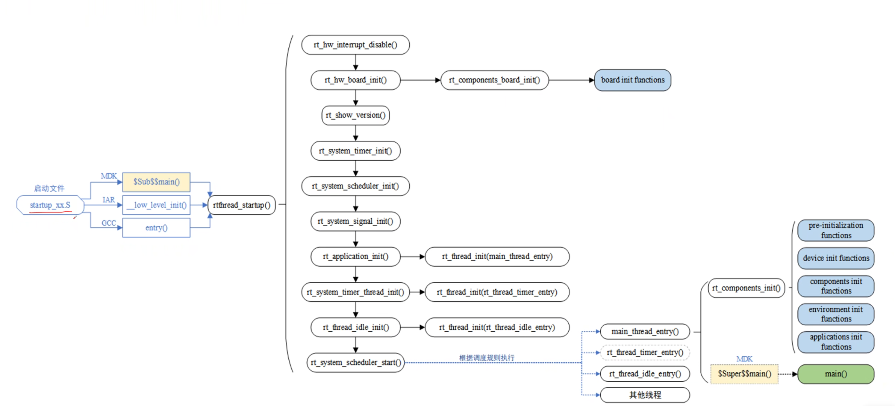

**整体流程一句话总结**：汇编启动文件 → 内核核心初始化（中断/板级/定时器/调度器/信号）→ 创建 main/定时器/空闲线程 → 启动调度器 → 组件初始化 → 进入用户 main()。

### 第一阶段：启动文件入口

系统复位后的第一个执行入口，负责初始化堆栈、中断向量等基础环境，并根据不同编译工具链进入对应的启动入口。

| 步骤 | 内容 | 功能作用 |
| --- | --- | --- |
| 1 | `startup_xx.S`（汇编启动文件） | 系统复位后的第一个执行入口，负责初始化堆栈、中断向量等基础环境 |
| 2 | MDK → `$Sub$$main()` | Keil 工具链的启动入口，在进入 main 前完成系统初始化 |
| 3 | IAR → `__low_level_init()` | IAR 工具链的启动入口，完成底层初始化 |
| 4 | GCC → `entry()` | GCC 工具链的启动入口，进入系统初始化流程 |
| 5 | 三个工具链分支汇入 `rtthread_startup()` | 实现跨编译器兼容，统一进入系统启动主流程 |

### 第二阶段：内核核心初始化（rtthread_startup 主流程）

`rtthread_startup()` 是系统启动主入口函数，串起整个初始化流程，依次完成中断、板级硬件、版本显示、定时器、调度器、信号等内核核心初始化。

| 步骤 | 内容                                                | 功能作用                                                     |
| ---- | --------------------------------------------------- | ------------------------------------------------------------ |
| 1    | `rtthread_startup()`                                | 系统启动主入口函数，串起整个初始化流程                       |
| 2    | `rt_hw_interrupt_disable()`                         | 禁用硬件中断，保证初始化过程不被中断打扰                     |
| 3    | `rt_hw_board_init()`→4                              | 板级硬件初始化，配置时钟、串口、内存等基础硬件               |
| 4    | `rt_components_board_init()` → board init functions | 调用板级初始化函数列表，完成各外设的板级配置                 |
| 5    | `rt_show_version()`                                 | 显示系统版本号，串口输出 RT-Thread 版本横幅                  |
| 6    | `rt_system_timer_init()`                            | 初始化系统定时器，为系统提供时间基准                         |
| 7    | `rt_system_scheduler_init()`                        | 初始化调度器，建立调度器数据结构                             |
| 8    | `rt_system_signal_init()`*                          | 初始化信号处理机制，支持线程间信号通信(如果不使用信号相关内容，可以在menuconfig里面关掉) |

### 第三阶段：线程创建

完成内核核心初始化后，系统开始创建各类系统线程与用户主线程，包括 main 主线程、定时器线程和空闲线程。

| 步骤 | 内容 | 功能作用 |
| --- | --- | --- |
| 1 | `rt_application_init()` | 初始化应用程序框架，创建应用入口线程 |
| 2 | `rt_thread_init(main_thread_entry)` | 创建 main 主线程（用户代码入口） |
| 3 | `rt_system_timer_thread_init()` | 初始化系统定时器线程 |
| 4 | `rt_thread_init(rt_thread_timer_entry)` | 创建定时器线程，负责软件定时器管理 |
| 5 | `rt_thread_idle_init()` | 初始化空闲线程 |
| 6 | `rt_thread_init(rt_thread_idle_entry)` | 创建 idle 空闲线程（优先级最低，回收资源） |

### 第四阶段：启动调度器

| 步骤 | 内容 | 功能作用 |
| --- | --- | --- |
| 1 | `rt_system_scheduler_start()` | 启动调度器，开始按优先级和时间片调度就绪线程 |
| 2 | 根据调度规则执行不同线程 | 线程创建后不会立即执行，由调度器决定何时运行 |

### 第五阶段：组件初始化与用户代码

调度器启动后，系统继续完成组件初始化，最终进入用户 `main()` 函数执行用户代码。

| 步骤 | 内容 | 功能作用 |
| --- | --- | --- |
| 1 | `rt_components_init()` | 组件初始化，按序执行各类初始化函数 |
| 2 | pre-initialization functions | 预初始化函数（最早执行） |
| 3 | device init functions | 设备驱动初始化 |
| 4 | components init functions | 组件初始化（文件系统、网络等） |
| 5 | environment init functions | 环境初始化 |
| 6 | applications init functions | 应用层初始化 |
| 7 | `main_thread_entry()` → `main()` | 用户主函数入口，用户代码从这里开始执行 |

## 三、线程管理

### 1. 线程控制块（TCB）

#### 1.1 什么是线程控制块

线程控制块（Thread Control Block, TCB）是 RT-Thread 操作系统中用于管理线程的一个数据结构。它存放线程的相关信息，如优先级、线程名称、线程状态等，也包含线程与线程之间连接用的链表结构、线程等待事件集合等。

线程控制块由结构体 `struct rt_thread` 定义并形成**线程内核对象**，再链接到**内核对象容器**中进行管理。

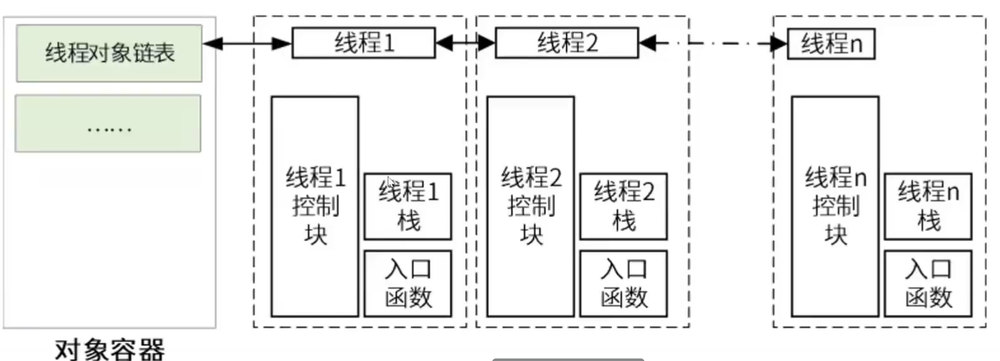

每个线程对象包含三部分：

- 线程控制块（TCB）：管理线程的核心数据结构
- 线程栈（Stack）：保存线程局部变量和调用栈
- 入口函数（Entry）：线程启动后执行的函数

#### 1.2 线程控制块继承关系

`struct rt_thread` 继承自基类 `rt_object`，在基类对象基础上进行扩展，增加了线程状态、优先级等属性。

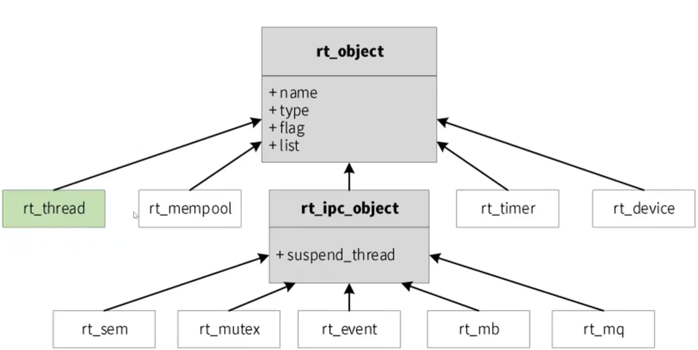

**基类 rt_object 成员**：

- `name`：对象名称
- `type`：对象类型
- `flag`：对象标志
- `list`：对象链表节点

**rt_object 派生类**：`rt_thread`、`rt_mempool`、`rt_ipc_object`、`rt_timer`、`rt_device`

**rt_ipc_object（IPC 对象基类）**：成员 `suspend_thread`（挂起线程链表），派生 `rt_sem`（信号量）、`rt_mutex`（互斥量）、`rt_event`（事件）、`rt_mb`（邮箱）、`rt_mq`（消息队列）

#### 1.3 线程控制块结构体定义

```c
struct rt_thread
{
    struct rt_object parent;        /* 继承自 rt_object 基类 */

    /* 栈指针与入口指针 */
    void *sp;                       /* 栈指针 */
    void *entry;                    /* 入口函数指针 */
    void *parameter;                /* 线程入口函数参数 */
    void *stack_addr;               /* 栈地址指针 */
    rt_uint32_t stack_size;         /* 栈大小 */

    /* 错误代码与状态 */
    rt_err_t error;                 /* 线程错误代码 */
    rt_uint8_t stat;                /* 线程状态 */

    /* 优先级 */
    rt_uint8_t current_priority;    /* 当前优先级 */
    rt_uint8_t init_priority;       /* 初始优先级 */
    rt_uint32_t number_mask;        /* 优先级位图掩码 */

    /* 时间片 */
    rt_ubase_t init_tick;           /* 线程初始化计数值（时间片） */
    rt_ubase_t remaining_tick;      /* 线程剩余计数值 */

    struct rt_timer thread_timer;   /* 内置线程定时器 */

    void (*cleanup)(struct rt_thread *tid); /* 线程退出清除函数 */
    rt_uint32_t user_data;          /* 用户数据 */
};
```

#### 1.4 关键字段功能说明

| 字段 | 功能作用 |
| --- | --- |
| `parent` | 继承 rt_object 基类，使线程成为内核对象，可被对象容器管理 |
| `sp` | 栈指针，保存线程当前运行上下文（寄存器状态） |
| `entry` | 入口函数指针，线程启动后执行的函数 |
| `parameter` | 传给入口函数的参数 |
| `stack_addr` / `stack_size` | 线程栈的地址和大小，用于保存线程局部变量和调用栈 |
| `error` | 线程错误代码 |
| `stat` | 线程状态（就绪/运行/挂起/关闭等） |
| `current_priority` / `init_priority` | 当前优先级 / 初始优先级（支持优先级继承） |
| `number_mask` | 优先级位图掩码，用于快速调度 |
| `init_tick` / `remaining_tick` | 时间片初始值 / 剩余值，用于时间片轮转调度 |
| `thread_timer` | 内置线程定时器，用于线程延时、超时等 |
| `cleanup` | 线程退出时的清除函数 |
| `user_data` | 用户自定义数据 |

### 2. 线程属性

#### 2.1 线程属性-线程栈

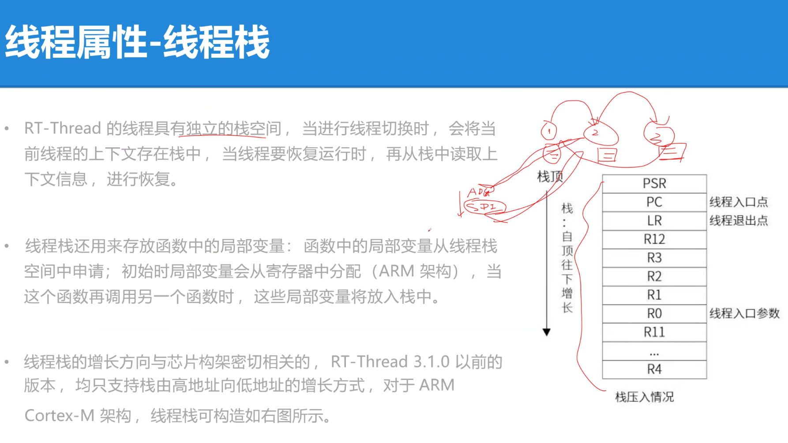

每个线程都拥有**独立的栈空间**，用于保存线程的上下文（寄存器状态）和局部变量。线程栈是线程运行时的私有存储区域，互不干扰。

##### 2.1.1 线程栈的作用

- **保存上下文**：发生上下文切换时，当前线程的寄存器状态会被压入其线程栈保存，待再次被调度时恢复。
- **存放局部变量**：线程内定义的局部变量从线程栈中申请空间，函数调用栈也建立在线程栈上。

##### 2.1.2 栈的增长方向

Cortex-M 处理器的栈**自顶向下增长**（从高地址向低地址方向），即栈指针 SP 初始指向栈顶（高地址），压栈时 SP 递减。

##### 2.1.3 硬件自动压栈顺序

Cortex-M 在进入中断/异常时由硬件自动压栈，寄存器入栈顺序如下：

```
PSR → PC → LR → R12 → R3 → R2 → R1 → R0 → R11 ... R4
```

其中 `PSR`（程序状态寄存器）、`PC`（程序计数器）、`LR`（链接寄存器）、`R12`、`R3~R0` 由硬件自动压栈，其余通用寄存器 `R11...R4` 由软件（上下文切换代码）负责保存。

#### 2.2 线程属性-优先级

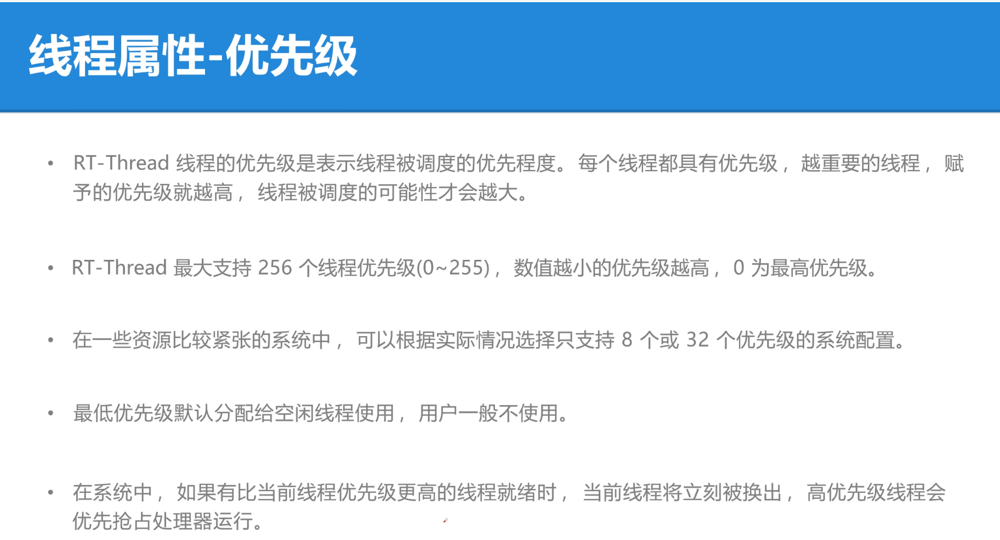

线程的优先级表示线程被调度的优先程度。每个线程都具有优先级，越重要的线程，赋予的优先级就越高，线程被调度的可能性才会越大。

- **优先级范围**：RT-Thread 最大支持 256 个线程优先级（0~255），数值越小优先级越高，0 为最高优先级。
- **可配置**：在一些资源比较紧张的系统中，可以根据实际情况选择只支持 8 个或 32 个优先级的系统配置。
- **空闲线程**：最低优先级默认分配给空闲线程使用，用户一般不使用。
- **抢占式调度**：在系统中，如果有比当前线程优先级更高的线程就绪时，当前线程将立刻被换出，高优先级线程会优先抢占处理器运行。

##### 2.2.1 调度机制剖析：调度器如何完成抢占

抢占式调度的核心思想：如果有更高优先级的线程进入就绪态，当前低优先级线程会被**立即暂停**，CPU 切换给高优先级线程（优先级数值越小，优先级越高）。调度器正是通过线程控制块（TCB）中的字段来参与抢占判断：

| TCB 字段 | 在抢占判断中的作用 |
| --- | --- |
| `stat` | 判断线程是否可被调度：`RT_THREAD_READY` 可调度、`RT_THREAD_RUNNING` 正在运行、`RT_THREAD_SUSPEND` 不能运行 |
| `current_priority` | 调度器据此判断谁更优先：数值越小优先级越高，越优先运行 |
| `sp` | 切换线程时保存 / 恢复现场 |

- **切换现场的过程**：切走线程时保存其 `sp`（把当前运行现场压栈并记录栈指针位置）；切入线程时恢复其 `sp`（从栈中弹出上下文，CPU 从原断点接着执行）。
- 举例：当前运行线程 B，若线程 A 突然变为就绪态且优先级更高，调度器判断 `current_priority` 后立即切换到线程 A，实现抢占。

#### 2.3 线程属性-时间片

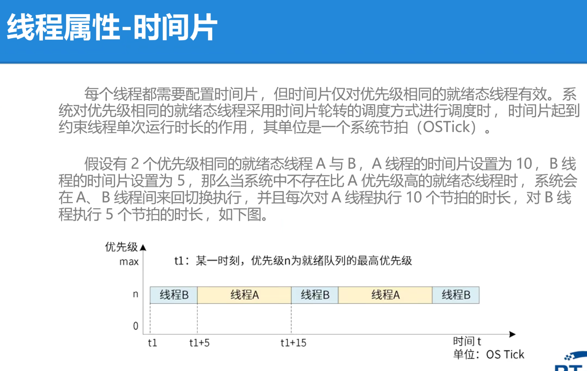

- **适用场景**：时间片仅对**优先级相同**的就绪态线程有效，用于时间片轮转调度。
- **作用**：约束线程单次运行时长，单位为系统节拍（OS Tick）。
- **示例**：A 线程时间片 10、B 线程时间片 5，则 A 每次运行 10 节拍、B 每次运行 5 节拍，两者交替执行。

#### 2.4 线程属性-入口函数

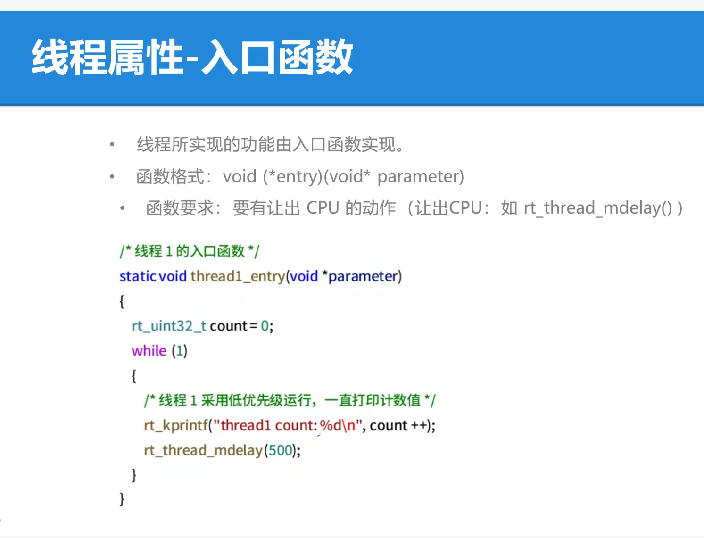

- **作用**：线程所实现的功能由入口函数实现。
- **函数格式**：`void (*entry)(void* parameter)`
- **关键要求**：入口函数内必须有**让出 CPU** 的动作（如 `rt_thread_mdelay()`），否则会独占 CPU，导致其他线程无法运行。

```c
/* 线程1的入口函数 */
static void thread1_entry(void *parameter)
{
    rt_uint32_t count = 0;
    while (1)
    {
        /* 线程1采用低优先级运行，一直打印计数值 */
        rt_kprintf("thread1 count:%d\n", count++);
        rt_thread_mdelay(500);   /* 让出 CPU，延时 500ms */
    }
}
```

#### 2.5 线程属性-线程延时

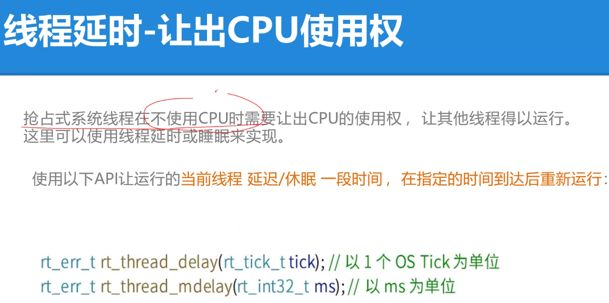

在**抢占式调度**系统中，线程不运行时应当**主动让出 CPU**，以保证其他线程能够获得运行机会。

- **延时 / 睡眠**：让出 CPU 的常用方法，线程调用延时函数后进入挂起状态，由调度器调度其他就绪线程运行。
- `rt_thread_delay()`：以**系统 Tick** 为单位让当前线程睡眠。
- `rt_thread_mdelay()`：以**毫秒（ms）** 为单位让当前线程睡眠，使用更直观。

### 3. 线程状态分类

RT-Thread 中线程共有 **5 种状态**，由线程控制块中的 `stat` 字段标识：

| 状态 | 宏定义 | 含义 |
| --- | --- | --- |
| 初始状态 | `RT_THREAD_INIT` | 线程刚创建（初始化）完成，尚未启动，未加入就绪队列 |
| 就绪状态 | `RT_THREAD_READY` | 线程已具备运行条件，等待调度器分配 CPU |
| 运行状态 | `RT_THREAD_RUNNING` | 线程正在占用 CPU 执行 |
| 挂起状态 | `RT_THREAD_SUSPEND` | 线程因等待资源/事件/延时等被阻塞，暂停执行 |
| 关闭状态 | `RT_THREAD_CLOSE` | 线程已结束/被删除，不再参与调度（终态） |

### 4. 线程状态转化

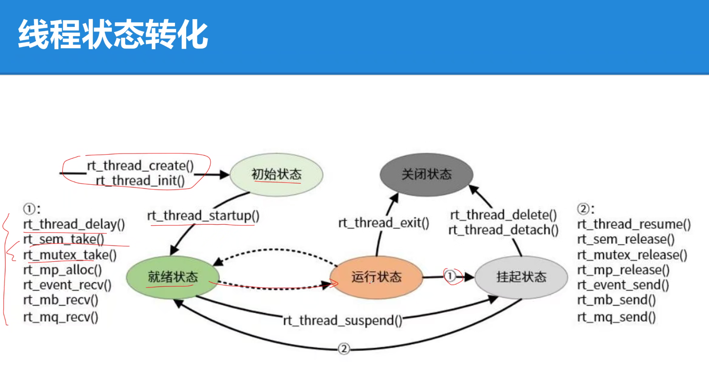

线程在生命周期中会在上述状态之间转换，状态转换关系如下图所示（结合"线程状态转化"PPT）：

```
初始状态 → 就绪状态 → 运行状态 ↔ 挂起状态 → 关闭状态
```

#### 4.1 状态转换关系

| 起始状态 | 目标状态 | 触发函数 / 条件 |
| --- | --- | --- |
| 初始状态 | 就绪状态 | `rt_thread_startup()` |
| 就绪状态 | 运行状态 | 被调度器选中执行（调度器调度） |
| 运行状态 | 挂起状态 | `rt_thread_suspend()` 及①组阻塞函数 |
| 挂起状态 | 就绪状态 | ②组唤醒函数 |
| 运行状态 | 关闭状态 | `rt_thread_exit()` |
| 挂起状态 | 关闭状态 | `rt_thread_delete()` / `rt_thread_detach()` |

#### 4.2 ①组阻塞函数（运行 → 挂起）

运行中的线程调用以下函数会主动让出 CPU 或阻塞等待资源，从而转入挂起状态：

```c
rt_thread_delay();   /* 延时等待 */
rt_sem_take();       /* 获取信号量（不可用则阻塞） */
rt_mutex_take();     /* 获取互斥锁（被占用则阻塞） */
rt_mp_alloc();       /* 分配内存池块（无可用块则阻塞） */
rt_event_recv();     /* 接收事件标志（无匹配事件则阻塞） */
rt_mb_recv();        /* 接收邮箱消息（为空则阻塞） */
rt_mq_recv();        /* 接收消息队列（为空则阻塞） */
```

#### 4.3 ②组唤醒函数（挂起 → 就绪）

由其他线程或中断调用，用于唤醒挂起中的线程，使其回到就绪状态：

```c
rt_thread_resume();  /* 显式恢复线程 */
rt_sem_release();    /* 释放信号量（唤醒等待者） */
rt_mutex_release();  /* 释放互斥锁（唤醒等待者） */
rt_mp_release();     /* 释放内存池块（唤醒等待分配者） */
rt_event_send();     /* 发送事件标志（唤醒等待者） */
rt_mb_send();        /* 发送邮箱消息（唤醒等待接收者） */
rt_mq_send();        /* 发送消息队列（唤醒等待接收者） */
```

#### 4.4 状态转化要点

- **挂起 → 运行需经就绪态**：挂起线程被唤醒后先进入就绪状态，再由调度器调度进入运行状态，不能直接由挂起态进入运行态。
- **关闭状态为终态**：线程一旦进入关闭状态即不可逆，不再参与调度，其资源由系统回收。
- 就绪态与运行态之间的切换由**调度器**完成（按优先级、时间片轮转等策略）。

### 5. 系统线程

#### 5.1 主线程

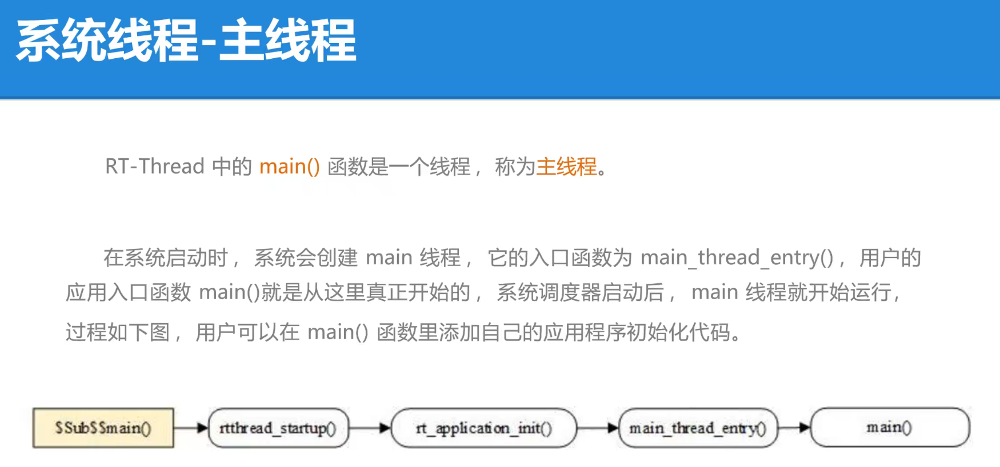

- 系统启动时自动创建，入口为 `main_thread_entry()`，用户代码从 `main()` 开始执行。
- 启动流程：`$Sub$$main()` → `rtthread_startup()` → `rt_application_init()` → `main_thread_entry()` → `main()`
- 用户可在 `main()` 中添加应用初始化代码。

`main()` 本质上是主线程的入口函数，经 `main_thread_entry()` 被调度器调度运行。在 `main()` 中打印字符串，可通过串口观察输出：

```c
int main(void)
{
    rt_kprintf("hello world!\n");   /* 串口输出 */
    return 0;
}
```

#### 5.2 空闲线程

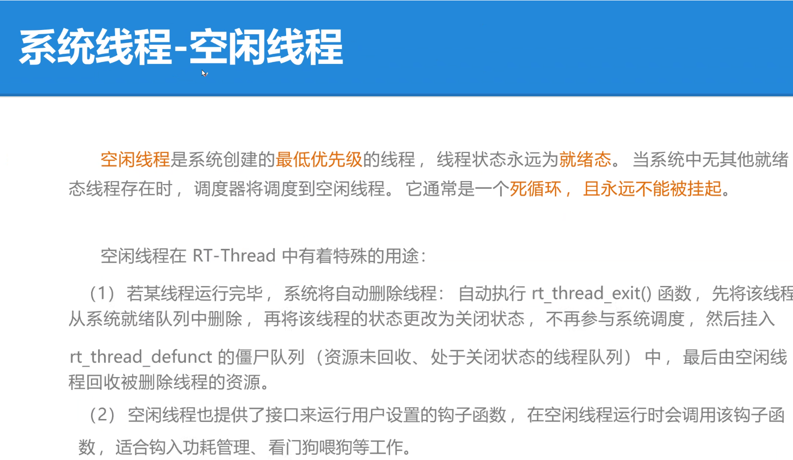

- 系统创建的最低优先级线程，状态永远为就绪态，无其他就绪线程时被调度。
- 通常为死循环，且永不被挂起。
- 特殊用途：
  1. **自动回收线程资源**：运行完毕线程执行 `rt_thread_exit()` → 从就绪队列删除 → 状态改为关闭 → 挂入僵尸队列 `rt_thread_defunct` → 由空闲线程回收资源。
  2. **提供钩子函数接口**：适合功耗管理、看门狗喂狗等任务。

### 6. 线程创建与初始化

#### 6.1 静态初始化线程 rt_thread_init

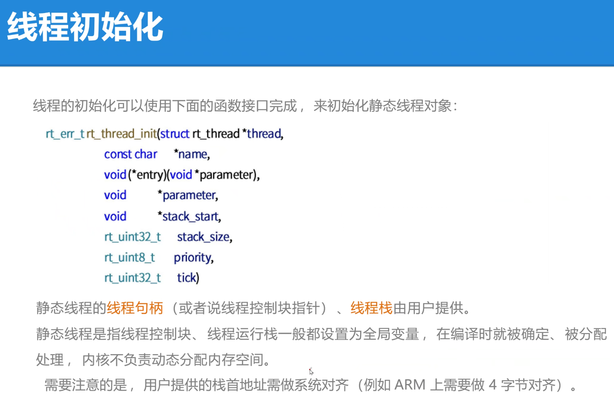

- 静态线程初始化使用 `rt_thread_init()`，线程句柄和栈由用户自行分配（通常为全局变量），内核不负责动态内存分配。

```c
rt_err_t rt_thread_init(struct rt_thread *thread,
                        const char    *name,
                        void *(*entry)(void *parameter),
                        void          *parameter,
                        void          *stack_start,
                        rt_uint32_t   stack_size,
                        rt_uint8_t    priority,
                        rt_uint32_t   tick)
```

**参数说明**：

| 参数 | 含义与要点 |
| --- | --- |
| `thread` | 线程句柄，由用户提供，指向对应的线程控制块内存地址 |
| `name` | 线程名称；最大长度受 `rtconfig.h` 中 `RT_NAME_MAX` 宏限制，多余部分自动截掉 |
| `entry` | 线程入口函数，线程启动后执行的函数 |
| `parameter` | 传给线程入口函数的参数 |
| `stack_start` | 线程栈起始地址；多数系统需做地址对齐（如 ARM 需 4 字节对齐） |
| `stack_size` | 线程栈大小，单位字节 |
| `priority` | 线程优先级，范围由 `RT_THREAD_PRIORITY_MAX` 宏决定；数值越小优先级越高，0 为最高 |
| `tick` | 时间片大小，单位是系统时钟节拍（OS Tick）；存在同优先级线程时，指定一次调度最大运行时长 |

**返回值**：`RT_EOK` 线程创建成功；`-RT_ERROR` 线程创建失败。

- **要点**：栈首地址需按架构对齐（如 ARM 需 4 字节对齐）。

#### 6.2 动态创建线程 rt_thread_create

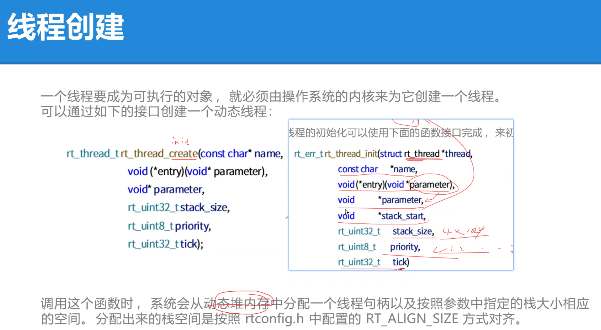

线程要成为可执行对象，**必须由操作系统内核创建**。动态创建线程使用 `rt_thread_create()`：

- **内存分配**：从**动态堆内存**中为线程分配句柄（TCB）和栈空间，无需用户预先定义。
- **栈对齐**：分配的栈空间按 `rtconfig.h` 中配置的 `RT_ALIGN_SIZE` 进行对齐。
- **创建参数**：需指定线程名称、入口函数、入口参数、栈大小等关键信息。

```c
rt_thread_t rt_thread_create(const char *name,
                             void (*entry)(void *parameter),
                             void       *parameter,
                             rt_uint32_t stack_size,
                             rt_uint8_t  priority,
                             rt_uint32_t tick);
```

#### 6.3 线程初始化完整示例

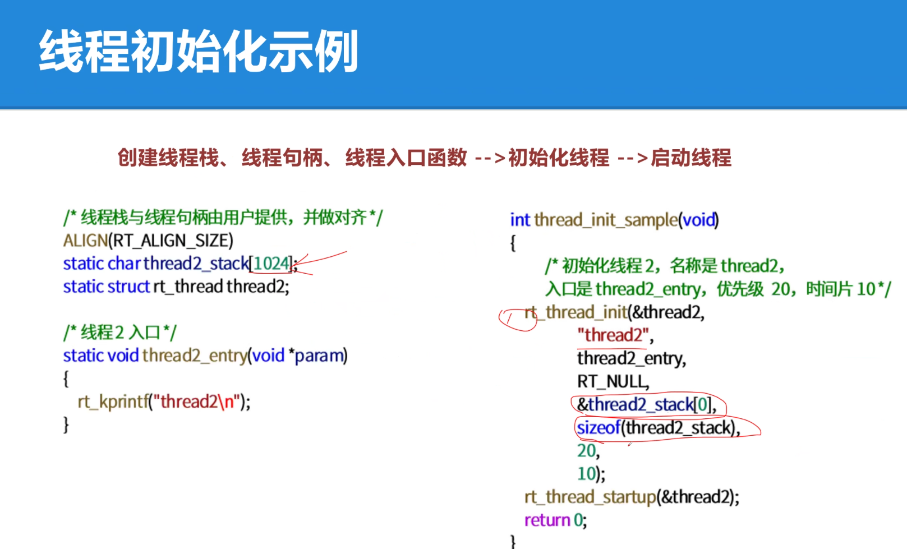

- **资源提供**：线程栈和句柄由用户提供，并需确保对齐（`ALIGN(RT_ALIGN_SIZE)`）。
- **完整流程**：准备资源 → `rt_thread_init()` 初始化 → `rt_thread_startup()` 启动线程。
- **初始化参数**：需指定线程名称、入口函数、起始地址（栈首地址）和栈大小。
- **示例**：自定义一个优先级为 20、时间片为 10 的线程。

```c
/* 定义线程栈与线程控制块 */
ALIGN(RT_ALIGN_SIZE)
static rt_uint8_t thread_stack[1024];
static struct rt_thread thread;

/* 线程入口函数 */
static void thread_entry(void *parameter)
{
    while (1)
    {
        rt_kprintf("thread running\n");
        rt_thread_mdelay(1000);   /* 让出 CPU */
    }
}

/* 初始化并启动线程：优先级 20，时间片 10 */
rt_thread_init(&thread, "thread", thread_entry, RT_NULL,
               thread_stack, sizeof(thread_stack), 20, 10);
rt_thread_startup(&thread);
```

#### 6.4 静态线程 vs 动态线程对比

| 对比项 | 静态线程（`rt_thread_init`） | 动态线程（`rt_thread_create`） |
| --- | --- | --- |
| 分配位置 | 全局/静态区 | 堆区 |
| 分配时机 | 编译/链接时确定 | 运行时申请 |
| 是否依赖堆 | 不依赖 | 通常依赖 |
| 生命周期 | 通常与系统一样长、常驻 | 可短可长、按需创建销毁 |
| 释放机制 | 固定占用，通常无需手动释放 | 线程退出/`delete`/`detach` 后释放，需关注 |
| 内存泄漏风险 | 一般不会 | 可能 |
| 内存碎片风险 | 基本不会 | 可能 |

**高可靠场景强制使用静态线程的原因**：

1. 内存在**编译期即可确定**，内存可控、行为确定。
2. **不依赖运行时堆**，开机前就把内存准备好，不会因堆不足导致分配失败。
3. 内存位置固定，长时间运行**不产生碎片**。
4. 不存在「用完释放」概念，内存固定占用，**不会因泄漏**导致系统越跑越危险。
5. **启动早期即可初始化**，只要静态数组存在，线程对象就存在。
6. 无需运行时分配内存，**行为确定、实时性可预测**。

> **一句话概括**：静态线程把内存问题从「运行时不确定」变成「编译期可检查」。

### 7. 线程启动与自动初始化

#### 7.1 如何真正启动线程运行（而非纯粹调用）

线程创建后**并不会自动运行**，它只是一个静态对象。要让线程真正跑起来，需要三步：

```
创建（init/create） → 启动（startup） → 调度器调度执行
```

- **创建**：`rt_thread_init()`（静态）或 `rt_thread_create()`（动态）完成线程对象和栈的初始化，此时线程处于初始态（`RT_THREAD_INIT`），未加入就绪队列。
- **启动**：`rt_thread_startup()` 将线程从初始态转入就绪态（`RT_THREAD_READY`），挂入就绪队列。
- **调度**：调度器（`rt_system_scheduler_start()` 启动后）按优先级和时间片从就绪队列中选中该线程，分配 CPU 执行入口函数。

> **常见误区**：直接调用线程入口函数（如 `thread1_entry(param);`）**并不是启动线程**，那只是普通函数调用——不会建立独立线程栈上下文、不经过调度器，无法体现多任务并发特性。

#### 7.2 rt_thread_startup() 启动线程

```c
rt_err_t rt_thread_startup(rt_thread_t thread);
```

- **作用**：将线程状态从 `RT_THREAD_INIT` 变为 `RT_THREAD_READY`，加入就绪队列，等待调度器调度。
- **适用对象**：静态（`rt_thread_init`）和动态（`rt_thread_create`）创建的线程，都需要调用它才能真正运行。
- **内部动作**：设置好线程栈上下文（sp 指向栈起始位置），调度器切换时从栈中恢复寄存器，跳转到入口函数执行。

#### 7.3 INIT_APP_EXPORT() 自动初始化机制

RT-Thread 提供一套「自动初始化」机制：**不需要手动调用**，系统启动时按优先级自动执行初始化函数。

```c
INIT_APP_EXPORT(fn);   /* 声明 fn 为应用层自动初始化函数 */
```

**自动初始化宏层级**（按执行先后顺序）：

| 宏 | 执行阶段 |
| --- | --- |
| `INIT_BOARD_EXPORT(fn)` | 板级初始化（最早） |
| `INIT_PREV_EXPORT(fn)` | 预初始化 |
| `INIT_DEVICE_EXPORT(fn)` | 设备驱动初始化 |
| `INIT_COMPONENT_EXPORT(fn)` | 组件初始化 |
| `INIT_ENV_EXPORT(fn)` | 环境初始化 |
| `INIT_APP_EXPORT(fn)` | 应用层初始化（最晚） |

**原理**：这些宏把函数指针放入指定的代码段（section），系统启动时 `rt_components_init()` 按段顺序遍历并逐个调用，实现「声明即自动执行」。

##### 7.3.1 底层原理深入剖析

**完整链路**：宏展开生成函数指针 → 放入特殊 section → 链接器收集成初始化函数表 → 启动时 `rt_components_init()` 遍历调用。

1. **宏展开：生成函数指针**。`INIT_APP_EXPORT(fn)` 并不是直接调用函数，而是展开为：定义函数指针类型 `typedef int (*init_fn_t)(void);`，生成一个保存 `fn` 函数地址的 const 函数指针变量，并用 `__attribute__((section(".rti_fn.6")))` 把它放入指定段。本质是把函数地址「登记」到一张自动初始化函数表里。

2. **INIT_BOARD_EXPORT 与 INIT_APP_EXPORT 的区别**：两者底层原理相同，区别在于 **section 不同**，因此被调用的阶段不同：

   | 宏 | section | 用途 |
   | --- | --- | --- |
   | `INIT_BOARD_EXPORT()` | `.rti_fn.1.board` | 板级硬件初始化（最早） |
   | `INIT_APP_EXPORT()` | `.rti_fn.6` | 应用层初始化（最晚） |

3. **链接器收集函数指针表**：编译器只是把函数指针放进特殊 section，真正形成「表」的是链接脚本。链接脚本的关键机制：

   ```text
   .rti_fn : {
       . = ALIGN(4);
       __rt_init_rti_start = .;
       KEEP(*(SORT(.rti_fn.*)))   /* 收集所有 .rti_fn.x 段 */
       __rt_init_rti_end = .;
   } > FLASH
   ```

   - **KEEP**：防止初始化函数表被链接器优化删除；
   - **SORT**：按 section 名称排序，保证初始化顺序；
   - **`__rt_init_rti_start` / `__rt_init_rti_end`**：初始化函数表的起止地址符号，供启动时遍历使用。

4. **Flash 内存示意图**：链接后各 `.rti_fn.x` 段依次存放对应初始化函数的地址（本质都是函数指针）：

   ```text
   Flash
   .rti_fn.1.board   ┌────────────────────────────┐  board_init      函数地址
   .rti_fn.3         ┌────────────────────────────┐  device_init     函数地址
   .rti_fn.4         ┌────────────────────────────┐  component_init  函数地址
   .rti_fn.6         ┌────────────────────────────┐  my_thread_create 函数地址
   ```

5. **启动时遍历调用**：RT-Thread 启动时调用 `rt_components_init()`，利用 `__rt_init_rti_start` / `__rt_init_rti_end` 遍历初始化函数表，依次调用表中的函数，实现「声明即自动执行」，最终进入用户 `main()`。

#### 7.4 两者的区别

| 对比项 | `INIT_APP_EXPORT()` | `rt_thread_startup()` |
| --- | --- | --- |
| 本质 | **初始化函数**的自动注册/自动调用机制 | **线程**的启动函数 |
| 作用对象 | 普通 C 函数（初始化回调） | 线程对象 `rt_thread_t` |
| 触发时机 | 系统启动阶段，由 `rt_components_init()` 自动按序调用 | 代码中手动调用 |
| 是否启动线程 | 否，只把函数挂入初始化段，不产生线程 | 是，把线程投入就绪队列，由调度器调度运行 |
| 执行环境 | 在系统启动流程中同步执行 | 在线程栈上下文中异步调度执行 |
| 典型用途 | 注册模块/驱动/组件的初始化代码 | 启动一个用户线程开始运行 |

> **总结**：`INIT_APP_EXPORT()` 是「让某个**初始化函数**在系统启动时被自动调用」；`rt_thread_startup()` 是「让某个**线程**进入就绪队列被调度运行」。前者初始化的是代码/模块，后者启动的是线程。

## 四、多线程实战编程（Day2 作业）

> 本大章基于作业 `thread_study.c` 与 README Part 2 提炼整理，完整源码见作业目录。

### 1. 任务需求概述

基于 STM32F407ZG（LED_R=PF12、LED_B=PF11、KEY=PC5）实现多线程实战，共 3 个工作线程 + 按键交互 + 调试命令：

| 线程 | 创建方式 | 优先级 | 时间片 | 栈大小 | 职责 |
| --- | --- | --- | --- | --- | --- |
| `th_led1` | 动态创建 | 16 | 5 | 2048 | 循环翻转板载 LED_R，打印计数与 `rt_tick_get()` |
| `th_led2` | 静态初始化 | 16 | 5 | 2048（全局栈） | 循环翻转板载 LED_B，打印计数 |
| `th_monitor` | 动态创建 | 10 | 5 | 2048 | 每 2000ms 读取按键计数、打印线程状态、挂起/恢复 th_led1 |

其他集成要求：

- **按键交互**：单次触发挂起 `th_led1`，再次触发恢复；
- **自动加载**：使用 `INIT_APP_EXPORT()` 自动加载测试模块，禁止在 `main.c` 中硬编码调用；
- **调试命令**：使用 `MSH_CMD_EXPORT()` 导出 `thread_dump` 查看命令。

### 2. 核心代码解析

#### 2.1 动态线程创建（th_led1）

动态线程由内核从堆中分配 TCB 与栈，返回线程句柄 `rt_thread_t`：

```c
th_led1 = rt_thread_create("th_led1", th_led1_entry, RT_NULL, 2048, 16, 5);
rt_thread_startup(th_led1);   /* 动态线程传句柄（指针）本身，不加 & */
```

#### 2.2 静态线程初始化（th_led2）

静态线程的 TCB 与栈由用户提供，全局定义并做字节对齐：

```c
ALIGN(RT_ALIGN_SIZE)                 /* 全局栈做字节对齐 */
static rt_uint8_t th_led2_stack[2048];
static struct rt_thread th_led2;

rt_thread_init(&th_led2, "th_led2", th_led2_entry, RT_NULL,
               th_led2_stack, sizeof(th_led2_stack), 16, 5);
rt_thread_startup(&th_led2);         /* 静态线程传 &th_led2 */
```

> **注意传参区别**：动态线程传 `th_led1`（句柄本身即指针），静态线程传 `&th_led2`（取结构体地址）。

#### 2.3 监控线程挂起 / 恢复 th_led1

监控线程优先级 10（高于工作线程 16），周期 `rt_thread_mdelay(2000)`。读取按键计数后，通过 TCB 的 `stat` 判断 th_led1 状态：

```c
if ((th_led1->stat & RT_THREAD_STAT_MASK) == RT_THREAD_SUSPEND)
    rt_thread_resume(th_led1);    /* 已挂起 → 恢复运行 */
else
    rt_sem_release(led_sem);      /* 运行中 → 释放信号量，由 th_led1 自行挂起 */
```

#### 2.4 按键 ISR：快进快出 + tick 消抖

- **ISR 必须快进快出**：中断函数里严禁使用 `rt_thread_mdelay`、`rt_kprintf` 或挂起线程等耗时 / 阻塞操作；
- **tick 消抖（20ms）**：记录上次中断触发时刻，与本次相差不足 20ms 视为机械抖动直接丢弃，兼顾防重复触发。

```c
static void key_isr_handler(void *args)
{
    rt_tick_t current_tick = rt_tick_get();
    if ((current_tick - last_isr_tick) >= rt_tick_from_millisecond(20))
    {
        last_isr_tick = current_tick;
        key_event_count++;        /* 有效按键计数 +1 */
    }
}
```

监控线程侧还会**关中断原子读取**计数（`rt_hw_interrupt_disable()/enable()`），读后清零防止重复处理，再 `rt_thread_mdelay(20)` 二次软件消抖确认按键仍按下。

#### 2.5 信号量 led_sem 通知挂起

- 创建动态信号量 `led_sem`（初值 0）；
- 监控线程按键事件中 `rt_sem_release(led_sem)` 通知 th_led1；
- th_led1 每次循环 `rt_sem_take(led_sem, 0)` 非阻塞尝试获取，拿到即调用 `rt_thread_suspend(th_led1)` 自行挂起：

```c
if (rt_sem_take(led_sem, 0) == RT_EOK)
{
    rt_kprintf("th_led1 suspend.\n");
    rt_thread_suspend(th_led1);
}
```

#### 2.6 ready_delay_ms()：保持 READY 态延时

- `rt_thread_mdelay()` 会让线程进入 **SUSPEND** 状态，此时 `rt_thread_suspend()` 将无法成功挂起该线程；
- 自定义 `ready_delay_ms()` 通过 `rt_tick_get()` 计时 + `rt_thread_yield()` 让出 CPU，使线程始终保持 **READY/RUNNING** 状态，保证监控线程能顺利挂起 th_led1：

```c
static void ready_delay_ms(rt_uint32_t ms)
{
    rt_tick_t start = rt_tick_get();
    rt_tick_t ticks = rt_tick_from_millisecond(ms);
    while ((rt_tick_get() - start) < ticks)
        rt_thread_yield();        /* 让出 CPU 但保持就绪态 */
}
```

#### 2.7 INIT_APP_EXPORT 自动初始化

- 模块初始化函数 `thread_study_init()` 负责 GPIO 初始化、信号量创建、三个线程的创建与启动；
- 用 `INIT_APP_EXPORT(thread_study_init)` 注册后，系统启动到应用层初始化阶段自动调用，**无需在 `main.c` 中硬编码调用**：

```c
static int thread_study_init(void)
{
    gpio_init();
    led_sem = rt_sem_create("led_sem", 0, RT_IPC_FLAG_PRIO);
    /* 创建并启动 th_led1 / th_led2 / th_monitor ... */
    return 0;
}
INIT_APP_EXPORT(thread_study_init);
```

#### 2.8 MSH_CMD_EXPORT 导出调试命令

```c
void thread_dump(void)
{
    print_all_status();   /* 打印各线程名称/状态/优先级/剩余栈 */
}
MSH_CMD_EXPORT(thread_dump, dump thread study status);
```

MSH 命令行中可直接输入 `thread_dump` 查看线程状态，便于运行调试。

### 3. 实验结果

先执行监控线程，再依次执行工作线程 1、2，并打印线程信息：

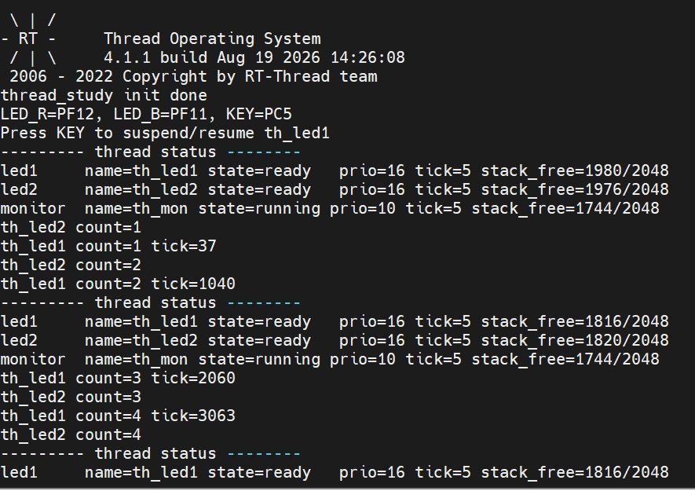

实物图：


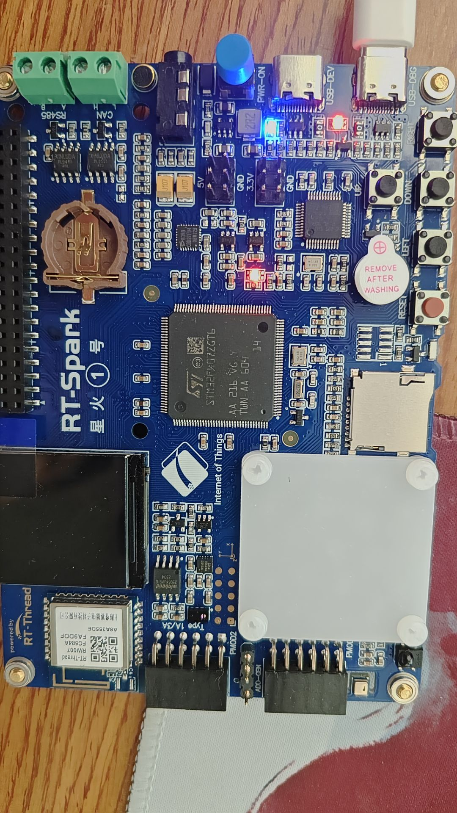

串口打印消息截图：

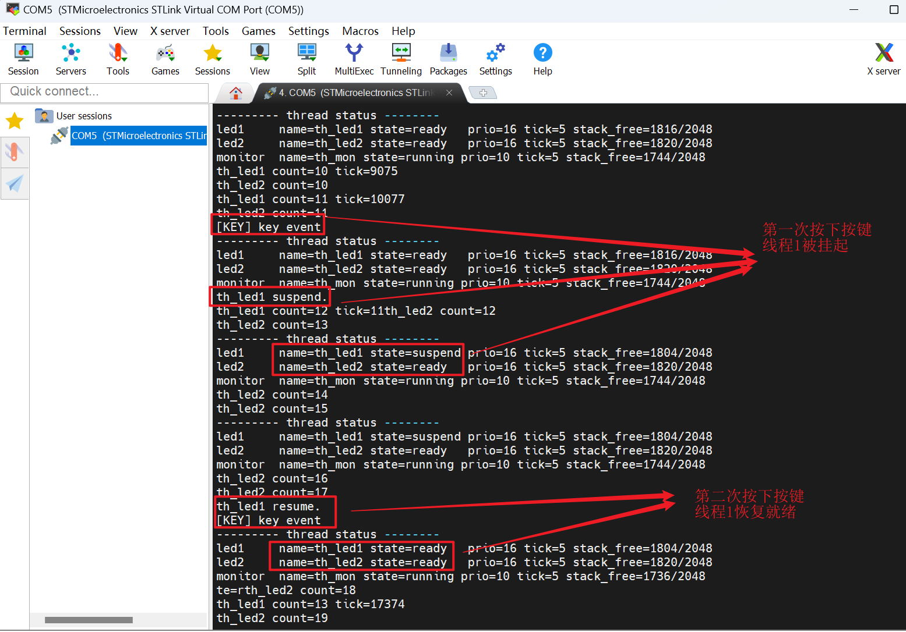
