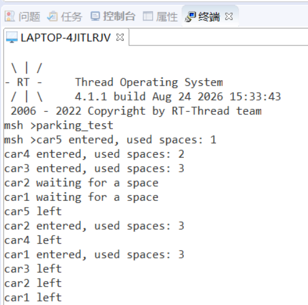

# 练习一：停车场车位管理

## 1.核心逻辑说明

| 关键点     | 实现方式                                                     |
| ---------- | ------------------------------------------------------------ |
| 车位建模   | 计数信号量初始值设为 `3`，每个 `take` 消耗一个车位，`release` 归还一个车位 |
| 超时重试   | `rt_sem_take` 传入 `WAIT_TIMEOUT`（2秒），返回非 `RT_EOK` 时打印等待信息并重试 |
| 并发安全   | 信号量内部自带原子操作，任意时刻 `take` 成功的线程数不会超过初始值 3 |
| 优先级等待 | 创建信号量时使用 `RT_IPC_FLAG_PRIO`，确保高优先级车辆优先获得车位 |

## 2. **运行效果**

在 msh 命令行中输入 parking_test 后，预期输出类似：



## 3.**思考题：为什么用计数信号量而不是互斥量？**

**互斥量只能表示"有/无"两种状态，无法表达"剩余多少个"的数量信息。**

| 对比维度     | 计数信号量                      | 互斥量                                |
| ------------ | ------------------------------- | ------------------------------------- |
| 可用资源数   | 可表示 N 个（初始值=3）         | 只能表示 0 或 1                       |
| 所有权       | 无所有权，任意线程都可 release  | 有所有权，必须由持有者释放            |
| 适用场景     | 管理多个同类资源                | 保护单个临界区                        |
| 本场景匹配度 | 3个车位 = 3个同类资源，完美匹配 | 只能保护"1个"资源，无法表达剩余车位数 |

---

# 练习二：多窗口售票系统

## 1.关键逻辑说明

| 关键点     | 实现方式                                                     |
| ---------- | ------------------------------------------------------------ |
| 两个窗口   | 两个线程共用同一个入口函数 `window_thread_entry`，通过参数区分 `window A` / `window B` |
| 共享票数   | 全局变量 `remaining_tickets` 表示剩余票数                    |
| 互斥保护   | 使用 `rt_mutex_take()` / `rt_mutex_release()` 保护“检查票数、取票号、票数减一、打印”这一整段操作 |
| 不超卖     | 进入临界区后再次判断 `remaining_tickets <= 0`，防止两个窗口同时进入后多卖 |
| 自动退出   | 当票卖完后，线程释放互斥量并 `break` 退出循环                |
| 命令名问题 | 使用 `MSH_CMD_EXPORT_ALIAS` 避免命令名过长导致 msh 识别失败  |

## 2.**结果输出**

### 2.1运行方式

在 msh 中输入：


```
ticket_test
```

### 2.2**输出**

```
msh >ticket_test
msh >window B sold ticket 20
window A sold ticket 19
window B sold ticket 18
window A sold ticket 17
window B sold ticket 16
window A sold ticket 15
window B sold ticket 14
window A sold ticket 13
window B sold ticket 12
window A sold ticket 11
window B sold ticket 10
window A sold ticket 9
window B sold ticket 8
window A sold ticket 7
window B sold ticket 6
window A sold ticket 5
window B sold ticket 4
window A sold ticket 3
window B sold ticket 2
window A sold ticket 1
window B exit
window A exit
```

## 3.对比实验

先暂时不使用互斥量，并在“读取余票”和“修改余票”之间加入短暂延时，观察是否会出现重复售票或余票错误。

```
msh >ticket_test_1
msh >window B sold ticket 20
window A sold ticket 20
window B sold ticket 19
window A sold ticket 19
window B sold ticket 18
window A sold ticket 18
window B sold ticket 17
window A sold ticket 17
window B sold ticket 16
window A sold ticket 16
window B sold ticket 15
window A sold ticket 15
window B sold ticket 14
window A sold ticket 14
window B sold ticket 13
window A sold ticket 13
window B sold ticket 12
window A sold ticket 12
window B sold ticket 11
window A sold ticket 11
window B sold ticket 10
window A sold ticket 10
window B sold ticket 9
window A sold ticket 9
window B sold ticket 8
window A sold ticket 8
window B sold ticket 7
window A sold ticket 7
window B sold ticket 6
window A sold ticket 6
window B sold ticket 5
window A sold ticket 5
window B sold ticket 4
window A sold ticket 4
window B sold ticket 3
window A sold ticket 3
window B sold ticket 2
window A sold ticket 2
window B sold ticket 1
window B exit
window A sold ticket 1
window A exit
```

| 版本                 | 结果                                         |
| -------------------- | -------------------------------------------- |
| 不加互斥量，不加延时 | 可能偶尔正常，但存在隐患                     |
| 不加互斥量，加延时   | 更容易出现重复售票、余票错误                 |
| 加互斥量             | 同一时刻只有一个窗口进入售票临界区，结果正确 |

## 4.思考题

问：为什么只给 `ticket_count--` 加锁仍可能不安全？

答：**根本原因是“检查”和“扣减”被拆成了两个独立操作，破坏了原子性。** 售票过程必须保证“检查余票→扣减票数”一气呵成，若只给 

### 4.1**错误写法与崩溃时序**

```
// 错误：只锁了 ticket_count--
if (remaining_tickets > 0)       // ① 检查 —— 没有锁保护！
{
    mutex_take();
    ticket_count--;              // ② 扣减 —— 有锁保护
    mutex_release();
}
```

当 `remaining_tickets = 1` 时，两个线程会同时通过检查并各自扣减：

| 时间 | 线程 A                              | 线程 B                              |
| ---- | ----------------------------------- | ----------------------------------- |
| T1   | 检查 `remaining_tickets > 0` → true |                                     |
| T2   |                                     | 检查 `remaining_tickets > 0` → true |
| T3   | 加锁，`ticket_count--`（1→0）       |                                     |
| T4   | 解锁                                | 加锁，`ticket_count--`（0→-1）      |
| T5   |                                     | 解锁                                |

### 4.2**核心原则：锁的粒度**

| 锁粒度                | 效果                            |
| --------------------- | ------------------------------- |
| 只锁 `ticket_count--` | 检查与扣减之间可被打断，不安全  |
| 锁住"检查 + 扣减"整体 | 保证 Check-and-Act 原子性，安全 |

---

# 练习三：系统启动条件检查

## 1.关键逻辑说明

| 关键点       | 实现方式                                                     |
| ------------ | ------------------------------------------------------------ |
| 事件位定义   | 用 `(1U << n)` 定义三个独立的 bit 位，分别代表网络、传感器、存储就绪 |
| 事件集创建   | `rt_event_create` 动态创建事件集对象                         |
| 发送事件     | 各初始化线程完成后调用 `rt_event_send` 设置对应的标志位      |
| AND 模式等待 | `rt_event_recv` 使用 `RT_EVENT_FLAG_AND` 选项，三个位全部置位才唤醒 |
| 自动清位     | 配合 `RT_EVENT_FLAG_CLEAR`，唤醒后自动清除已接收的标志位     |
| 命令别名     | 使用 `MSH_CMD_EXPORT_ALIAS` 避免命令名超过 16 字符限制       |
## 2.**结果输出**

```
msh >startup_test
msh >storage module initializing...
sensor module initializing...
network module initializing...
business thread waiting for all modules...
sensor module ready
network module ready
storage module ready
all modules are ready
business task started
```

## 3.补充测试实验

OR 模式配合超时为 0（非阻塞）来逐个检查事件位：

```
msh >startup_test_1
msh >storage module initializing...
sensor module initializing...
network module initializing...
business thread waiting for all modules...
sensor module ready
network module ready
wait timeout! checking unfinished modules...
  - storage module NOT ready
continue waiting...
storage module ready
all modules are ready
business task started
```

## 4.思考题

问：如果用三个独立信号量实现这个功能，与使用事件集相比有什么区别？

答：**两者都能实现多模块同步，但核心区别在于：事件集用单个对象即可表达多条件组合，而三个独立信号量需多次阻塞等待且无法灵活切换等待模式。** 具体对比如下：

| 维度     | 事件集                      | 三个独立信号量             |
| -------- | --------------------------- | -------------------------- |
| 对象数量 | 1 个事件集                  | 3 个信号量                 |
| 发送事件 | `rt_event_send(event, bit)` | `rt_sem_release(sem_x)`    |
| 等待方式 | 一次 `rt_event_recv` 搞定   | 需要连续三次 `rt_sem_take` |
| 等待模式 | AND / OR 一行参数切换       | 只能按固定顺序逐个等待     |

| 场景                            | 推荐方案 |
| ------------------------------- | -------- |
| 多个独立条件需要同时满足（AND） | 事件集   |
| 多个独立条件任一满足即可（OR）  | 事件集   |
| 需要精确诊断“哪些条件未满足”    | 事件集   |
| 简单的资源计数（如停车场车位）  | 信号量   |
| 保护共享变量（如售票）          | 互斥量   |


---

# 练习四：快递分拣中心

## 1.关键逻辑说明

| 模块       | 关键逻辑                                    | 说明                                                         |
| ---------- | ------------------------------------------- | ------------------------------------------------------------ |
| 参数编码   | `PACK_PARAM(count, start_id, region)` 宏    | 将消息数量、起始ID、区域编号编码到一个32位参数中，通过线程的 `parameter` 传递 |
| 发件线程   | `sender_entry` 按各自数量循环发送           | 从 `parameter` 解码出 `count`、`start_id`、`region`，循环 `count` 次构造消息并发送到消息队列 |
| 消息队列   | `rt_mq_create` 创建定长消息队列             | 用于发件线程与分拣线程之间的通信，队列满时发送失败并记录     |
| 分拣线程   | `sorter_entry` 循环接收并分类统计           | 从消息队列中取消息，按 `region` 字段分类计数，累加总重量，收到 `REGION_END` 消息后退出 |
| 失败计数   | `fail_mutex` 互斥量保护 `send_failed_count` | 多个发件线程并发写入失败计数时，通过互斥量保证计数正确       |
| 结束信号   | `end_signal_entry` 轮询等待所有发件线程退出 | 通过 `rt_thread_find` 查找三个发件线程，全部退出后才向消息队列发送结束消息，通知分拣线程终止 |
| 线程优先级 | 分拣线程优先级 19，发件/结束线程优先级 20   | 分拣线程优先级更高，确保消息被及时消费，降低队列满的概率     |

## 2.**结果输出**

```
msh >package_test
msh >sender [north] created package 3001, weight: 537 g
package 3001 -> north, weight: 537 g
sender [south] created package 2001, weight: 1037 g
package 2001 -> south, weight: 1037 g
sender [east] created package 1001, weight: 1537 g
package 1001 -> east, weight: 1537 g
sender [north] created package 3002, weight: 574 g
package 3002 -> north, weight: 574 g
sender [south] created package 2002, weight: 1074 g
package 2002 -> south, weight: 1074 g
sender [east] created package 1002, weight: 1574 g
package 1002 -> east, weight: 1574 g
sender [north] created package 3003, weight: 611 g
package 3003 -> north, weight: 611 g
sender [south] created package 2003, weight: 1111 g
package 2003 -> south, weight: 1111 g
sender [east] created package 1003, weight: 1611 g
package 1003 -> east, weight: 1611 g
sender [north] created package 3004, weight: 648 g
package 3004 -> north, weight: 648 g
sender [south] created package 2004, weight: 1148 g
package 2004 -> south, weight: 1148 g
sender [east] finished, sent 3 packages
sender [north] created package 3005, weight: 685 g
package 3005 -> north, weight: 685 g
sender [south] created package 2005, weight: 1185 g
package 2005 -> south, weight: 1185 g
sender [north] created package 3006, weight: 722 g
package 3006 -> north, weight: 722 g
sender [south] finished, sent 5 packages
sender [north] created package 3007, weight: 759 g
package 3007 -> north, weight: 759 g
sender [north] created package 3008, weight: 796 g
package 3008 -> north, weight: 796 g
sender [north] created package 3009, weight: 833 g
package 3009 -> north, weight: 833 g
sender [north] finished, sent 9 packages

===== sorting result =====
total packages: 17
east: 3, south: 5, north: 9
total weight: 16442 g
send failed: 0
==========================
end signal sent to sorter
```

