# 一级标题

## 二级标题

### 三级标题


```c
#include <studio.h>

int main()
{
    return 0;
}
```


|  t1  |  t2  |
| :--: | :--: |
|  1   |  2   |


**加粗**

`高亮`

*斜体*


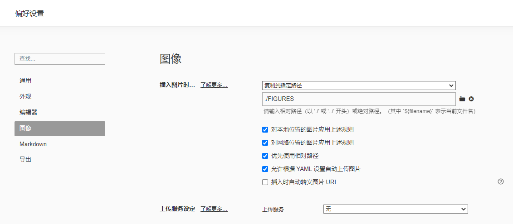


1.

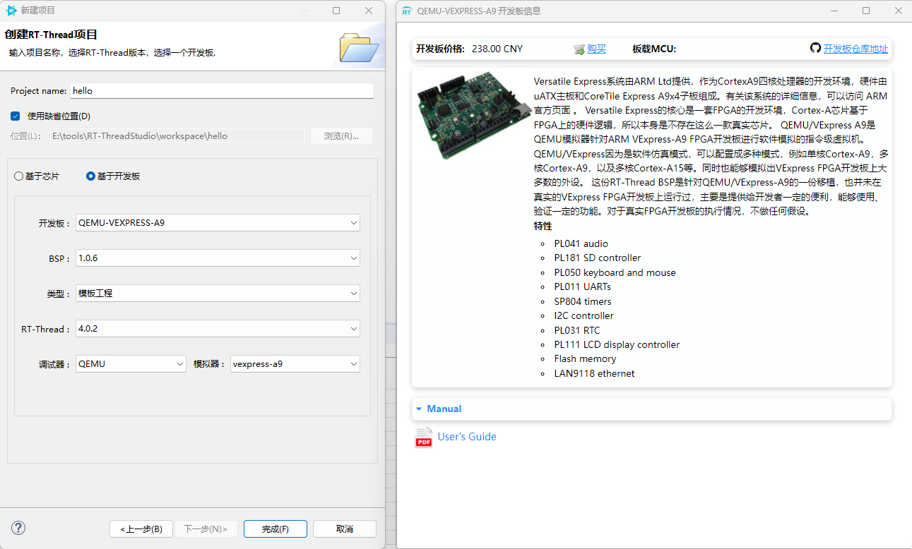


2.点击小锤子进行编译

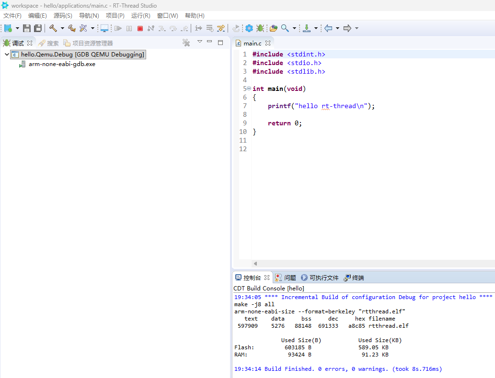


3.点击下载，弹出终端，显示日志和打印出内容

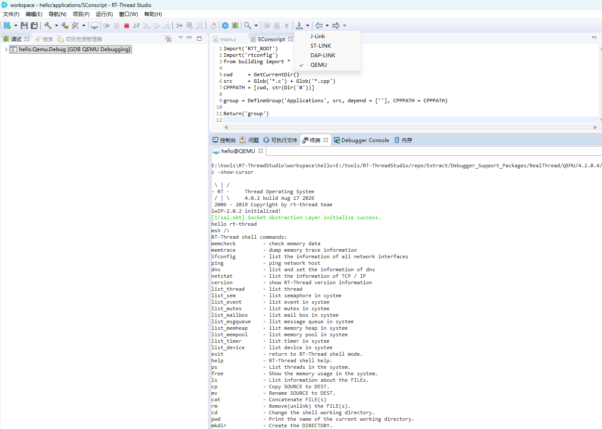


1.连接星火1号type-C供电和Debug接口，并按下蓝色电源开关

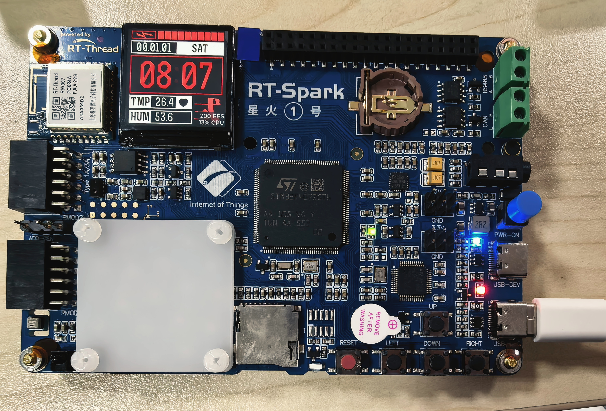


2.查看设备管理器>通用串行总线设备

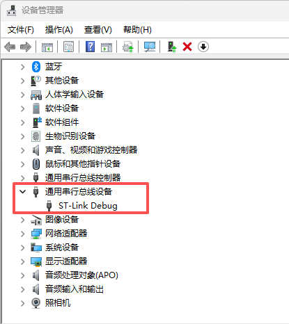


3.基于芯片创建RTT项目

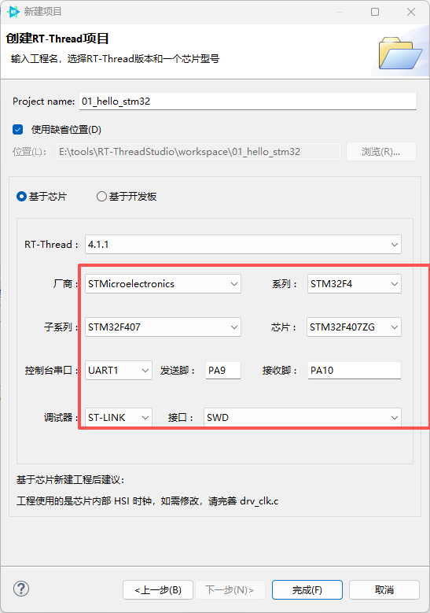


4.输入打印信息，进行编译

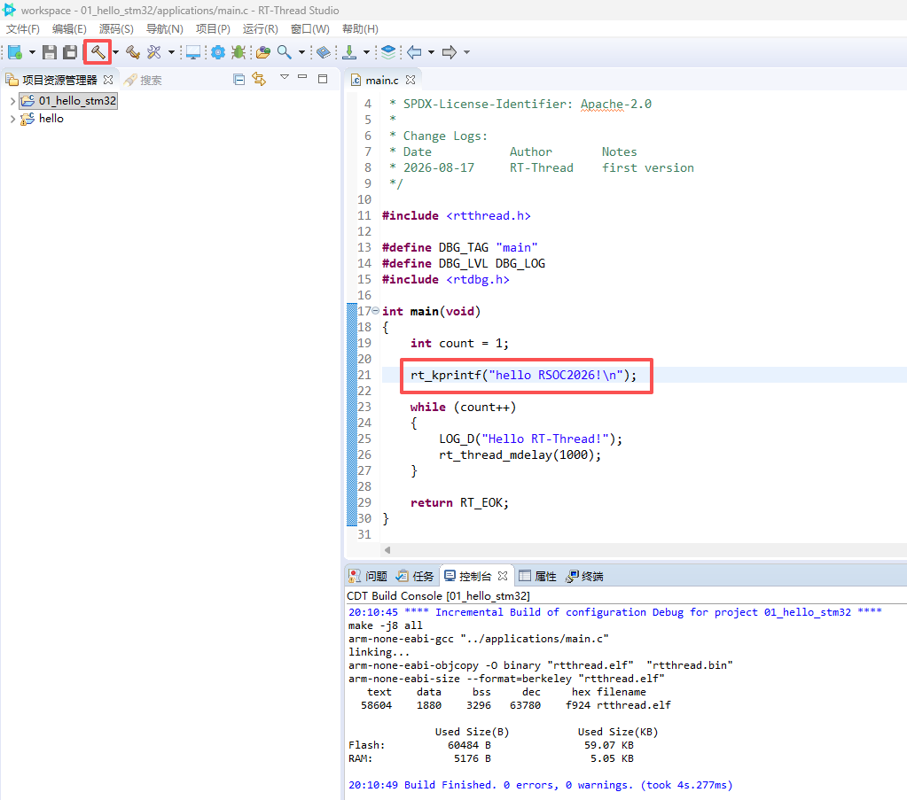


5.下载
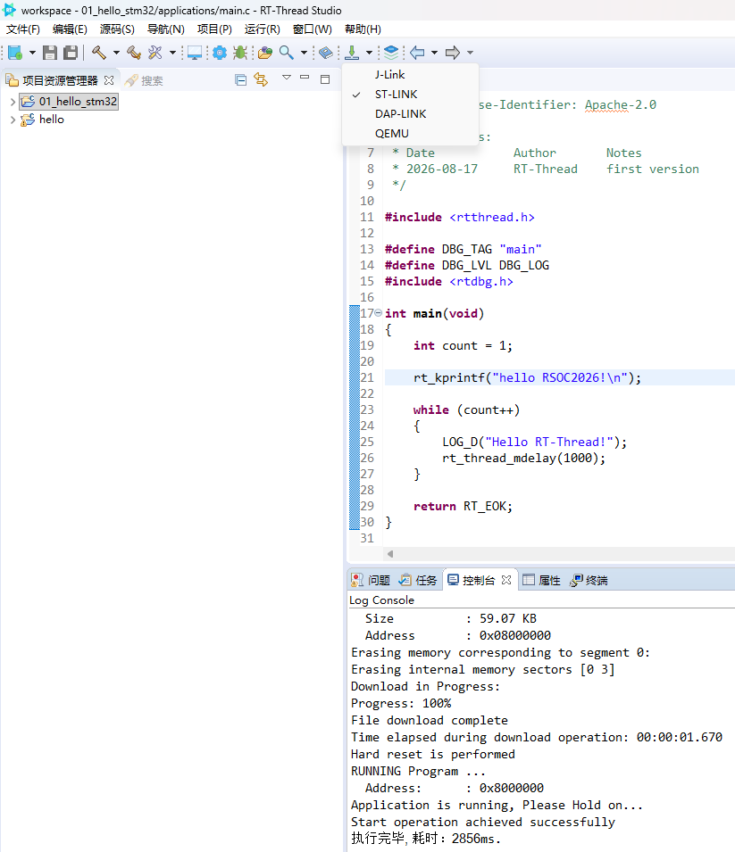


6.启动串行终端。注意波特率：115200

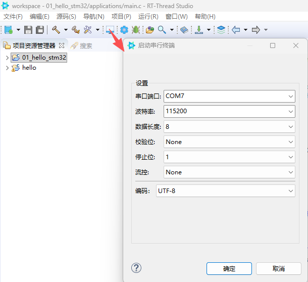


7.终端结果打印，配合复位按键。

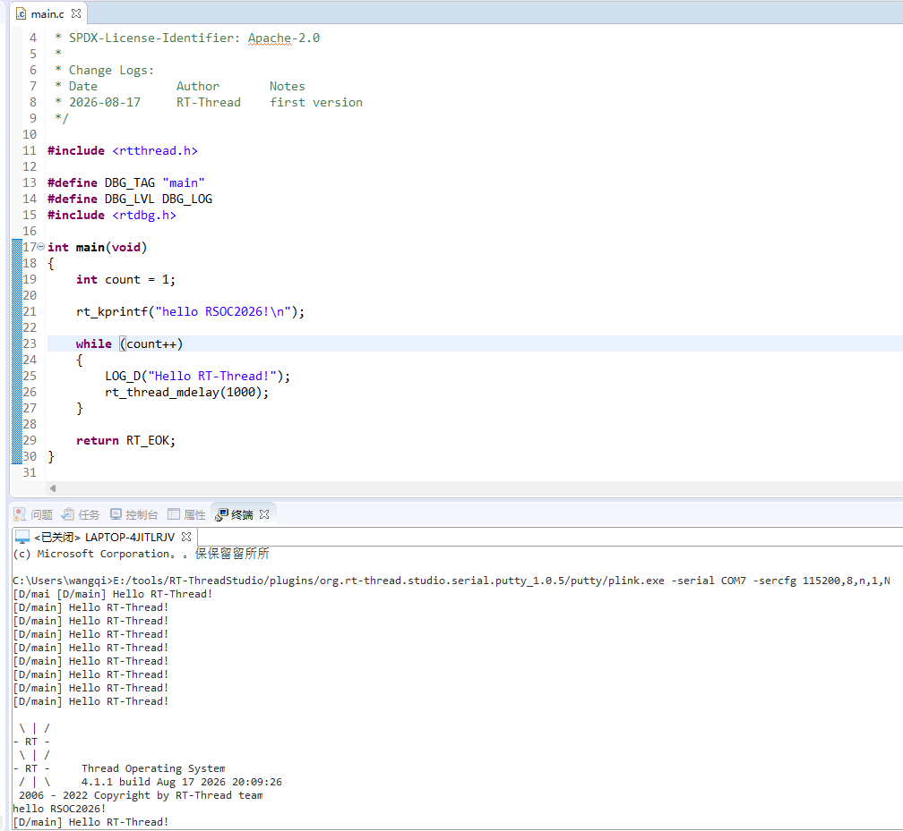

8.Debug,升级固件

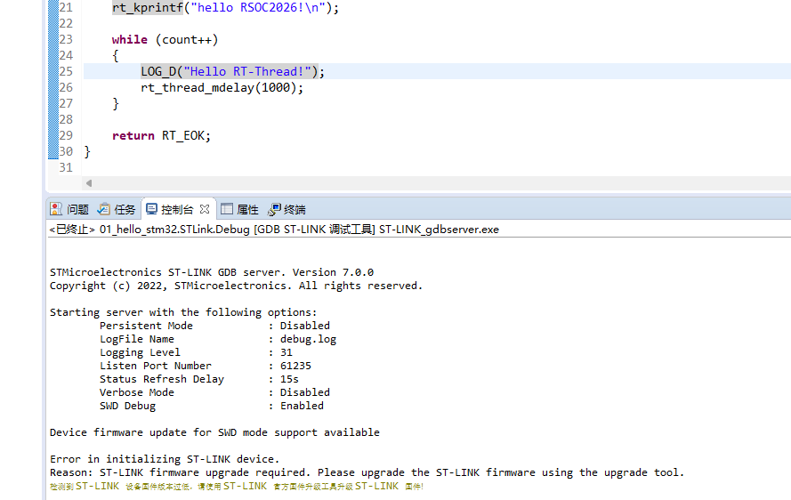

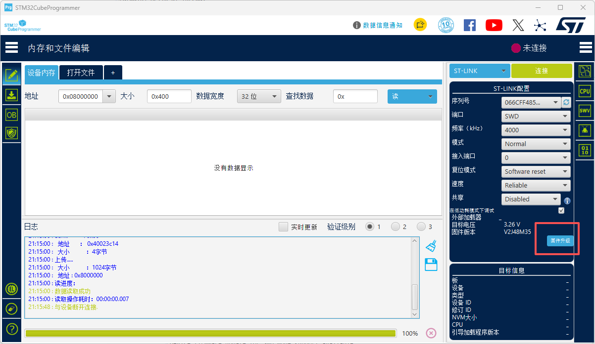

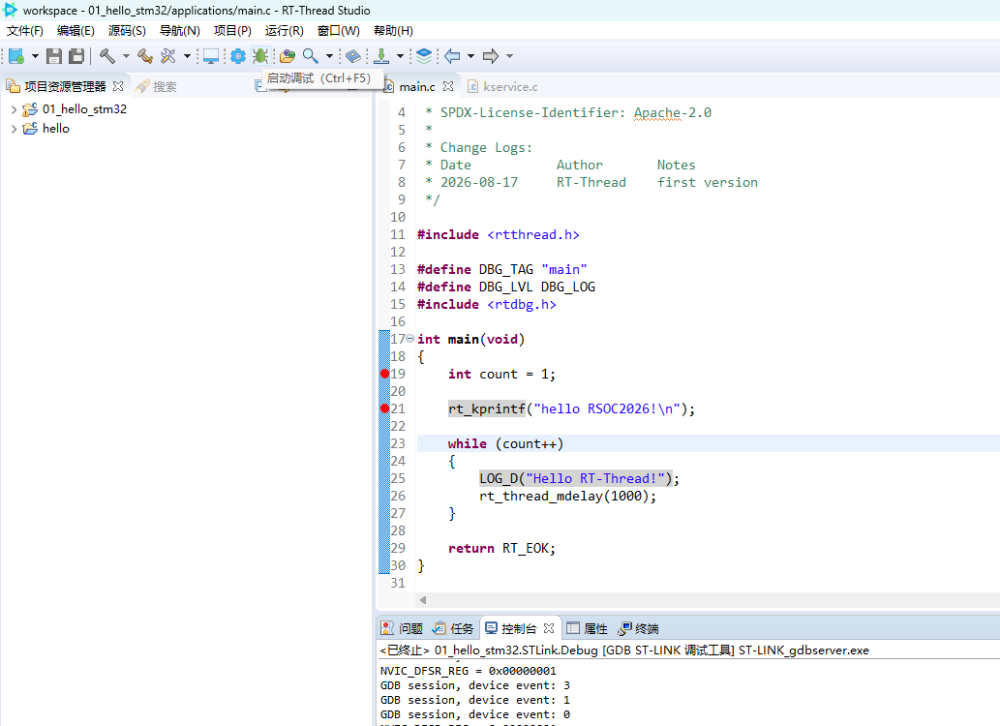


