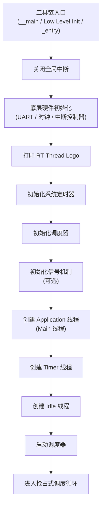
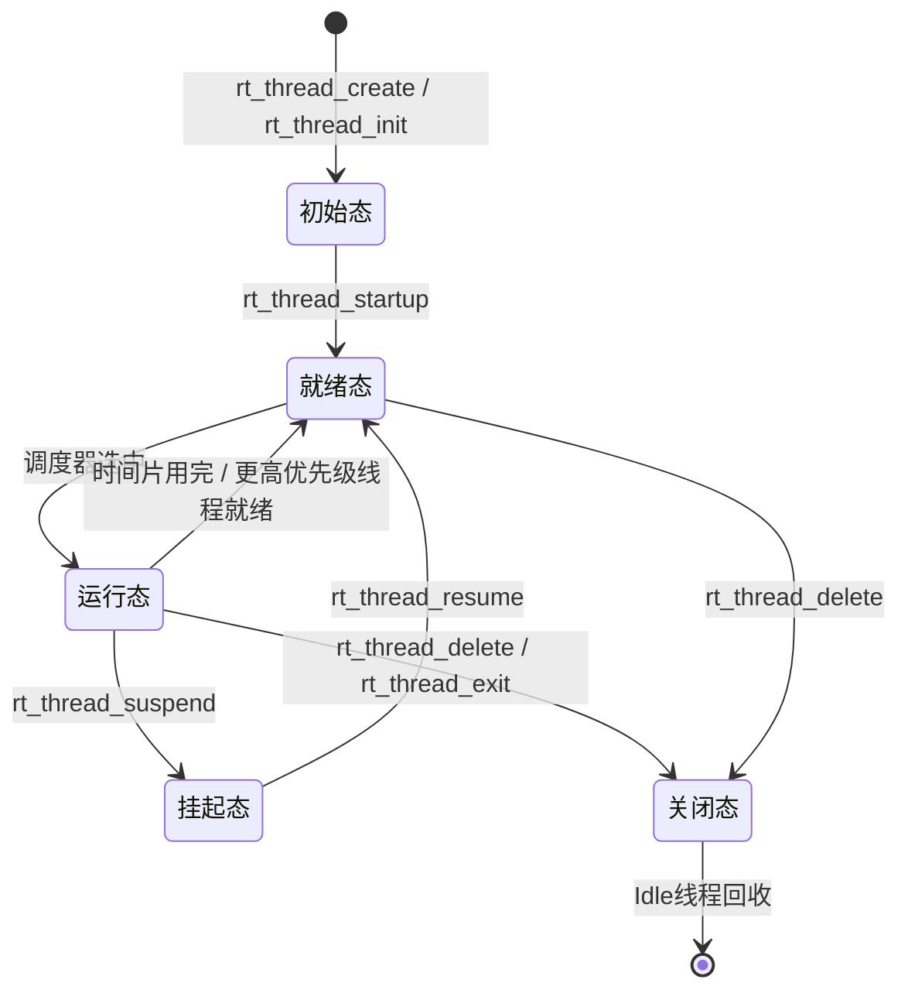
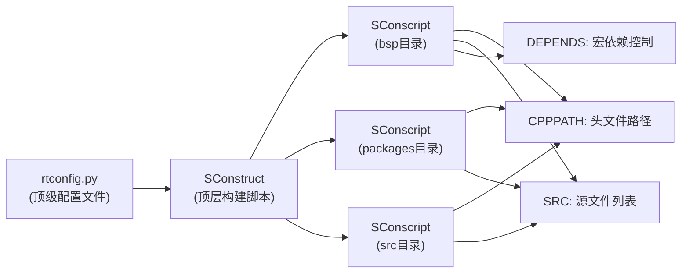
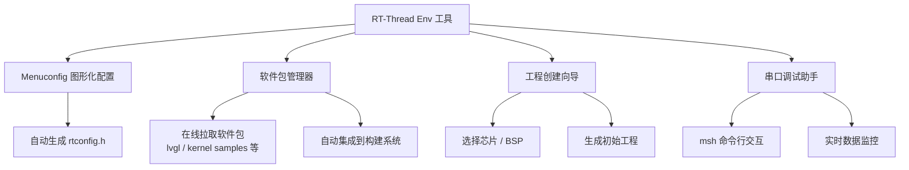
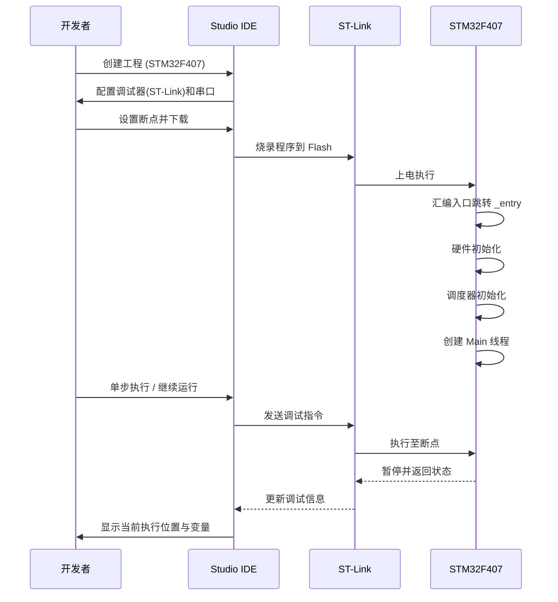
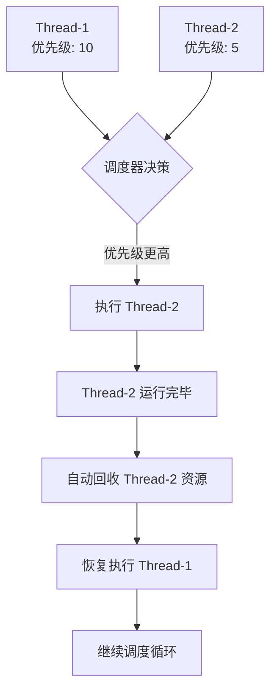

# RT-Thread 学习笔记

---

## 一、RT-Thread 内核启动流程与线程机制

针对嵌入式开发从裸机向RTOS过渡的需求，讲师详细拆解了RT-Thread的内核启动逻辑与线程管理核心概念。

### 1.1 裸机开发的局限性

**阻塞性问题：** 裸机前后台系统中，后台循环任务若存在阻塞行为（如等待标志位），会导致LCD刷新等实时任务无法及时响应。

**系统缺陷总结：**

| 缺陷类型 | 具体表现 |
| :--- | :--- |
| 并发效率低 | 无法并行执行多个任务 |
| 实时性差 | 阻塞影响导致响应延迟 |
| 可维护性差 | 牵一发而动全身 |
| 可重用性差 | 模块化程度低 |

### 1.2 RT-Thread 启动流程详解

**工具链入口差异：** 不同工具链（MDK/IAR/GCC）在main函数之前有不同的插桩入口函数（如MDK的`__main`、IAR的`Low Level Init`、GCC的`_entry`），RT-Thread利用这些入口进行系统初始化。

**启动流程序列图：**

**调度器启动与切换：** 调度器启动后，系统基于抢占式优先级策略查找最高优先级线程执行；若优先级相同，则基于时间片轮转调度。

### 1.3 线程生命周期与状态管理

**线程状态流转：** 线程生命周期包含初始态、就绪态、运行态、挂起态和关闭态。创建线程后需调用 `rt_thread_startup` 使其进入就绪态。

**线程状态流转图：**

**上下文切换机制：** 线程切换涉及保存上下文（压栈）和恢复上下文（弹栈），确保切换前后代码执行逻辑不被破坏。

**空闲线程（Idle）职责：** 优先级最低（通常为31），负责资源回收（销毁关闭态线程）及低功耗管理（如喂狗、休眠）。

### 1.4 线程创建方式对比

**静态创建（Static）：** 使用 `rt_thread_init`，需预先分配栈空间数组，编译阶段即可确定RAM/Flash占用，具有确定性，适用于高安全场景。

**动态创建（Dynamic）：** 使用 `rt_thread_create`，从系统堆分配内存，灵活性高但存在内存碎片风险，不具备确定性。

**创建方式对比表：**

| 对比维度 | 静态创建 | 动态创建 |
| :--- | :--- | :--- |
| API | `rt_thread_init` | `rt_thread_create` |
| 内存分配 | 预先分配栈空间数组 | 从系统堆动态分配 |
| 确定性 | 编译阶段可确定RAM/Flash占用 | 运行时分配合并，不具备确定性 |
| 内存碎片 | 无碎片风险 | 存在内存碎片风险 |
| 适用场景 | 高安全、实时性要求高的场景 | 灵活多变、资源充足的应用场景 |
| 销毁方式 | 手动调用 `rt_thread_detach` | 自动回收或手动删除 |

---

## 二、SCons 构建系统语法与应用

讲师介绍了RT-Thread采用的SCons构建系统，旨在简化Makefile配置，提升开发效率。

### 2.1 SCons 核心语法与脚本结构

**脚本文件构成：** 每个源码子目录通常包含SConscript脚本，用于配置当前层级源码的构建行为；rtconfig.py为顶级配置文件，定义编译器参数。

**路径与文件配置：** 使用 `CPPPATH` 添加头文件路径，`SRC` 列表添加源文件；可通过 `glob` 函数进行通配符匹配。

**依赖关系控制：** 使用 `DEPENDS` 参数定义宏依赖，仅在特定宏定义生效时，对应的源码才会参与构建。

**SConscript 脚本结构图：**

### 2.2 构建命令与工程生成

**常用构建命令：**

| 命令 | 功能说明 |
| :--- | :--- |
| `scons` | 编译整个工程 |
| `scons -c` | 清理编译产物 |
| `scons --target=xxx` | 生成特定IDE工程（MDK、IAR、VS Code等） |
| `scons --dist` | 打包BSP为独立压缩包，移除无关文件 |

**工程打包（Dist）：** 使用 `scons --dist` 命令可将当前BSP打包成独立的压缩包，移除无关文件，便于独立开发。

### 2.3 图形化配置工具（Env/Studio）

**菜单配置（Menuconfig）：** 通过Env工具或RT-Thread Studio的图形化界面配置内核参数，配置结果自动写入 `rtconfig.h`。

**软件包管理：** 支持在线拉取软件包（如lvgl、kernel samples），自动集成到工程构建中。

**Env 工具生态图：**

---

## 三、实操演示与调试技巧

通过STM32星火一号开发板演示了完整的开发流程。

### 3.1 工程创建与调试

**基于芯片创建工程：** 在Studio中基于STM32F407芯片创建工程，配置调试器（ST-Link）和串口。

**调试启动流程：** 通过打断点验证启动流程，从汇编入口跳转到 `_entry` 函数，依次执行硬件初始化、调度器初始化及线程创建。

**调试流程时序图：**

### 3.2 线程实例演示

**线程调度验证：** 演示了kernel samples软件包中的线程示例，展示了线程优先级调度（Thread-2优先执行）及线程退出后的自动回收。

**线程调度演示图：**

**命令行交互：** 利用msh命令行工具查看线程列表（list_thread），验证线程状态。

**msh 常用命令参考：**

| 命令 | 功能 |
| :--- | :--- |
| `list_thread` | 查看当前所有线程列表及状态 |
| `list_sem` | 查看信号量信息 |
| `list_event` | 查看事件对象 |
| `list_mutex` | 查看互斥量信息 |
| `list_msg` | 查看消息队列信息 |
| `list_mem` | 查看内存池信息 |
| `df` | 查看文件系统信息 |
| `ping` | 网络连通性测试 |

---

## 四、Day 2 作业核心理论补充

根据作业要求，针对STM32F407启动细节、内核对象模型及调度算法进行深度梳理。

### 4.1 STM32F407 启动流程与 RT-Thread 引导机制

#### 1. 启动路径：从复位到 main()

在STM32F407上，RT-Thread的启动调用链如下：

1. **上电复位 (Reset_Handler)**：位于 `startup_stm32f407xx.s`。
   - 初始化栈指针 SP。
   - 复制 `.data` 段到 SRAM，清零 `.bss` 段。
   - 调用 `SystemInit` 配置时钟。
   - 跳转至 `__main` (ARMCC) 或 `_entry` (GCC)。
2. **C 库初始化与入口**：
   - 进入 `components.c` 中的 `rtthread_startup()`。
3. **RT-Thread 内核初始化**：
   - `rt_hw_interrupt_disable()`：关中断。
   - `rt_hw_board_init()`：板级初始化（SysTick, UART, Heap）。
   - `rt_show_version()`：打印版本信息。
   - `rt_timer_init()`：定时器初始化。
   - `rt_thread_init()`：调度器初始化。
   - `rt_system_signal_init()`：信号初始化（若开启）。
   - `rt_application_init()`：**创建 main 线程**（入口函数为 `main_thread_entry`）。
   - `rt_system_timer_thread_init()`：创建 timer 线程。
   - `rt_system_idle_init()`：创建 idle 线程。
   - `rt_thread_startup(&idle)`：启动 idle 线程。
   - `rt_system_scheduler_start()`：**启动调度器**（从此不再返回，跳转到最高优先级线程，即 main 线程）。
4. **用户 main 函数**：
   - `main_thread_entry()` -> `rt_application_init()` -> `main()`。

#### 2. 自动初始化原理

RT-Thread 使用 `__attribute__((section("...")))` 将初始化函数指针放入特定的只读数据段，实现类似构造函数机制。

- **实现机制**：
  - 定义宏 `INIT_EXPORT(fn, level)`。
  - 利用 `__attribute__((section(".rti_fn." level)))` 将 `fn` 的地址存放在特定的段中。
- **初始化等级**：
  - `INIT_BOARD_EXPORT(fn)`：等级 "1"。在 `rtthread_startup` 中，`rt_hw_board_init` 之后执行。用于板级硬件驱动初始化。
  - `INIT_APP_EXPORT(fn)`：等级 "4"。在 `rt_application_init` 中，`main` 线程创建后执行。用于应用层初始化。
- **执行流程**：内核启动时，通过遍历这些段的起始地址和结束地址，依次调用其中的函数指针。

### 4.2 内核基础与对象模型

#### 1. 面向对象的设计思想

RT-Thread 虽然是 C 语言编写，但通过结构体继承模拟了面向对象。

- **基类**：`struct rt_object`（包含名称、类型、标志、列表节点）。
- **继承**：内核对象（线程、信号量、互斥量等）的第一个成员都是 `struct rt_object`。
- **容器管理**：所有内核对象都挂载在 `rt_object_container` 中，通过链表管理，支持按名称查找。

#### 2. 线程控制块 (TCB) 关键成员

`struct rt_thread` 继承自 `struct rt_object`。

| 成员变量 | 作用描述 |
| :--- | :--- |
| `sp` (stack pointer) | **栈指针**。指向线程栈顶，上下文切换时用于保存/恢复 CPU 寄存器。 |
| `stat` (status) | **线程状态**。标识线程当前处于就绪、挂起、初始化等状态。 |
| `current_priority` | **当前优先级**。调度器依据此值决定执行顺序（数值越小优先级越高）。 |
| `init_tick` | **初始时间片**。线程每次获得 CPU 时的默认时间片长度。 |
| `remaining_tick` | **剩余时间片**。运行时递减，减为0时触发时间片轮转。 |
| `entry` | **线程入口函数**。线程启动后执行的具体任务逻辑。 |
| `parameter` | **入口参数**。传递给线程入口函数的参数。 |
| `stack_addr` / `stack_size` | 栈起始地址和大小，用于栈溢出检测。 |

#### 3. 内存分配方式对比

- **静态对象**：
  - **分配**：编译时分配（全局变量或静态变量）。
  - **生命周期**：永久存在，直到系统关闭。
  - **释放**：通常不需要释放，或仅从内核对象容器中脱离。
  - **场景**：高可靠场景（如航天、医疗），避免运行时内存分配失败或碎片化。
- **动态对象**：
  - **分配**：运行时从系统堆（heap）分配。
  - **生命周期**：动态创建和删除。
  - **释放**：必须调用删除接口（如 `rt_thread_delete`），由 Idle 线程回收内存。
  - **场景**：通用应用，灵活性高。

### 4.3 线程状态机与调度算法

#### 1. 五态模型与 API 触发

| 状态 | 描述 | 触发 API / 事件 |
| :--- | :--- | :--- |
| **初始态** | 线程已创建但未就绪 | `rt_thread_create/init` |
| **就绪态** | 线程准备好运行，等待 CPU | `rt_thread_startup` (从初始态) `rt_thread_resume` (从挂起态) 时间片用完 (从运行态) |
| **运行态** | 线程正在占用 CPU | 调度器选中 (从就绪态) |
| **挂起态** | 线程被阻塞或主动挂起 | `rt_thread_suspend` `rt_thread_delay` `rt_sem_take` (等待信号量) |
| **关闭态** | 线程执行完毕或被删除 | `rt_thread_exit` `rt_thread_delete` |

#### 2. 调度机制剖析

- **抢占式调度 (Preemptive Scheduling)**：
  - **原理**：系统总是执行**当前就绪状态中优先级最高**的线程。
  - **触发时机**：
    1. 当前线程优先级降低或挂起。
    2. 有更高优先级的线程变为就绪态（如中断中释放信号量唤醒了高优先级线程）。
  - **特点**：实时性强，响应快。

- **时间片轮转调度 (Round-Robin Scheduling)**：
  - **原理**：当多个线程**优先级相同**时，它们共享 CPU。
  - **机制**：每个线程分配一个时间片（Tick）。SysTick 中断发生时，剩余时间片减 1。当时间片减为 0，该线程被放到同优先级就绪队列的末尾，下一个线程获得执行权。
  - **特点**：保证同优先级任务的公平执行。
