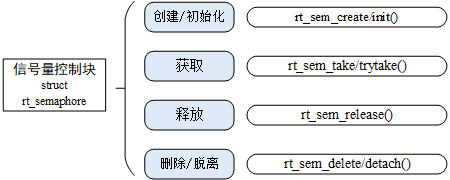
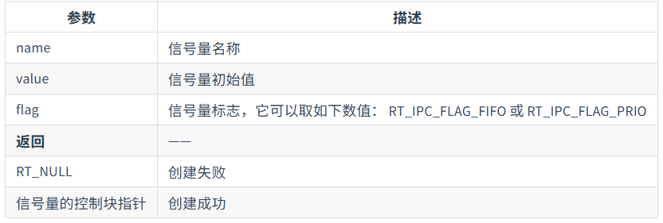
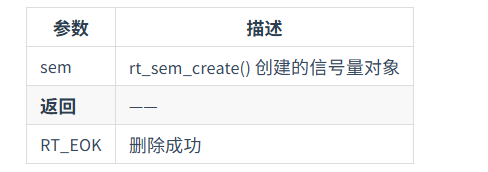
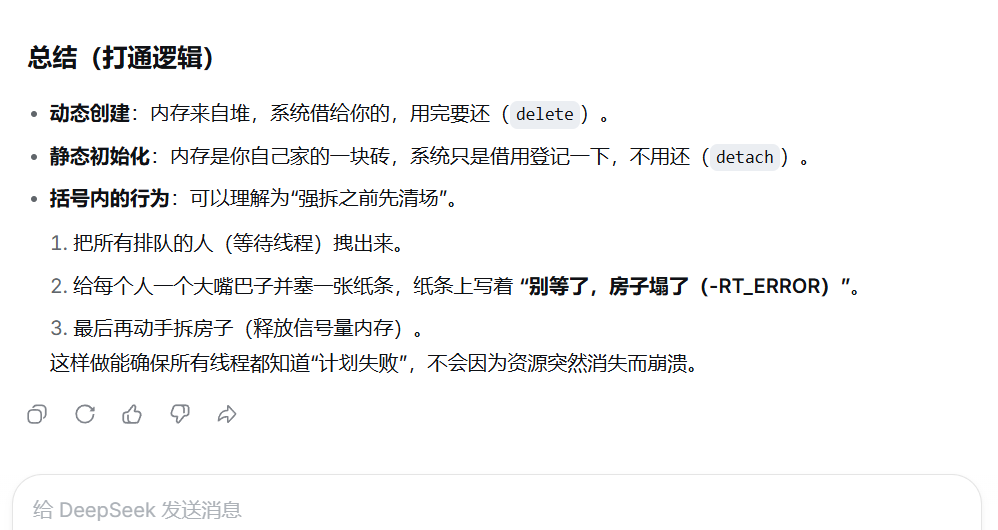
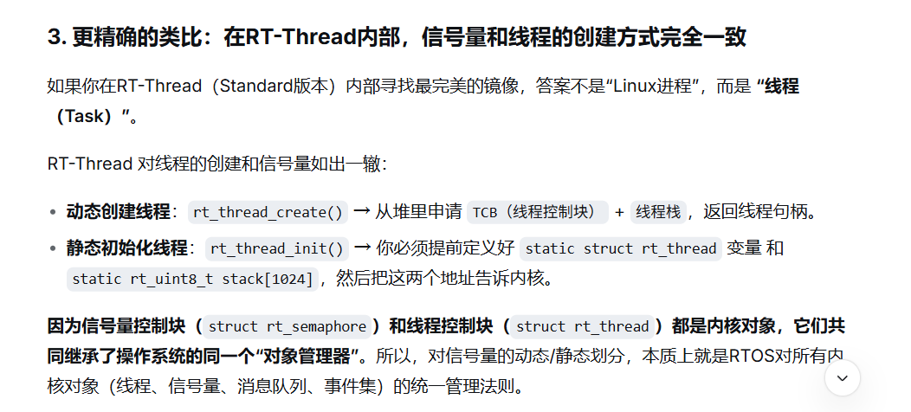
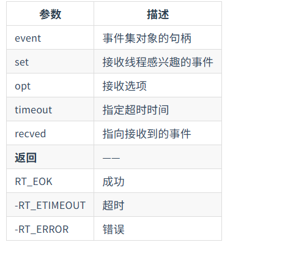

引入：RTOS中会频繁地使用多线程地编程，在多线程中如何实现线程间地通信
# IPC机制（Inter-Process Communication）
指进程/线程/任务之间交换数据或信号的方式

IPC机制是操作系统提供的一套标准化的“软硬件接口”，允许不同的执行实体（线程/任务，或在中断中）安全地交换数据或同步执行节奏。

分为线程同步和线程间通信，线程同步分为信号量（Semaphore）、互斥量(mutex)和事件集(event)；线程间通信分为邮箱（mailbox）和消息队列（msgqueue）

概念：
- 临界区：一个资源在一个时间只能被一个线程使用，不能被多个线程占用
- 阻塞（这里有对上课时内容的修正和重新表述）：**阻塞是对等待者讲的，非阻塞是对调用方式讲的**
  - 线程阻塞：当某线程尝试获取已被占用的临界区资源时，由于资源不可用，该线程被迫由就绪/运行态转入等待态（阻塞态）的现象。阻塞是由内核强制施加给“等待线程”的被动状态。线程在访问临界区资源时，调用同步接口（如 take 带超时时间）。若资源被占用，该线程主动放弃CPU使用权，进入阻塞态等待。直到资源释放，线程被唤醒后继续执行。这种模式以“同步等待”为本质特征，线程的生命周期受制于外部资源的状态。
  - 阻塞式访问：线程采用同步等待机制，若资源不满足则长期挂起，直至资源可用
  - 非阻塞式访问：线程采用立即返回机制，若资源不满足则快速失败（返回错误），线程继续保持运行，后续可通过轮询或回调机制检查资源状态
  - 关于占用临界区资源的线程：持有临界区资源的线程不被称为阻塞式线程，它应该被称为“资源持有者”，它导致了其他线程的阻塞，但自身在该时间段内不受资源锁的限制（除非它再次嵌套请求自身持有的锁，那属于递归死锁问题）
- 挂起：当线程被阻塞时，会转入挂起状态，到阻塞解除，线程被唤醒时才到新的状态

## 信号量的概念和使用
一种用于解决线程间同步问题的内核对象，一个或多个线程可以获取或释放它达到线程间同步或互斥的目的。信号量用于实现任务与任务之间、任务与中断处理程序之间的同步或者是互斥
分为三种：
- 互斥信号量：用于解决互斥问题，但可能造成优先级反转
- 二值信号量：用于解决同步问题
- 计数信号量：用于解决资源计数问题

本质上，信号量是一个“计数器+等待队列”。在底层上就是一个整数计数器，配套take和give两个基本操作。
- 计数值>0：还有空闲资源或未触发的信号，线程获取时直接成功，计数值-1
- 计数值=0：代表资源耗尽或信号未到，此时线程来获取，就会触发阻塞（挂起），被放到等待队列中排队
- 释放：计数值+1，并唤醒等待队列中的第一个线程

### 互斥和同步
用于互斥和同步：是两种不同的使用场景，取决于把信号量的初始值设为多少。是由OS维护的公共计数器
- 用于互斥（保护临界区），初值设为1（二值信号量）。一个进程take成功后，该量变为0，其他线程再来时由于计数值变为0，所以必须等待
- 用于同步（协调先后顺序），初值设为0。例如线程B必须等待线程A做完某事才能继续，初始值未0时，线程B去进行take操作，立即被阻塞；线程A完成后，调用give，计数值变为1，线程B被唤醒。这样就实现了线程同步，不涉及资源占用的场景
- 关于一个或多个线程可以获取或释放：是信号量和互斥量的核心区别。互斥场景下，通常规定同一个线程获取就必须由该线程释放（谁上锁谁解锁），在同步场景下，获取和释放可以由不同的线程完成（如生产者释放，消费者获取），在同步场景下只关心计数器数值变化
- 结合“中断”与任务交互：中断只能give，不能take信号量。外部设备触发中断，ISR（中断处理程序）立即调用Give（释放信号量，值+1）然后快速退出。从等待输入的任务视角，在触发中断之前（如用户输入数据），任务调用take获取信号量，因为初始值为0，任务会进入阻塞态，直到ISR释放信号量，任务被唤醒，才开始处理（本示例场景下）用户输入的数据（会触发中断）
  
### 二值信号量
主要用于线程和线程之间、线程与中断服务程序ISR之间的同步，在上面解释过，这里不再赘述

### 计数信号量
初始化为临界区资源的可使用数量

## 信号量结构体和操作
文档中心  [线程同步](https://www.rt-thread.org/document/site/#/rt-thread-version/rt-thread-standard/programming-manual/ipc1/ipc1?id=信号量)
- 创建/初始化信号量
- 删除/脱离
- 获取/释放
- 尝试获取信号量
### 信号量控制块

```c
struct rt_semaphore
{
   struct rt_ipc_object parent;  /* 继承自 ipc_object 类 */
   rt_uint16_t value;            /* 信号量的值 */
   rt_uint16_t max_value;        /* 信号量的最大值 */
   struct rt_spinlock spinlock;  /* 自旋锁 */
};
/* rt_sem_t 是指向 semaphore 结构体的指针类型 */
typedef struct rt_semaphore* rt_sem_t;
```
线程因信号量不足而进入“阻塞态”（挂起到链表）发生在自旋锁解锁之后。这里**自旋锁**是用于保护信号量控制块内部成员，管的是“修改内部状态”那一刻的并发；而信号量管的是“线程长期等待”的并发的。

关于“自旋”：
在底层的汇编代码层面，自旋锁会被编译为类似这样的死循环：
```assembly
spin_lock:
    ; 尝试原子性地获取锁
    LDREX   r0, [r1]       ; 读取锁变量到寄存器
    CMP     r0, #0         ; 比较是否为0（空闲）
    STREXEQ r0, r1, [r2]   ; 如果是0，尝试写入1（加锁）
    CMP     r0, #0         ; 检查写入是否成功
    BNE     spin_lock      ; 如果失败（锁被占用），跳回开头
                           ; 【重点】这行指令让CPU又回到了这条指令上
```
“自旋”的本质：程序指针（PC指针）在这一段狭小的代码区间内反复跳转。如果画一张程序执行流的路径图，你会发现它既没有前进（执行后续业务），也没有后退（调度出去），而是在原地画着一个紧凑的圆环。这就是“旋转”在计算机指令层面的具象表现。
> 如果你在手机上刷网页，遇到网络卡顿，你死死盯着屏幕上的加载转圈图标——那个转动的菊花。
> 这一刻，你就是CPU。
> 那个转动的菊花图标，就是“自旋”的视觉化。
> 
> 你无法去干别的事（无法切换线程），你所有的注意力都集中在等待网络数据（锁）的到来，你的目光（PC指针）就在那个菊花上反复“扫视”。
> 
> 等到数据来了（锁释放），你立刻开始浏览（执行临界区代码）。

`struct rt_ipc_object parent`是一个父类，在RTT中，所有用于同步和通信的内核对象，都继承自这个`rt_ipc_object`，父类中包含的最关键成员就是**挂起线程的等待队列**
>不管你是信号量（rt_semaphore）、互斥量（rt_mutex），还是消息队列（rt_mq），它们的底层阻塞机制是复用的。当你调用rt_sem_take导致线程阻塞时，线程并不是凭空消失，而是被挂载到了rt_ipc_object所包含的那个等待链表上。等到别的线程或中断调用rt_sem_release时，内核直接操作这个父类的链表，把线程“摘”下来唤醒。

`rt_ipc_object` 的等待链表管理的是线程控制块（TCB），而线程句柄则是指向这个TCB的指针。

### 信号量API
[信号量的管理方式](https://www.rt-thread.org/document/site/#/rt-thread-version/rt-thread-standard/programming-manual/ipc1/ipc1?id=%e4%bf%a1%e5%8f%b7%e9%87%8f%e7%9a%84%e7%ae%a1%e7%90%86%e6%96%b9%e5%bc%8f)



#### 创建和删除信号量

创建一个信号量时，内核首先创建一个信号量控制块，然后对该控制块进行基本的初始化操作

创建信号量使用的函数接口为`rt_sem_create`
```c
rt_sem_t rt_sem_create(
    const char*name,
    rt_uint32_t value, 
    rt_uint8_t flag);
```
调用这个函数时，系统先从对象管理器中分配一个信号量（semaphore）对象，并初始化这个对象

然后初始化父类IPC对象以及semaphore相关部分

该函数的参数和返回值如下表所示：


在创建信号量指定的参数中，信号量标志参数（flag）决定了当前信号量不可用时，多线程等待的排队方式。选择RT_IPC_FLAG_FIFO（先进先出）时，等待线程队列将按照FIFO方式排队，先进入队列的线程先获得等待的信号量；选择RT_IPC_FLAG_PRIO（优先级等待）时，等待线程队列按照优先级排序。

这里的FIFO属于非实时调度方式，所有涉及到的信号量都会变成非实时线程，在非常在意线程的先来后到时可以使用RT_IPC_FLAG_FIFO。在需要确保线程的实时性时，建议采用RT_IPC_FLAG_PRIO

系统不再使用该信号量时，可以通过删除信号量释放系统资源，适用于动态创建（rt_sem_create）的信号量（从堆上分配的）

```c
rt_err_t rt_sem_delete(rt_sem_t sem);
```
调用这个函数时，系统将删除这个信号量。


如果删除这个信号量时，有进程正在等待该信号量，删除操作会先唤醒在该信号量上的线程()，然后再释放该信号量的内存资源。

以下是ds对上述删除操作内容的解释：


更细致的解释：
1. 先唤醒：信号量被删除，意味着这个IPC对象即将“物理消失”。如果此时还有线程挂在该信号量的等待链表上（阻塞态），并且系统直接把信号量的内存释放掉，那么这些线程的TCB（线程控制块）里依然记录着“我在等这个地址的信号量”。一旦内存被释放，这个地址可能被分配给其他数据，线程再去访问就是野指针/内存越界，系统必定死机或崩溃。
2. 唤醒时发生的事：内核在释放内存之前，会遍历该信号量等待链表上的所有线程，强行将它们从阻塞态拉出来，放入就绪队列。
3. 等待线程返回值是RT_ERROR：系统将所有等待线程从rt_sem_take()函数的返回值设为RT_ERROR(一个通用的错误码，如果是成功会返回RT_EOK)，不会获得信号量（因为信号量已经被毁了）；对于等待该信号量的应用程序此时也知道自己等待的哪个信号量（锁）已经不存在了，没有拿到资源，需要执行错误处理分支（如重试、放弃任务或重启设备等）

> 关于动态创建的信号量和进程（问的时候打错了，先记录相关部分，后续再修改）（ds的回复）
> 在思想层面（内存管理策略）上，它们高度相似,都遵循着 “运行时借（堆）” 和 “编译时买（静态区）” ；但在具体实现和系统开销层面，它们有着本质的区别，进程创建涉及MMU、虚拟内存和文件加载，而RT-Thread的信号量创建仅仅是操作一个无MMU的物理内存块。
> 

> 关于创建信号量和创建线程
> 

#### 初始化和脱离信号量
静态信号量的初始化发生在运行时，使用前，而不是编译时。动态信号量初始化发生在调用rt_sem_create()的函数内部，在内存申请成功之后，所以动态创建的信号量不需要再显式初始化

对于静态信号量对象，其内存空间在编译期就被编译器分配出来，放在读写数据段或未初始化数据段上，在使用前调用`rt_sem_init`对其(semaphore对象)进行初始化，然后初始化IPC对象及与semaphore相关的部分

```c
rt_err_t rt_sem_init(
    rt_sem_t sem,       //信号量对象的句柄
    const char *name,   //信号量名称
    rt_uint32_t value,  //信号量初始值
    rt_uint8_t flag)    //信号量标志，它可以取如下数值： RT_IPC_FLAG_FIFO 或 RT_IPC_FLAG_PRIO

    //初始化成功返回RT_EOK
```

脱离信号量

脱离和删除：都会把信号量从内核对象管理链表上摘除，并且都会强行唤醒所有等待该信号量的线程（让它们返回RT_ERROR），区别在是否释放信号量本身占用的内存块。

1. 删除（rt_sem_delete）:
   1. 仅限动态创建的信号量
   2. 内核动作：唤醒所有等待线程（给他们返回错误码）；把信号量控制块从内核链表摘下；调用rt_free()将信号量控制块占用的那十几个字节内存释放回系统的堆内存中（归还给堆管理器）
   3. 结果：之前持有的那个指针（rt_sem_t）变为“野指针”，这块内存可以被系统重新分配给其他对象
2. 脱离（rt_sem_detach）：rt_err_t rt_sem_detach(rt_sem_t sem);
   1. 仅限通过rt_sem_init()静态初始化的信号量（内存是全局变量或静态变量）
   2. 内核动作：前两步和删除相同，后面不调用rt_free，也不释放任何内存
   3. 结果：之前保存信号量的那块内存（全局结构体变量）仍然在物理内存的.data或.bss段中，只是内核不再管理它了，可以再次调用rt_sem_init()把它重新挂回内核链表，重新投入使用
> 如果在“不再管理”期间，你擅自修改了结构体内部的私有字段（比如自己改了 value），再重新init时，这些修改会被init函数覆盖，一切以init设置的值为准。

#### 获取信号量
线程通过获取信号量来获得信号量资源实例，当信号量值大于零时，线程将获得信号量，并且相应的信号量值会减 1，获取信号量使用下面的函数接口

rt_err_t rt_sem_take (rt_sem_t sem, rt_int32_t timeout);

当用户不想在申请的信号量上挂起线程进行等待时，可以使用无等待方式获取信号量

rt_err_t rt_sem_trytake(rt_sem_t sem);

这个函数与 rt_sem_take(sem, RT_WAITING_NO) 的作用相同，即当线程申请的信号量资源实例不可用的时候，它不会等待在该信号量上，而是直接返回 - RT_ETIMEOUT。

#### 释放信号量

释放信号量可以唤醒挂起在该信号量上的线程。当信号量的值等于零时，并且有线程等待这个信号量时，释放信号量将唤醒等待在该信号量线程队列中的第一个线程，由它获取信号量；否则将把信号量的值加 1。

rt_err_t rt_sem_release(rt_sem_t sem);

## 互斥量

一种特殊的二值信号量

优先级翻转，即当一个高优先级线程试图通过信号量机制访问共享资源时，如果该信号量已被一低优先级线程持有，而这个低优先级线程在运行过程中可能又被其它一些中等优先级的线程抢占，因此造成高优先级线程被许多具有较低优先级的线程阻塞，实时性难以得到保证。

RTT中
互斥量可以解决优先级翻转问题，实现的是优先级继承协议 (Sha, 1990)。优先级继承是通过在线程 A 尝试获取共享资源而被挂起的期间内，将线程 C 的优先级提升到线程 A 的优先级别，从而解决优先级翻转引起的问题。这样能够防止 C（间接地防止 A）被 B 抢占，如下图所示。优先级继承是指，提高某个占有某种资源的低优先级线程的优先级，使之与所有等待该资源的线程中优先级最高的那个线程的优先级相等，然后执行，而当这个低优先级线程释放该资源时，优先级重新回到初始设定。因此，继承优先级的线程避免了系统资源被任何中间优先级的线程抢占。


## 事件集
一个事件集可以包含多个事件，利用事件集可以完成一对多，多对多的线程间同步。

### 事件集控制块
```c
struct rt_event
{
    struct rt_ipc_object parent;    /* 继承自 ipc_object 类 */

    /* 事件集合，每一 bit 表示 1 个事件，bit 位的值可以标记某事件是否发生 */
    rt_uint32_t set;
    struct rt_spinlock spinlock;
};
/* rt_event_t 是指向事件结构体的指针类型  */
typedef struct rt_event* rt_event_t;

```
### 发送事件
发送事件函数可以发送事件集中的一个或多个事件
```c
rt_err_t rt_event_send(rt_event_t event, rt_uint32_t set);
```

### 接收事件
内核使用 32 位的无符号整数来标识事件集，它的每一位代表一个事件，因此一个事件集对象可同时等待接收 32 个事件，内核可以通过指定选择参数 “逻辑与” 或“逻辑或”来选择如何激活线程，使用 “逻辑与” 参数表示只有当所有等待的事件都发生时才激活线程，而使用 “逻辑或” 参数则表示只要有一个等待的事件发生就激活线程。
```c
rt_err_t rt_event_recv(rt_event_t event,
                           rt_uint32_t set,
                           rt_uint8_t opt,
                           rt_int32_t timeout,
                           rt_uint32_t* recved);

```
当用户调用这个接口时，系统首先根据 set 参数和接收选项 opt 来判断它要接收的事件是否发生，如果已经发生，则根据参数 opt 上是否设置有 RT_EVENT_FLAG_CLEAR 来决定是否重置事件的相应标志位，然后返回（其中 recved 参数返回接收到的事件）；如果没有发生，则把等待的 set 和 opt 参数填入线程本身的结构中，然后把线程挂起在此事件上，直到其等待的事件满足条件或等待时间超过指定的超时时间。如果超时时间设置为零，则表示当线程要接受的事件没有满足其要求时就不等待，而直接返回 - RT_ETIMEOUT。

