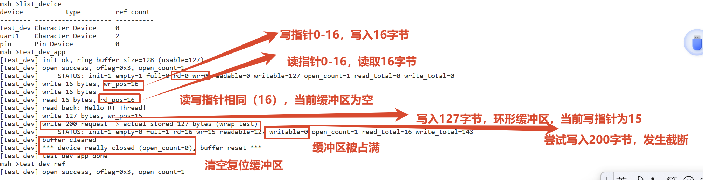
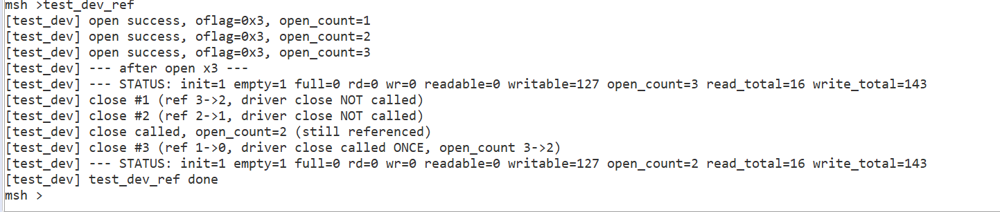

# PIN设备的对接
PIN设备（GPIO）的对接，是将芯片厂商提供的、各不相同的GPIO硬件操作库，通过一个统一的接口包装起来


# 设计虚拟设备驱动框架层 `test_dev`

## 一、设计思路

### 1.1 架构分层

整体架构：

| 层级 | 职责 | 对应代码 |
|------|------|----------|
| **应用层** | 调用标准 API 访问设备，不感知底层实现 | `test_dev_app()`、`test_dev_ref()` |
| **设备管理层** | RT-Thread 内核提供统一设备模型 | `rt_device_find/open/read/write/control` |
| **驱动层** | 实现具体的设备操作逻辑 | `test_dev_init/open/close/read/write/control` |

```c
// 私有数据结构：设备对象作为首成员
struct test_dev
{
    struct rt_device parent;            /* 设备对象（必须第一成员） */
    rt_uint8_t  buffer[TEST_DEV_BUF_SIZE];  /* 环形缓冲区 */
    rt_uint16_t rd_pos;                 /* 读指针 */
    rt_uint16_t wr_pos;                 /* 写指针 */
    rt_uint32_t open_count;             /* 驱动层打开引用计数 */
    rt_uint32_t read_bytes;             /* 累计读字节数 */
    rt_uint32_t write_bytes;            /* 累计写字节数 */
    rt_bool_t   initialized;            /* 初始化标志 */
    struct rt_mutex lock;               /* 互斥锁 */
};
```


---

### 1.2 环形缓冲区（FIFO）

```c
// 环形缓冲辅助函数（代码片段）
static rt_bool_t test_dev_is_empty(struct test_dev *d) {
    return (d->rd_pos == d->wr_pos);
}
static rt_bool_t test_dev_is_full(struct test_dev *d) {
    return (((d->wr_pos + 1) % TEST_DEV_BUF_SIZE) == d->rd_pos);
}
```

**核心机制**：
- **判空**：`rd_pos == wr_pos` → 缓冲区为空
- **判满**：`(wr_pos + 1) % SIZE == rd_pos` → 缓冲区满（留一格空位区分空/满）
- **可读量**：`(wr_pos - rd_pos + SIZE) % SIZE`
- **可写量**：`SIZE - 1 - 可读量`
- **回绕处理**：读写操作分两段拷贝，自动处理指针到达缓冲区末尾时跳回头部

---

### 1.3 并发安全设计

在多线程 RTOS 环境中，缓冲区和计数是共享资源，必须加以保护。

```c
// 所有临界区操作均加锁（代码片段）
rt_mutex_take(&d->lock, RT_WAITING_FOREVER);
// ... 操作 buffer / rd_pos / wr_pos / open_count ...
rt_mutex_release(&d->lock);
```

使用 `rt_mutex` 互斥量保护所有共享资源，确保并发读写场景下数据不会错乱。

---

### 1.4 引用计数与不对称关闭语义

解决多线程共享设备时的资源生命周期管理问题。

```c
// 驱动 open：每次被调用都累加计数（代码片段）
d->open_count++;

// 驱动 close：仅在系统引用计数归零时被调用一次（代码片段）
if (d->open_count > 0) d->open_count--;
if (d->open_count == 0) {
    /* 真正关闭：复位缓冲区 */
    memset(d->buffer, 0, sizeof(d->buffer));
    d->rd_pos = 0;
    d->wr_pos = 0;
}
```

**两层计数**：
| 计数类型 | 维护者 | 变化时机 | 作用 |
|----------|--------|----------|------|
| 系统引用计数 (`ref_count`) | RT-Thread 内核 | `open` +1，`close` -1 | 控制驱动 `close` 是否执行 |
| 驱动私有计数 (`open_count`) | 驱动层 | 驱动 `open` 被调用时 +1 | 追踪真实打开次数，用于最终清理 |

**不对称语义**：
- 驱动 `open` 被调用的次数 = 应用调用 `rt_device_open` 的次数
- 驱动 `close` 仅在系统引用计数归零时被调用 **一次**
- 避免了单一线程关闭设备导致其他线程无法访问的问题

---

### 1.5 打开模式校验

```c
// 模式校验（代码片段）
if ((req_mode == RT_DEVICE_OFLAG_WRONLY) &&
    !(dev_cap & (RT_DEVICE_FLAG_WRONLY | RT_DEVICE_FLAG_RDWR))) {
    return -RT_EINVAL;
}
```

当应用请求的打开模式（只读/只写/读写）与设备能力不匹配时，驱动拒绝打开，返回 `-RT_EINVAL`，增强了驱动可靠性。

---

### 1.6 自定义控制命令

```c
#define TEST_DEV_CTRL_CLEAR       0x01   /* 清空内部缓冲区 */
#define TEST_DEV_CTRL_GET_STATUS  0x02   /* 查询设备状态 */
```

支持清空缓冲区和查询设备运行状态，便于调试和功能验证。

---

## 二、运行结果分析

### 2.1 设备注册

```
[test_dev] registered successfully (direct function pointers)
msh >list_device
device           type         ref count
-------- -------------------- ----------
test_dev Character Device     0
uart1    Character Device     2
pin      Pin Device           0
```

**分析**：`INIT_DEVICE_EXPORT` 在系统启动时自动注册了 `test_dev`。`list_device` 确认设备已加入设备管理器，引用计数为 0（尚未被打开）。

---

### 2.2 基础功能测试：`test_dev_app`

#### ① 打开设备与初始状态

```
[test_dev] init ok, ring buffer size=128 (usable=127)
[test_dev] open success, oflag=0x3, open_count=1
[test_dev] --- STATUS: init=1 empty=1 full=0 rd=0 wr=0 readable=0 writable=127 open_count=1 read_total=0 write_total=0
```

**分析**：
- `init` 初始化环形缓冲区、互斥锁，置 `initialized = 1`。
- `oflag=0x3` 对应 `RT_DEVICE_OFLAG_RDWR`（读写模式）。
- `open_count=1`：驱动层引用计数 +1。
- `writable=127`：缓冲区容量 128，可用空间为 127（留一格区分空/满）。

#### ② 写入并读回

```
[test_dev] write 16 bytes, wr_pos=16
[test_dev] write 16 bytes
[test_dev] read 16 bytes, rd_pos=16
[test_dev] read back: Hello RT-Thread!
```

**分析**：写入 `"Hello RT-Thread!"` 长度 16，写指针从 0→16。读回 16 字节，读指针从 0→16。数据完整读回，FIFO 顺序正确。

#### ③ 环形回绕测试

```
[test_dev] write 127 bytes, wr_pos=15
[test_dev] write 200 request -> actual stored 127 bytes (wrap test)
[test_dev] --- STATUS: init=1 empty=0 full=1 rd=16 wr=15 readable=127 writable=0 open_count=1 read_total=16 write_total=143
```

**分析**：
- 当前 `rd=16, wr=16`（缓冲区为空）。
- 尝试写入 200 字节，驱动自动截断为 127 字节（缓冲区满）。
- `wr_pos` 从 16 开始，写入 127 字节后变为 15，发生**环形回绕**（`(16+127)%128=15`）。
- 状态显示 `full=1`，`readable=127`，`writable=0`，缓冲区完全占满。

#### ④ 清空缓冲区与关闭设备

```
[test_dev] buffer cleared
[test_dev] *** device really closed (open_count=0), buffer reset ***
[test_dev] test_dev_app done
```

**分析**：`TEST_DEV_CTRL_CLEAR` 清空缓冲区。`rt_device_close` 时 `open_count` 从 1→0，触发“真正关闭”，复位缓冲区。

---

### 2.3 引用计数专项测试：`test_dev_ref`

#### ① 连续打开 3 次

```
[test_dev] open success, oflag=0x3, open_count=1
[test_dev] open success, oflag=0x3, open_count=2
[test_dev] open success, oflag=0x3, open_count=3
[test_dev] --- after open x3 ---
[test_dev] --- STATUS: init=1 empty=1 full=0 rd=0 wr=0 readable=0 writable=127 open_count=3 read_total=16 write_total=143
```

**分析**：每次 `rt_device_open` 都进入驱动 `open`，`open_count` 从 1 累加到 3。证明驱动 `open` 调用次数 = 应用 `open` 次数。

#### ② 连续关闭 3 次

```
[test_dev] close #1 (ref 3->2, driver close NOT called)
[test_dev] close #2 (ref 2->1, driver close NOT called)
[test_dev] close called, open_count=2 (still referenced)
[test_dev] close #3 (ref 1->0, driver close called ONCE, open_count 3->2)
[test_dev] --- STATUS: init=1 empty=1 full=0 rd=0 wr=0 readable=0 writable=127 open_count=2 read_total=16 write_total=143
```


**结论**：驱动 `close` 仅在系统引用计数归零时执行一次，完美验证了“不对称关闭”语义。最终 `open_count=2`，缓冲区未被复位（因为 `open_count` 未归零），说明驱动正确区分了“关闭”与“真正释放”。

---
### 运行效果



