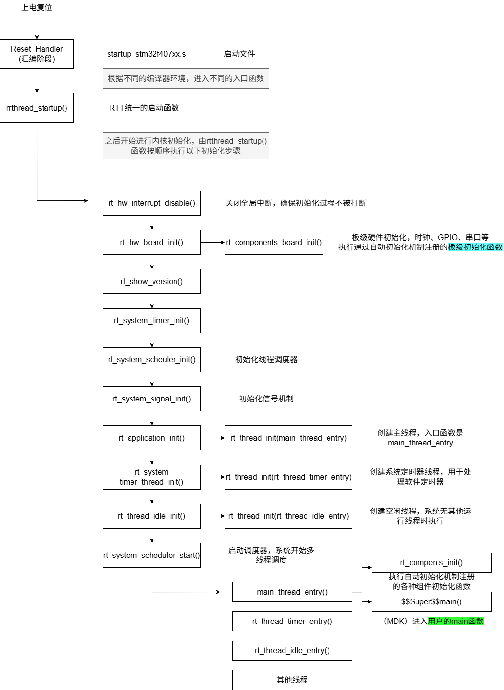
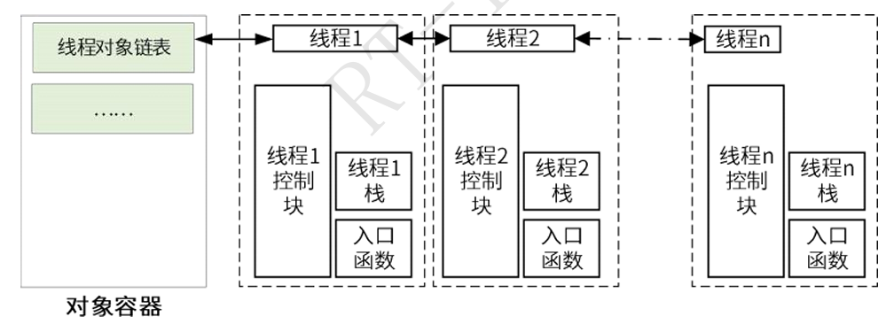
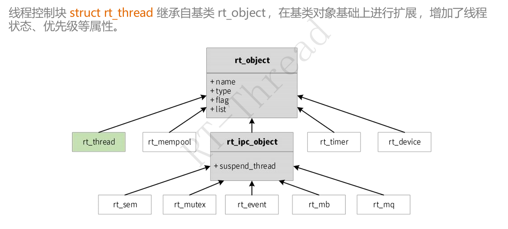
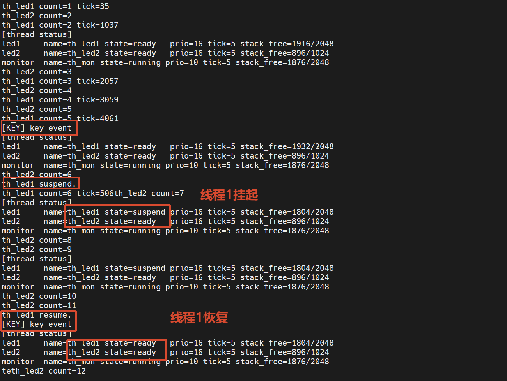

# 【DAY2】RT-Thread 启动流程、内核基础与多线程编程

- **目标平台**：STM32F407 星火号（`stm32f407-rtspark`）
- **提交仓库**：`https://gitee.com/rtthread/rsoc-rtt`
- **作业交付物**：理论总结与实验报告（`README.md`）+ 可编译源码（`*.c`）通过 Gitee PR 提交。

## Part 1：理论知识梳理文档（写入作业目录 `README.md`）

### 1. STM32F407 启动流程与 RT-Thread 引导机制

#### **启动路径**
详细画出/写出从上电复位 `Reset_Handler` 到进入 `main()` 的完整调用链。
  


概念解释：

Rest_Handler是系统上电复位后第一个执行入口，是一段汇编代码，位于芯片启动文件startup_stm32f407xx.s中。是stm32复位后第一个软件执行点，负责完成从硬件复位状态到C语言运行环境的最小必要初始化，最终把控制权交给C代码

启动文件执行后，**在入口函数中调用rtthread_setup()**

系统的线程由调度器分配 rt_system_scheduler_init()初始化线程调度器

信号量不需要时可以关掉

application_init 创建一个线程， main thread是系统中的一个线程，不是裸机中的

系统线程定时器的线程也是可选的，如果打开可以创建一个叫timer的线程

idle初始化，idle比较重要，空闲线程，系统空转时

启动调度器之后上面的调度器开始调度。RTT时抢占式优先级的调度策略，在整个调度链表中找优先级最高的（小号高）执行优先级最高的线程

组件初始化设计RTT的自动初始化机制，通过宏实现（下一道题，自动化初始化原理）。rt_components_init()，进行组件的初始化。在main函数实际调用之前，发现有函数就去调用（自动初始化机制，不需要人手动初始化，是系统初始化的）

然后就进入main函数了

这里的C代码是__main，C库，是系统代码。从上电到用户代码的链如下：
 ```plain
Reset_Handler (汇编)
    └── 直接跳转 ──► __main (C 库，系统代码)
            └── 初始化 C 环境后 ──► 调用main()或$Sub$$main()
                    └── 最终 ──► 用户函数的main()
 ```


#### **自动初始化原理**
解释 `INIT_BOARD_EXPORT` 与 `INIT_APP_EXPORT` 的底层实现原理。

将函数指针放入特定的数据段，启动时遍历调用

补充：
两个宏分别作用于板级初始化和应用初始化。板级初始化阶段内核尚未完全就绪，进行硬件驱动的初始化（UART、GPIO、Timer）应用初始化阶段内核已经完成初始化，调度器即将启动，用于应用系统、文件系统和网络协议栈的初始化。


### 2. 内核基础与对象模型

#### **对象容器与控制块**
简述 RT-Thread 面向对象的设计思想，线程控制块（`struct rt_thread`）中关键成员（如 `stat`、`current_priority`、`init_tick`、`sp`）的作用。
1. 面向对象设计思想
  RTT采用C语言模拟面向对象设计
  
  基类：
  ```c
  struct rt_object //所有内核对象的公共属性
  ```

  派生：其他内核对象均集成自rt_object

  容器管理：所有对象按类型分类挂入对象容器链表（rt_object_container），支持遍历、查找和统计

  线程控制块由结构体`struct rt_thread`定义并形成**线程内核对象**，在基类的基础上增加了线程状态、优先级等组件，在链接（通过**双向链表**）到内核对象容器中进行管理
  

  每个线程中有线程控制块，线程栈和每个线程的入口函数。

  

  RTT线程控制块`struct rt_thread`定义和属性如下：
  ```c
  struct rt_thread{
   struct rt_object parent;  //继承rt_object

   void *sp; //栈指针，上下文切换时保存/恢复 CPU 寄存器到线程私有栈
   void *entry; //入口函数指针
   void *paramter;
   void *stact_addr;  //栈起始地址，线程私有栈底地址，用于栈溢出检测。每个线程有自己的线程栈
   rt_uint32_t stack_size; //栈大小

   rt_err_t error;
   rt_uint8_t stat; //线程状态，决定调度器行为（就绪/运行/挂起/关闭/初始）

   rt_uint8_t current_priority;
   rt_uint8_t init_priority;
   rt_uint32_t number_mask;

   rt_ubase_t init_tick; //线程初始化计数值（初始时间片）
   rt_ubase_t remaining_tick； //线程剩余计数值（剩余时间片）

   struct rt_timer thread_timer; //内置线程定时器，用于延时

   void(*cleanup)(struct rt_thread *tid)； //线程退出清除函数
   rt_uint32_t user_data;  //用户数据
  }
  ```


#### **内存分配方式**
对比静态对象与动态对象的区别（分配位置、生命周期、释放机制），分析为什么某些高可靠场景强制使用静态线程。
| 对比维度  | 静态对象 | 动态对象|
| --- | -------- | -- |
| **分配位置** | 编译期确定，存储在 `.data`/`.bss` 段或用户指定的全局数组 | 运行时从 **内存堆（Heap）** 或 **内存池（Memory Pool）** 分配  |
| **生命周期**   | 与程序同生命周期，除非显式删除  | 创建时分配，删除时释放  |
| **释放机制**   | `rt_thread_delete()` / `rt_sem_delete()` 仅从调度器/容器中移除，**内存不回收** | `rt_thread_delete()` / `rt_sem_delete()` 释放内存回堆/池 |
| **API 前缀** | `rt_thread_init()` / `rt_sem_init()`  | `rt_thread_create()` / `rt_sem_create()  |
| **内存确定性**  | **编译期可知**，无运行时分配失败风险  | 依赖堆状态，存在**内存碎片**和**分配失败**风险  |
| **适用场景**   | 高可靠、资源受限、硬实时系统 | 功能复杂、对象数量动态变化的应  |


### 3. 线程状态机与调度算法

#### **五态模型**
绘制或描述 RT-Thread 线程状态（初始态、就绪态、运行态、挂起态、关闭态）及触发状态转换的典型 API。

  | 起始状态 | 目标状态 | 触发函数 / 条件                                              |
  | -------- | -------- | ------------------------------------------------------------ |
  | 无       | 初始状态 | 动态`rt_thread_create()`静态`rt_thread_init()` |
  | 初始状态 | 就绪状态 | `rt_thread_startup()`                                        |
  | 就绪状态 | 运行状态 | 被调度器选中执行（调度器调度）                               |
  | 运行状态 | 挂起状态 | `rt_thread_suspend()` 及阻塞函数                          |
  | 挂起状态 | 就绪状态 | 唤醒函数                                                  |
  | 运行状态 | 关闭状态 | `rt_thread_exit()`                                           |
  | 挂起状态 | 关闭状态 | `rt_thread_delete()` / `rt_thread_detach()`                  |

#### **调度机制剖析**

  - **抢占式调度**：通过优先级调度
  - **时间片轮转**：在优先级相同时，按时间片决定进程的执行时间

## Part 2：多线程实战编程（C 语言实现）

### 任务说明

1. **工作线程 1（动态创建 `th_led1`）**：
   - 优先级 `16`，时间片 `5 ticks`，栈 `1024 Bytes`。
   - 循环翻转板载 LED_R，每次执行打印计数与 `rt_tick_get()`。
2. **工作线程 2（静态初始化 `th_led2`）**：
   - 优先级 `16`，时间片 `5 ticks`，静态定义全局栈与 TCB。
   - 循环翻转板载 LED_B，每次执行打印计数。
3. **监控与控制线程（动态创建 `th_monitor`）**：
   - 优先级 `10`（高于工作线程），周期延时 `rt_thread_mdelay(2000)`。
   - 唤醒后获取并打印 `th_led1` 与 `th_led2` 的运行状态与剩余栈空间大小。
   - 结合板载按键检测（或按键中断）：单次触发时调用 `rt_thread_suspend()` 挂起 `th_led1`；再次触发时调用 `rt_thread_resume()` 恢复。
4. **系统集成与调试命令**：
   - 使用 `INIT_APP_EXPORT()` 自动加载测试模块，禁止在 `main.c` 中硬编码调用。
   - 使用 `MSH_CMD_EXPORT()` 导出自定义查看命令（如 `thread_dump`）。

## Part 3：Gitee PR 提交与规范

### 1. 提交目录规范

```
2026/<组别>/<姓名>/第二天作业
├── README.md             # 包含：Part 1 理论整理 + Part 2 实验结果分析与串口截图
└── thread_study.c        # 作业源码（含动/静态线程、自动初始化、MSH导出）
```

### 2. PR 提交流程与规范

1. Fork 官方仓库 [https://gitee.com/rtthread/rsoc-rtt](https://gitee.com/rtthread/rsoc-rtt) 到个人账号。
2. 基于 `master` 新建分支：`day2-姓名拼音`。
3. 编写代码、文档并进行本地 `scons` 编译验证与星火1号烧录测试。
4. 提交 Commit。
5. 向主仓库提交 Pull Request：
   - **PR 标题**：`[作业提交] 内核与多线程培训 - <姓名>`
   - **PR 内容**：附带理论文档简述、硬件运行现象照片及 FinSH 串口日志输出。