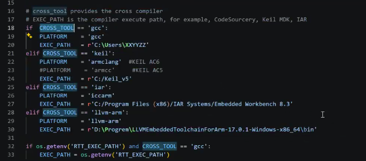
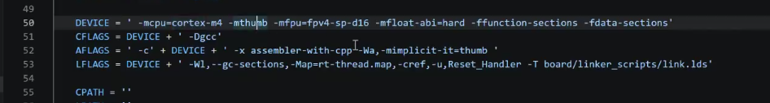
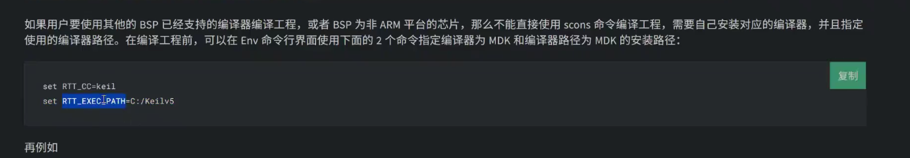

# SCons
RTT使用scons命令编译和构建系统

文档地址：[text](https://www.rt-thread.org/document/site/#/development-tools/build-config-system/SCons)

构建工具：根据一定的规则或指令，将源代码编译成可执行的二进制程序

SCons 由python编写的构建工具

脚本作用范围：当前src目录下的.c、.h文件，是分散式写的

## rtconfig.py 配置文件
写了编译器和构建参数相关的内容

工具链的区分

工具链参数

# SCons基本命令

使用`scons`命令编译BSP
可以加后缀 -j 多线程编译

`scons -c` 清除编译目标 包括临时文件和目标文件

`scons --target=makefile（或者什么其他的内容）` scons根据当前的目录结构生成一个makefile或c脚本，也可以生成一些mdk的工程

`scons --dist`打包，变成一个比较精简的BSP，不相关的BSP文件都会被移除，并且可以拷贝此工程到任意目录下使用

`scons --verbose` 打印详细参数

# config文件

