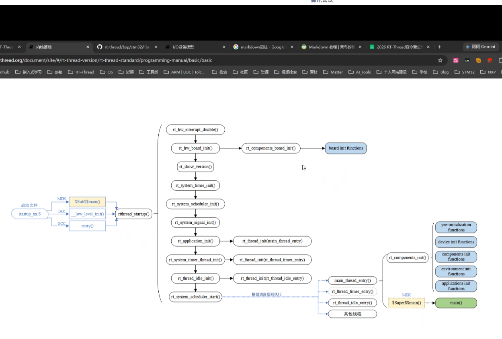

因为git和markdown是之前掌握的内容，不再重复记录
这里有一点不理解的是为什么会出现不同的编译器环境

# RTT 启动流程
 
图片显示了从芯片上电到用户 `main()` 函数执行的整个初始化过程。



## 一、启动入口（左侧）

系统上电后，首先执行 **启动文件** `startup_xx.S`，根据不同的编译器环境，进入不同的入口函数：（为什么会出现不同的编译期环境）


| 编译器 | 入口函数 | 说明 |
|--------|----------|------|
| **MDK (Keil)** | `$Sub$$main()` | 使用 MDK 的符号扩展机制，拦截 main 函数 |
| **IAR** | `__low_level_init()` | IAR 编译器的底层初始化入口 |
| **GCC** | `entry()` | GCC 工具链的标准入口 |

这些入口最终都会汇聚到 **`rtthread_startup()`**，（RT-Thread 统一的启动函数）。


## 二、内核初始化阶段（中间主干）

`rtthread_startup()` 按顺序执行以下初始化步骤：

1. **`rt_hw_interrupt_disable()`** — 关闭全局中断，确保初始化过程不被打断。
2. **`rt_hw_board_init()`** → **`rt_components_board_init()`** → **board init functions**  
   进行板级硬件初始化（时钟、GPIO、串口等），执行通过自动初始化机制注册的板级初始化函数。
3. **`rt_show_version()`** — 打印 RT-Thread 版本信息（通常通过串口输出）。
4. **`rt_system_timer_init()`** — 初始化系统定时器（用于提供时钟 tick）。
5. **`rt_system_scheduler_init()`** — 初始化线程调度器。
6. **`rt_system_signal_init()`** — 初始化信号机制（如果使能）。
7. **`rt_application_init()`** → **`rt_thread_init(main_thread_entry)`**  
   创建**主线程**（main thread），入口函数是 `main_thread_entry()`。
8. **`rt_system_timer_thread_init()`** → **`rt_thread_init(rt_thread_timer_entry)`**  
   创建**系统定时器线程**，用于处理软件定时器。
9. **`rt_thread_idle_init()`** → **`rt_thread_init(rt_thread_idle_entry)`**  
   创建**空闲线程**（idle thread），当系统无其他线程运行时执行。
10. **`rt_system_scheduler_start()`** — **启动调度器**，从此操作系统开始多线程调度。

---

## 三、线程运行与组件初始化（右侧）

调度器启动后，按照调度规则执行各个线程：

### 1. 主线程 `main_thread_entry()`
这是最重要的线程，它负责：
- 调用 **`rt_components_init()`** — 执行通过自动初始化机制注册的各种组件初始化函数，按层级包括：
  - **pre-initialization functions** — 预初始化
  - **device init functions** — 设备初始化
  - **components init functions** — 组件初始化
  - **environment init functions** — 环境初始化
  - **applications init functions** — 应用初始化
- 最后调用 **`$Super$$main()`**（MDK 环境下）→ 进入用户的 **`main()`** 函数。

### 2. 定时器线程 `rt_thread_timer_entry()`
处理系统中所有的软件定时器超时回调。

### 3. 空闲线程 `rt_thread_idle_entry()`
系统空闲时运行，通常用于执行低优先级任务或进入低功耗模式。

### 4. 其他线程
用户自定义的其他应用线程。

---

## 总结

这张图清晰地展示了 RT-Thread 的**分层启动架构**：

```
启动文件 → rtthread_startup() [内核初始化] → 调度器启动 → 多线程运行
                                               ↓
                                        main_thread_entry()
                                               ↓
                                   rt_components_init() [组件自动初始化]
                                               ↓
                                            main()
```

**核心特点**：
- **自动初始化机制**：通过宏（如 `INIT_BOARD_EXPORT`、`INIT_APP_EXPORT` 等）将初始化函数分散在各个文件中，由 `rt_components_init()` 统一按优先级调用。
- **主线程包裹 main()**：用户的 `main()`是RT-Thread的主线程上下文中执行的，因此可以直接使用RT-Thread的API（创建线程、信号量等）。
- **编译器兼容**：通过不同的入口适配MDK、IAR、GCC三种主流嵌入式编译工具链。（但是不知道为什么要这么做）

注：与linux系统的区别

 Linux为通用操作系统，其初始化止于内核边界、用户空间依赖外部配置，main()是拥有独立地址空间的用户进程，必须通过系统调用访问内核，且构建体系深度绑定 GCC。