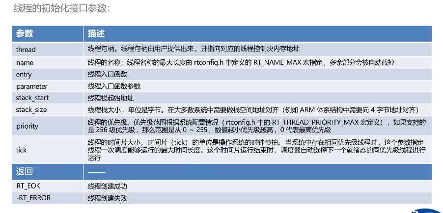
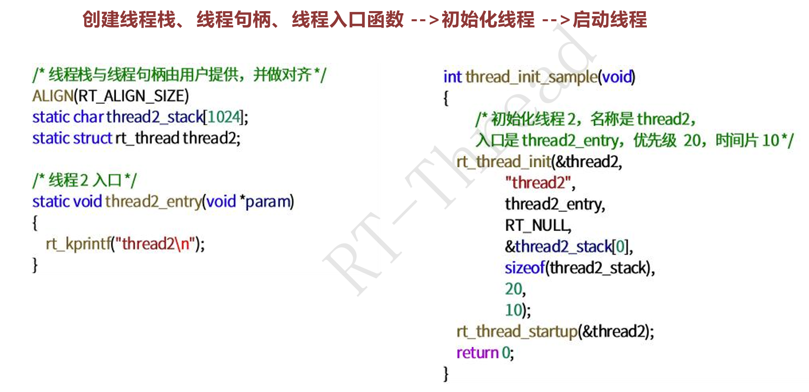
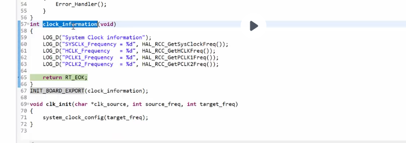

## 线程初始化
有静态初始化和动态初始化

静态线程对象初始化，线程句柄（线程控制块指针）、线程栈由用户提供
> 静态线程是指 线程控制块、线程运行栈一般都设置为全局变量，在编译时就被确定、分配处理，内核不负责动态分配内存空间
> 
> 用户提供的栈首地址要做系统对齐（ARM 上为4字节对齐）、

函数接口：
```c
rt_err rt_thread_init(struct rt_thread *thread, //线程控制块指针
                    const char *name,  //线程名称
                    void(*entry)(void *parameter),  //可以调用的参数
                    void *parameter,  
                    void *stack_start,  //线程起始地址
                    rt_uint32_t stack_size,
                    rt_uint8_t priority, //线程优先级，小数高
                    rt_uint32_t tick);  //调度方式，优先级相同时的时间片
                     
```
线程初始化接口参数：


注意线程是由返回值的，编码时注意接收。如果没有足够分配线程的空间可能会分配失败

与linux的不同：**因为RTT没有MMU，直接使用物理地址，所以这里会有线程起始地址这个说法**，栈大小、位置由开发者显式指定，链接器在编译期就把地址写死了

静态编译的好处：有确定性，在编译时就知道系统资源的分配情况。动态初始化不知道申请空间的时机和次数等（尽量不要用递归，会分配很多空间）

动态初始化线程，调用到这个函数时，系统会从动态堆内存中分配一个线程句柄以及相应栈大小参数的空间。分配出的栈空间按rtconfig.h中配置的RT_ALIGN_SIZE方式对齐

```c
rt_thread_t rt_thread_create(
    const char* name,
    void (*entry)(void* parameter),
    void *parameter,
    rt_uint32_t stack_size,
    rt_uint8_t priority,
    rt_uint32_t tick);
```

## 线程启动
线程怎么让他工作

创建（初始化）的线程处于初始状态，没有变成就绪态，就未进入就绪线程的调度队列

创建成功后调用函数接口`rt_thread_startup`让该线程进入就绪状态。调用这个函数时，立即将线程状态改为就绪态，并放到相应优先级队列中调度。如果启动的这个线程优先级是最高的，将立即切换到这个线程。

```c
rt_err_t rt_thread_startup(rt_thread_t thread)  //让线程起来
```
线程初始化示例



## 线程延时
让出CPU使用权
抢占式系统线程在不适用CPU时需要让出CPU使用权，让其他线程运行。这通过线程延时或睡眠实现

通过使用让线程延时/休眠的API实现，在指定的时间到达后重新运行

```c
rt_err_t rt_thread_delay(rt_tick_t tick); //以一个OS tick为单位（理解为时钟周期？）
rt_err_t rt_thread_delay(rt_int32_t ms)；//以ms为单位，用32位整数表示
```

# 代码实现：基于星火1号芯片的内核实例
所有的启动流程都在/rt-thread/src/components.c文件中

自动初始化


# 作业：多线程实战编程
使用C语言写函数实现创建线程
点LED看标准版本中的设备驱动IO设备模型，根据[PIN设备使用示例](https://www.rt-thread.org/document/site/#/rt-thread-version/rt-thread-standard/programming-manual/device/pin/pin?id=pin-%e8%ae%be%e5%a4%87%e4%bd%bf%e7%94%a8%e7%a4%ba%e4%be%8b)编写

## 任务说明

1. **工作线程 1（动态创建 `th_led1`）**：
   - 优先级 `16`，时间片 `5 ticks`，栈 `1024 Bytes`。
   - 循环翻转板载 LED_R，每次执行打印计数与 `rt_tick_get()`。
2. **工作线程 2（静态初始化 `th_led2`）**：
   - 优先级 `16`，时间片 `5 ticks`，静态定义全局栈与 TCB。
   - 循环翻转板载 LED_B，每次执行打印计数。
3. **监控与控制线程（动态创建 `th_monitor`）**：
   - 优先级 `10`（高于工作线程），周期延时 `rt_thread_mdelay(2000)`。
   - 唤醒后获取并打印 `th_led1` 与 `th_led2` 的运行状态与剩余栈空间大小。
   - 结合板载按键检测（或按键中断）：单次触发时调用 `rt_thread_suspend()` 挂起 `th_led1`；再次触发时调用 `rt_thread_resume()` 恢复。
4. **系统集成与调试命令**：
   - 使用 `INIT_APP_EXPORT()` （自动初始化）自动加载测试模块，禁止在 `main.c` 中硬编码调用。
   - 使用 `MSH_CMD_EXPORT()` 导出自定义查看命令（如 `thread_dump`）。