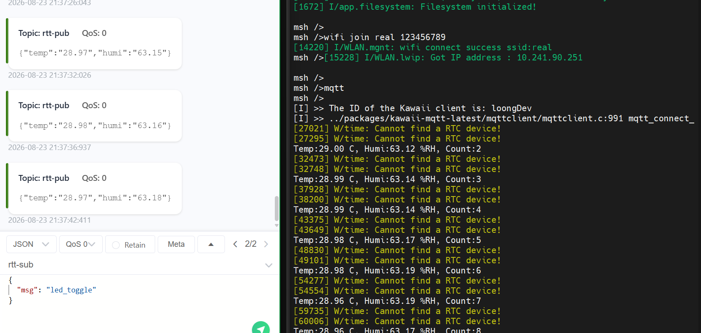
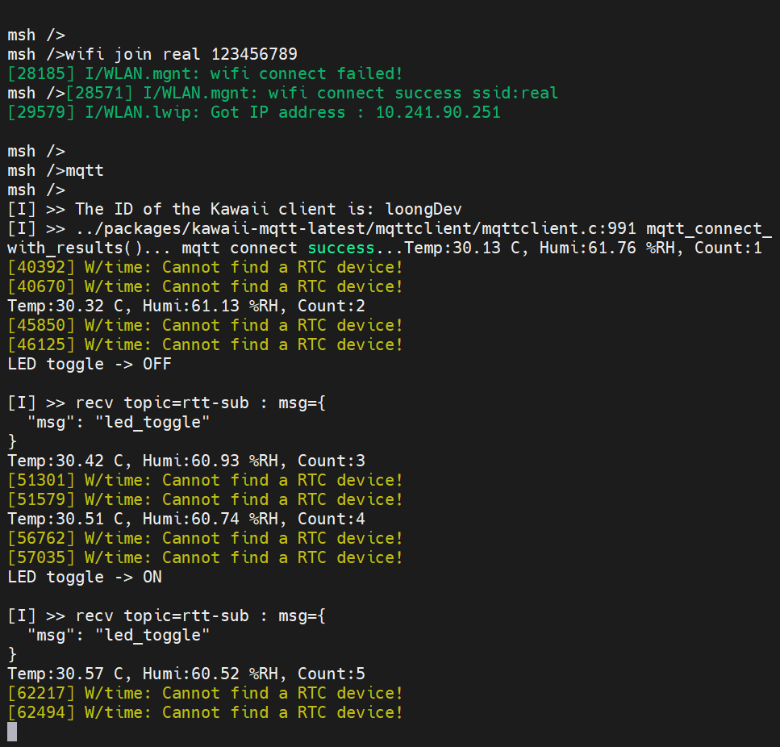
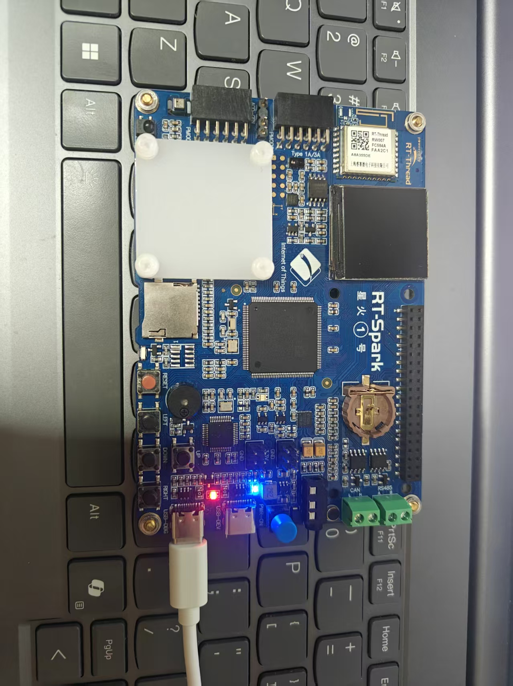
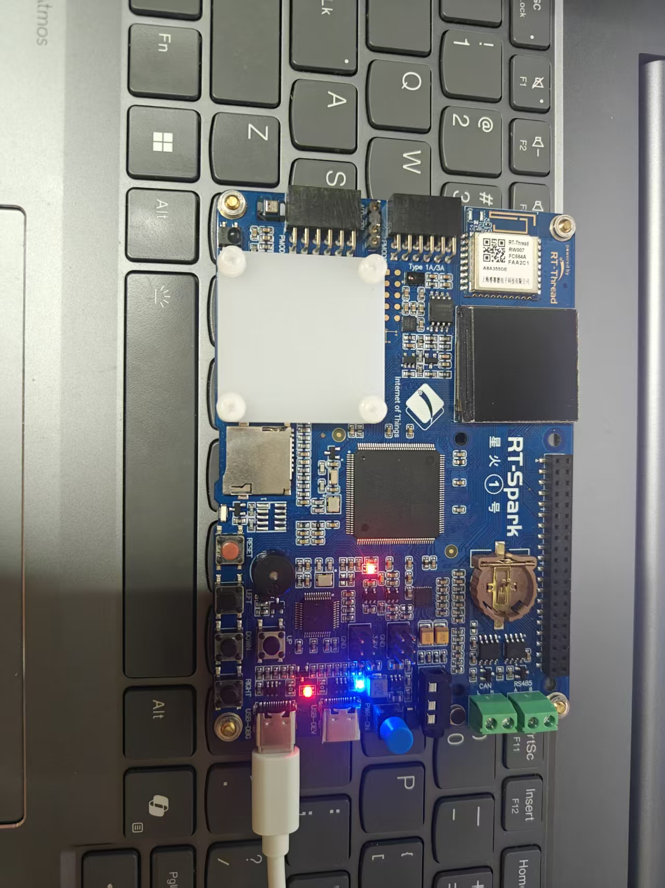

# RT-Thread AHT10采集 + EMQX MQTT上传 + 文件本地存储 + MQTT远程控制LED

## 项目功能概述

本工程基于 RT-Thread 操作系统实现以下功能：

1. 使用 AHT10 软件包采集环境温湿度数据，并通过 MQTT 协议上传至 EMQX MQTT 服务器；
2. 在温湿度数据上传云端的同时，同步将采集数据保存至本地文件系统，文件名称为 `Data.txt`；
3. 通过 MQTT 云端下发指令，远程控制开发板 LED 状态翻转；
4. 借助 FinSH Shell 命令完成文件系统相关调试，学习文件挂载、文件查看等基础操作。

> MQTT 公共服务器地址：`broker.emqx.io:1883` 订阅主题：`rtt-sub`（云端下发控制指令至开发板） 发布主题：`rtt-pub`（开发板上传温湿度数据至云端）

## 硬件资源说明

| 外设    | 引脚/设备名 | 功能说明                                               |
| ------- | ----------- | ------------------------------------------------------ |
| AHT10   | i2c3        | I2C 接口温湿度采集传感器                               |
| LED_R   | PF12        | 受控红色LED                                            |
| W25Q64  | SPI Flash   | 文件系统存储介质，分区名 `filesystem`，挂载路径 `/fal` |
| WIFI CS | PF10        | WIFI模块片选引脚，上电默认拉高                         |

## RT-Thread Settings 配置说明

工程在 RT-Thread Settings 中开启如下组件：

1. DFS 虚拟文件系统，开启 POSIX API 支持；
2. ELM-FAT 文件系统组件；
3. FAL 组件，开启 W25Q64 filesystem 分区支持，开启文件系统自动挂载；
4. AHT10 软件包；
5. Kawaii-MQTT 轻量 MQTT 客户端软件包；
6. I2C、SPI、WIFI 相关底层设备驱动。


## 代码分段说明

### 1. 头文件引入与宏定义

**作用**：引入RT-Thread基础头文件、外设驱动、MQTT、AHT10驱动以及POSIX文件操作头文件；定义LED引脚、MQTT服务器地址、通信主题等全局宏参数，方便统一修改配置。

```c
#include <stdio.h>
#include <stdint.h>
#include <string.h>
#include <rtthread.h>
#include <rtdevice.h>
#include <board.h>
#include "mqttclient.h"
#include <aht10.h>
#include <unistd.h>
#include <fcntl.h>
#include <sys/stat.h>
#include <sys/types.h>

#define LED_R_PIN       GET_PIN(F,12)

/* ===================== KAWAII MQTT 配置 ===================== */
#define KAWAII_MQTT_HOST               "broker.emqx.io"
#define KAWAII_MQTT_PORT               "1883"
#define KAWAII_MQTT_CLIENTID           "loongDev"
#define KAWAII_MQTT_USERNAME           "rt-thread"
#define KAWAII_MQTT_PASSWORD           "rt-thread"
#define KAWAII_MQTT_SUBTOPIC           "rtt-sub"
#define KAWAII_MQTT_PUBTOPIC           "rtt-pub"

static struct aht10_dev *aht10_dev = RT_NULL;
```

### 2. MQTT订阅回调函数

**作用**：MQTT客户端收到订阅主题消息后自动执行该回调函数。拷贝消息载荷防止内存越界，判断指令中是否包含 `led_toggle`，如果匹配则翻转LED状态，并打印日志。

```c
static void sub_topic_handle1(void* client, message_data_t* msg)
{
    (void) client;
    if(msg == RT_NULL || msg->message == RT_NULL)
    {
        return;
    }
    char payload_buf[64] = {0};
    int copy_len = rt_min(msg->message->payload_len, sizeof(payload_buf)-1);
    rt_memcpy(payload_buf, msg->message->payload, copy_len);

    KAWAII_MQTT_LOG_I("recv topic=%s : msg=%s\n", msg->topic_name, payload_buf);

    if (strstr(payload_buf, "led_toggle") != RT_NULL)
    {
        int led_state = rt_pin_read(LED_R_PIN);
        rt_pin_write(LED_R_PIN, led_state ? PIN_LOW : PIN_HIGH);
        rt_kprintf("LED toggle -> %s\n", led_state ? "OFF" : "ON");
    }
}
```

### 3. MQTT发布封装函数

**作用**：封装MQTT消息发布流程，统一填充消息QoS、数据长度等参数，简化业务代码中上传数据的调用。

```c
static int mqtt_publish_handle1(mqtt_client_t *client, const char *payload)
{
    mqtt_message_t msg;
    memset(&msg, 0, sizeof(msg));
    msg.qos = QOS0;
    msg.payload = (void *)payload;
    msg.payloadlen = strlen(payload);
    return mqtt_publish(client, KAWAII_MQTT_PUBTOPIC, &msg);
}
```

### 4. 本地文件保存函数

**作用**：接收温度、湿度、采集次数，按照规定格式拼接字符串，以追加模式打开 `/fal/Data.txt`，将本次采集记录写入本地文件系统，实现数据本地持久存储。

```c
static void save_data_to_file(float temp, float humi, int count)
{
    char buf[128];
    snprintf(buf, sizeof(buf), "Temp：%.2f ; Humi：%.2f ; Count： %d\r\n", temp, humi, count);

    int fd = open("/fal/Data.txt", O_CREAT | O_RDWR | O_APPEND);
    if (fd >= 0)
    {
        write(fd, buf, rt_strlen(buf));
        close(fd);
    }
    else
    {
        rt_kprintf("open /fal/Data.txt failed!\n");
    }
}
```

### 5. MQTT业务主任务函数

**作用**：作为独立线程运行。延时等待系统就绪，初始化AHT10传感器；创建并配置MQTT客户端，连接服务器、订阅控制主题；循环读取温湿度，调用函数保存本地文件并上传MQTT云端，循环间隔5秒。

```c
static void kawaii_mqtt_demo(void *parameter)
{
    mqtt_client_t *client = NULL;
    char pub_buf[128];
    float temp, humi;
    int sample_count = 0;

    rt_thread_delay(6000);
    aht10_dev = aht10_init("i2c3");
    if (aht10_dev == RT_NULL)
    {
        rt_kprintf("aht10 create failed!\n");
        return;
    }

    mqtt_log_init();
    client = mqtt_lease();
    mqtt_set_host(client, KAWAII_MQTT_HOST);
    mqtt_set_port(client, KAWAII_MQTT_PORT);
    mqtt_set_user_name(client, KAWAII_MQTT_USERNAME);
    mqtt_set_password(client, KAWAII_MQTT_PASSWORD);
    mqtt_set_client_id(client, KAWAII_MQTT_CLIENTID);
    mqtt_set_clean_session(client, 1);
    KAWAII_MQTT_LOG_I("The ID of the Kawaii client is: %s ", KAWAII_MQTT_CLIENTID);

    mqtt_connect(client);
    mqtt_subscribe(client, KAWAII_MQTT_SUBTOPIC, QOS0, sub_topic_handle1);

    while (1)
    {
        temp = aht10_read_temperature(aht10_dev);
        humi = aht10_read_humidity(aht10_dev);
        sample_count++;
        rt_kprintf("Temp:%.2f C, Humi:%.2f %%RH, Count:%d\n", temp, humi, sample_count);

        save_data_to_file(temp, humi, sample_count);

        snprintf(pub_buf, sizeof(pub_buf), "{\"temp\":\"%.2f\",\"humi\":\"%.2f\"}", temp, humi);
        mqtt_publish_handle1(client, pub_buf);

        mqtt_sleep_ms(5 * 1000);
    }
}
```

### 6. MSH命令导出函数

**作用**：提供FinSH控制台命令 `mqtt`，创建业务线程并启动，支持在shell中手动启动整套采集与MQTT功能。

```c
int mqtt(void)
{
    rt_thread_t tid_mqtt;
    tid_mqtt = rt_thread_create("kawaii_demo", kawaii_mqtt_demo, RT_NULL, 2048, 17, 10);
    if (tid_mqtt == RT_NULL)
    {
        return -RT_ERROR;
    }
    rt_thread_startup(tid_mqtt);
    return RT_EOK;
}
MSH_CMD_EXPORT(mqtt, Kawaii MQTT + AHT10 test);
```

### 7. WIFI引脚初始化

**作用**：板级初始化，配置WIFI片选引脚为输出并拉高，在系统启动阶段自动执行。

```c
#define WIFI_CS GET_PIN(F, 10)
void WIFI_CS_PULL_DOWM(void)
{
    rt_pin_mode(WIFI_CS, PIN_MODE_OUTPUT);
    rt_pin_write(WIFI_CS, PIN_HIGH);
}
INIT_BOARD_EXPORT(WIFI_CS_PULL_DOWM);
```

### 8. main主函数

**作用**：系统入口函数，初始化LED引脚电平，主循环保持系统运行。

```c
int main(void)
{
    rt_pin_mode(LED_R_PIN, PIN_MODE_OUTPUT);
    rt_pin_write(LED_R_PIN, PIN_LOW);

    while (1)
    {
        rt_thread_mdelay(500);
    }
    return 0;
}
```

## Data.txt 文件存储格式示例

```c
Temp：25.30 ; Humi：48.20 ; Count： 1
Temp：25.32 ; Humi：48.15 ; Count： 2
Temp：25.35 ; Humi：48.00 ; Count： 3
Temp：25.40 ; Humi：47.90 ; Count： 4
```

## 整体运行流程

1. 开发板上电，执行板级初始化，配置 WIFI 片选引脚、LED 引脚；
2. 系统自动完成 FAL、ELM-FAT、DFS 文件系统相关初始化，并自动挂载 filesystem 分区至 `/fal`；
3. 在 FinSH 控制台输入 `mqtt` 命令，启动业务线程；
4. 线程内部完成 AHT10 传感器初始化、MQTT 客户端初始化，连接 EMQX 服务器并订阅控制指令主题；
5. 循环读取 AHT10 温湿度数据，将数据写入本地 `/fal/Data.txt` 文件，同时以 JSON 格式通过 MQTT 上传至云端；
6. MQTT 客户端持续监听订阅主题消息，当云端下发 `led_toggle` 指令时，触发回调函数，翻转LED电平状态；
7. 采集完成后延时 5 秒，进入下一次采集周期。

## 最终效果

1. 温湿度数据上传



2. 控制LED灯，可以看到当发送"led_toggle"时，led灯发送了翻转

   

   

