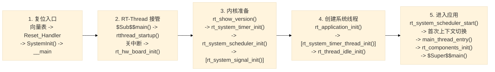
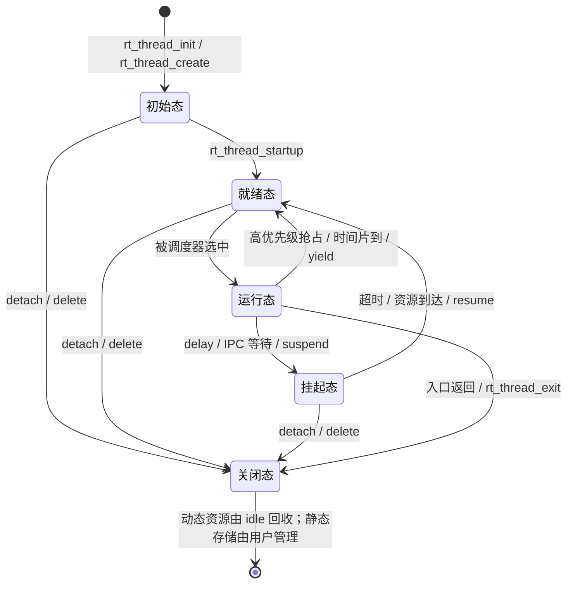

# Part 1 理论整理

## 1. STM32F407 启动流程与 RT-Thread 引导机制

### 1.1 从上电复位到用户 `main()`

STM32F407 复位后，Cortex-M4 先从中断向量表读取两个值：

- `vector[0]`：主栈顶地址，装入 MSP；
- `vector[1]`：复位入口地址，装入 PC，开始执行 `Reset_Handler`。

常见的 MDK 工程为例，完整调用链如下：



> **关键点**：`rt_system_scheduler_start()` 启动后不再返回；不同工具链（MDK/GCC/IAR）仅在 C 库到 `rtthread_startup()` 的入口方式上有差异。

------

### 1.2 自动初始化原理（`INIT_BOARD_EXPORT` 与 `INIT_APP_EXPORT`）

**底层核心机制**：
利用**编译链接器的段（Section）收集功能**，将函数指针在编译阶段放置在特定的内存段中，启动时统一遍历调用。

1. **宏展开**：`INIT_EXPORT(fn, level)` 定义了一个带有 `rt_section(".rti_fn." level)` 属性的常量函数指针 `__rt_init_##fn`，该指针指向用户函数 `fn`。
2. **链接器收集**：链接脚本将不同 `level`（1~6）的 `.rti_fn.` 段按顺序排列，形成连续的函数指针数组。通过 `rti_board_start`、`rti_board_end`、`rti_end` 等哨兵变量确定数组边界。
3. **遍历调用**：
   - **`rt_components_board_init()`**：仅遍历 **1级**（`.rti_fn.1`）函数。在调度器启动前（`rt_hw_board_init()` 内部）执行，用于 GPIO、串口等最底层硬件初始化，**严禁阻塞**。
   - **`rt_components_init()`**：遍历 **2~6级** 函数。在 main 线程中（用户 `main` 之前）执行。

| 级别 | 导出宏                  | 执行上下文   | 典型用途                     |
| :--- | :---------------------- | :----------- | :--------------------------- |
| 1    | `INIT_BOARD_EXPORT`     | 调度器启动前 | GPIO、串口等板级硬件初始化   |
| 2    | `INIT_PREV_EXPORT`      | main 线程    | 依赖较少的纯软件初始化       |
| 3    | `INIT_DEVICE_EXPORT`    | main 线程    | 设备驱动注册                 |
| 4    | `INIT_COMPONENT_EXPORT` | main 线程    | DFS、网络等组件初始化        |
| 5    | `INIT_ENV_EXPORT`       | main 线程    | 文件系统挂载等运行环境初始化 |
| 6    | `INIT_APP_EXPORT`       | main 线程    | 用户应用初始化               |

------

## 2. 内核基础与对象模型

### 2.1 面向对象设计思想与 TCB 关键成员

- **设计思想**：RT-Thread 用 C 模拟面向对象，通过**继承**机制——将 `struct rt_object parent` 作为结构体的**首成员**，使子类（线程、设备、IPC等）复用父类的名称、类型、对象链表节点等公共属性。内核通过 `rt_object_container[]` 容器统一管理所有内核对象。
- **线程控制块关键成员**（`struct rt_thread`）：

| 成员               | 作用                                                         |
| :----------------- | :----------------------------------------------------------- |
| `sp`               | 当前线程栈指针。保存上下文时记录现场，恢复时加载；不同架构（如 Cortex-M 栈向下增长）决定其具体存储方式。 |
| `stat`             | 线程当前状态及附加标志（如挂起、就绪、运行、关闭等），调度器通过它决定是否将线程入队或忽略。 |
| `current_priority` | 当前有效优先级。当发生互斥量**优先级继承**时会被临时提高，避免优先级翻转。 |
| `init_priority`    | 线程基础（原始）优先级，用于优先级继承结束后恢复。           |
| `init_tick`        | 每轮时间片的初始长度（单位：OS Tick），轮转时重置给 `remaining_tick`。 |
| `remaining_tick`   | 本轮剩余时间片。每个 OS Tick 递减，归零时触发同优先级轮转。  |

### 2.2 静态线程 vs 动态线程（内存分配与高可靠场景分析）

| 维度         | 静态线程 (`rt_thread_init`)                                  | 动态线程 (`rt_thread_create`)                                |
| :----------- | :----------------------------------------------------------- | :----------------------------------------------------------- |
| **分配位置** | TCB 与栈空间**由调用者分配**，通常位于全局/静态存储区（`.bss/.data`）或栈上。 | TCB 与栈空间从**系统堆（Heap）**动态申请。                   |
| **生命周期** | 由调用者显式控制，存储空间在编译期已确定，可长期保留并复用。 | 随线程创建而分配，随线程退出而回收。                         |
| **释放机制** | `rt_thread_detach()` 仅从内核对象容器中脱离，**不释放**用户提供的 TCB 和栈内存。 | `rt_thread_delete()` 或线程入口返回后进入关闭态，由 **idle 线程**进行延迟资源回收。 |
| **主要风险** | 栈尺寸配置过小导致溢出，或对象被过早复用（生命周期管理混乱）。 | 堆分配失败、内存碎片、分配耗时不确定（实时性抖动）。         |

**高可靠项目强制使用静态线程的原因**：

1. **内存上界可预估**：启动前即可精确计算 TCB 与栈所需的总内存容量，不存在运行期堆溢出风险。
2. **运行时确定性**：无动态内存分配（`malloc`）带来的耗时抖动和失败分支，路径耗时稳定。
3. **规避碎片化**：没有 `free` 操作，系统长期运行不存在堆内存碎片问题。
4. **所有权清晰**：生命周期与模块绑定，便于代码审查与安全认证（如 DO-178C、IEC 61508）。

------

## 3. 线程状态机与调度算法

### 3.1 五态模型及转换

RT-Thread 线程严格遵循以下状态流转，核心转换逻辑如下：

### 



| 状态                       | 含义                                   | 典型进入方式                                                 |
| -------------------------- | -------------------------------------- | ------------------------------------------------------------ |
| 初始态 `RT_THREAD_INIT`    | 已创建但未进入就绪队列，不参与调度     | `rt_thread_init()`、`rt_thread_create()`                     |
| 就绪态 `RT_THREAD_READY`   | 运行条件满足，按优先级等待 CPU         | `rt_thread_startup()`、超时或资源到达                        |
| 运行态 `RT_THREAD_RUNNING` | 当前占用 CPU；单核系统同一时刻只有一个 | 调度器选中                                                   |
| 挂起态 `RT_THREAD_SUSPEND` | 等待时间或资源，不参与调度             | `rt_thread_delay()`、`rt_sem_take()`、`rt_mutex_take()`、`rt_mq_recv()` 等 |
| 关闭态 `RT_THREAD_CLOSE`   | 不再参与调度，等待清理                 | 入口返回、`rt_thread_exit()`、删除或脱离                     |

### 3.2 调度机制剖析

**（1）抢占式优先级调度**

- **规则**：固定优先级，**数值越小优先级越高**。最高就绪优先级线程必定抢占当前线程。
- **实现**：通过**优先级位图（O(1) 查找）**定位最高就绪优先级。≤32 级用单 32 位位图；>32 级采用二级位图（组+组内）。
- **触发点**：
  1. 新线程就绪（如 `rt_thread_startup`、IPC 释放/超时）。
  2. 当前线程阻塞（延时、等待 IPC、主动 yield 或退出）。
  3. SysTick 中断导致时间片耗尽。
  4. 中断唤醒高优先级线程（中断中仅标记，退出时通过 PendSV 切换）。

**（2）时间片轮转**

- **作用范围**：**仅作用于相同优先级**的就绪线程。高优先级线程就绪仍会立即抢占，不受时间片限制。
- **运行逻辑**：
  - 线程运行时，每个 OS Tick 递减 `remaining_tick`。
  - 归零时：将 `remaining_tick` 重置为 `init_tick`，并将当前线程移到同优先级就绪队列尾部。
  - 调度器取该队列的下一个线程运行。
- **特殊场景**：若同优先级队列只有一个线程，时间片耗尽后它仍继续运行（无轮转对象）。

> **工程建议**：应使线程阻塞于事件（如信号量、队列），避免高优先级线程持续空转，否则会导致低优先级线程及 idle 线程饥饿，影响动态资源回收与低功耗。


# Part 2 实验结果分析与串口截图

## 实验结果分析

### 1. `thread_dump` 全局视图

| 线程     | 优先级 | 状态    | 栈深(sp) | max used | 剩余时间片 | 错误 |
| -------- | ------ | ------- | -------- | -------- | ---------- | ---- |
| th_monit | 10     | suspend | 168B     | 16%      | 5          | OK   |
| th_led2  | 16     | suspend | 124B     | 16%      | 4          | OK   |
| th_led1  | 16     | suspend | 128B     | 17%      | 5          | OK   |
| tshell   | 20     | running | 344B     | 15%      | 3          | OK   |
| tidle0   | 31     | ready   | 144B     | 56%      | 28         | OK   |
| timer    | 4      | suspend | 128B     | 25%      | 9          | OK   |
| main     | 10     | suspend | 172B     | 14%      | 1          | OK   |

结论:

- **优先级符合设计**:th_monitor(10)> 工作线程(16);系统 timer 线程 4 最高,tshell 20、tidle0 31 垫底。数值越小优先级越高的规则得到直观验证;
- **状态解读**:dump 时三个模块线程全部 suspend,是因为命令执行时它们被协作式暂停/正睡在 `mdelay` 里;`tshell running` 正是执行 `thread_dump` 命令的 shell 线程本身;
- **`th_monit` 名字截断**:RT-Thread 线程名上限 `RT_NAME_MAX=8`,"th_monitor" 被截为 8 字符,属正常现象;
- **两种栈测量方法互相印证**:内核按 `'#'` 扫描算出的 max used 17%/16%,与我们 `thread_stack_free()` 报出的 848/1024(已用 176B=17.2%)、852/1024(已用 172B=16.8%)**完全一致**——说明剩余栈统计方法是可靠的;
- **时间片验证**:left tick 列显示 5/4/5,工作线程的 5 ticks 时间片正在生效(4 表示被打断时已耗掉 1 个 tick);
- **error 全 OK**:各线程运行至今无异常错误码。

### 2. `thread_log on` 后的周期日志

- th_led1 的 tick 每次递增约 **505**(500ms 周期 + 5 ticks 调度抖动,1 tick=1ms,`RT_TICK_PER_SECOND=1000` 验证成立);
- th_led1/th_led2 各自独立计数、互不干扰;
- **观察到一个典型现象**:`th_led1 count=401, tick=200` 后面紧跟着孤立的 `123le` —— 这是日志刷屏时你在终端敲的字符与输出流交错显示,视觉上被拆散嵌进了日志行尾。msh 没有行编辑隔离,刷屏时输入显示不可靠(命令本身仍能被接收)。**建议输入命令前先 `thread_log off`**。

### 3. KEY1 挂起/恢复实验(核心结果)

日志给出了教科书级的完整证据链:

**第一次按键(tick≈209722)**:

```
th_led1 count=420, tick=209722
KEY1: suspend requested for th_led1     ← 监控线程处理按键事件
th_led2 count=421 / 422 / 423 ...       ← th_led2 不受影响继续跑
(th_led1 计数冻结在 420, LED_R 停闪)
```

**第二次按键(tick≈216159)**:

```
KEY1: th_led1 resumed
th_led1: state=ready                   ← 刚恢复:在就绪队列中,尚未运行
th_led1 count=421, tick=216159         ← 从 421 继续,而不是从 0 重来
```

三个关键结论:

1. **挂起只冻结目标线程**:th_led1 停住期间 th_led2 正常计数 421→432,系统其它部分完全不受影响;
2. **挂起是"现场冻结"而非"重新开始"**:恢复后 th_led1 从 count=421 接着跑,证明 CPU 上下文(寄存器+PC)被完整保存;
3. **两套时钟互相印证**:tick 从 209722 跳到 216159,间隔 **6437ms**;同期 th_led2 计数 420→432 = 12 次 × 500ms = **6s**,完全吻合;
4. **ready ≠ running**:恢复瞬间监控报 `state=ready`(已放回就绪队列),下一个报告又变回 `suspend`(进入 mdelay 睡眠)——三种状态(ready/suspend/running)的转换在日志里都能看到。

### 4. 栈空间分析

- 稳态运行:th_led1 **776/1024(24%)**、th_led2 780/1024、th_monitor 856/1024,长时间运行 + 挂起/恢复循环后**数字稳定不变 → 无栈泄漏**;
- dump 时 848/852 与稳态 776/780 的差异**不是泄漏**,是采样点不同:dump 把线程停在循环顶部(浅栈 128B),稳态监控采样在 `mdelay` 睡眠点(深栈 248B)——开启 LOG 后 `LOG_I→rt_kprintf` 调用链使最深栈点增加了约 70B;
- 使用率均 <25%,1024B 配置余量充足,距溢出很远。

### 5. 与任务要求的逐项对照

| 任务要求                                                     | 实验验证                                     |
| ------------------------------------------------------------ | -------------------------------------------- |
| th_led1 动态创建,优先级 16、时间片 5、栈 1024B,翻转 LED_R 并打印 count+tick | ✓ left tick=5,max used 17%,tick 步进 505ms   |
| th_led2 静态初始化(全局栈+TCB),参数同上,翻转 LED_B 打印 count | ✓ 列表可见且与动态线程行为一致               |
| th_monitor 优先级 10、周期 2s、打印状态与剩余栈;KEY1 单次挂起/再次恢复 | ✓ 报告周期 2s,挂起/恢复证据链完整            |
| INIT_APP_EXPORT 自动加载、main.c 无硬编码;MSH_CMD_EXPORT 调试命令 | ✓ `thread_dump`/`thread_log` 均可从 msh 调用 |

### 6.建议的进一步实验

1. 挂起期间执行 `thread_dump`,确认 th_led1 保持 suspend 不被命令误恢复;
2. 快速连按 KEY1,观察 50ms 去抖与"挂起请求未完成时按键被忽略"的日志(`KEY1: suspend pending, press ignored`);
3. 在 `thread_log off` 状态下观察:LED 仍闪烁、按键日志仍输出——证明静默的只是周期打印,线程本身照常运行。

## 串口截图


