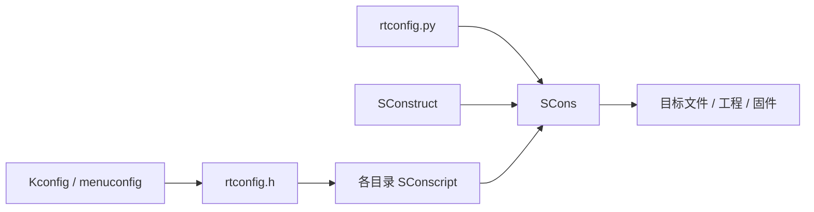

# RT-Thread 线程 IPC 理论

> 核心原则：**同步解决“何时运行、谁能访问”，通信解决“传递什么数据”。**

## 1. 概念

### 1.1 同步、互斥与通信

- **临界区**：多个线程都会访问的共享数据或代码区域。
- **互斥**：同一时刻只允许一个线程进入临界区，重点是保护资源。
- **同步**：按照约定的先后顺序运行，重点是协调事件或工作阶段。
- **通信**：在线程之间传递数值、指针或数据块。

没有同步保护时，线程可能在另一个线程尚未完成写入时读取共享数据，产生竞态和数据不一致。阻塞对象在资源不可用时可使线程挂起；资源到达、对象释放或超时后，线程再被唤醒。

### 1.2 RT-Thread IPC 的共同模型


所有 IPC 对象都包含控制块、等待队列和对象生命周期。等待队列通常可选 `RT_IPC_FLAG_PRIO`（按优先级）或 `RT_IPC_FLAG_FIFO`（先进先出）；实时任务通常优先使用 `PRIO`。

## 2. 五类 IPC 如何选

| 对象 | 解决的问题 | 数据能力 | 关键语义 | 典型场景 |
| --- | --- | --- | --- | --- |
| 信号量 Semaphore | 通知或资源计数 | 不传数据 | 计数可累加，无所有权 | 中断通知线程、生产者/消费者资源数 |
| 互斥量 Mutex | 保护共享资源 | 不传数据 | 有所有者、可递归、支持优先级继承 | 保护共享变量、设备或临界区 |
| 事件集 Event | 等待多个条件 | 仅事件位 | 32 个标志位，支持 AND/OR；事件不排队 | “任一条件”或“全部条件”满足后唤醒 |
| 消息邮箱 Mailbox | 低开销传递单值 | 一个机器字（32 位目标通常为 4 字节） | 邮箱有容量；可发送紧急邮件 | 传整数、状态码或缓冲区指针 |
| 消息队列 Message Queue | 传递结构化数据 | 单条大小由创建时 `msg_size` 限制 | 普通消息入队尾，紧急消息入队首 | 串口帧、命令、结构体或数据块 |

快速判断：**只需要唤醒，用信号量；需要保护资源，用互斥量；要等多个条件，用事件集；只传一个机器字，用邮箱；要传结构体或缓冲区，用消息队列。**

## 3. 线程间同步

### 3.1 信号量

信号量的值表示可用实例数。`take` 成功时值减一；值为零时，线程按等待策略阻塞或按超时返回；`release` 会唤醒等待线程或使值加一。

| 类型 | 初始值 | 用途 |
| --- | ---: | --- |
| 二值信号量 | 常用 `0` | 事件通知；例如中断释放，线程处理 |
| 计数信号量 | 资源数量 | 表示可用缓冲区、空位或设备实例数 |

常用 API：

| 动态对象 | 静态对象 | 运行操作 |
| --- | --- | --- |
| `rt_sem_create` / `rt_sem_delete` | `rt_sem_init` / `rt_sem_detach` | `rt_sem_take`、`rt_sem_trytake`、`rt_sem_release` |

要点：信号量没有“谁持有、谁释放”的所有权约束；它可用于同步，也可用于计数，但不应替代需要所有权和优先级继承的互斥量。

### 3.2 互斥量

互斥量是带所有权语义的二值锁：成功获取后只有持有者可以释放；同一线程可递归获取，递归次数需匹配释放次数。RT-Thread 的优先级继承会在高优先级线程等待低优先级持有的互斥量时临时提升持有者优先级，从而缓解优先级反转。

常用 API：

| 动态对象 | 静态对象 | 运行操作 |
| --- | --- | --- |
| `rt_mutex_create` / `rt_mutex_delete` | `rt_mutex_init` / `rt_mutex_detach` | `rt_mutex_take`、`rt_mutex_trytake`、`rt_mutex_release` |

使用原则：只在临界区内持有锁，统一多个锁的获取顺序；互斥量能缓解优先级反转，但不能自动消除死锁。

### 3.3 事件集

事件集用一个 32 位无符号数表示 32 个独立事件位，只用于同步，不携带数据，也没有计数排队能力。

- `RT_EVENT_FLAG_OR`：关注的事件中任意一个到达即可唤醒。
- `RT_EVENT_FLAG_AND`：关注的事件全部到达才唤醒。
- `RT_EVENT_FLAG_CLEAR`：成功接收后清除对应事件位；不设置则事件位继续保留。

常用 API：`rt_event_create` / `rt_event_delete`、`rt_event_init` / `rt_event_detach`、`rt_event_send`、`rt_event_recv`。

同一事件在清除前重复发送，效果等同于发送一次；需要累计次数时应使用信号量。

## 4. 线程间通信

### 4.1 消息邮箱

邮箱每次传递一个 `rt_ubase_t` 机器字。4 字节只适用于 32 位目标，不能把它当作所有平台都固定为 4 字节。邮箱容量在创建或初始化时确定，邮件满时普通发送会立即返回；需要等待空间时使用 `rt_mb_send_wait`。

常用 API：

| 动态对象 | 静态对象 | 发送与接收 |
| --- | --- | --- |
| `rt_mb_create` / `rt_mb_delete` | `rt_mb_init` / `rt_mb_detach` | `rt_mb_send`、`rt_mb_send_wait`、`rt_mb_urgent`、`rt_mb_recv` |

邮箱适合传整数、状态码或指针。传指针时，指向的缓冲区必须在线程接收并处理完成前保持有效；中断服务例程可用邮箱发送轻量通知，数据本体应放在安全的共享缓冲区中。

### 4.2 消息队列

消息队列在创建时指定 `msg_size`（单条消息最大长度）和队列容量，消息块由内核管理。它不是无限长或任意长度队列：实际发送长度不能超过 `msg_size`，队列满时应选择立即返回或带超时等待。

常用 API：

| 动态对象 | 静态对象 | 发送与接收 |
| --- | --- | --- |
| `rt_mq_create` / `rt_mq_delete` | `rt_mq_init` / `rt_mq_detach` | `rt_mq_send`、`rt_mq_send_wait`、`rt_mq_urgent`、`rt_mq_recv` |

普通消息进入队尾；`rt_mq_urgent` 将消息插入队首，适合退出、故障或高优先级控制命令。消息队列会把消息内容复制到队列中，发送方可在发送返回后复用源缓冲区；若消息本身是指针，仍需管理指针指向对象的生命周期。

## 5. API 生命周期与等待

### 5.1 动态与静态对象

| 方式 | 内存来源 | 结束操作 | 适用情况 |
| --- | --- | --- | --- |
| 动态创建 | 内核动态分配 | `delete` | 对象数量或生命周期运行时决定 |
| 静态初始化 | 用户提供控制块/缓冲区 | `detach` | 启动时固定、对内存可控或不使用堆 |

创建和初始化必须与删除和脱离匹配。对象仍有线程等待时，不要随意销毁；删除或脱离会唤醒等待者并返回错误，业务代码应检查返回值。

### 5.2 超时参数

- `RT_WAITING_NO`：不等待，条件不满足立即返回。
- `RT_WAITING_FOREVER`：永久等待，直到条件满足或对象被删除/脱离。
- 其他非负值：等待指定的 OS Tick 数，超时返回 `-RT_ETIMEOUT`。

阻塞调用应根据业务实时性设置超时，并对 `RT_EOK`、超时和对象错误分别处理；不要用永久等待掩盖线程无法推进的问题。

## 6. 常见问题

1. **把信号量当互斥锁**：信号量没有所有权，可能被错误线程释放；保护共享资源应使用互斥量。
2. **忽略优先级反转**：共享资源采用互斥量，并缩短持锁时间；多个锁统一获取顺序。
3. **误解事件集**：事件位不是计数器，重复事件不会累加；需要次数语义时改用信号量或消息队列。
4. **邮箱传递失效指针**：邮箱只传机器字，不复制指针指向的数据；接收方使用期间必须保证缓冲区生命周期。
5. **消息队列长度未规划**：创建时根据最大消息大小和峰值数量配置 `msg_size` 与容量，队列满时明确丢弃、等待或降级策略。
6. **FIFO 影响实时性**：除非确实需要先来后到，否则 IPC 等待队列优先选择 `RT_IPC_FLAG_PRIO`。
7. **只依赖调试现象**：线程调度具有时序性，数据“看起来正常”不等于没有竞态；共享数据必须有明确的同步协议。

## 7. SCons 构建配置速查

SCons 是 RT-Thread 使用的 Python 构建系统。它把源码组织、配置裁剪和工具链参数分开管理：



- `SConstruct`：BSP 的构建入口，一个 BSP 通常只有一个。
- `SConscript`：各目录的子构建脚本，组织源文件、头文件路径和依赖组。
- `rtconfig.py`：选择 `CROSS_TOOL`、工具链路径以及编译/汇编/链接参数。
- `Kconfig` 与 `menuconfig`：配置功能并生成 `rtconfig.h`，SCons 据此裁剪构建内容。

常用命令：

| 命令 | 作用 |
| --- | --- |
| `scons` | 在 BSP 目录执行增量编译 |
| `scons -c` | 清除生成的目标文件 |
| `scons -jN` | 使用 N 路并行编译 |
| `scons --verbose` | 显示完整编译参数 |
| `scons --target=mdk5` / `--target=iar` | 生成对应 IDE 工程 |
| `scons --dist` | 生成可独立分发的 BSP 工程 |

模块的最小 `SConscript` 结构如下，`depend` 用于让 Kconfig 宏控制该模块是否参与构建：

```python
from building import *

cwd = GetCurrentDir()
src = Glob('*.c')
group = DefineGroup('App', src,
                    depend=['RT_USING_APP'],
                    CPPPATH=[cwd])
Return('group')
```

配置 IPC 功能时，先通过 BSP 的 `menuconfig` 使能对应内核组件，再重新执行 `scons`；若需要更新 MDK/IAR 等工程文件，继续执行相应的 `--target` 命令。

## 8. 工程化延伸：线程参数也有生命周期

四个练习在创建线程时都向 `rt_thread_create()` 传入了 `parameter`。这个参数看起来不起眼，却很容易成为并发程序中的隐藏错误：**内核只保存指针，不会自动复制指针指向的数据。**

参考代码采用了两种安全做法：

- `task1.c` 为每辆车动态分配一份独立参数，线程使用完后释放；
- `task2.c`、`task3.c`、`task4.c` 使用静态参数，参数的生命周期覆盖线程运行期。

### 8.1 一个容易写出的错误实例

下面把局部变量的地址交给线程，看似每次都传入了不同的通道号，实际并不安全：

```c
static void start_sensor_threads(void)
{
    int i;

    for (i = 0; i < 2; i++)
    {
        sensor_arg_t arg;

        arg.channel = i;
        arg.output = g_sample_mq;

        /* 错误：arg 是循环中的局部变量 */
        create_and_start_sensor(&arg);
    }
}
```

问题不在于线程有没有立即启动，而在于 `arg` 的存储时间太短：

1. 下一次循环可能覆盖同一块栈内存，两个线程便可能读到相同的参数；
2. 函数返回后，`arg` 已经失效，线程再次访问属于悬空指针；
3. 加延时只能改变错误出现的概率，不能修复生命周期问题。

> 判断标准：传给线程的不是“一个值”，而是“一个地址”。这个地址指向的对象，必须至少存活到线程最后一次访问它。

### 8.2 固定配置：使用静态参数

若线程参数在整个程序运行期间都固定不变，可以使用静态存储：

```c
typedef struct
{
    rt_uint8_t channel;
    rt_mq_t output;
} sensor_arg_t;

static sensor_arg_t g_sensor_args[2];

static void prepare_sensor_args(void)
{
    g_sensor_args[0].channel = 0;
    g_sensor_args[0].output = g_sample_mq;
    g_sensor_args[1].channel = 1;
    g_sensor_args[1].output = g_sample_mq;
}
```

创建线程时分别传入 `&g_sensor_args[0]` 和 `&g_sensor_args[1]`。静态对象不会随启动函数返回而失效，但线程启动后不要在没有同步保护的情况下继续修改这些参数。

### 8.3 动态配置：明确参数所有权

如果每次启动的参数都不同，可以为每个线程单独分配内存。下面只展示参数交接的核心写法，采集业务函数省略：

```c
static void sensor_entry(void *parameter)
{
    sensor_arg_t local = *(sensor_arg_t *)parameter;

    /* 参数已复制到本线程栈中，尽早释放堆内存 */
    rt_free(parameter);

    collect_sensor_data(local.channel, local.output);
}

static rt_err_t start_one_sensor(rt_uint8_t channel, rt_mq_t output)
{
    sensor_arg_t *arg;
    rt_thread_t tid;
    rt_err_t result;
    char name[RT_NAME_MAX];

    arg = (sensor_arg_t *)rt_malloc(sizeof(*arg));
    if (arg == RT_NULL)
        return -RT_ENOMEM;

    arg->channel = channel;
    arg->output = output;
    rt_snprintf(name, sizeof(name), "sensor%u", (unsigned int)channel);

    tid = rt_thread_create(name, sensor_entry, arg, 512, 15, 10);
    if (tid == RT_NULL)
    {
        rt_free(arg);                 /* 创建失败，仍由启动者释放 */
        return -RT_ERROR;
    }

    result = rt_thread_startup(tid);
    if (result != RT_EOK)
    {
        rt_thread_delete(tid);
        rt_free(arg);                 /* 启动失败，所有权尚未移交 */
        return result;
    }

    /* 启动成功后，arg 归工作线程所有，启动者不能再访问 */
    return RT_EOK;
}
```

参数所有权的变化可以画成一条清晰的路径：


### 8.4 三种需求如何选

| 参数需求 | 推荐做法 | 原因 |
| --- | --- | --- |
| 配置固定，且整个运行期都有效 | 静态或全局参数 | 无需动态分配，生命周期容易保证 |
| 每个线程有一份独立的启动配置 | 动态分配并移交所有权 | 各线程互不覆盖，退出或复制后可释放 |
| 线程运行期间还要持续接收新数据 | 消息队列或邮箱 | `parameter` 适合初始配置，不适合充当持续通信通道 |

最后分清三个互不相同的生命周期：**线程对象何时退出、参数内存何时释放、参数中引用的 IPC 对象何时删除。** 参数结构体已经安全释放，并不代表其中保存的消息队列或信号量句柄也可以提前删除。
