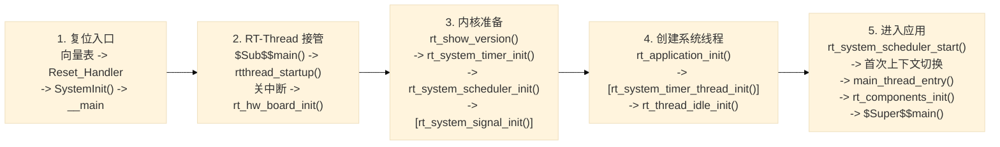
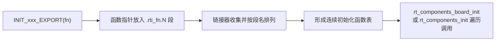
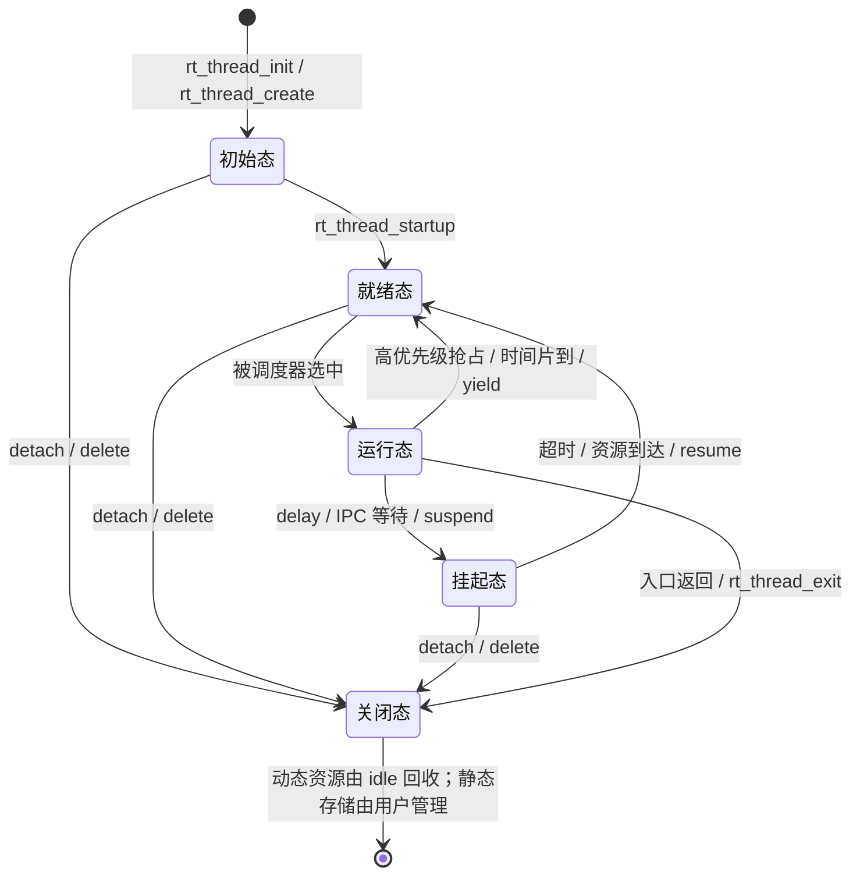
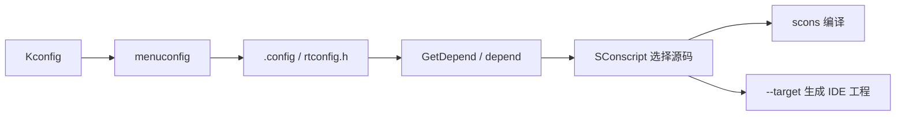

## 1. STM32F407 启动流程与 RT-Thread 引导机制

### 1.1 从上电复位到用户 `main()`

STM32F407 复位后，Cortex-M4 先从中断向量表读取两个值：

- `vector[0]`：主栈顶地址，装入 MSP；
- `vector[1]`：复位入口地址，装入 PC，开始执行 `Reset_Handler`。

常见的 MDK 工程为例，完整调用链如下：



> 图中“可选”步骤由配置项决定是否启用。`rt_system_scheduler_start()` 正常情况下不会返回。

#### 三个容易混淆的点

| 问题                                        | 结论                                                         |
| ------------------------------------------- | ------------------------------------------------------------ |
| `SystemInit()` 是否完成 168 MHz 主频配置？  | 不一定。它负责芯片早期底层配置；具体 PLL 和总线时钟通常由 BSP 的 `SystemClock_Config()` 在 `rt_hw_board_init()` 中完成。以实际 BSP 为准。 |
| `rt_system_timer_init()` 是否配置 SysTick？ | 不是。它初始化内核定时器数据结构；硬件 Tick 通常在 `rt_hw_board_init()` 中配置。 |
| 调度器启动后谁先运行？                      | 最高优先级的就绪线程。若启用且软件定时器线程优先级更高，它可能先运行并随即阻塞；之后才轮到 main 线程。 |

不同工具链只改变“C 运行库到 `rtthread_startup()`”这一小段：

| 工具链             | RT-Thread 接管入口   | 用户 `main()` 的调用方式       |
| ------------------ | -------------------- | ------------------------------ |
| MDK / Arm Compiler | `$Sub$$main()`       | main 线程调用 `$Super$$main()` |
| GCC                | 链接入口 `entry()`   | main 线程调用 `main()`         |
| IAR                | `__low_level_init()` | main 线程调用 `main()`         |

### 1.2 自动初始化：`INIT_BOARD_EXPORT` 与 `INIT_APP_EXPORT`

自动初始化的本质是“**编译时登记函数指针，启动时按区间遍历**”。模块只需导出初始化函数，无需集中修改一个总初始化函数。

```c
typedef int (*init_fn_t)(void);

#define INIT_EXPORT(fn, level)                                      \
    rt_used const init_fn_t __rt_init_##fn                          \
    rt_section(".rti_fn." level) = fn

#define INIT_BOARD_EXPORT(fn)      INIT_EXPORT(fn, "1")
#define INIT_PREV_EXPORT(fn)       INIT_EXPORT(fn, "2")
#define INIT_DEVICE_EXPORT(fn)     INIT_EXPORT(fn, "3")
#define INIT_COMPONENT_EXPORT(fn)  INIT_EXPORT(fn, "4")
#define INIT_ENV_EXPORT(fn)        INIT_EXPORT(fn, "5")
#define INIT_APP_EXPORT(fn)        INIT_EXPORT(fn, "6")
```

> 只有启用 `RT_USING_COMPONENTS_INIT` 时，上述宏才会建立初始化表；关闭该配置时，导出宏为空。新版本可能在 1 级板级初始化中继续细分阶段，具体以工程的 `rtdef.h` 和链接脚本为准。



内核通过 `rti_board_start`、`rti_board_end`、`rti_end` 等哨兵确定遍历边界：

- `rt_components_board_init()` 只执行 1 级函数，通常在 `rt_hw_board_init()` 中调用；
- `rt_components_init()` 执行 2～6 级函数，由 main 线程在用户 `main()` 之前调用。

| 级别 | 导出宏                  | 执行上下文   | 典型用途                     |
| :--: | ----------------------- | ------------ | ---------------------------- |
|  1   | `INIT_BOARD_EXPORT`     | 调度器启动前 | GPIO、串口等板级硬件初始化   |
|  2   | `INIT_PREV_EXPORT`      | main 线程    | 依赖较少的纯软件初始化       |
|  3   | `INIT_DEVICE_EXPORT`    | main 线程    | 设备驱动注册                 |
|  4   | `INIT_COMPONENT_EXPORT` | main 线程    | DFS、网络等组件初始化        |
|  5   | `INIT_ENV_EXPORT`       | main 线程    | 文件系统挂载等运行环境初始化 |
|  6   | `INIT_APP_EXPORT`       | main 线程    | 用户应用初始化               |

关键差异：

| `INIT_BOARD_EXPORT`          | `INIT_APP_EXPORT`               |
| ---------------------------- | ------------------------------- |
| 调度器尚未启动               | 已进入 main 线程上下文          |
| 不应阻塞，也不能依赖线程调度 | 可使用已初始化的线程与 IPC 服务 |
| 适合最早期硬件准备           | 适合业务模块启动                |

> 链接器保证不同级别按段排列；同一级别内的先后次序不应作为模块依赖契约。存在依赖时，应调整初始化级别，或在同一初始化函数中显式控制顺序。

---

## 2. 内核基础与对象模型

### 2.1 对象容器与控制块

RT-Thread 用 C 语言模拟面向对象：派生对象把 `struct rt_object parent` 放在首成员，从而复用名称、类型、标志和对象链表等公共能力。

```text
rt_object
├── rt_thread                       线程
├── rt_timer                        定时器
├── rt_device                       设备
└── rt_ipc_object                   IPC 基类
    ├── rt_semaphore / rt_mutex
    ├── rt_event
    └── rt_mailbox / rt_messagequeue
```

`rt_object_container[]` 按对象类型维护全局链表。对象初始化或创建后挂入对应容器，可统一完成对象查找、类型检查和线程列表展示。静态对象使用 `rt_object_init()` 登记，动态对象使用 `rt_object_allocate()` 分配并登记。

### 2.2 `struct rt_thread` 关键成员

线程控制块（TCB）保存线程的身份、调度属性、栈和等待信息，是调度器管理线程的核心数据结构。

| 成员                        | 作用                                                         |
| --------------------------- | ------------------------------------------------------------ |
| `parent`                    | 继承的 `rt_object`，提供名称、类型、静态/动态属性和对象链表节点 |
| `sp`                        | 当前线程栈指针。切出时保存现场位置，切入时据此恢复上下文     |
| `entry` / `parameter`       | 线程入口函数及其参数                                         |
| `stack_addr` / `stack_size` | 栈空间起始地址与大小，用于上下文、局部变量和栈使用检查       |
| `stat`                      | 当前状态及附加状态标志，是就绪、挂起、关闭等转换的判断依据   |
| `current_priority`          | 当前有效优先级；发生互斥量优先级继承时可能临时改变           |
| `init_priority`             | 创建时的基础优先级，优先级继承结束后用于恢复                 |
| `init_tick`                 | 每轮时间片的初值，单位为 OS Tick                             |
| `remaining_tick`            | 本轮剩余时间片，每个 Tick 递减                               |
| `tlist` / 调度节点          | 挂入就绪队列或等待队列；具体字段组织随版本变化               |
| `thread_timer`              | 线程内置单次定时器，用于延时和阻塞超时                       |

Cortex-M 栈通常从高地址向低地址增长。线程第一次运行前，`rt_hw_stack_init()` 会预先构造入口地址、参数、返回地址和寄存器初值；此后上下文切换只需保存或恢复该线程自己的栈。

### 2.3 静态线程与动态线程

| 维度     | 静态线程                                                 | 动态线程                                                     |
| -------- | -------------------------------------------------------- | ------------------------------------------------------------ |
| API      | `rt_thread_init()`                                       | `rt_thread_create()`                                         |
| TCB 与栈 | 由调用者提供，通常位于全局/静态存储区                    | 从系统堆分配 TCB 和栈                                        |
| 前提     | 不依赖系统堆                                             | 需启用并初始化动态堆                                         |
| 生命周期 | 由调用者控制，存储空间可长期保留并复用                   | 通常随线程创建、退出和删除而变化                             |
| 结束处理 | `rt_thread_detach()` 脱离内核对象；用户内存不会被 `free` | `rt_thread_delete()` 或入口返回后进入关闭态，由 idle 线程完成延迟回收 |
| 主要风险 | 栈尺寸配置不当、对象被过早复用                           | 分配失败、碎片、泄漏和分配耗时波动                           |

某些高可靠项目规定线程必须静态创建，原因不是“静态一定更快”，而是它更容易证明系统行为：

1. 启动前即可计算 TCB 与栈的总内存上界；
2. 运行期无堆分配失败和外部碎片；
3. 创建路径耗时稳定，故障分支更少；
4. 所有权和生命周期清晰，便于审查与认证。

静态创建仍需正确估算栈空间并监测栈余量，它不能自动避免栈溢出。

---

## 3. 线程状态机与调度算法

### 3.1 五态模型



| 状态                       | 含义                                   | 典型进入方式                                                 |
| -------------------------- | -------------------------------------- | ------------------------------------------------------------ |
| 初始态 `RT_THREAD_INIT`    | 已创建但未进入就绪队列，不参与调度     | `rt_thread_init()`、`rt_thread_create()`                     |
| 就绪态 `RT_THREAD_READY`   | 运行条件满足，按优先级等待 CPU         | `rt_thread_startup()`、超时或资源到达                        |
| 运行态 `RT_THREAD_RUNNING` | 当前占用 CPU；单核系统同一时刻只有一个 | 调度器选中                                                   |
| 挂起态 `RT_THREAD_SUSPEND` | 等待时间或资源，不参与调度             | `rt_thread_delay()`、`rt_sem_take()`、`rt_mutex_take()`、`rt_mq_recv()` 等 |
| 关闭态 `RT_THREAD_CLOSE`   | 不再参与调度，等待清理                 | 入口返回、`rt_thread_exit()`、删除或脱离                     |

`rt_thread_suspend()` / `rt_thread_resume()` 适合成对控制“显式挂起”的线程。因信号量、互斥量或消息队列而挂起的线程，应由对应 IPC 对象或超时机制唤醒，不能用 `rt_thread_resume()` 强行打断等待关系。

### 3.2 抢占式优先级调度

RT-Thread 采用固定优先级抢占调度：**优先级数值越小，优先级越高**。优先级数量由 `RT_THREAD_PRIORITY_MAX` 配置，常见为 32，最大可为 256。


- 不超过 32 个优先级时，一个 32 位位图即可定位最高就绪优先级；
- 超过 32 个优先级时，使用“组位图 + 组内位图”的两级查找；
- 每个优先级对应一条就绪链表，同优先级线程在链表内轮转。

典型调度触发点：

1. `rt_thread_startup()`、IPC 释放或超时使更高优先级线程就绪；
2. 当前线程延时、等待 IPC、主动 `yield` 或退出；
3. SysTick 使当前线程时间片耗尽；
4. 中断唤醒更高优先级线程。中断中只登记切换请求，实际切换在中断退出时完成。

Cortex-M 通常借助 PendSV 完成上下文切换：硬件自动保存异常现场，移植层保存其余寄存器，并把栈位置写入当前线程的 `sp`；切入时执行相反过程。调度锁或临界区期间，切换会推迟到允许调度时。

### 3.3 时间片轮转

时间片只解决“**多个就绪线程优先级相同**”时谁先运行，不会削弱高优先级线程的抢占权。

```text
线程开始本轮运行
  -> 每个 OS Tick：remaining_tick--
  -> remaining_tick > 0：继续运行
  -> remaining_tick == 0：恢复为 init_tick，移到同优先级队列尾部
  -> 调度同优先级的下一个线程
```

| 场景                       | 调度结果                             |
| -------------------------- | ------------------------------------ |
| 更高优先级线程就绪         | 立即抢占；当前线程保留未用完的时间片 |
| 同优先级且当前时间片耗尽   | 当前线程排到队尾，下一线程运行       |
| 同优先级但只有一个就绪线程 | 没有可轮转对象，仍由它运行           |
| 低优先级线程就绪           | 不会抢占当前线程                     |

工程上应优先让线程阻塞等待真实事件，如信号量、消息队列或周期定时，而不是持续空转。高优先级线程若长期不阻塞，会使低优先级线程和 idle 线程饥饿，动态线程资源回收与低功耗处理也会受影响。

### 3.4 工程实践补充

#### 从最小系统开始验证

面对“编译成功但无法运行”或启动后 HardFault，不要一次启用全部组件。更稳妥的顺序是：

1. 用 Env 的 `menuconfig` 或 RT-Thread Studio 的 Settings 检查配置，暂时关闭无关组件和外设；
2. 先验证系统时钟、系统 Tick、控制台和一个简单 LED 线程；
3. 再逐项启用驱动、组件和软件包，每次修改后重新编译验证并保留可回退版本。

#### 线程参数检查表

| 检查项   | 建议                                                         | 判断依据                                                     |
| -------- | ------------------------------------------------------------ | ------------------------------------------------------------ |
| 优先级   | 按响应期限分配，同时检查 main、timer（启用软定时器时）等系统线程 | 只要高优先级线程就绪，它就能抢占低优先级线程                 |
| 时间片   | 重点检查同优先级线程；没有同优先级竞争时无需反复调大         | 时间片只参与同优先级轮转                                     |
| 线程栈   | 先留合理余量，再通过 `list_thread` / `ps` 观察最大占用并调整 | 过小会溢出，过大则浪费 RAM；显示列名随版本而异               |
| 阻塞点   | 业务循环优先等待信号量、消息队列或事件；周期任务可使用延时   | 防止高优先级线程持续占用 CPU                                 |
| idle     | 可用 idle 钩子观察系统是否还有空闲时间，但钩子必须短且不能阻塞 | idle 能运行表示 CPU 有余量，不代表所有线程都满足实时期限     |
| 状态查看 | 把 `list_thread` / `ps` 当作瞬时快照                         | shell 线程通常显示运行态，其他线程显示挂起态不等于从未被调度 |

#### 三类“定时器”不要混淆

| 类型                   | 本质                      | 回调上下文     | 使用原则                                           |
| ---------------------- | ------------------------- | -------------- | -------------------------------------------------- |
| MCU 硬件定时器         | 芯片 TIM 等外设           | 外设中断       | 精度高；中断处理应短小                             |
| RT-Thread `HARD_TIMER` | 基于 OS Tick 的软件定时器 | 系统 Tick 中断 | 默认模式；不能阻塞，避免耗时操作                   |
| RT-Thread `SOFT_TIMER` | 基于 OS Tick 的软件定时器 | timer 线程     | 需启用 `RT_USING_TIMER_SOFT`；多个长回调会相互延迟 |

定时器回调适合“触发动作”，耗时业务更适合通知专用线程处理。

---

## 4. SCons 构建要点

### 4.1 文件分工

| 文件                     | 职责                                          |
| ------------------------ | --------------------------------------------- |
| `SConstruct`             | BSP 的构建入口，装载环境并递归组织工程        |
| `SConscript`             | 描述当前模块的源文件、头文件、依赖和编译参数  |
| `rtconfig.py`            | 选择工具链并设置编译、汇编和链接参数          |
| `Kconfig`                | 定义可配置选项及依赖关系                      |
| `.config` / `rtconfig.h` | 保存配置结果，并向构建脚本和 C 代码提供配置值 |

### 4.2 常用命令

| 命令                  | 作用                     |
| --------------------- | ------------------------ |
| `scons`               | 增量编译当前 BSP         |
| `scons -c`            | 清理构建产物             |
| `scons -j4`           | 使用 4 个并行任务编译    |
| `scons --target=mdk5` | 生成 Keil MDK5 工程      |
| `scons --target=iar`  | 生成 IAR 工程            |
| `scons --dist`        | 导出可独立发布的工程目录 |

### 4.3 `SConscript` 最小示例

```python
from building import *

cwd = GetCurrentDir()
src = Split('''
shell.c
msh.c
''')

if GetDepend('MSH_USING_BUILT_IN_COMMANDS'):
    src += ['cmd.c']

group = DefineGroup(
    'Finsh',
    src,
    depend=['RT_USING_FINSH'],
    CPPPATH=[cwd]
)

Return('group')
```

- `depend`：控制整个 Group 是否加入构建；
- `GetDepend()`：在脚本中按配置选择源文件；
- `CPPPATH` / `CPPDEFINES`：添加头文件目录和宏；
- `CFLAGS` / `CXXFLAGS` / `LIBS` / `LIBPATH`：设置编译选项和库。



使用 Keil 或 IAR 工程时，修改配置或源码分组后应重新执行相应的 `scons --target=...`，使 IDE 工程与 SCons 描述保持一致。