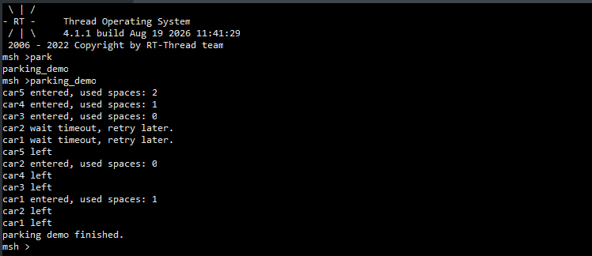
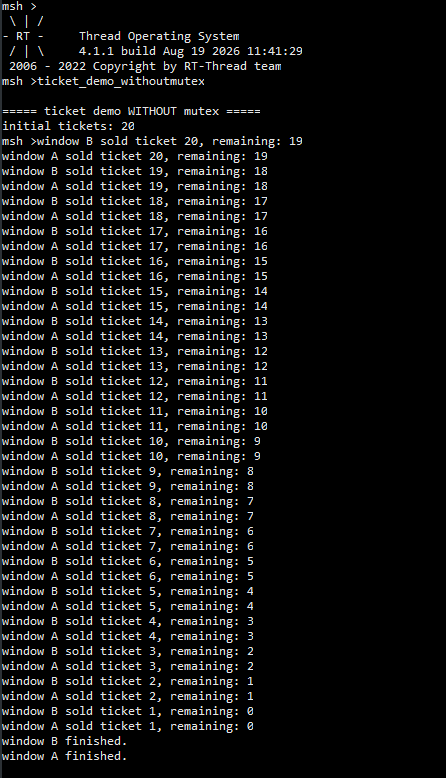
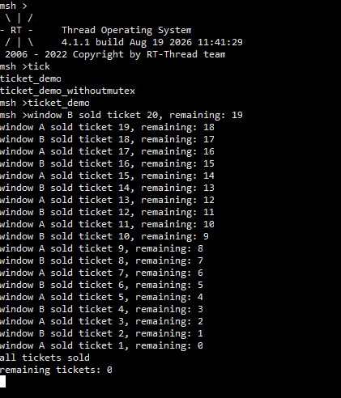
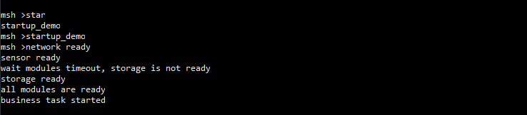
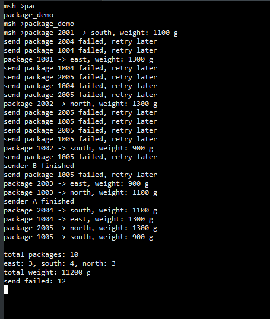

# RT-Thread 线程同步与 IPC 实验报告

## 一、实验目的

本次实验通过 RT-Thread 中的线程调度、信号量、互斥量、事件集和消息队列等机制，模拟多个典型的多线程应用场景，理解线程同步、共享资源保护以及线程间通信的基本方法。

实验主要包括以下四个练习：

1. 停车场车位管理：使用计数信号量管理有限资源；
2. 多窗口售票系统：比较不使用互斥量和使用互斥量时共享数据访问的区别；
3. 系统启动条件检查：使用事件集等待多个模块全部初始化完成；
4. 快递分拣中心：使用消息队列完成生产者与消费者之间的数据传递。

---

## 二、实验环境

- 操作系统：RT-Thread
- 开发语言：C
- 线程创建：`rt_thread_create()`
- 线程启动：`rt_thread_startup()`
- MSH 命令导出：`MSH_CMD_EXPORT()`

实验中主要使用以下 IPC 机制：

- 计数信号量 `rt_sem_t`
- 互斥量 `rt_mutex_t`
- 事件集 `rt_event_t`
- 消息队列 `rt_mq_t`

---

## 三、理论总结

### 3.1 线程调度

RT-Thread 中每个线程具有自己的优先级、线程栈和时间片。

当多个线程具有相同优先级时，可以在调度器控制下竞争 CPU。需要注意的是，相同优先级并不代表真正的随机执行，实际运行顺序还会受到就绪队列、时间片、线程阻塞和唤醒等因素影响。

因此，本实验中的车辆线程和售票线程虽然使用相同优先级，但其实际执行顺序主要由调度器决定。

### 3.2 信号量

信号量适合表示有限数量的共享资源。

例如停车场存在 3 个车位，可以创建初始值为 3 的计数信号量。

线程调用：

```c
rt_sem_take();
```

成功获取信号量后，相当于占用一个资源。

线程完成操作后调用：

```c
rt_sem_release();
```

相当于归还一个资源。

因此，计数信号量适合停车位、缓冲区等有限资源管理场景。

### 3.3 互斥量

互斥量主要用于保护共享资源。

一个线程获得互斥量后，其他需要同一个互斥量的线程必须等待，直到当前线程释放互斥量。

基本过程为：

```c
rt_mutex_take();

访问和修改共享资源;

rt_mutex_release();
```

如果一个业务过程包含“读取、判断、修改”等多个步骤，就需要将整个过程放入临界区，而不是只保护其中一条语句。

### 3.4 事件集

事件集适合处理多个独立条件的同步。

例如设备启动时，可以分别使用不同事件位表示：

```c
EVENT_NET_READY
EVENT_SENSOR_READY
EVENT_STORAGE_READY
```

主线程使用 `RT_EVENT_FLAG_AND` 等待时，只有所有指定事件位全部满足，线程才会继续运行。

因此事件集适合“多个条件全部完成后才能继续”的场景。

### 3.5 消息队列

消息队列用于不同线程之间传递数据。

生产线程通过：

```c
rt_mq_send();
```

发送消息。

消费线程通过：

```c
rt_mq_recv();
```

接收消息。

使用消息队列后，生产线程不需要直接操作消费线程，二者可以独立执行，因此能够降低线程之间的耦合。

---

# 四、练习一：停车场车位管理

## 4.1 实验目的

模拟一个只有 3 个车位的停车场，同时有 5 辆车尝试进入。

要求最多只有 3 辆车同时停车，当车位已满时，其他车辆等待停车位；等待超过 2 秒后输出超时信息并重新申请。

## 4.2 实现方法

程序创建初始值为 3 的计数信号量：

```c
parking_sem = rt_sem_create(
    "parksem",
    PARKING_SPACE_COUNT,
    RT_IPC_FLAG_FIFO);
```

同时创建 5 个相同优先级的车辆线程。

车辆通过：

```c
rt_sem_take(
    parking_sem,
    rt_tick_from_millisecond(2000));
```

申请停车位。

获得停车位成功后，全局变量：

```c
remaining_spaces
```

减 1，用于记录当前剩余停车位。

车辆停车一段时间后执行：

```c
rt_sem_release(parking_sem);
```

释放停车资源，并将剩余车位加 1。

## 4.3 实验现象

运行：

```text
parking_demo
```

后可以观察到：

- 5 个车辆线程参与停车位竞争；
- 同一时刻最多只有 3 辆车能够获得停车位；
- 当 3 个车位全部占用以后，其余车辆进入等待；
- 等待超过 2 秒的车辆输出超时信息；
- 超时车辆稍后再次申请停车位；
- 有车辆离开并释放信号量以后，等待车辆可以继续进入；
- 最终所有车辆完成停车过程。

由于车辆线程优先级和时间片相同，因此车辆的具体执行顺序由 RT-Thread 调度器决定，而不是程序人为固定。



## 4.4 结果分析

停车场初始存在：

```text
3 个可用停车位
```

一辆车成功执行 `rt_sem_take()` 后，可用停车资源减少一个。

车辆执行 `rt_sem_release()` 后，停车资源重新可用。

因此，即使存在 5 个车辆线程同时竞争，也只有最多 3 个线程能够同时获得停车资源。

说明计数信号量非常适合管理**数量有限的共享资源**。

---

# 五、练习二：多窗口售票系统

## 5.1 实验目的

使用窗口 A 和窗口 B 同时出售 20 张车票，通过“不使用互斥量”和“使用互斥量”两种情况进行对比，观察并发修改共享变量时可能发生的问题。

全局余票定义为：

```c
static rt_int32_t remaining_tickets = TOTAL_TICKETS;
```

---

## 5.2 不使用互斥量

### 实现方法

在第一个版本中，窗口线程不使用互斥量。

线程首先读取：

```c
ticket_no = remaining_tickets;
```

随后故意延时：

```c
rt_thread_mdelay(50);
```

再执行：

```c
remaining_tickets = ticket_no - 1;
```

通过这个延时增加线程在“读取”和“修改”之间发生切换的概率。

### 实验现象

运行：

```text
ticket_demo_withoutmutex
```

时可能出现两个窗口出售相同票号的情况，例如：

```text
window A sold ticket 20
window B sold ticket 20
```

假设初始余票为：

```text
20
```

窗口 A 首先读取 20，然后发生线程切换。

窗口 B 也读取到 20。

因此两个线程本地保存的：

```c
ticket_no
```

都等于 20。

随后两个线程分别执行：

```c
remaining_tickets = 19;
```

这样虽然发生了两次售票，但全局余票只减少了一次。



### 原因分析

问题的根本原因是：

```text
读取余票 → 修改余票
```

不是一个不可分割的操作。

两个线程同时访问共享变量时发生了竞态条件。

这会导致：

- 重复售票；
- 数据覆盖；
- 实际售票数量与余票变化不一致。

---

## 5.3 使用互斥量

### 实现方法

加入互斥量以后，窗口线程首先执行：

```c
rt_mutex_take(ticket_mutex, RT_WAITING_FOREVER);
```

然后完成：

```text
检查余票
读取票号
余票减 1
打印售票结果
```

最后执行：

```c
rt_mutex_release(ticket_mutex);
```

整个售票过程都处于互斥量保护之下。

### 实验现象

运行：

```text
ticket_demo
```

后，两个窗口仍然可以交替工作，但是不会再同时修改余票。

票号能够从：

```text
20
19
18
...
2
1
```

依次售出。

最终结果为：

```text
all tickets sold
remaining tickets: 0
```

不会出现重复票号，也不会出现负数余票。



## 5.4 两种情况对比

| 项目 | 无互斥量 | 使用互斥量 |
|---|---|---|
| 两个窗口并发执行 | 是 | 是 |
| 共享变量有保护 | 否 | 是 |
| 可能出现重复票号 | 是 | 否 |
| 可能发生覆盖写入 | 是 | 否 |
| 最终余票可靠 | 不一定 | 是 |
| 售票过程完整互斥 | 否 | 是 |

## 5.5 实验结论

多线程程序中，即使只是简单的变量加减，也不能默认其业务过程是线程安全的。

在售票实验中，必须把：

```text
检查余票 → 获取票号 → 修改余票 → 输出结果
```

作为完整临界区保护。

互斥量可以避免两个窗口同时操作同一份票务数据。

---

# 六、练习三：系统启动条件检查

## 6.1 实验目的

模拟设备启动过程中三个独立模块的初始化：

- 网络模块；
- 传感器模块；
- 存储模块。

只有三个模块全部初始化完成以后，主业务线程才能启动。

## 6.2 实现方法

程序定义三个事件位：

```c
#define EVENT_NET_READY      (1U << 0)
#define EVENT_SENSOR_READY   (1U << 1)
#define EVENT_STORAGE_READY  (1U << 2)
```

三个初始化线程分别延时：

```text
网络模块：1 秒
传感器模块：2 秒
存储模块：5 秒
```

初始化完成后，通过：

```c
rt_event_send();
```

发送对应的就绪事件。

主业务线程第一次最多等待 3 秒，并使用：

```c
RT_EVENT_FLAG_AND
```

等待三个事件全部到达。

## 6.3 实验现象

由于网络模块 1 秒完成，首先输出：

```text
network ready
```

传感器 2 秒完成，随后输出：

```text
sensor ready
```

但是存储模块需要 5 秒。

业务线程第一次只等待 3 秒，因此会发生超时，并检查当前尚未完成的事件：

```text
wait modules timeout, storage is not ready
```

随后业务线程继续等待。

5 秒后：

```text
storage ready
```

三个事件全部满足，业务线程输出：

```text
all modules are ready
business task started
```



## 6.4 结果分析

事件集中的三个事件位分别表示三个模块的状态。

使用 AND 模式，相当于要求：

```text
网络准备完成
AND
传感器准备完成
AND
存储准备完成
```

三个条件全部成立以后，主业务线程才能运行。

事件等待还可以设置超时时间，因此程序能够在某个模块初始化时间过长时发现问题，而不是无限阻塞。

该实验说明，事件集适合多个独立任务完成后的统一同步。

---

# 七、练习四：快递分拣中心

## 7.1 实验目的

模拟两个发件线程不断生成快递数据，一个分拣线程从消息队列中接收快递并进行分类统计。

主要观察：

- 消息队列的数据传递；
- 多生产者、单消费者模式；
- 队列满时的处理；
- 消息结束标志；
- 数据统计。

## 7.2 消息结构

快递消息定义为：

```c
struct package_msg
{
    rt_uint32_t id;
    rt_uint8_t region;
    rt_uint16_t weight;
};
```

其中：

```text
region = 1：华东
region = 2：华南
region = 3：华北
```

消息队列容量设置为：

```text
5 条消息
```

## 7.3 发件线程

程序创建两个发件线程，每个线程产生 5 条消息。

发送线程 A 使用：

```text
1001 ~ 1005
```

发送线程 B 使用：

```text
2001 ~ 2005
```

因此 10 条快递的 ID 不会重复。

按照当前源码中的区域生成方式，最终区域数量为：

```text
华东：3
华南：4
华北：3
```

按照当前源码中的重量计算方式，10 条快递的总重量为：

```text
11200 g
```

## 7.4 队列满处理

发送线程调用：

```c
rt_mq_send();
```

向消息队列放入快递信息。

如果队列已经达到容量上限，程序不会崩溃，也不会直接丢弃快递，而是：

```c
send_failed++;
```

记录发送失败次数。

随后等待 50 ms 后再次发送。

因此一条快递即使第一次发送失败，也会一直重试到发送成功。

当前程序中发送线程每产生一条快递后只延时 20 ms，而分拣线程处理一条消息后延时 100 ms。

因此生产速度大于消费速度时，消息队列可能达到容量上限。

## 7.5 分拣线程

分拣线程通过：

```c
rt_mq_recv();
```

持续接收快递。

每收到一条正常快递后：

1. 总快递数量加 1；
2. 对对应区域数量加 1；
3. 将快递重量加入总重量；
4. 打印快递 ID、区域和重量。

两个发件线程全部结束以后，最后一个发件线程发送特殊结束消息。

分拣线程收到结束消息后退出并打印统计结果。

## 7.6 实验现象

运行：

```text
package_demo
```

后，可以看到类似：

```text
package 1001 -> east, weight: 1300 g
package 2001 -> south, weight: 1100 g
...
```

当队列暂时满时，可能出现：

```text
send package xxxx failed, retry later
```

说明生产速度超过了当前分拣速度。

但由于发送线程进行了重试，所以最终仍会完成全部 10 条快递的处理。

根据当前源码的确定性生成规则，最终统计应满足：

```text
total packages: 10
east: 3, south: 4, north: 3
total weight: 11200 g
```

最后还会打印：

```text
send failed: x
```

其中 `x` 会受到实际运行时线程调度和队列占用情况影响，因此具体数值应以实际 MSH 输出为准。



## 7.7 结果分析

消息队列将发送线程和分拣线程分离。

发送线程只负责产生数据，分拣线程只负责处理数据，双方不需要直接操作彼此线程内部的数据。

同时，由于消息队列容量有限，当生产速度超过消费速度时可能产生发送失败。

因此实际程序中必须正确处理：

```text
队列已满
```

这种情况，而不能假设消息一定能够一次发送成功。

---

# 八、实验中遇到的问题及解决方法

## 8.1 信号量返回值判断

停车场实验中，必须正确判断：

```c
rt_sem_take() == RT_EOK
```

只有返回成功才表示真正获得了停车位。

发生超时时，车辆应该等待后重新申请。

## 8.2 售票竞态条件

不使用互斥量时，两个线程可以在相同时间读取同一个余票值。

通过在读取和修改之间加入短暂延时，可以更容易观察到重复售票现象。

加入互斥量以后，将整个售票流程作为临界区保护，问题得到解决。

## 8.3 多模块完成条件判断

系统启动实验中，各模块完成时间不同。

如果只使用固定延时启动主业务，无法准确判断模块是否真正准备完成。

使用事件集后，每个模块主动发送完成状态，主业务线程可以准确等待所有模块就绪。

## 8.4 消息队列满

快递实验中，生产速度高于消费速度时，消息队列会暂时达到最大容量。

程序通过记录发送失败次数并重试来避免消息永久丢失。

---

# 九、实验总结

通过本次实验，对 RT-Thread 中多线程同步和 IPC 机制有了更加直观的认识。

停车场实验表明，**计数信号量适合管理数量有限的共享资源**，能够从机制上限制同时获得资源的线程数量。

售票实验通过无互斥量和有互斥量两种程序的对比，说明了多线程同时修改共享变量时可能产生竞态条件。**互斥量可以保护完整临界区，保证共享数据的一致性。**

系统启动实验说明，**事件集适合表示多个独立条件的完成状态**。使用 AND 模式可以保证所有条件全部满足后再执行主业务，同时结合超时等待还能检查未完成模块。

快递分拣实验说明，**消息队列适合在线程之间传递结构化数据**，能够实现生产者和消费者之间的解耦，同时也需要考虑队列容量有限以及发送失败等情况。

四种 IPC 机制的典型应用可以总结如下：

| IPC 机制 | 主要作用 | 本实验中的应用 |
|---|---|---|
| 计数信号量 | 管理有限数量资源 | 停车场车位 |
| 互斥量 | 保护共享数据 | 多窗口售票 |
| 事件集 | 等待多个状态条件 | 系统启动检查 |
| 消息队列 | 在线程间传递数据 | 快递分拣 |

通过这些实验可以认识到，多线程程序不仅需要实现功能，还必须考虑线程之间的执行顺序、共享资源竞争、同步条件以及线程间的数据传递。选择合适的 IPC 机制，是保证实时操作系统程序正确性和可靠性的关键。
::: ​​