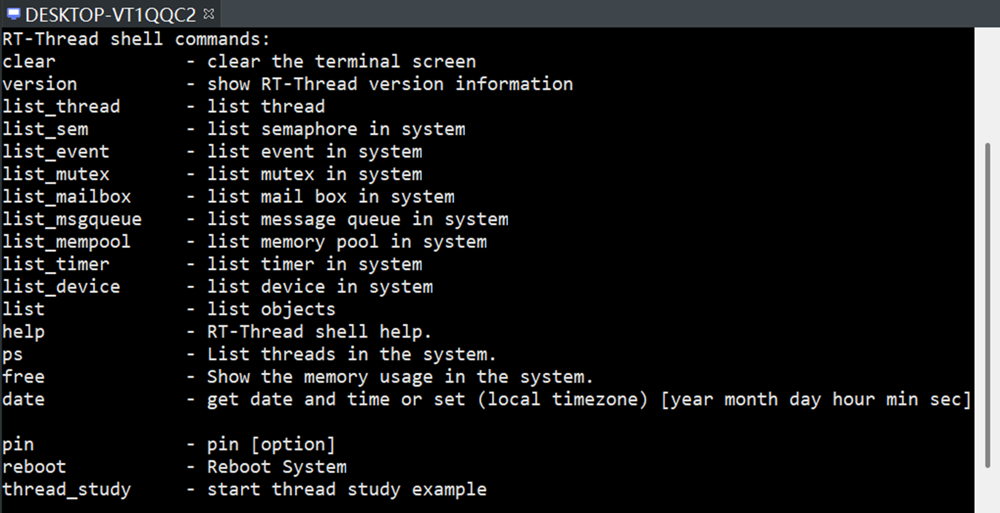
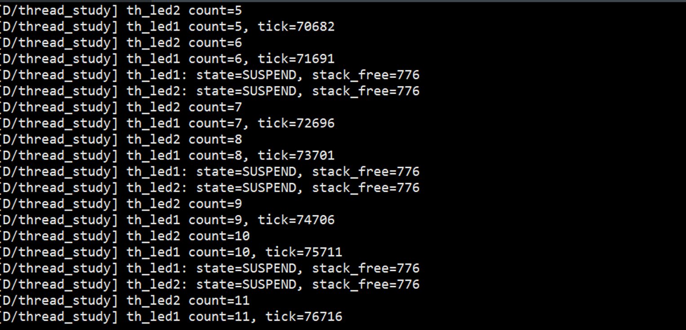
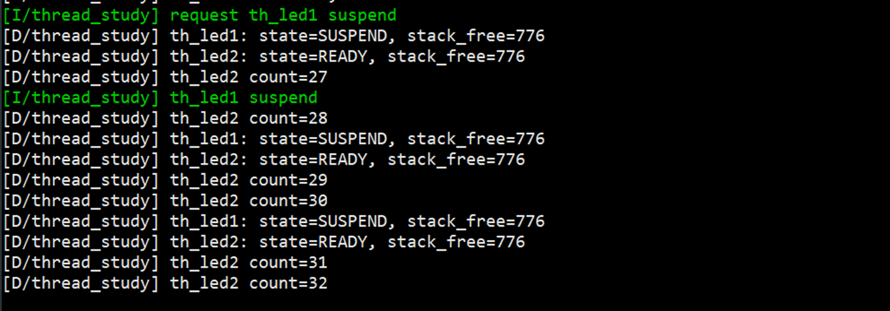
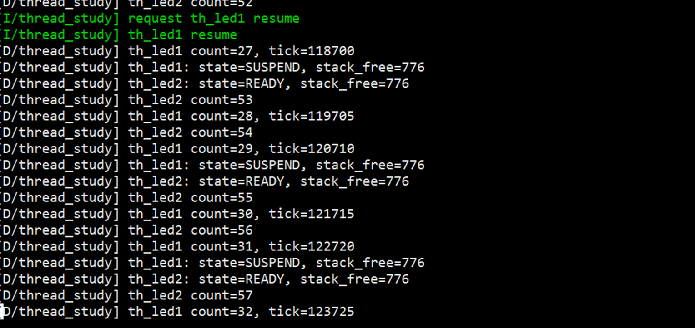

# RT-Thread线程培训学习随笔

今天的培训算是真正开始进入RT-Thread的“内核世界”了。前面搭环境、用Git、提PR，更像是在为后面的学习准备工具；而今天开始接触线程以后，很多以前只知道名字的概念，终于慢慢连成了一条线。尤其是从裸机开发讲到RTOS，再讲到线程控制块、线程状态、优先级、时间片，最后落到`rt_thread_init()`、`rt_thread_create()`和`rt_thread_startup()`这些API上，我第一次比较完整地看到了一个线程从“被创建”到“真正运行”的全过程。

这次培训对我来说最大的收获，是开始理解：**RTOS到底是怎样把一个复杂的嵌入式程序拆成多个任务，再让这些任务按照一定规则共享CPU的。**

---

## 一、从裸机开发走到RTOS多任务

### 1.以前的`while(1)`为什么会慢慢变得难维护

刚开始学单片机的时候，最熟悉的程序结构往往就是一个`while(1)`大循环。初始化完成后，ADC采集、SPI读取、USB处理、LCD刷新、文件写入等功能，一个接一个地放在循环里执行。遇到外部事件时，再通过中断服务程序进行处理。

大概就是下面这种感觉：

```c
void main(void)
{
    init();

    while (1)
    {
        ADC_Read();
        SPI_Read();
        USB_Packet();
        LCD_Update();
        Audio_Decode();
        File_Write();
    }
}
```

这种写法在程序规模很小的时候其实很好理解。哪个功能先执行、哪个功能后执行，一眼就能看出来。但是今天培训里提到的一个问题让我印象很深：**只要其中一个函数出现了比较长的等待，整个后台循环都会被拖住。**

比如`ADC_Read()`里面为了等待转换结束，一直卡在某个循环中，那么后面的`SPI_Read()`、`LCD_Update()`这些任务就只能排队等着。程序功能少的时候问题可能还不明显，但功能一旦变复杂，所有任务互相影响，实时性就越来越难保证。

课件把裸机模式的问题总结成了几个方面：并发性低、实时性难保证、可维护性差、可重用性低。我觉得这几个词放到实际代码里非常容易理解。一个大循环里塞了十几个功能以后，如果想改其中一个模块，往往要同时考虑它对其他流程有没有影响；而且很多功能之间通过各种全局变量和状态标志联系在一起，改动一个地方可能就会牵出一串问题。

所以我现在对裸机开发的理解是：

> 裸机不是不能做复杂程序，而是当任务越来越多时，程序员需要自己承担越来越多的“调度工作”。

而RTOS出现的意义，就是把这部分工作交给操作系统。

### 2.线程让我第一次真正理解“分而治之”

今天培训里讲线程时，用到了“分而治之”这个说法，我觉得非常贴切。

一个复杂系统里，可能同时存在很多事情：传感器要采集数据、串口要接收命令、网络要发送数据、屏幕要刷新、按键还要及时响应。如果全部塞进一个大循环里，就很容易互相干扰。

RTOS的思路则是把这些事情拆开：

```text
传感器采集  → 一个线程
串口处理    → 一个线程
网络通信    → 一个线程
界面刷新    → 一个线程
数据存储    → 一个线程
```

每个线程只专注于自己的任务，然后由RTOS的调度器决定它们什么时候运行。

这里有一点我以前容易误解，就是“多线程”看起来像很多任务一起跑，但如果是在单核CPU上，某一个时刻真正运行的仍然只有一个线程。只是操作系统切换得很快，所以从整体效果上看，多个任务像是在并行工作。

我觉得这个概念非常重要，因为它说明RTOS的核心并不是简单地“多创建几个函数”，而是：

1.把功能拆成多个独立任务；
2.为每个任务建立线程；
3.由调度器统一分配CPU时间；
4.线程之间按照优先级、状态等规则切换。

也就是说，**线程是任务真正被操作系统管理起来之后的实体。**

### 3.RT-Thread启动以后，`main()`其实已经在一个线程里

今天还看了RT-Thread的启动流程图。虽然流程比较长，但我觉得有一件事特别值得记住：在RT-Thread里，`main()`并不是脱离操作系统单独运行的，它本身就在主线程中执行。

系统从启动文件进入以后，会执行`rtthread_startup()`，然后完成一系列初始化工作，例如板级初始化、系统定时器初始化、调度器初始化、应用初始化等。之后系统会创建主线程、空闲线程等系统线程，最后启动调度器。

我现在可以把这个流程粗略理解成：

```text
启动文件
   ↓
rtthread_startup()
   ↓
板级初始化
   ↓
定时器、调度器等内核初始化
   ↓
创建系统线程
   ↓
启动调度器
   ↓
main_thread_entry()
   ↓
main()
```

也就是说，当我在`main()`里写：

```c
int main(void)
{
    rt_kprintf("hello world!\n");
    return 0;
}
```

这段代码其实已经是在RT-Thread建立好的线程环境中运行了。

这让我对“操作系统启动”和“应用程序启动”的关系清楚了很多。以前总觉得程序从`main()`开始，实际上在RTOS里，真正进入`main()`之前，系统已经完成了很多内核层面的准备工作。

---

## 二、线程不是一个函数，而是一整套运行信息

### 1.线程控制块就像线程的“个人档案”

如果RT-Thread要管理很多线程，那么系统必须知道每个线程现在是什么情况。比如这个线程叫什么名字、优先级是多少、现在是运行还是挂起、线程栈在哪里、入口函数是什么、还剩多少时间片等等。

这些信息都需要一个地方保存，这个地方就是**线程控制块**。

RT-Thread中的线程控制块由`struct rt_thread`定义。课件里提到，它会保存线程的优先级、线程名称、线程状态，还会保存线程栈、入口函数、链表结构以及其他内核管理信息。

我觉得可以把它想成一个线程的“个人档案”：

```text
struct rt_thread
│
├── 线程名称
├── 线程状态
├── 当前优先级
├── 初始优先级
├── 线程入口函数
├── 入口函数参数
├── 线程栈地址
├── 栈大小
├── 时间片
├── 定时器
└── 内核管理链表等信息
```

所以线程并不只是那段入口函数代码。入口函数只定义“这个线程要做什么”，而线程控制块才真正让操作系统能够“认识、记录和管理”这个线程。

另外，`struct rt_thread`继承自RT-Thread中的基础对象`rt_object`。这说明RT-Thread内部很多资源都不是零散管理的，而是通过统一的内核对象机制组织起来。线程只是其中一种对象，其他像信号量、互斥量、消息队列、定时器、设备等，也有相应的对象结构。

这一点让我觉得RT-Thread的内部设计其实很有体系，而不是简单地堆API。

### 2.线程状态不是固定的，而是在不断变化

今天线程状态这一部分我觉得特别重要，因为调度其实就是围绕这些状态展开的。

RT-Thread里主要有以下几种线程状态：

- `RT_THREAD_INIT`：初始状态；
- `RT_THREAD_READY`：就绪状态；
- `RT_THREAD_RUNNING`：运行状态；
- `RT_THREAD_SUSPEND`：挂起状态；
- `RT_THREAD_CLOSE`：关闭状态。

一开始创建或者初始化线程以后，线程还不能直接运行，而是处于初始状态。调用`rt_thread_startup()`之后，线程才进入就绪状态，开始参加调度。

如果调度器选中了它，它就从就绪态进入运行态。运行过程中，如果调用了延时函数、等待某个资源，或者主动挂起，它就会进入挂起状态。等延时时间到了或者等待条件满足以后，它又会重新回到就绪状态。

最后如果线程执行结束，就会进入关闭状态，不再参与调度。

我觉得最值得记住的主线就是：

```text
创建/初始化
    ↓
初始态
    ↓ rt_thread_startup()
就绪态
    ↓ 调度器选中
运行态
    ↓ 延时/等待资源
挂起态
    ↓ 条件满足
就绪态
    ↓
再次被调度
```

这样一看，线程调度就没有那么抽象了。调度器实际上一直在“就绪线程”里选择最应该运行的线程，而挂起状态的线程暂时不会参与竞争。

### 3.优先级、时间片和线程栈决定线程怎样运行

线程创建时需要设置很多参数，其中让我印象最深的三个就是：**优先级、时间片和线程栈。**

先说优先级。RT-Thread中优先级数值越小，优先级越高，`0`是最高优先级。这个地方和生活里“数字越大级别越高”的直觉相反，所以很容易记错。

如果当前正在运行一个优先级为20的线程，而此时一个优先级为10的线程进入就绪状态，那么后者优先级更高，可以马上抢占CPU。

所以我现在可以把优先级理解成：

> 谁更重要，谁就应该更早得到CPU。

不过如果两个线程优先级一样，就需要用到时间片。时间片只对**相同优先级的就绪线程**有意义。比如线程A和线程B优先级相同，A的时间片是10个OSTick，B的时间片是5个OSTick，那么系统会让它们轮流运行，每次分别执行对应的节拍数量。

所以可以简单记成：

> 优先级决定谁先跑，时间片决定同优先级线程一次跑多久。

线程栈则是另一个很重要的资源。每个线程都有自己独立的栈空间。线程切换时，当前线程的上下文信息会保存到它自己的栈里，等以后重新运行时再恢复。函数调用过程中产生的局部变量等内容也会使用线程栈。

这让我意识到：线程栈不是“随便给个数字”就行。栈给得太小，复杂函数调用时可能出现栈溢出；栈给得太大，又会浪费宝贵的RAM。所以以后真正做项目时，线程栈大小应该根据实际任务复杂度去调整，而不是所有线程统一写一个很大的值。

---

## 三、从API开始真正创建一个线程

### 1.静态线程和动态线程，其实是在选择“内存由谁准备”

今天开始接触线程管理API以后，我觉得线程终于从概念变成了可以实际操作的东西。

RT-Thread中创建线程主要有两种方式：静态线程和动态线程。

静态线程使用`rt_thread_init()`进行初始化。它的特点是线程控制块和线程栈都由用户自己准备。

例如：

```c
static struct rt_thread thread1;
static char thread1_stack[1024];
```

这里`thread1`是线程控制块，`thread1_stack`是线程运行需要的栈空间。

然后调用：

```c
rt_thread_init(&thread1,
               "thread1",
               thread1_entry,
               RT_NULL,
               &thread1_stack[0],
               sizeof(thread1_stack),
               20,
               10);
```

这些参数分别对应线程控制块、线程名称、入口函数、入口参数、栈地址、栈大小、优先级和时间片。

静态线程让我感觉更“可控”，因为内存是在编译阶段就准备好的，不依赖运行时动态分配。

动态线程则使用`rt_thread_create()`：

```c
rt_thread_t tid;

tid = rt_thread_create("thread1",
                       thread1_entry,
                       RT_NULL,
                       1024,
                       20,
                       10);
```

调用这个函数后，RT-Thread会从动态堆中为线程控制块和线程栈申请空间。

所以我现在对这两种方式有一个比较简单的记法：

> `rt_thread_init()`：内存我准备，系统帮我初始化。  
> `rt_thread_create()`：内存也由系统帮我申请。

静态和动态并没有绝对的好坏，更多是看实际项目中对内存、确定性和使用方便程度的要求。

### 2.创建成功不代表已经运行，还需要`rt_thread_startup()`

这一点是今天特别需要注意的地方。

无论使用`rt_thread_init()`还是`rt_thread_create()`，线程刚创建完成以后都只是处于**初始状态**，还没有真正进入调度器的就绪队列。

还需要调用：

```c
rt_thread_startup(thread);
```

或者动态线程中：

```c
rt_thread_startup(tid);
```

线程才会变成就绪状态。

因此一个线程真正跑起来的过程应该是：

```text
准备线程入口函数
      ↓
准备线程控制块和线程栈（静态线程）
      ↓
rt_thread_init()
或
rt_thread_create()
      ↓
线程处于初始态
      ↓
rt_thread_startup()
      ↓
线程进入就绪队列
      ↓
调度器进行调度
      ↓
线程开始运行
```

这个过程让我对“创建”和“启动”两个概念分得更清楚了。

更有意思的是，如果新启动的线程优先级比当前线程更高，那么它进入就绪态后，调度器可能马上发生切换，让这个新线程立即运行。也就是说，`rt_thread_startup()`之后程序的实际执行顺序，已经不完全由代码书写顺序决定，而是开始受调度器控制。

这也是RTOS和裸机程序非常明显的区别。

### 3.线程不仅要会“抢CPU”，也要会主动让出CPU

今天最后讲到线程延时时，我觉得这个概念把前面的调度逻辑补完整了。

如果一个线程一直在下面这样的死循环里工作：

```c
while (1)
{
    do_something();
}
```

并且里面没有阻塞、延时或等待，那么它可能会一直保持就绪甚至运行状态，不断占用CPU。

在抢占式系统里，一个设计合理的线程应该在暂时没有事情需要处理时，把CPU让给其他线程。

RT-Thread可以使用：

```c
rt_thread_delay(10);
```

这里的延时单位是OSTick。

也可以使用更容易理解的毫秒接口：

```c
rt_thread_mdelay(500);
```

线程调用延时以后，会暂时进入挂起状态。此时它不再参与调度，CPU可以去执行其他就绪线程。等时间到了以后，它再重新回到就绪状态，等待调度器安排执行。

因此一个比较典型的线程入口函数可以写成：

```c
static void thread1_entry(void *parameter)
{
    while (1)
    {
        rt_kprintf("thread1 running\n");

        /* 当前任务完成，暂时让出CPU */
        rt_thread_mdelay(500);
    }
}
```

以前看到`delay`时，我第一反应只是“让程序停一会儿”。但在RTOS里，它的意义其实完全不同：

> 它不仅是延时，更重要的是让当前线程暂时退出CPU竞争，把执行机会交给其他线程。

从这个角度看，线程的运行其实一直是在“运行—等待—再次运行”之间循环，而不是一个线程永远霸占处理器。

在这次实际练习里，我把前面这些线程状态和调度概念放到了`thread_study`示例中观察。相比只看API说明，直接从日志里看两个线程的计数、状态变化和挂起/恢复过程，会更容易理解线程到底是怎么被调度器管理的。

首先把这个实验命令导出到了msh中。在msh帮助列表里可以看到新增的：

```text
thread_study    - start thread study example
```

这样就不需要每次都在`main()`中固定调用实验代码，而是可以在系统启动后通过msh手动执行`thread_study`。我觉得这种方式很适合做RT-Thread学习实验：系统正常启动以后，需要测试哪一部分功能，就在msh里运行对应命令，调试过程会灵活很多。



*图：msh命令列表中已经出现`thread_study`，说明实验命令成功导出到RT-Thread Shell。*

在正常运行`thread_study`时，`th_led1`和`th_led2`都会持续执行。日志里可以看到两个线程的`count`不断增加，其中`th_led1`还打印了系统`tick`。同时程序会周期性读取线程状态和剩余栈空间，可以看到`stack_free=776`。截图中偶尔显示`state=SUSPEND`并不代表线程被永久挂起，因为线程入口中本身存在延时操作，监测线程状态的时刻刚好可能落在线程延时期间。



*图：`thread_study`正常运行过程，可以观察两个线程的计数、tick以及线程状态和剩余栈空间。*

接着尝试主动挂起`th_led1`。从日志可以看到程序先输出`request th_led1 suspend`，随后`th_led1`进入`SUSPEND`状态，而`th_led2`仍然处于`READY`并继续增加计数。此时最直观的现象就是`th_led1`的计数停止，而`th_led2`仍然正常运行。这让我第一次比较直观地看到：**挂起一个线程并不是整个系统停下来，而只是让这个线程暂时退出调度，其他就绪线程仍然可以继续获得CPU。**



*图：主动挂起`th_led1`后，`th_led1`保持`SUSPEND`，而`th_led2`继续执行。*

之后再恢复`th_led1`。日志中可以看到`request th_led1 resume`以及`th_led1 resume`，紧接着`th_led1 count`重新开始增加，说明它重新具备了被调度执行的条件。后面状态监测再次出现`SUSPEND`，这里同样需要结合线程本身的延时逻辑来看：恢复操作已经成功，只是线程运行后又进入了正常的延时等待阶段，所以抓取状态时仍可能看到`SUSPEND`。



*图：恢复`th_led1`后，其计数重新增长，说明线程重新进入正常调度流程。*

---

## 今天学习后的整体理解：再和以前用过的系统对照一下

今天把RT-Thread线程这一套逻辑学完以后，我很自然地想到了之前接触过的FreeRTOS、ChibiOS，还有Linux里的线程。以前用这些系统的时候，很多API更多是“照着例程会用”，但没有特别认真地把它们放到一起比较。现在再回头看，会发现它们虽然都有“任务”“线程”“优先级”“调度”“延时”这些概念，但背后的定位和使用习惯其实差别很明显。

这部分不是课件原本的内容，而是我在今天RT-Thread线程培训的基础上，结合RT-Thread、FreeRTOS、ChibiOS官方文档以及Linux线程文档做的一次对照整理。对我来说，这种横向比较反而更容易理解RT-Thread为什么要这样设计。

### 1.和FreeRTOS相比：很多概念很熟悉，但RT-Thread更像一个完整的“小型操作系统”

FreeRTOS应该是我最容易拿来和RT-Thread对比的一个系统，因为两者都是面向嵌入式场景的RTOS，而且最核心的多任务思路很接近。

在FreeRTOS里通常把运行实体叫做`Task`，而RT-Thread直接叫`Thread`。名字不同，但从最基本的使用角度看，它们其实非常相似：每个任务都有自己的栈、优先级和运行状态，调度器总是优先让更高优先级的就绪任务运行；如果多个任务处于相同优先级，也可以进行时间片轮转。

以前写FreeRTOS时，一个很典型的创建任务方式是：

```c
xTaskCreate(TaskEntry,
            "task1",
            256,
            NULL,
            3,
            &task_handle);
```

对应到RT-Thread里，会变成类似：

```c
rt_thread_t tid;

tid = rt_thread_create("thread1",
                       thread1_entry,
                       RT_NULL,
                       1024,
                       20,
                       10);

rt_thread_startup(tid);
```

这两个系统放在一起看，有几个区别我觉得特别值得记。

**第一个区别是优先级数字的方向刚好相反。**

在FreeRTOS里，任务优先级通常是**数字越大，优先级越高**，`0`是最低的任务优先级，空闲任务也位于最低优先级。而RT-Thread正好反过来，**数字越小，优先级越高，`0`是最高优先级**。

所以从FreeRTOS切到RT-Thread以后，如果还按照以前的习惯写优先级，就非常容易把高低关系写反。

我现在会直接记成：

```text
FreeRTOS：数字越大 → 优先级越高
RT-Thread：数字越小 → 优先级越高
```

**第二个区别是“创建”和“启动”的关系。**

FreeRTOS里的`xTaskCreate()`创建任务以后，会把任务加入可调度的任务列表；如果调度器已经启动，新任务满足调度条件，就可能直接开始运行。

而RT-Thread把这两个动作拆得更加明显：

```text
rt_thread_create()
       ↓
线程只是被创建，处于初始态
       ↓
rt_thread_startup()
       ↓
进入就绪队列
       ↓
参与调度
```

这种设计一开始比FreeRTOS多了一步，但我觉得它的好处是线程生命周期更直观。创建对象和让对象参与调度是两个清晰的阶段，如果需要先把若干线程都准备好，再按照自己的顺序启动，会比较容易理解。

**第三个区别是系统整体给我的感觉不同。**

FreeRTOS的Kernel本身非常聚焦，最核心的内容就是任务调度、队列、信号量、事件组、软件定时器以及内存管理等。它给我的感觉更像一个非常精炼的实时内核：需要什么功能，就围绕Kernel和对应库去组合。

RT-Thread除了实时内核以外，还把设备模型、组件、软件包、BSP、FinSH/msh、POSIX接口、Env、menuconfig和软件包管理工具放进了同一套体系中。尤其是在今天看到`rt_object`、线程对象容器这些内容之后，我会感觉RT-Thread的风格更接近一个“小型完整操作系统”，而不仅仅是一个任务调度内核。

这也是我目前觉得RT-Thread相对FreeRTOS比较明显的优点之一：

> 对于只需要几个任务、队列和中断的小型工程，FreeRTOS很直接；而当项目逐渐增加设备驱动、文件系统、网络、Shell、软件包和更多组件以后，RT-Thread提供的整体框架会让我更容易把这些东西放到同一个系统里管理。

当然，这并不代表FreeRTOS能力弱。FreeRTOS本身非常成熟，支持的处理器架构很多，Kernel接口也比较精炼，而且现在还有网络、SMP以及云服务相关组件。只是从我当前学习RT-Thread的角度看，RT-Thread更强调“内核+设备+组件+开发工具+软件包”的整体体验。

### 2.和ChibiOS相比：两者都很强调线程，但RT-Thread的组件化和工具链让我感觉更完整

ChibiOS和RT-Thread放在一起比较也很有意思，因为ChibiOS本身就非常强调`Thread`这个概念，而不是像FreeRTOS那样习惯称为`Task`。

ChibiOS/RT中的线程同样拥有自己的处理器上下文、状态以及独立栈空间，而且也支持静态线程和动态线程。系统初始化以后，也会存在主线程和空闲线程。从这些概念上看，它和今天学习的RT-Thread非常接近。

比如以前在ChibiOS里创建一个静态线程时，会先准备Working Area：

```c
static THD_WORKING_AREA(waThread1, 128);
```

然后调用：

```c
chThdCreateStatic(waThread1,
                  sizeof(waThread1),
                  NORMALPRIO,
                  Thread1,
                  NULL);
```

这里和RT-Thread静态线程的思路很像，本质上都是提前准备好线程需要的内存和栈，再交给内核管理。

不过两者还是有一些明显的使用差异。

**首先还是优先级方向。**ChibiOS常见的优先级定义中，`NORMALPRIO`位于中间，而`HIGHPRIO`对应更高的数值，整体习惯上也是**数值越大，线程优先级越高**。RT-Thread则仍然是数字越小优先级越高。

所以如果把三个RTOS放在一起记：

```text
FreeRTOS：高数字 = 高优先级
ChibiOS：高数字 = 高优先级
RT-Thread：低数字 = 高优先级
```

这个区别对实际写代码非常重要。

**其次是线程创建接口的风格。**ChibiOS的`chThdCreateStatic()`本身就是“创建并启动一个线程”的常用接口；而RT-Thread更明确地把`rt_thread_init()`/`rt_thread_create()`和`rt_thread_startup()`分开。RT-Thread这种方式在我看来更容易观察一个线程从“对象已经存在”到“进入调度队列”的状态变化，也更贴合今天课件里讲的初始态、就绪态这些概念。

ChibiOS的优势也很明显。它的RT内核非常强调小体积、高性能和严格的优先级调度，同时ChibiOS不只有RT内核，还包含HAL等一整套嵌入式组件，所以做MCU项目时，从驱动到线程都可以保持统一的ChibiOS风格。

而我现在觉得RT-Thread比较吸引我的地方，是它在这种完整性之外，又增加了比较明显的“软件生态”思路。比如使用`menuconfig`进行裁剪、通过Env管理工程和软件包、用`pkgs`获取组件，以及比较统一的设备框架。它还提供POSIX兼容层，这意味着以后如果需要把一些Linux/POSIX风格的代码迁移到RT-Thread上，思路会更顺一些。

所以从我自己的使用感觉上，可以暂时这样概括：

> ChibiOS给我的感觉是“紧凑、高性能、RT内核和HAL结合得很紧”；RT-Thread则更像“从MCU实时内核继续向完整嵌入式操作系统扩展”，尤其适合后面还想继续接触设备框架、文件系统、网络、Shell和软件包的场景。

### 3.和Linux线程相比：名字都叫线程，但实际上是在两个完全不同的系统层级里工作

Linux线程和RT-Thread线程的对比是我觉得最有意思的一组，因为表面上它们都叫`thread`，都可以创建多个执行流，也都有线程栈、优先级、阻塞和唤醒，但它们所在的系统环境完全不同。

Linux用户态最常见的是POSIX Threads，也就是Pthreads：

```c
pthread_t tid;
pthread_create(&tid, NULL, thread_entry, NULL);
```

一个Linux进程中可以有多个线程。这些线程共享同一个进程的数据段和堆，但每个线程有自己的栈、线程ID以及部分独立属性。Linux现在常用的NPTL实现是1:1模型，也就是说一个用户线程会对应一个内核调度实体，由Linux调度器进行调度。

这一点和RT-Thread最大的区别，是Linux首先有一个非常完整的**进程模型**。

可以简单理解为：

```text
Linux
│
├── 进程A
│   ├── 线程1
│   ├── 线程2
│   └── 线程3
│
└── 进程B
    ├── 线程1
    └── 线程2
```

而我们今天学习的标准RT-Thread里，重点是直接由内核管理线程，常见MCU场景通常没有Linux这种完整的用户进程+虚拟地址空间模型，各个线程更直接地共享系统资源和地址空间。（RT-Thread Smart带有进程和用户态机制，这里讨论的是今天培训中的标准RT-Thread线程模型。）

另外，Linux默认线程调度也不是简单的“固定优先级最高者永远先跑”。普通Linux线程通常使用`SCHED_OTHER`这类面向公平性的分时调度策略，系统会考虑CPU使用情况，让不同任务都能够取得运行机会。Linux同时也提供`SCHED_FIFO`、`SCHED_RR`和`SCHED_DEADLINE`等实时调度策略，并且在启用`PREEMPT_RT`后可以进一步强化实时能力。

RT-Thread的默认思路则简单直接得多：

```text
找到最高优先级就绪线程
          ↓
       立即运行
          ↓
出现更高优先级就绪线程
          ↓
       立即抢占
```

这种调度模型对嵌入式实时控制很容易推理。比如我需要一个紧急保护线程必须比日志线程更快响应，只要合理设置优先级并控制临界区，就能比较直接地分析它什么时候能够拿到CPU。

Linux的优势在于功能完整：进程隔离、虚拟内存、用户态和内核态、成熟的文件系统、网络协议栈、驱动框架以及庞大的用户态软件生态，这些都是普通MCU上的RTOS无法直接相比的。但这些能力也意味着系统更庞大，调度和资源管理层次更多。

RT-Thread的优势则正好体现在嵌入式实时场景：系统小、路径短、线程调度规则直接、和硬件联系更紧密，对RAM和Flash有限的MCU更加友好。特别是在控制类应用里，我们往往更关心“这个高优先级任务能不能及时运行”，而不是桌面系统那种“所有应用长期运行是否足够公平”。

还有一个让我觉得很有用的地方是，RT-Thread本身提供了POSIX接口支持，Pthreads相关接口实际上是对RT-Thread内核线程能力的封装。也就是说，以前在Linux里学习过的`pthread_create()`、mutex、condition variable等概念并没有完全浪费，它们可以帮助我理解RT-Thread里的线程和IPC；只是到了RT-Thread底层，最终还是会落到`rt_thread`以及RT-Thread自己的调度和内核对象上。

如果把这四套系统用一句比较粗略的话放在一起，我现在的感觉是：

| 系统       | 我现在对它的理解                       | 比较突出的特点                                               |
| ---------- | -------------------------------------- | ------------------------------------------------------------ |
| FreeRTOS   | 精炼的嵌入式实时内核                   | Kernel简单直接、任务和IPC接口清晰、适合快速构建实时任务系统  |
| ChibiOS/RT | 高性能RT内核+紧密的嵌入式组件/HAL体系  | 线程模型紧凑、调度直接、HAL结合度高                          |
| RT-Thread  | 从RTOS内核继续向完整嵌入式OS发展的体系 | 线程和内核对象清晰，设备框架、组件、POSIX、Env和软件包体系完整 |
| Linux      | 完整的通用操作系统                     | 进程隔离、虚拟内存、POSIX线程、丰富驱动和用户态生态，系统能力最完整 |

如果只从今天学习的“线程”这一件事来看，RT-Thread并没有发明一套完全陌生的概念。它和FreeRTOS、ChibiOS一样，都离不开栈、优先级、阻塞、唤醒和调度；它和Linux的Pthreads也有很多概念上的对应关系。

真正让我感觉RT-Thread有特色的地方，是它把这些RTOS最核心的机制保留下来，同时又往上增加了一套比较完整的设备、组件、Shell、POSIX和软件包体系。对于我这种已经接触过FreeRTOS、ChibiOS和Linux线程的人来说，很多基础概念其实可以直接迁移过来，而需要重新适应的重点主要是RT-Thread自己的对象体系、优先级方向、线程生命周期以及开发工具链。

---

### 把今天的内容重新串起来


今天这节线程培训的信息量比较大，但把内容串起来以后，我觉得RT-Thread线程其实可以用一条完整的逻辑来理解：

```text
复杂程序
   ↓
拆成多个独立任务
   ↓
每个任务建立一个线程
   ↓
线程拥有自己的控制块、栈、优先级和时间片
   ↓
线程创建后进入初始状态
   ↓
调用rt_thread_startup()进入就绪状态
   ↓
调度器根据优先级选择线程运行
   ↓
线程执行自己的入口函数
   ↓
延时或等待时主动让出CPU
   ↓
条件满足后重新进入就绪状态
```

如果只记API，很容易觉得`rt_thread_init()`、`rt_thread_create()`、`rt_thread_startup()`、`rt_thread_mdelay()`都是互相独立的函数。但今天学完之后，我发现这些API其实是在描述线程生命周期的不同阶段。

`rt_thread_init()`和`rt_thread_create()`负责让线程“出生”；`rt_thread_startup()`让线程正式进入调度体系；调度器决定它什么时候获得CPU；`rt_thread_mdelay()`等接口则让它在暂时不需要运行时主动退出竞争。

这样一来，RTOS里的多任务也没有最开始想象得那么神秘。它本质上就是不断维护线程状态、管理线程资源，再按照优先级和调度规则，让不同线程轮流使用CPU。

今天算是第一次真正从“会用RT-Thread工程”往“理解RT-Thread为什么能这样运行”迈了一步。后面如果继续学习线程同步、信号量、互斥量、邮箱、消息队列这些内容，我觉得它们应该都是建立在今天这个线程和调度模型之上的。
