# RT-Thread软件包管理、MQTT与NOR Flash学习

今天的内容比前几天更接近一个完整的嵌入式应用系统。前面学习线程、线程同步和线程通信时，主要是在理解RT-Thread“内核怎样管理任务”和“系统怎样管理硬件”；而今天继续往上走，开始接触**软件包管理、MQTT网络通信、FAL Flash抽象层、DFS文件系统以及NOR Flash文件系统挂载**。

把这些内容串起来以后，我觉得今天最大的收获不是单独学会了几个配置选项，而是开始看到RT-Thread从底层硬件到应用功能之间的完整链路：

```text
硬件Flash / SPI / 网络设备
        ↓
设备驱动
        ↓
FAL / 网络协议栈
        ↓
DFS文件系统 / MQTT客户端
        ↓
软件包
        ↓
应用程序
```

以前写裸机或者只使用HAL时，很多功能都需要自己从底层一点一点拼起来。RT-Thread则把这些常用能力做成了组件和软件包，通过Kconfig配置以后就能比较自然地组合进工程。今天学完以后，我对“RTOS不只是一个线程调度器”这句话有了更深的理解。

---

# 一、软件包管理：让第三方功能真正成为工程的一部分

## 1.软件包并不是简单复制几个`.c`文件

以前在单片机工程里加入第三方库，最常见的方式就是：

```text
下载源码
   ↓
复制到工程目录
   ↓
添加Include Path
   ↓
手动修改宏
   ↓
解决依赖
   ↓
参与编译
```

这种方式小项目还能接受，但项目复杂以后，很容易出现版本、依赖和配置混乱。

RT-Thread的软件包机制给我的感觉更像是：

> **软件包不只是源码集合，而是“源码+版本+Kconfig配置+SCons构建+依赖关系”的整体。**

今天查看RT-Thread Studio使用的Env目录时，可以看到软件包相关目录：

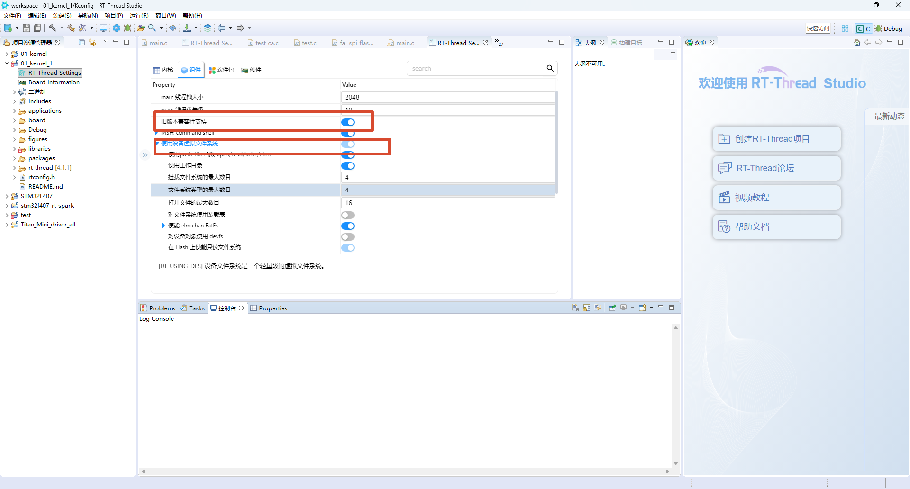

从目录结构上能看到`packages`和`Kconfig`。也就是说，软件包不是完全游离在RT-Thread工程之外，而是和Env、Kconfig、构建系统结合在一起。

应用开发时，我们不需要每次手动把整个库复制进工程，而是可以通过RT-Thread Settings或者menuconfig选择需要的软件包，配置完成以后再由构建系统把对应源码加入工程。

所以我现在把RT-Thread软件包理解成：

```text
软件包源码
+
Kconfig配置
+
SConscript构建
+
版本信息
+
依赖项
=
可重复使用的软件模块
```

## 2.以kawaii-mqtt为例理解软件包配置

今天MQTT使用的就是`kawaii-mqtt`软件包。

在RT-Thread Studio的图形配置界面中，可以直接启用：

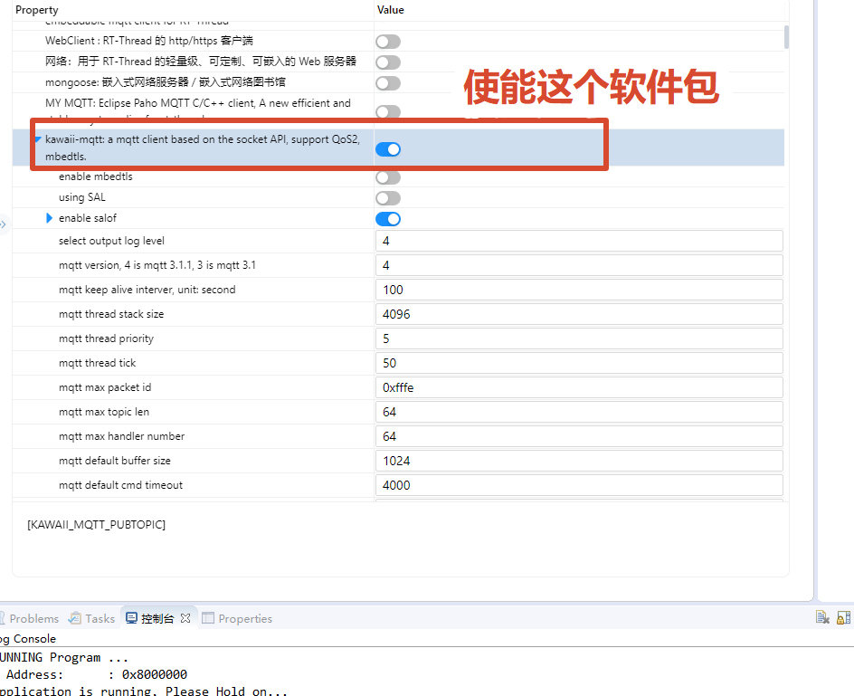

配置界面里不仅仅有一个“打开/关闭”开关，还能继续设置：

```text
MQTT版本
Keep Alive时间
线程栈大小
线程优先级
线程时间片
最大Topic长度
默认Buffer大小
命令超时时间
```

这些配置把原本需要在源码里修改的宏整理成了Kconfig参数。应用层真正关心的是“我需要怎样的MQTT客户端”，而不是每次打开头文件去找几十个`#define`。

软件包还提供测试示例：

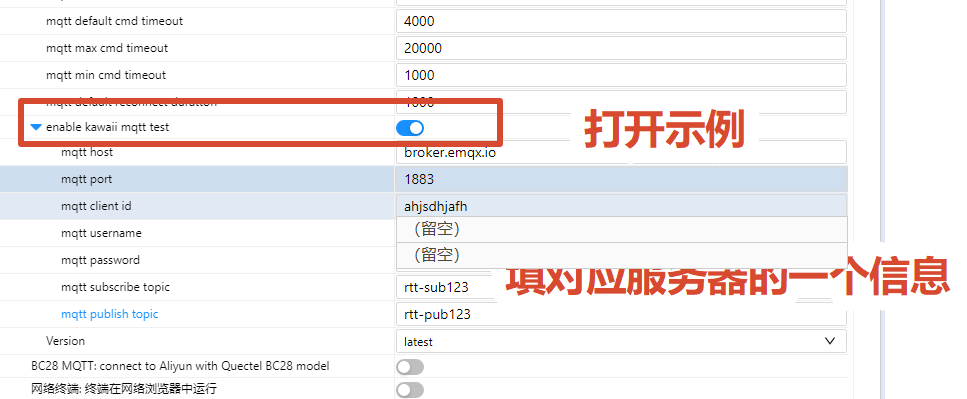

这里可以直接设置：

```text
MQTT Host
MQTT Port
Client ID
Username
Password
Subscribe Topic
Publish Topic
```

今天的配置中Broker使用`broker.emqx.io`，端口为`1883`。


另外，今天还接触到了`rw007`这个SPI WiFi驱动软件包。它也很适合用来理解RT-Thread软件包不只是“下载源码”，还会把硬件接口参数一起纳入配置。

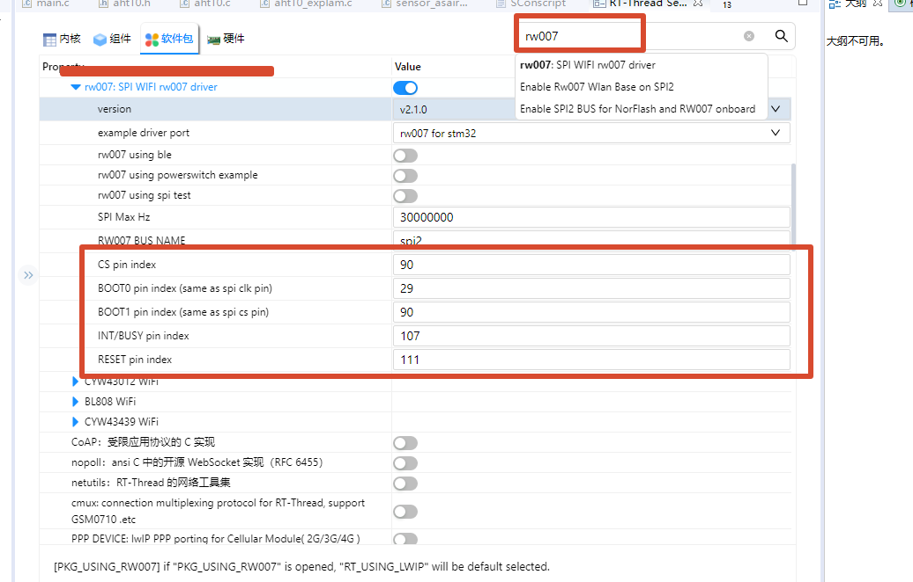

从配置界面可以看到，RW007使用`spi2`作为总线，同时还需要配置CS、BOOT0、BOOT1、INT/BUSY和RESET等引脚。当前截图中的参数为：

```text
RW007 BUS NAME：spi2
CS pin index：90
BOOT0 pin index：29
BOOT1 pin index：90
INT/BUSY pin index：107
RESET pin index：111
SPI Max Hz：30000000
```

这一张图让我对“软件包”和“驱动框架”的关系有了更直观的认识。像RW007这种软件包，上层提供的是WiFi功能，但底层仍然要依赖前面学过的SPI设备和PIN设备。也就是说，它实际形成的是这样一条链路：

```text
应用程序
   ↓
RW007软件包
   ↓
RT-Thread网络组件
   ↓
SPI设备 + PIN设备
   ↓
BSP驱动
   ↓
STM32 HAL
   ↓
RW007硬件
```

所以软件包并没有绕开驱动框架，而是在驱动框架之上继续向上封装。之前学PIN、SPI时看到的是“怎样把硬件接入RT-Thread”，今天看到RW007后则更像是在理解“接入系统的硬件怎样继续被上层软件包利用”。

这也让我觉得前几天学的内容开始真正串起来了：

```text
PIN/SPI驱动框架
      ↓
RW007 WiFi设备
      ↓
网络协议栈
      ↓
kawaii-mqtt
      ↓
MQTT应用
```

从底层引脚到最后向Broker发布消息，中间其实已经跨过了好几层抽象。

## 3.我对RT-Thread软件包管理的一点理解

今天用完以后，我觉得软件包机制最大的价值不是“下载代码更方便”，而是降低功能整合成本。

如果后面一个工程需要：

```text
AHT10
MQTT
EasyFlash
WebClient
LVGL
文件系统
OTA
```

如果每个模块都自己手动整理源码位置、头文件路径、依赖关系、宏配置和初始化顺序，工程很快就会变乱。

RT-Thread软件包体系则更像：

```text
选择功能
   ↓
配置参数
   ↓
解析依赖
   ↓
加入工程
   ↓
编译
```

这让我感觉RT-Thread已经不只是一个实时内核，而是开始提供完整的嵌入式软件生态。

---

# 二、MQTT：从“设备联网”开始理解发布/订阅模型

## 1.MQTT的关键不是Socket，而是Broker和Topic

以前如果直接使用TCP Socket，我的思路通常是：

```text
客户端
   ↓
连接服务器IP:Port
   ↓
send()
   ↓
recv()
```

MQTT虽然最终也建立在网络连接之上，但它在应用层增加了一个非常重要的模型：

```text
发布者
   ↓
Broker
   ↓
订阅者
```

课堂中的图很好地说明了这个关系：

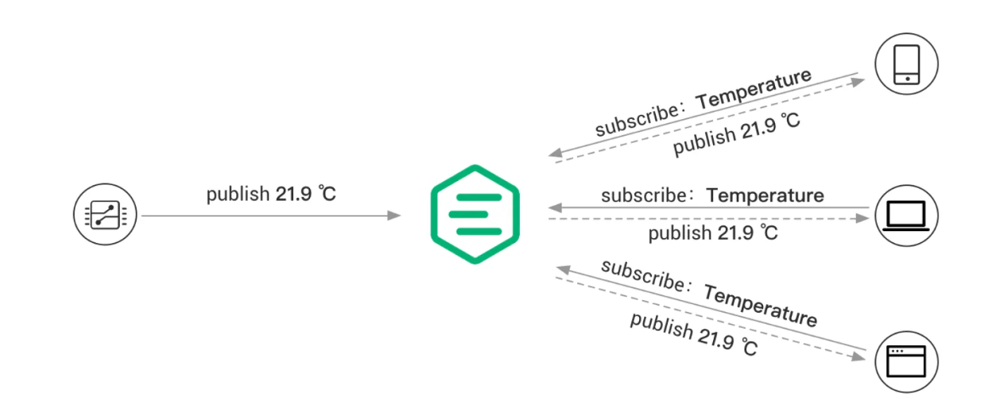

例如一个温度传感器节点发布：

```text
Temperature = 21.9℃
```

它并不需要知道手机、电脑或者网页客户端的IP地址，只需要把消息发布到Broker的某个Topic。其他客户端只要订阅这个Topic，Broker就会把对应消息转发过去。

这让我觉得MQTT一个很重要的价值是：

> **发布者和订阅者之间是解耦的。**

## 2.Topic把网络通信变成了“按主题组织消息”

今天配置kawaii-mqtt时，除了Broker地址，最核心的就是：

```text
Publish Topic
Subscribe Topic
```

例如：

```text
Publish Topic：rtt-pub123
Subscribe Topic：rtt-sub123
```

这样一个RT-Thread设备既可以是发布者，也可以同时是订阅者。

以后做一个温湿度设备，可以设计：

```text
device/001/sensor
device/001/status
device/001/cmd
```

设备周期上传：

```text
device/001/sensor
```

云端下发控制命令：

```text
device/001/cmd
```

设备执行以后再返回：

```text
device/001/status
```

这样应用逻辑比直接维护多条TCP连接更清晰。

它也和前面学习的RT-Thread消息队列有一点相似：

```text
RT-Thread Message Queue：
系统内部线程之间传消息

MQTT Topic：
设备和网络节点之间传消息
```

虽然两者工作层级完全不同，但思想上都有一种“通过约定好的通道传递消息”的感觉。

## 3.软件包、网络和业务线程开始连接起来

今天学MQTT后，我开始能想象一个真正RT-Thread物联网程序的结构：

```text
传感器线程
   ↓
读取温湿度
   ↓
消息队列/共享数据
   ↓
MQTT线程
   ↓
kawaii-mqtt
   ↓
TCP/IP
   ↓
网络设备
   ↓
Broker
```

反过来控制命令则是：

```text
Broker
   ↓
MQTT Subscribe
   ↓
MQTT回调
   ↓
消息队列/事件
   ↓
LED控制线程
   ↓
GPIO
```

这其实正好把前几天学习的线程、IPC、设备驱动、软件包和MQTT串在了一起。

---

# 三、NOR Flash、FAL与DFS：把Flash变成真正可以使用的文件系统

## 1.FAL解决的是“不同Flash如何统一管理”

今天NOR Flash部分首先接触的是FAL，也就是Flash Abstraction Layer。

课堂中的框架图：

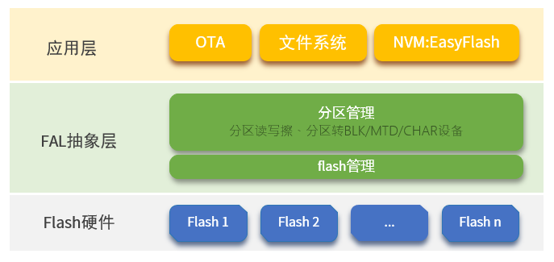

从图里可以看到，FAL位于应用和Flash硬件之间。

上层可能是：

```text
OTA
文件系统
EasyFlash
```

下面则可能有：

```text
Flash1
Flash2
...
Flash n
```

FAL中间提供：

```text
Flash管理
分区管理
```

所以FAL最重要的作用不是“实现文件系统”，而是：

> **统一不同Flash设备，并在Flash之上增加分区管理。**

FAL主要API在课堂图中也整理得很清楚：

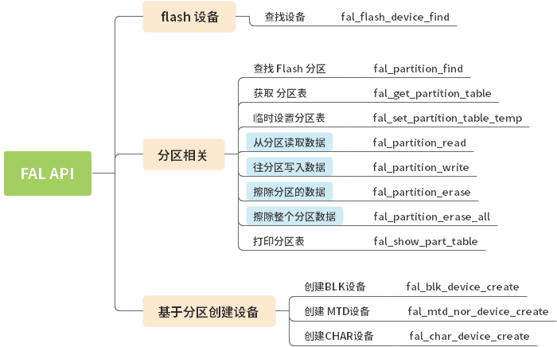

Flash设备相关：

```c
fal_flash_device_find();
```

分区相关：

```c
fal_partition_find();
fal_get_partition_table();
fal_partition_read();
fal_partition_write();
fal_partition_erase();
fal_partition_erase_all();
fal_show_part_table();
```

另外还可以基于分区创建BLK、MTD、CHAR设备。

## 2.FAL移植、本地Flash和W25Q64之间的关系

FAL移植的核心是建立Flash设备表和分区表。

课堂图：

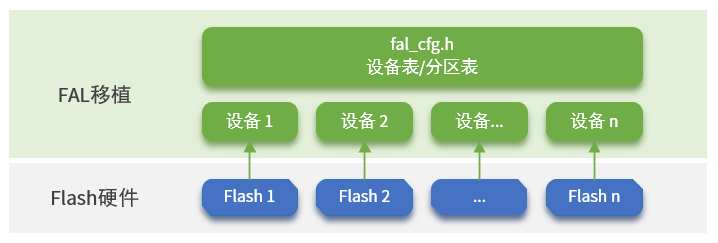

可以看到：

```text
fal_cfg.h
   ↓
设备表/分区表
   ↓
设备1、设备2、...、设备n
   ↓
Flash1、Flash2、...、Flash n
```

也就是说FAL需要知道系统里有哪些Flash、每个Flash叫什么、容量多大、擦除粒度是多少，以及read/write/erase函数是什么。

今天配置中还使能了SPI Flash和FAL：

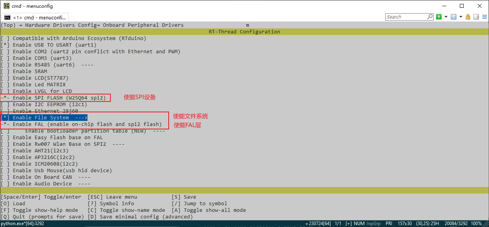

其中可以看到类似：

```text
Enable SPI FLASH(W25Q64 spi2)
Enable File System
Enable FAL
```

这一步让我对“挂载NOR Flash文件系统”有了更完整的认识。

它其实不是直接：

```text
W25Q64 → FatFS
```

而是：

```text
W25Q64
   ↓
SPI驱动
   ↓
Flash驱动
   ↓
FAL Flash Device
   ↓
FAL Partition
   ↓
Block Device
   ↓
DFS
   ↓
elm FatFS
   ↓
挂载点
```

## 3.DFS和FatFS把Flash真正变成“文件”

如果FAL负责的是Flash和分区管理，那么DFS负责的就是**文件系统统一接口**。

课堂中的结构图：

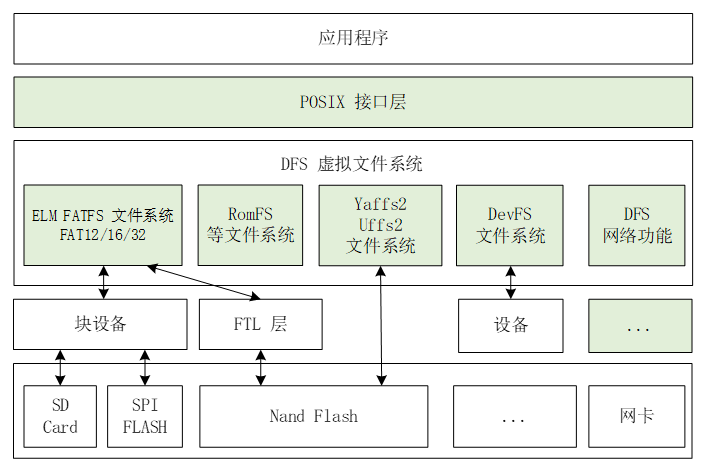

可以看到：

```text
应用程序
   ↓
POSIX接口层
   ↓
DFS虚拟文件系统
   ↓
ELM FATFS / RomFS / YAFFS2 / UFFS2 / DevFS / 网络功能
   ↓
块设备 / FTL / 设备
   ↓
SD Card / SPI FLASH / NAND Flash / 网卡
```

上层统一通过：

```c
open();
close();
read();
write();
```

访问文件。

文件API关系：

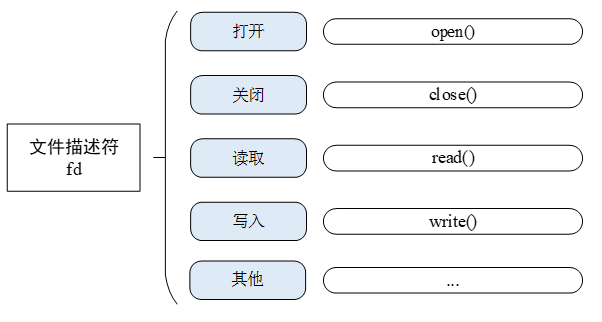

目录操作：

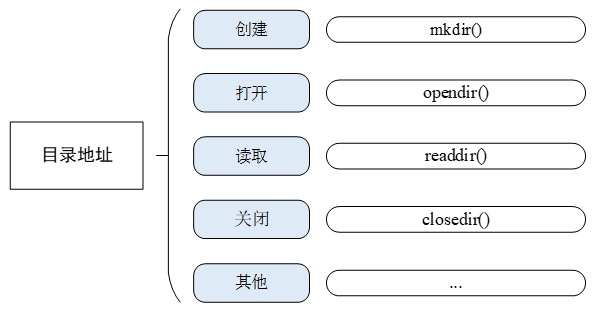

包括：

```c
mkdir();
opendir();
readdir();
closedir();
```

因此，当NOR Flash成功挂载以后，应用层就不再需要自己计算Flash地址、处理扇区和维护数据结构，而是可以像使用普通文件一样：

```c
int fd = open("/data/test.txt", O_WRONLY | O_CREAT);
write(fd, buffer, len);
close(fd);
```

这一步实际上把开发思维从“Flash地址管理”提升到了“文件管理”。

---

# 四、今天实际配置文件系统时几个值得记住的点

## 1.先使能DFS和elm FatFS

在RT-Thread Components中首先需要使能DFS：

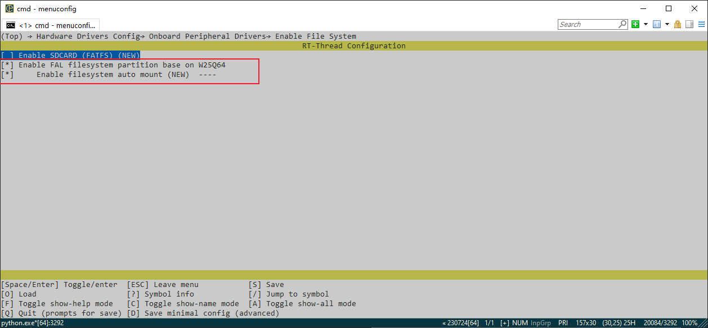

然后开启elm-chan FatFS：

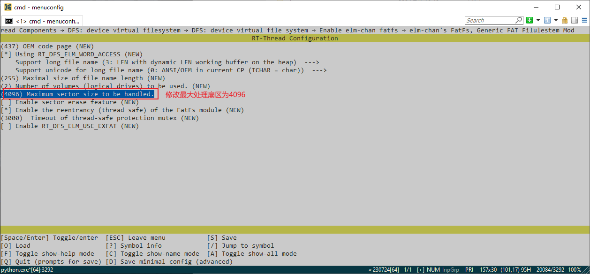

这里容易混淆的一点是：

```text
DFS != FatFS
```

DFS是RT-Thread的虚拟文件系统框架。

FatFS只是DFS下面的一种具体文件系统。

## 2.FatFS最大扇区大小要和底层设备匹配

课堂配置中把：

```text
Maximum sector size to be handled
```

改成：

```text
4096
```

如图：

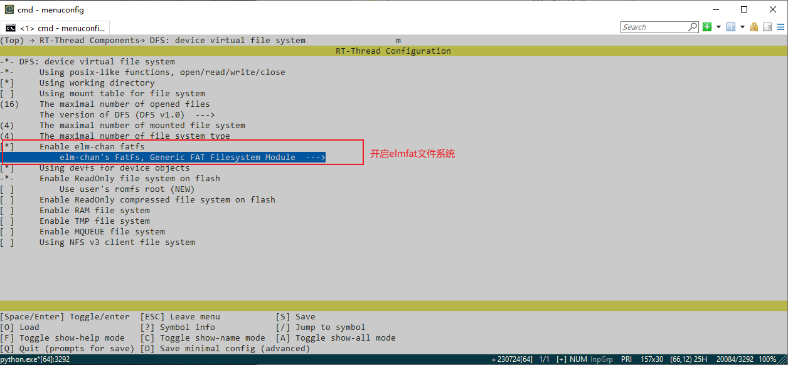

这里是一个很容易忽略、但实际非常关键的配置。

Flash通常以扇区为擦除单位，实际底层块设备也可能暴露4096字节这样的Sector Size。如果FatFS配置支持的最大Sector Size太小，就可能无法正确适配底层块设备。

所以这里让我意识到：

> **文件系统参数并不是随便配置的，它必须和底层存储设备的几何特性对应起来。**

## 3.让FAL分区成为文件系统的真正载体

文件系统配置里还使能：

```text
Enable FAL filesystem partition based on W25Q64
Enable filesystem auto mount
```

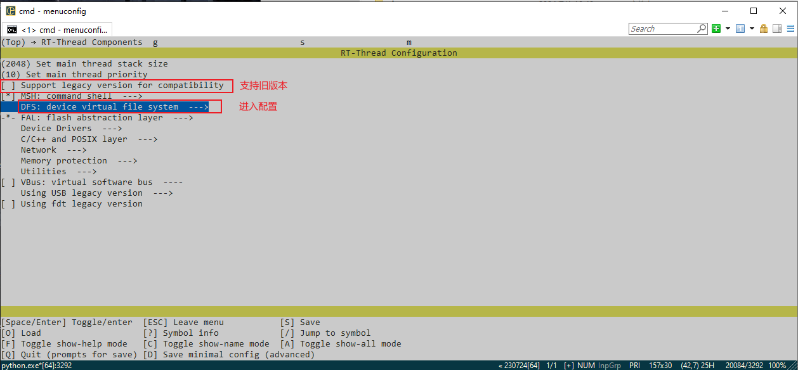

这说明最终FatFS不是直接挂在“整个W25Q64”上，而是挂在FAL管理的某个分区对应设备上。

整个路径可以总结成：

```text
W25Q64硬件
   ↓
SPI Flash驱动
   ↓
FAL Flash Device
   ↓
FAL Partition
   ↓
Block Device
   ↓
elm FatFS
   ↓
DFS Mount
   ↓
目录和文件
```

---

# 五、把今天三部分内容放到一起以后，我的一些发现

今天的三个主题看起来分别是：

```text
软件包管理
MQTT
NOR Flash文件系统
```

但把它们放在一起以后，我觉得它们其实是在教我同一个东西：

> **复杂嵌入式系统不能一直靠应用代码直接操作底层，而需要一层一层把能力抽象和组合起来。**

MQTT并不是应用自己重新写TCP协议，而是：

```text
应用
↓
kawaii-mqtt软件包
↓
网络接口
```

Flash文件也不是应用自己管理扇区，而是：

```text
应用
↓
POSIX/DFS
↓
FatFS
↓
FAL
↓
Flash驱动
```

软件包管理则进一步把这些成熟组件的获取、配置、依赖和构建也统一起来。

所以现在我对RT-Thread整个系统的理解开始变成：

```text
                    应用
                      │
       ┌──────────────┼──────────────┐
       │              │              │
     MQTT           文件操作         OTA
       │              │              │
 软件包kawaii-mqtt   POSIX/DFS       FAL
       │              │              │
      网络           FatFS          Partition
       │              │              │
    网络设备        Block Device    Flash Device
       │              └──────┬───────┘
       │                     │
      硬件               SPI NOR Flash
```

以前做一个功能时，我常常会从“我要调用哪个函数？”开始想。

现在慢慢变成：

```text
这个功能处在哪一层？
它下面依赖什么框架？
设备对象在哪里？
上层应该通过哪个统一接口访问？
```

我觉得这才是今天真正值得记下来的变化。

---

# 六、今天的实践流程总结

如果以后重新做一次“W25Q64+FatFS+MQTT”的工程，我现在会按下面的顺序检查。

### 第一步：确认底层设备

```text
SPI是否正常
W25Q64是否识别
网络设备是否工作
```

### 第二步：使能组件和软件包

```text
Enable SPI FLASH
Enable FAL
Enable DFS
Enable elm FatFS
Enable kawaii-mqtt
```

### 第三步：检查关键参数

```text
Flash容量
Flash擦除粒度
FatFS最大Sector Size
FAL分区大小
挂载点
MQTT Broker
Port
Publish Topic
Subscribe Topic
```

### 第四步：验证FAL

可以先检查：

```text
Flash Device能否找到
Partition能否找到
分区表是否正确
读写擦除是否正常
```

### 第五步：验证文件系统

重点确认：

```text
mount是否成功
目录是否存在
文件能否创建
write/read是否正常
掉电后数据是否保留
```

### 第六步：验证MQTT

确认：

```text
Broker连接
Subscribe成功
Publish成功
回调收到消息
断线重连
```

到这里，一个很基础的物联网数据链路就已经形成：

```text
传感器采集
   ↓
本地文件保存
   +
MQTT上传云端
```

这个结构已经非常接近真正项目中的“本地存储+云端同步”模式了。
