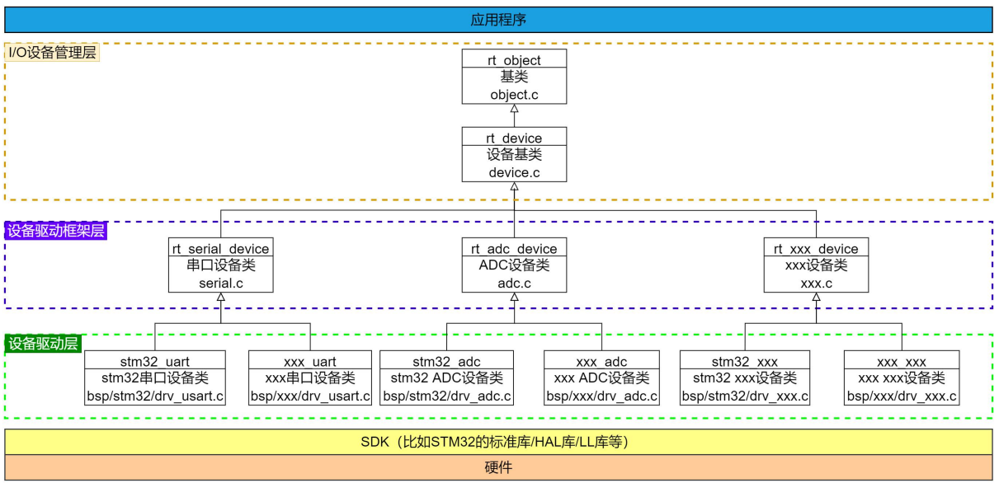
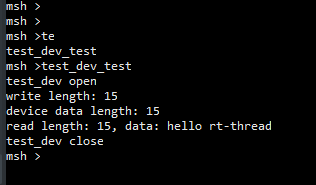

# RT-Thread设备驱动框架学习随笔——GPIO、I2C、SPI与PIN设备对接

今天的培训开始进入RTOS里我比较感兴趣的一部分——**设备驱动框架**。前面学习线程、线程同步和线程通信时，更多是在理解“操作系统怎样管理任务”；而今天开始接触GPIO、I2C、SPI以后，关注点变成了另外一个问题：

> **操作系统怎样把不同芯片、不同外设的底层操作，整理成一套上层可以统一使用的接口？**

这部分内容让我感觉非常熟悉，因为以前接触Linux驱动时，同样会遇到“设备对象、操作函数表、注册、匹配、统一接口”这些概念。再对比之前用过的Zephyr，会发现三套系统其实都在解决同一个问题：**把硬件相关代码和应用代码拆开**。

RT-Thread整体给我的感觉是：它把Linux里比较完整的设备模型简化到更适合MCU的程度，同时又比单纯直接调用HAL库多了一层清晰的设备抽象。特别是今天自己写完`test_dev`这个虚拟设备之后，再回头看PIN、I2C、SPI的框架，很多东西一下就对应起来了。

---

# 一、从HAL直接操作到RT-Thread设备驱动框架

## 1.为什么需要设备驱动框架

如果是在裸机程序里控制LED，通常会直接写：

```c
HAL_GPIO_WritePin(GPIOF, GPIO_PIN_11, GPIO_PIN_SET);
```

读取按键也是：

```c
HAL_GPIO_ReadPin(GPIOC, GPIO_PIN_0);
```

I2C和SPI也是类似，应用层直接调用：

```c
HAL_I2C_Master_Transmit();
HAL_SPI_TransmitReceive();
```

这种方式在小项目里非常直接，但它有一个明显的问题：

> **应用代码知道得太多了。**

应用不仅知道自己要“点亮LED”，它还知道LED属于哪个GPIO端口、具体是哪一个Pin、当前芯片使用哪套HAL接口。如果以后换一块开发板，或者芯片平台发生变化，那么应用代码也容易跟着修改。

RT-Thread设备框架做的事情，就是在应用和硬件之间加入抽象层：

```text
                应用层
                  │
                  │统一API
                  ▼
           I/O设备管理层
             rt_device
                  │
                  ▼
          设备驱动框架层
      PIN / I2C / SPI / UART...
                  │
                  ▼
             BSP设备驱动
         drv_gpio.c / drv_spi.c
                  │
                  ▼
         HAL / LL / 寄存器操作
                  │
                  ▼
                硬件
```

这样应用真正关心的是“我要把某个PIN拉高”“我要从I2C设备读数据”“我要向SPI设备发送数据”，而不是关心底层到底是哪一颗MCU。

我觉得今天最重要的一个认识就是：

> **HAL解决“怎样操作这颗芯片”，设备驱动框架解决“整个系统怎样统一管理硬件”。**

## 2.RT-Thread的三层I/O设备模型

课堂里的框架图把RT-Thread的设备体系分得很清楚：



从图里可以看到，最上层是应用程序，然后依次经过：

```text
I/O设备管理层
      ↓
设备驱动框架层
      ↓
设备驱动层
      ↓
SDK/HAL
      ↓
硬件
```

### I/O设备管理层

这一层主要负责统一管理设备对象。核心公共对象是：

```c
struct rt_device
```

它本身又属于RT-Thread内核对象体系的一部分。

应用层常见的统一接口包括：

```c
rt_device_find();
rt_device_open();
rt_device_read();
rt_device_write();
rt_device_control();
rt_device_close();
```

也就是说，上层并不需要直接知道某个驱动函数的具体名字，而是通过设备对象间接进入驱动实现。

### 设备驱动框架层

这一层是今天学习的重点。

RT-Thread并没有把所有设备都简单做成一个`read()`和`write()`，而是根据硬件类型建立不同框架，例如：

```text
Serial
PIN
ADC
I2C
SPI
PWM
Sensor
```

课堂图中可以看到`rt_serial_device`、`rt_adc_device`等具体设备类位于`rt_device`之下。这个关系很像“基类+派生类”：

```text
rt_object
   ↓
rt_device
   ↓
rt_serial_device / rt_adc_device / ...
```

虽然C语言没有真正的类继承，但通过“公共结构体嵌入私有结构体”的方式，也能得到类似效果。

### 设备驱动层

这一层才是真正和具体芯片绑定的实现。

例如：

```text
stm32_uart
stm32_adc
stm32_pin
```

最终会落到STM32 HAL、LL或者寄存器操作。

所以同一个RT-Thread上层接口，可以由不同BSP分别实现：

```text
RT-Thread PIN API
      ├── STM32实现
      ├── GD32实现
      ├── NXP实现
      └── 其他MCU实现
```

这就是设备框架真正带来的可移植性。

## 3.GPIO、I2C、SPI其实用了不同层次的抽象

今天同时学习GPIO、I2C、SPI后，我发现这三个虽然都叫“设备驱动”，但它们在RT-Thread里的抽象方式并不完全一样。

### PIN/GPIO

PIN设备更像：

```text
一个GPIO控制器
     ↓
管理很多PIN
```

应用通常直接调用：

```c
rt_pin_mode();
rt_pin_write();
rt_pin_read();
rt_pin_attach_irq();
rt_pin_irq_enable();
```

因此PIN框架实际上在通用`rt_device`之上，又提供了一组更符合GPIO语义的接口。

### I2C

I2C更强调“总线”。

应用通常先找到：

```text
i2c1
```

这样的I2C Bus，再通过设备地址区分不同从机：

```text
i2c1
 ├── 0x38  AHT10
 ├── 0x50  EEPROM
 └── 0x68  RTC/IMU
```

所以I2C的核心对象关系更像：

```text
I2C Bus + Slave Address + Message
```

### SPI

SPI除了Bus之外，通常还需要明确的SPI Device以及CS。

因此更像：

```text
SPI Bus
  ├── SPI Device A + CS_A
  ├── SPI Device B + CS_B
  └── SPI Device C + CS_C
```

所以我现在会这样区分：

```text
PIN：控制器 → PIN
I2C：Bus → 地址
SPI：Bus → Device → CS
```

这也让我意识到：

> **好的抽象并不是强迫所有硬件都长得一样，而是在统一管理的基础上保留不同硬件本身的语义。**

---

# 二、结合实际`drv_gpio.c`分析PIN设备如何完成对接

## 1.第一步：把RT-Thread逻辑PIN转换成STM32GPIO

这次拿到实际BSP里的`drv_gpio.c`以后，PIN框架的调用过程一下就具体起来了。

文件开头定义了几个很关键的宏：

```c
#define PIN_NUM(port, no) (((((port) & 0xFu) << 4) | ((no) & 0xFu)))
#define PIN_PORT(pin)     ((uint8_t)(((pin) >> 4) & 0xFu))
#define PIN_NO(pin)       ((uint8_t)((pin) & 0xFu))
```

这说明RT-Thread这里使用一个逻辑PIN编号，把：

```text
Port编号
+
Pin编号
```

编码到同一个整数里。

例如从概念上看：

```text
PA0  → port=0, pin=0
PB3  → port=1, pin=3
PF11 → port=5, pin=11
```

真正访问STM32GPIO时，又通过：

```c
PIN_STPORT(pin)
PIN_STPIN(pin)
```

重新得到：

```text
GPIO_TypeDef *gpio_port
uint16_t gpio_pin
```

这一步就是**逻辑PIN编号到STM32HAL参数之间的桥梁**。

`stm32_pin_get()`又支持类似：

```text
PA.0
PF.11
```

这样的字符串名称，并转换成RT-Thread内部PIN编号。

所以这里实际上存在两个方向：

```text
字符串名字
    ↓
stm32_pin_get()
    ↓
RT-Thread逻辑PIN编号
    ↓
PIN_PORT/PIN_NO
    ↓
STM32 GPIO Port + Pin
```

这比我之前只看到`GET_PIN(F, 11)`时理解得更完整。

## 2.第二步：`rt_pin_ops`把PIN框架接到底层HAL

真正的核心对接点是：

```c
const static struct rt_pin_ops _stm32_pin_ops =
{
    stm32_pin_mode,
    stm32_pin_write,
    stm32_pin_read,
    stm32_pin_attach_irq,
    stm32_pin_dettach_irq,
    stm32_pin_irq_enable,
    stm32_pin_get,
};
```

这里相当于STM32驱动向RT-Thread声明：

```text
你要求的PIN能力，我都实现好了。
```

分别对应：

```text
设置模式    → stm32_pin_mode()
写引脚      → stm32_pin_write()
读引脚      → stm32_pin_read()
挂接中断    → stm32_pin_attach_irq()
解除中断    → stm32_pin_dettach_irq()
开关中断    → stm32_pin_irq_enable()
名字转PIN   → stm32_pin_get()
```

例如`stm32_pin_write()`里面最终就是：

```c
HAL_GPIO_WritePin(gpio_port,
                  gpio_pin,
                  (GPIO_PinState)value);
```

`stm32_pin_read()`最终就是：

```c
HAL_GPIO_ReadPin(gpio_port, gpio_pin);
```

`stm32_pin_mode()`则根据：

```text
PIN_MODE_OUTPUT
PIN_MODE_INPUT
PIN_MODE_INPUT_PULLUP
PIN_MODE_INPUT_PULLDOWN
PIN_MODE_OUTPUT_OD
```

翻译成STM32 HAL里的：

```text
GPIO_MODE_OUTPUT_PP
GPIO_MODE_INPUT
GPIO_PULLUP
GPIO_PULLDOWN
GPIO_MODE_OUTPUT_OD
```

最后：

```c
HAL_GPIO_Init();
```

所以一条最典型的调用链就是：

```text
应用程序
│
│ rt_pin_write(pin, PIN_HIGH)
▼
RT-Thread PIN框架
│
│ 调用已注册的pin_write
▼
_stm32_pin_ops.pin_write
│
▼
stm32_pin_write()
│
├── PIN_STPORT(pin)
├── PIN_STPIN(pin)
│
▼
HAL_GPIO_WritePin()
│
▼
STM32 GPIO寄存器
│
▼
真实引脚电平改变
```

这条链路也是我今天觉得最值得记住的一部分。

因为以后看任何一类RT-Thread驱动，都可以尝试找：

```text
上层API
   ↓
框架ops
   ↓
BSP回调
   ↓
HAL/寄存器
```

## 3.第三步：`rt_hw_pin_init()`完成真正注册

`drv_gpio.c`最后的：

```c
int rt_hw_pin_init(void)
```

先打开各GPIO Port的时钟，例如：

```c
__HAL_RCC_GPIOA_CLK_ENABLE();
__HAL_RCC_GPIOB_CLK_ENABLE();
...
```

最后真正执行：

```c
return rt_device_pin_register("pin",
                              &_stm32_pin_ops,
                              RT_NULL);
```

这一步非常关键。

它把：

```text
设备名称："pin"
STM32实现：_stm32_pin_ops
私有数据：RT_NULL
```

交给RT-Thread PIN框架。

所以PIN设备的完整建立过程可以写成：

```text
BSP启动
   ↓
rt_hw_pin_init()
   ↓
开启GPIO时钟
   ↓
准备_stm32_pin_ops
   ↓
rt_device_pin_register("pin", ...)
   ↓
PIN设备进入RT-Thread设备体系
   ↓
应用可以使用rt_pin_xxx()
```

### PIN中断又是怎样接回应用回调的

这次源码里中断部分也很完整。

`stm32_pin_attach_irq()`会把用户传入的：

```text
pin
mode
hdr
args
```

保存到：

```c
pin_irq_hdr_tab[]
```

里。

`stm32_pin_irq_enable()`再根据：

```text
PIN_IRQ_MODE_RISING
PIN_IRQ_MODE_FALLING
PIN_IRQ_MODE_RISING_FALLING
```

配置：

```text
GPIO_MODE_IT_RISING
GPIO_MODE_IT_FALLING
GPIO_MODE_IT_RISING_FALLING
```

并开启NVIC。

真正发生外部中断时，以普通STM32系列为例：

```text
EXTI15_10_IRQHandler()
    ↓
rt_interrupt_enter()
    ↓
HAL_GPIO_EXTI_IRQHandler()
    ↓
HAL_GPIO_EXTI_Callback()
    ↓
pin_irq_hdr()
    ↓
pin_irq_hdr_tab[irqno].hdr(...)
    ↓
用户注册的callback()
    ↓
rt_interrupt_leave()
```

所以PIN中断其实又把：

```text
STM32 EXTI
```

翻译成：

```text
RT-Thread PIN IRQ callback
```

这让我对驱动框架的理解更进一步：

> **设备框架不只是包装几个HAL函数，它还负责把底层硬件事件重新映射成上层统一可以理解的事件。**

---

# 三、从`test_dev`再看Linux和Zephyr，我的一些感想

## 1.`test_dev`把最小RT-Thread设备模型完整跑了一遍

这次虚拟设备实验的msh结果已经能够完整验证驱动框架：



可以看到执行：

```text
test_dev_test
```

之后依次输出：

```text
test_dev open
write length: 15
device data length: 15
read length: 15, data: hello rt-thread
test_dev close
```

这个结果和代码里的调用关系是完全对应的：

```text
test_dev_test()
    │
    ├── rt_device_find("test_dev")
    │
    ├── rt_device_open()
    │        ↓
    │   test_dev_open()
    │
    ├── rt_device_write()
    │        ↓
    │   test_dev_write()
    │
    ├── rt_device_control()
    │        ↓
    │   test_dev_control()
    │
    ├── rt_device_read()
    │        ↓
    │   test_dev_read()
    │
    └── rt_device_close()
             ↓
        test_dev_close()
```

我觉得这个Demo最大的价值不是“用128字节buffer模拟了一个设备”，而是它把下面这套最小设备模型完整跑通了：

```text
私有设备结构体
      ↓
嵌入struct rt_device
      ↓
实现操作函数
      ↓
建立rt_device_ops
      ↓
rt_device_register()
      ↓
rt_device_find()
      ↓
统一设备API访问
```

再结合：

```c
INIT_DEVICE_EXPORT(test_dev_register);
```

和：

```c
MSH_CMD_EXPORT(test_dev_test, test virtual device);
```

就可以直接完成自动注册和Shell测试。

这让我第一次真正感觉：

> **RT-Thread设备框架不是一套抽象概念，而是一条能从注册一路追到实际驱动函数的完整调用链。**

## 2.为什么它让我想到Linux驱动

今天看这套结构时，我第一反应还是Linux。

RT-Thread：

```text
struct rt_device
struct rt_device_ops
rt_device_register()
rt_device_find()
read/write/control
```

Linux字符设备：

```text
设备私有结构体
struct file_operations
open/read/write/ioctl
设备注册
```

尤其是这种写法：

```c
struct test_device
{
    struct rt_device parent;
    ...
};
```

让我很容易想到Linux里：

```text
公共内核对象
嵌入
驱动私有结构体
```

然后通过指针转换或者`container_of()`重新得到私有结构体。

GPIO这一层也很像。

RT-Thread：

```text
rt_pin_ops
```

Linux gpiolib：

```text
gpio_chip callbacks
```

都在描述：

```text
这个GPIO控制器能做什么
```

包括：

```text
输入
输出
get/set
配置
中断
```

所以这次我感觉到，RT-Thread和Linux之间的相似不是API名字像，而是设计思想真的相似：

> **设备对象+操作函数表+注册+统一入口。**

区别主要在于Linux还需要解决：

```text
Bus匹配
Device/Driver绑定
probe/remove
Device Tree/ACPI
sysfs
/dev
热插拔
电源管理
引用计数
用户态访问
```

RT-Thread则把这些在典型MCU场景里不一定需要的复杂度大量裁掉了。

所以对我来说：

> **RT-Thread像是保留Linux驱动框架核心思想以后，做了一次面向MCU的轻量化。**

## 3.再和Zephyr对比：我更能理解三种设备模型的取向

之前用Zephyr时，对它最深的印象是：

```text
Devicetree
+
Kconfig
+
DEVICE_DEFINE/DEVICE_DT_DEFINE
```

Zephyr的设备对象同样包含：

```text
设备实例
+
API函数表
+
静态配置
+
运行期数据
```

所以从最底层的设计思想来看：

```text
RT-Thread：
rt_device + ops + user_data

Zephyr：
device + api + config + data

Linux：
device/driver + ops + private data
```

它们都在做同一件事：

> **把“设备是什么”和“设备怎么操作”分开。**

但三套系统的工程取向不同。

### RT-Thread

我觉得RT-Thread更适合顺着C源码去理解：

```text
谁注册了设备？
ops在哪里？
上层调用最终落到哪个函数？
HAL在哪一层？
```

配合msh、`list_device`以及设备名字查找，调试过程也很直观。

### Zephyr

Zephyr更强调：

```text
硬件关系应该放在Devicetree里描述
```

例如GPIO不只是一个数字PIN，而通常会形成：

```text
device + pin + flags
```

这样的描述。

这样做跨Board移植时很漂亮，因为换板时很多情况下改Devicetree，而不是改应用C代码。

但代价是初学时需要同时理解：

```text
Devicetree
Binding
Kconfig
宏展开
设备初始化级别
```

调用链不像RT-Thread这样一眼就能顺着C代码走到底。

### Linux

Linux设备模型则是三者里最完整的一套。

它不仅关心MCU式的“这个GPIO怎么set”，还要面对：

```text
设备动态发现
Driver匹配
用户空间
热插拔
文件系统接口
电源管理
复杂总线
```

所以功能最强，学习曲线也最陡。

如果把今天的体会压缩一下，我现在更愿意这样理解：

```text
RT-Thread：
轻量、直接、容易追调用链，
适合MCU和嵌入式RTOS学习。

Zephyr：
硬件描述体系强，
编译期配置和跨平台能力突出。

Linux：
设备模型最完整，
通用性和动态管理能力最强。
```

今天学完设备框架以后，我最大的感受已经不是“RT-Thread多了一套API”，而是：

> **从直接调用HAL，到开始建立设备对象、设备类型、操作函数表和统一管理入口，这其实就是嵌入式软件从“能运行”走向“可维护、可移植、可扩展”的过程。**

---

# 今天学习后的整体总结

结合课堂框架图、`test_dev`和实际STM32的`drv_gpio.c`，现在我对PIN设备的完整链路可以总结成：

```text
应用代码
│
│ rt_pin_write()/rt_pin_read()/rt_pin_attach_irq()
▼
RT-Thread PIN框架
│
│ 根据已注册的rt_pin_ops调用
▼
_stm32_pin_ops
│
├── stm32_pin_mode()
├── stm32_pin_write()
├── stm32_pin_read()
├── stm32_pin_attach_irq()
├── stm32_pin_dettach_irq()
└── stm32_pin_irq_enable()
│
▼
PIN编号转换
│
├── PIN_PORT()
├── PIN_NO()
├── PIN_STPORT()
└── PIN_STPIN()
│
▼
STM32 HAL
│
├── HAL_GPIO_Init()
├── HAL_GPIO_WritePin()
├── HAL_GPIO_ReadPin()
└── HAL_GPIO_EXTI_IRQHandler()
│
▼
STM32 GPIO / EXTI / NVIC
│
▼
真实硬件
```

设备注册则是：

```text
rt_hw_pin_init()
      ↓
开启GPIO时钟
      ↓
rt_device_pin_register(
    "pin",
    &_stm32_pin_ops,
    RT_NULL
)
      ↓
PIN设备正式接入RT-Thread
```

以后再分析其他驱动时，我觉得可以沿用下面这套方法：

```text
1.找到设备对象是什么
2.找到框架定义的ops是什么
3.找到BSP里谁实现了这些ops
4.找到register发生在哪里
5.找到上层API怎样调用ops
6.最后追到HAL或寄存器
```

只要这六个问题能回答出来，一个RT-Thread驱动的整体结构基本就已经看清楚了。
